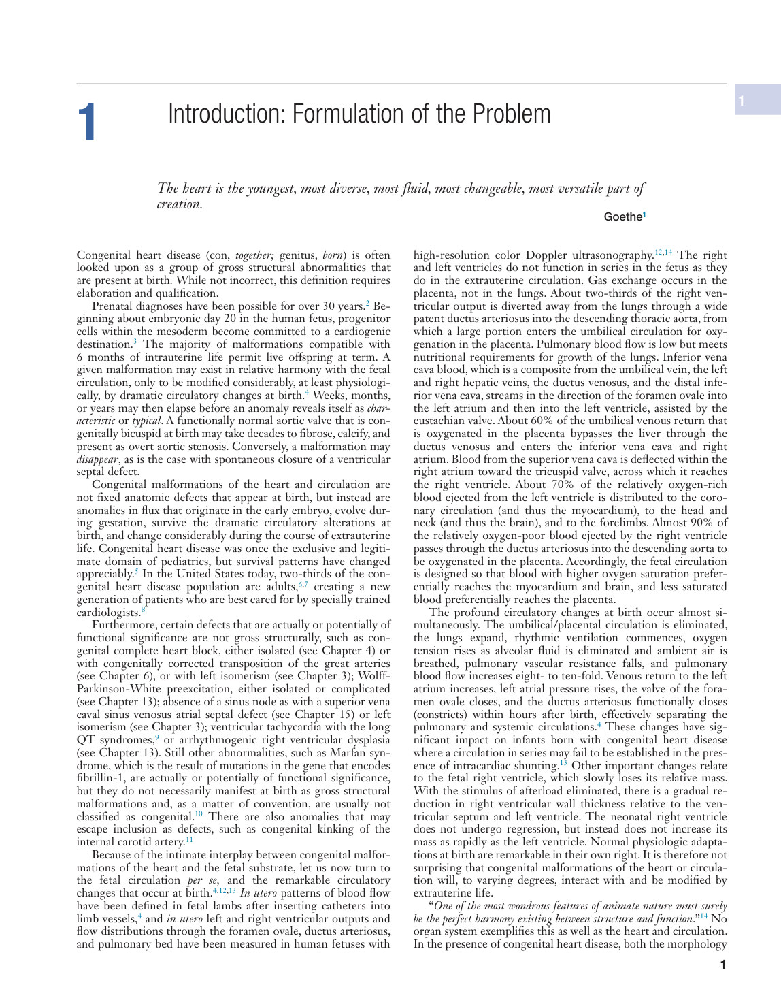
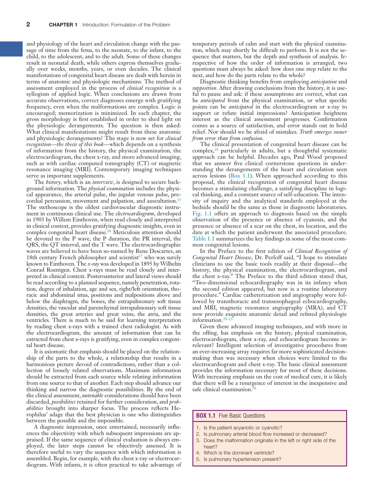
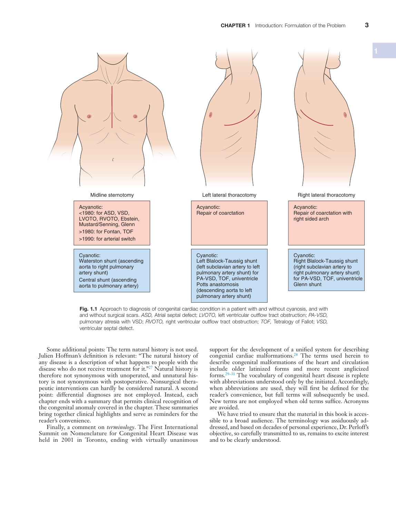
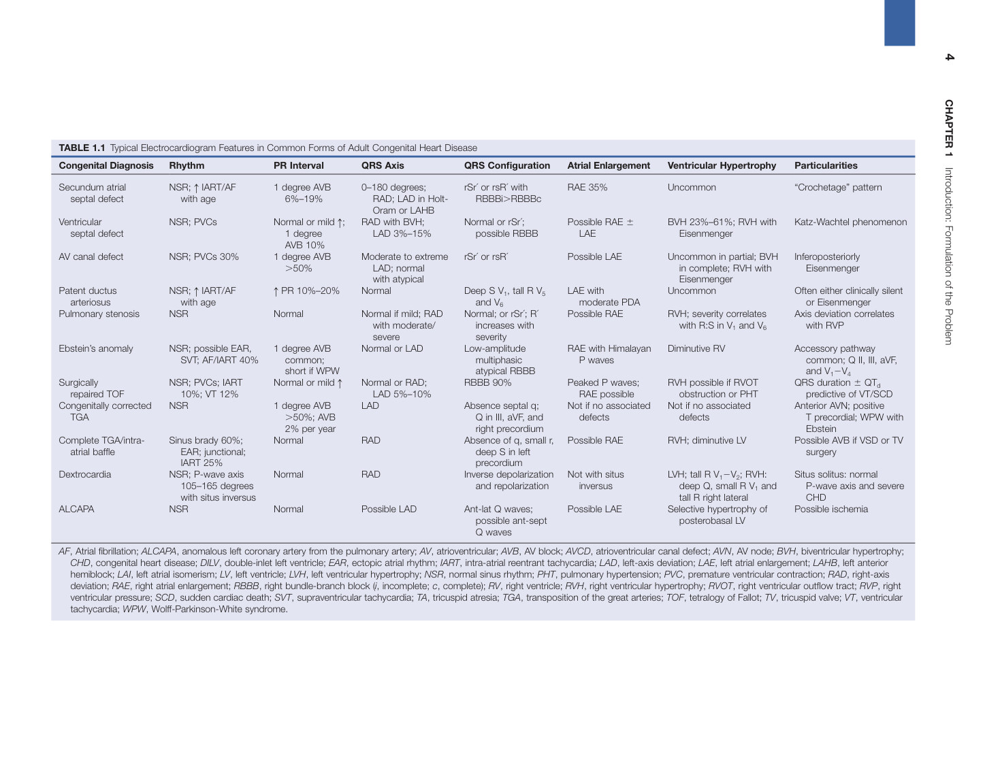
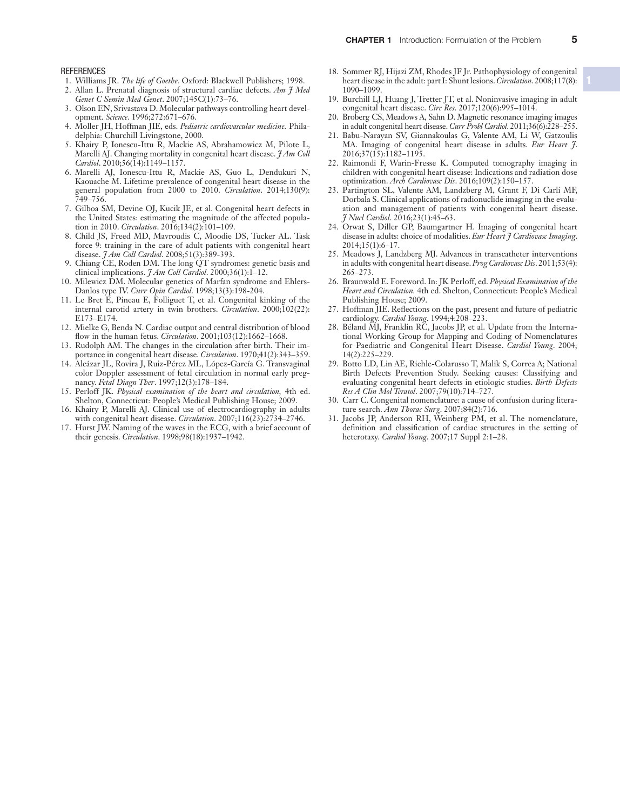
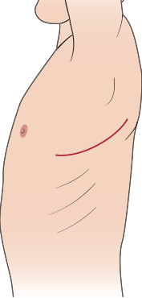
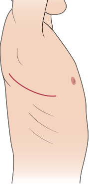
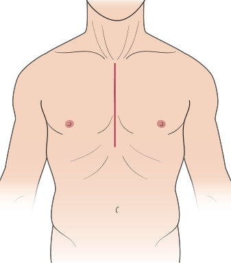
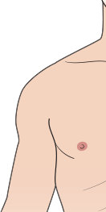
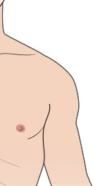

# 1. Introduction: Formulation of the problem
> [Source credits](../../SOURCE_CREDITS.md).

## PDF page 15 | printed page 1

1 1 Introduction: Formulation of the Problem

The heart is the youngest, most diverse, most fluid, most changeable, most versatile part of creation.

Goethe1

Congenital heart disease (con, together; genitus, born) is often looked upon as a group of gross structural abnormalities that are present at birth. While not incorrect, this definition requires elaboration and qualification.

Prenatal diagnoses have been possible for over 30 years.2 Beginning about embryonic day 20 in the human fetus, progenitor cells within the mesoderm become committed to a cardiogenic destination.3 The majority of malformations compatible with 6 months of intrauterine life permit live offspring at term. A given malformation may exist in relative harmony with the fetal circulation, only to be modified considerably, at least physiologically, by dramatic circulatory changes at birth.4 Weeks, months, or years may then elapse before an anomaly reveals itself as characteristic or typical. A functionally normal aortic valve that is congenitally bicuspid at birth may take decades to fibrose, calcify, and present as overt aortic stenosis. Conversely, a malformation may disappear, as is the case with spontaneous closure of a ventricular septal defect.

Congenital malformations of the heart and circulation are not fixed anatomic defects that appear at birth, but instead are anomalies in flux that originate in the early embryo, evolve during gestation, survive the dramatic circulatory alterations at birth, and change considerably during the course of extrauterine life. Congenital heart disease was once the exclusive and legitimate domain of pediatrics, but survival patterns have changed appreciably.5 In the United States today, two-thirds of the congenital heart disease population are adults,6,7 creating a new generation of patients who are best cared for by specially trained cardiologists.8

Furthermore, certain defects that are actually or potentially of functional significance are not gross structurally, such as congenital complete heart block, either isolated (see Chapter 4) or with congenitally corrected transposition of the great arteries (see Chapter 6), or with left isomerism (see Chapter 3); Wolff- Parkinson-White preexcitation, either isolated or complicated (see Chapter 13); absence of a sinus node as with a superior vena caval sinus venosus atrial septal defect (see Chapter 15) or left isomerism (see Chapter 3); ventricular tachycardia with the long QT syndromes,9 or arrhythmogenic right ventricular dysplasia (see Chapter 13). Still other abnormalities, such as Marfan syndrome, which is the result of mutations in the gene that encodes fibrillin-1, are actually or potentially of functional significance, but they do not necessarily manifest at birth as gross structural malformations and, as a matter of convention, are usually not classified as congenital.10 There are also anomalies that may escape inclusion as defects, such as congenital kinking of the internal carotid artery.11

Because of the intimate interplay between congenital malformations of the heart and the fetal substrate, let us now turn to the fetal circulation per se, and the remarkable circulatory changes that occur at birth.4,12,13 In utero patterns of blood flow have been defined in fetal lambs after inserting catheters into limb vessels,4 and in utero left and right ventricular outputs and flow distributions through the foramen ovale, ductus arteriosus, and pulmonary bed have been measured in human fetuses with

high-resolution color Doppler ultrasonography.12,14 The right and left ventricles do not function in series in the fetus as they do in the extrauterine circulation. Gas exchange occurs in the placenta, not in the lungs. About two-thirds of the right ventricular output is diverted away from the lungs through a wide patent ductus arteriosus into the descending thoracic aorta, from which a large portion enters the umbilical circulation for oxygenation in the placenta. Pulmonary blood flow is low but meets nutritional requirements for growth of the lungs. Inferior vena cava blood, which is a composite from the umbilical vein, the left and right hepatic veins, the ductus venosus, and the distal inferior vena cava, streams in the direction of the foramen ovale into the left atrium and then into the left ventricle, assisted by the eustachian valve. About 60% of the umbilical venous return that is oxygenated in the placenta bypasses the liver through the ductus venosus and enters the inferior vena cava and right atrium. Blood from the superior vena cava is deflected within the right atrium toward the tricuspid valve, across which it reaches the right ventricle. About 70% of the relatively oxygen-rich blood ejected from the left ventricle is distributed to the coronary circulation (and thus the myocardium), to the head and neck (and thus the brain), and to the forelimbs. Almost 90% of the relatively oxygen-poor blood ejected by the right ventricle passes through the ductus arteriosus into the descending aorta to be oxygenated in the placenta. Accordingly, the fetal circulation is designed so that blood with higher oxygen saturation preferentially reaches the myocardium and brain, and less saturated blood preferentially reaches the placenta.

The profound circulatory changes at birth occur almost simultaneously. The umbilical/placental circulation is eliminated, the lungs expand, rhythmic ventilation commences, oxygen tension rises as alveolar fluid is eliminated and ambient air is breathed, pulmonary vascular resistance falls, and pulmonary blood flow increases eight- to ten-fold. Venous return to the left atrium increases, left atrial pressure rises, the valve of the foramen ovale closes, and the ductus arteriosus functionally closes (constricts) within hours after birth, effectively separating the pulmonary and systemic circulations.4 These changes have significant impact on infants born with congenital heart disease where a circulation in series may fail to be established in the presence of intracardiac shunting.13 Other important changes relate to the fetal right ventricle, which slowly loses its relative mass. With the stimulus of afterload eliminated, there is a gradual reduction in right ventricular wall thickness relative to the ventricular septum and left ventricle. The neonatal right ventricle does not undergo regression, but instead does not increase its mass as rapidly as the left ventricle. Normal physiologic adaptations at birth are remarkable in their own right. It is therefore not surprising that congenital malformations of the heart or circulation will, to varying degrees, interact with and be modified by extrauterine life.

“One of the most wondrous features of animate nature must surely be the perfect harmony existing between structure and function.”14 No organ system exemplifies this as well as the heart and circulation. In the presence of congenital heart disease, both the morphology

## PDF page 16 | printed page 2

and physiology of the heart and circulation change with the passage of time from the fetus, to the neonate, to the infant, to the child, to the adolescent, and to the adult. Some of these changes result in neonatal death, while others express themselves gradually over weeks, months, years, or even decades. The clinical manifestations of congenital heart disease are dealt with herein in terms of anatomic and physiologic mechanisms. The method of assessment employed in the process of clinical recognition is a syllogism of applied logic. When conclusions are drawn from accurate observations, correct diagnoses emerge with gratifying frequency, even when the malformations are complex. Logic is encouraged; memorization is minimized. In each chapter, the gross morphology is first established in order to shed light on the physiologic derangements. The question is then asked: What clinical manifestations might result from these anatomic and physiologic derangements? The stage is now set for clinical recognition—the thesis of this book—which depends on a synthesis of information from the history, the physical examination, the electrocardiogram, the chest x-ray, and more advanced imaging, such as with cardiac computed tomography (CT) or magnetic resonance imaging (MRI). Contemporary imaging techniques serve as important supplements.

The history, which is an interview, is designed to secure background information. The physical examination includes the physical appearance, the arterial pulse, the jugular venous pulse, precordial percussion, movement and palpation, and auscultation.15 The stethoscope is the oldest cardiovascular diagnostic instrument in continuous clinical use. The electrocardiogram, developed in 1903 by Willem Einthoven, when read closely and interpreted in clinical context, provides gratifying diagnostic insights, even in complex congenital heart disease.16 Meticulous attention should be devoted to the P wave, the P duration, the PR interval, the QRS, the QT interval, and the T wave. The electrocardiographic waves are believed to have been so-named by Rene Descartes, an 18th century French philosopher and scientist17 who was surely known to Einthoven. The x-ray was developed in 1895 by Wilhelm Conrad Roentgen. Chest x-rays must be read closely and interpreted in clinical context. Posteroanterior and lateral views should be read according to a planned sequence, namely penetration, rotation, degree of inhalation, age and sex, right/left orientation, thoracic and abdominal situs, positions and malpositions above and below the diaphragm, the bones, the extrapulmonary soft tissue densities, the vascular and parenchymal intrapulmonary soft tissue densities, the great arteries and great veins, the atria, and the ventricles. There is much to be said for learning interpretation by reading chest x-rays with a trained chest radiologist. As with the electrocardiogram, the amount of information that can be extracted from chest x-rays is gratifying, even in complex congenital heart disease.

It is axiomatic that emphasis should be placed on the relationship of the parts to the whole, a relationship that results in a harmonious picture devoid of contradictions, rather than a collection of loosely related observations. Maximum information should be extracted from each source while relating information from one source to that of another. Each step should advance our thinking and narrow the diagnostic possibilities. By the end of the clinical assessment, untenable considerations should have been discarded, possibilities retained for further consideration, and probabilities brought into sharper focus. The process reflects Herophilus’ adage that the best physician is one who distinguishes between the possible and the impossible.

A diagnostic impression, once entertained, necessarily influences the objectivity with which subsequent impressions are appraised. If the same sequence of clinical evaluation is always employed, the later steps cannot be objectively assessed. It is therefore useful to vary the sequence with which information is assembled. Begin, for example, with the chest x-ray or electrocardiogram. With infants, it is often practical to take advantage of

temporary periods of calm and start with the physical examination, which may shortly be difficult to perform. It is not the sequence that matters, but the depth and synthesis of analysis. Irrespective of how the order of information is arranged, two questions must always be asked: how does one step relate to the next, and how do the parts relate to the whole?

Diagnostic thinking benefits from employing anticipation and supposition. After drawing conclusions from the history, it is useful to pause and ask: if these assumptions are correct, what can be anticipated from the physical examination, or what specific points can be anticipated in the electrocardiogram or x-ray to support or refute initial impressions? Anticipation heightens interest as the clinical assessment progresses. Confirmation comes as a source of satisfaction, and error stands out in bold relief. Nor should we be afraid of mistakes. Truth emerges sooner from error than from confusion.

The clinical presentation of congenital heart disease can be complex,18 particularly in adults, but a thoughtful systematic approach can be helpful. Decades ago, Paul Wood proposed that we answer five clinical cornerstone questions in understanding the derangements of the heart and circulation seen across lesions (Box 1.1). When approached according to this proposal, the clinical recognition of congenital heart disease becomes a stimulating challenge, a satisfying discipline in logical thinking, and a constant source of self-education. The intensity of inquiry and the analytical standards employed at the bedside should be the same as those in diagnostic laboratories. Fig. 1.1 offers an approach to diagnosis based on the simple observation of the presence or absence of cyanosis, and the presence or absence of a scar on the chest, its location, and the date at which the patient underwent the associated procedure. Table 1.1 summarizes the key findings in some of the most common congenital lesions.

In the Preface to the first edition of Clinical Recognition of Congenital Heart Disease, Dr. Perloff said, “I hope to stimulate clinicians to use the basic tools readily at their disposal—the history, the physical examination, the electrocardiogram, and the chest x-ray.” The Preface to the third edition stated that, “Two-dimensional echocardiography was in its infancy when the second edition appeared, but now is a routine laboratory procedure.” Cardiac catheterization and angiography were followed by transthoracic and transesophageal echocardiography, and MRI, magnetic resonance angiography (MRA), and CT now provide exquisite anatomic detail and refined physiologic information.19–25

Given these advanced imaging techniques, and with more in the offing, has emphasis on the history, physical examination, electrocardiogram, chest x-ray, and echocardiogram become irrelevant? Intelligent selection of investigative procedures from an ever-increasing array requires far more sophisticated decisionmaking than was necessary when choices were limited to the electrocardiogram and chest x-ray. The basic clinical assessment provides the information necessary for most of these decisions. With increasing emphasis on the cost of medical care, it is likely that there will be a resurgence of interest in the inexpensive and safe clinical examination.26

### BOX 1.1 Five Basic Questions

1. Is the patient acyanotic or cyanotic? 2. Is pulmonary arterial blood flow increased or decreased? 3. Does the malformation originate in the left or right side of the

heart? 4. Which is the dominant ventricle? 5. Is pulmonary hypertension present?

## PDF page 17 | printed page 3

Midline sternotomy

Left lateral thoracotomy

Acyanotic: <1980: for ASD, VSD, LVOTO, RVOTO, Ebstein, Mustard/Senning, Glenn >1980: for Fontan, TOF >1990: for arterial switch

Acyanotic: Repair of coarctation

Cyanotic: Waterston shunt (ascending aorta to right pulmonary artery shunt) Central shunt (ascending aorta to pulmonary artery)

Cyanotic: Left Blalock-Taussig shunt (left subclavian artery to left pulmonary artery shunt) for PA-VSD, TOF, univentricle Potts anastomosis (descending aorta to left pulmonary artery shunt)

Fig. 1.1 Approach to diagnosis of congenital cardiac condition in a patient with and without cyanosis, and with and without surgical scars. ASD, Atrial septal defect; LVOTO, left ventricular outflow tract obstruction; PA-VSD, pulmonary atresia with VSD; RVOTO, right ventricular outflow tract obstruction; TOF, Tetralogy of Fallot; VSD, ventricular septal defect.

Some additional points: The term natural history is not used. Julien Hoffman’s definition is relevant: “The natural history of any disease is a description of what happens to people with the disease who do not receive treatment for it.”27 Natural history is therefore not synonymous with unoperated, and unnatural history is not synonymous with postoperative. Nonsurgical therapeutic interventions can hardly be considered natural. A second point: differential diagnoses are not employed. Instead, each chapter ends with a summary that permits clinical recognition of the congenital anomaly covered in the chapter. These summaries bring together clinical highlights and serve as reminders for the reader’s convenience.

Finally, a comment on terminology. The First International Summit on Nomenclature for Congenital Heart Disease was held in 2001 in Toronto, ending with virtually unanimous

1

Right lateral thoracotomy

Acyanotic: Repair of coarctation with right sided arch

Cyanotic: Right Blalock-Taussig shunt (right subclavian artery to right pulmonary artery shunt) for PA-VSD, TOF, univentricle Glenn shunt

support for the development of a unified system for describing congenial cardiac malformations.28 The terms used herein to describe congenital malformations of the heart and circulation include older latinized forms and more recent anglicized forms.29–31 The vocabulary of congenital heart disease is replete with abbreviations understood only by the initiated. Accordingly, when abbreviations are used, they will first be defined for the reader’s convenience, but full terms will subsequently be used. New terms are not employed when old terms suffice. Acronyms are avoided.

We have tried to ensure that the material in this book is accessible to a broad audience. The terminology was assiduously addressed, and based on decades of personal experience, Dr. Perloff’s objective, so carefully transmitted to us, remains to excite interest and to be clearly understood.

## PDF page 18 | printed page 4

4 CHAPTER 1 Introduction: Formulation of the Problem

Katz-Wachtel phenomenon Eisenmenger

P-wave axis and severe

AF, Atrial fibrillation; ALCAPA, anomalous left coronary artery from the pulmonary artery; AV, atrioventricular; AVB, AV block; AVCD, atrioventricular canal defect; AVN, AV node; BVH, biventricular hypertrophy;

T precordial; WPW with

Possible AVB if VSD or TV RVH; diminutive LV Possible RAE

Often either clinically silent Uncommon moderate PDA

common; Q II, III, aVF,

Axis deviation correlates with R:S in V1 and V6

predictive of VT/SCD

Anterior AVN; positive defects

Situs solitus: normal

QRS duration  QTd obstruction or PHT

“Crochetage” pattern Uncommon RAE 35% RBBBi.RBBBc

Accessory pathway Diminutive RV P waves

or Eisenmenger

Possible ischemia posterobasal LV

Inferoposteriorly

Eisenmenger

Particularities Ventricular Hypertrophy Atrial Enlargement QRS Configuration QRS Axis PR Interval

and V12V4

with RVP

surgery

Ebstein

CHD

Uncommon in partial; BVH Possible LAE rSr ́ or rsR ́

BVH 23%–61%; RVH with LAE

deep Q, small R V1 and

in complete; RVH with

Selective hypertrophy of Possible LAE

RVH; severity correlates Possible RAE

LVH; tall R V12V2; RVH: inversus

RVH possible if RVOT RAE possible

Not if no associated defects

tall R right lateral

Eisenmenger

RAE with Himalayan

Not if no associated

Peaked P waves; RBBB 90% LAD 5%–10%

Possible RAE  possible RBBB

Not with situs and repolarization

LAE with and V6

Absence of q, small r, RAD Normal

Inverse depolarization RAD Normal

possible ant-sept

Deep S V1, tall R V5 Normal h PR 10%–20%

Q in III, aVF, and

Absence septal q; LAD

Normal; or rSr ́; R ́

right precordium

increases with

Ant-lat Q waves; Possible LAD Normal

deep S in left

atypical RBBB

Low-amplitude Normal or LAD

rSr ́ or rsR ́ with

Normal or rSr ́; LAD 3%–15%

multiphasic

precordium

Q waves

severity

TABLE 1.1 Typical Electrocardiogram Features in Common Forms of Adult Congenital Heart Disease

Moderate to extreme .50%

RAD; LAD in Holt-

Normal if mild; RAD Normal

with moderate/

Oram or LAHB

Normal or RAD; Normal or mild h

0–180 degrees; 6%–19%

RAD with BVH;

LAD; normal

with atypical

severe

Normal or mild h;

short if WPW

.50%; AVB

1 degree AVB

1 degree AVB SVT; AF/IART 40%

2% per year

1 degree AVB

1 degree AVB

common;

1 degree

AVB 10%

105–165 degrees

NSR; possible EAR,

with situs inversus

ventricular pressure; SCD, sudden cardiac death; SVT, supraventricular tachycardia; TA, tricuspid atresia; TGA, transposition of the great arteries; TOF, tetralogy of Fallot; TV, tricuspid valve; VT, ventricular

deviation; RAE, right atrial enlargement; RBBB, right bundle-branch block (i, incomplete; c, complete); RV, right ventricle; RVH, right ventricular hypertrophy; RVOT, right ventricular outflow tract; RVP, right

hemiblock; LAI, left atrial isomerism; LV, left ventricle; LVH, left ventricular hypertrophy; NSR, normal sinus rhythm; PHT, pulmonary hypertension; PVC, premature ventricular contraction; RAD, right-axis

CHD, congenital heart disease; DILV, double-inlet left ventricle; EAR, ectopic atrial rhythm; IART, intra-atrial reentrant tachycardia; LAD, left-axis deviation; LAE, left atrial enlargement; LAHB, left anterior

tachycardia; WPW, Wolff-Parkinson-White syndrome.

## PDF page 19 | printed page 5

REFERENCES 1. Williams JR. The life of Goethe. Oxford: Blackwell Publishers; 1998. 2. Allan L. Prenatal diagnosis of structural cardiac defects. Am J Med

18. Sommer RJ, Hijazi ZM, Rhodes JF Jr. Pathophysiology of congenital

19. Burchill LJ, Huang J, Tretter JT, et al. Noninvasive imaging in adult

Genet C Semin Med Genet. 2007;145C(1):73–76. 3. Olson EN, Srivastava D. Molecular pathways controlling heart devel-

20. Broberg CS, Meadows A, Sahn D. Magnetic resonance imaging images

opment. Science. 1996;272:671–676. 4. Moller JH, Hoffman JIE, eds. Pediatric cardiovascular medicine. Phila-

21. Babu-Narayan SV, Giannakoulas G, Valente AM, Li W, Gatzoulis

delphia: Churchill Livingstone, 2000. 5. Khairy P, Ionescu-Ittu R, Mackie AS, Abrahamowicz M, Pilote L,

Marelli AJ. Changing mortality in congenital heart disease. J Am Coll Cardiol. 2010;56(14):1149–1157. 6. Marelli AJ, Ionescu-Ittu R, Mackie AS, Guo L, Dendukuri N,

22. Raimondi F, Warin-Fresse K. Computed tomography imaging in

Kaouache M. Lifetime prevalence of congenital heart disease in the general population from 2000 to 2010. Circulation. 2014;130(9): 749–756. 7. Gilboa SM, Devine OJ, Kucik JE, et al. Congenital heart defects in

23. Partington SL, Valente AM, Landzberg M, Grant F, Di Carli MF,

the United States: estimating the magnitude of the affected population in 2010. Circulation. 2016;134(2):101–109. 8. Child JS, Freed MD, Mavroudis C, Moodie DS, Tucker AL. Task

24. Orwat S, Diller GP, Baumgartner H. Imaging of congenital heart

force 9: training in the care of adult patients with congenital heart disease. J Am Coll Cardiol. 2008;51(3):389-393. 9. Chiang CE, Roden DM. The long QT syndromes: genetic basis and

25. Meadows J, Landzberg MJ. Advances in transcatheter interventions

clinical implications. J Am Coll Cardiol. 2000;36(1):1–12. 10. Milewicz DM. Molecular genetics of Marfan syndrome and Ehlers-

26. Braunwald E. Foreword. In: JK Perloff, ed. Physical Examination of the

Danlos type IV. Curr Opin Cardiol. 1998;13(3):198-204. 11. Le Bret E, Pineau E, Folliguet T, et al. Congenital kinking of the

27. Hoffman JIE. Reflections on the past, present and future of pediatric

internal carotid artery in twin brothers. Circulation. 2000;102(22): E173–E174. 12. Mielke G, Benda N. Cardiac output and central distribution of blood

28. Béland MJ, Franklin RC, Jacobs JP, et al. Update from the Interna-

flow in the human fetus. Circulation. 2001;103(12):1662–1668. 13. Rudolph AM. The changes in the circulation after birth. Their im-

portance in congenital heart disease. Circulation. 1970;41(2):343–359. 14. Alcázar JL, Rovira J, Ruiz-Pérez ML, López-García G. Transvaginal

29. Botto LD, Lin AE, Riehle-Colarusso T, Malik S, Correa A; National

color Doppler assessment of fetal circulation in normal early pregnancy. Fetal Diagn Ther. 1997;12(3):178–184. 15. Perloff JK. Physical examination of the heart and circulation, 4th ed.

30. Carr C. Congenital nomenclature: a cause of confusion during litera-

Shelton, Connecticut: People’s Medical Publishing House; 2009. 16. Khairy P, Marelli AJ. Clinical use of electrocardiography in adults

31. Jacobs JP, Anderson RH, Weinberg PM, et al. The nomenclature,

with congenital heart disease. Circulation. 2007;116(23):2734–2746. 17. Hurst JW. Naming of the waves in the ECG, with a brief account of

their genesis. Circulation. 1998;98(18):1937–1942.

1

heart disease in the adult: part I: Shunt lesions. Circulation. 2008;117(8): 1090–1099.

congenital heart disease. Circ Res. 2017;120(6):995–1014.

in adult congenital heart disease. Curr Probl Cardiol. 2011;36(6):228–255.

MA. Imaging of congenital heart disease in adults. Eur Heart J. 2016;37(15):1182–1195.

children with congenital heart disease: Indications and radiation dose optimization. Arch Cardiovasc Dis. 2016;109(2):150–157.

Dorbala S. Clinical applications of radionuclide imaging in the evaluation and management of patients with congenital heart disease. J Nucl Cardiol. 2016;23(1):45–63.

disease in adults: choice of modalities. Eur Heart J Cardiovasc Imaging. 2014;15(1):6–17.

in adults with congenital heart disease. Prog Cardiovasc Dis. 2011;53(4): 265–273.

Heart and Circulation. 4th ed. Shelton, Connecticut: People’s Medical Publishing House; 2009.

cardiology. Cardiol Young. 1994;4:208–223.

tional Working Group for Mapping and Coding of Nomenclatures for Paediatric and Congenital Heart Disease. Cardiol Young. 2004; 14(2):225–229.

Birth Defects Prevention Study. Seeking causes: Classifying and evaluating congenital heart defects in etiologic studies. Birth Defects Res A Clin Mol Teratol. 2007;79(10):714–727.

ture search. Ann Thorac Surg. 2007;84(2):716.

definition and classification of cardiac structures in the setting of heterotaxy. Cardiol Young. 2007;17 Suppl 2:1–28.

## Complete original page views

Searchable extraction can lose mathematical symbols or reading order. These original pages preserve source layout, symbols and credits.

### Original PDF page 15

### Original PDF page 16

### Original PDF page 17

### Original PDF page 18

### Original PDF page 19

## Individual source figure views

Fig. 1.1 Approach to diagnosis of congenital cardiac condition in a patient with and without cyanosis, and with and without surgical scars. ASD, Atrial septal defect; LVOTO, left ventricular outflow tract obstruction; PA-VSD, pulmonary atresia with VSD; RVOTO, right ventricular outflow tract obstruction; TOF, Tetralogy of Fallot; VSD, ventricular septal defect.

Fig. 1.1 Approach to diagnosis of congenital cardiac condition in a patient with and without cyanosis, and with and without surgical scars. ASD, Atrial septal defect; LVOTO, left ventricular outflow tract obstruction; PA-VSD, pulmonary atresia with VSD; RVOTO, right ventricular outflow tract obstruction; TOF, Tetralogy of Fallot; VSD, ventricular septal defect.

Fig. 1.1 Approach to diagnosis of congenital cardiac condition in a patient with and without cyanosis, and with and without surgical scars. ASD, Atrial septal defect; LVOTO, left ventricular outflow tract obstruction; PA-VSD, pulmonary atresia with VSD; RVOTO, right ventricular outflow tract obstruction; TOF, Tetralogy of Fallot; VSD, ventricular septal defect.

Fig. 1.1 Approach to diagnosis of congenital cardiac condition in a patient with and without cyanosis, and with and without surgical scars. ASD, Atrial septal defect; LVOTO, left ventricular outflow tract obstruction; PA-VSD, pulmonary atresia with VSD; RVOTO, right ventricular outflow tract obstruction; TOF, Tetralogy of Fallot; VSD, ventricular septal defect.

Fig. 1.1 Approach to diagnosis of congenital cardiac condition in a patient with and without cyanosis, and with and without surgical scars. ASD, Atrial septal defect; LVOTO, left ventricular outflow tract obstruction; PA-VSD, pulmonary atresia with VSD; RVOTO, right ventricular outflow tract obstruction; TOF, Tetralogy of Fallot; VSD, ventricular septal defect.
