# 18. Anomalous origin of the left coronary artery from the pulmonary trunk
> [Source credits](../../SOURCE_CREDITS.md).

## PDF page 373 | printed page 359

18 18 Anomalous Origin of the Left Coronary Artery From the Pulmonary Trunk

### HISTORICAL NOTES

In 1886, St. John Brooks described two cases of “an abnormal coronary artery arising from the pulmonary artery.”1 The diagnosis was subsequently called into question when the abnormal communication was attributed to a coronary arterial fistula. The seminal report of Bland, White, and Garland in 19332 referred to Maude Abbott’s case of a 60-year-old woman with anomalous origin of the left coronary artery from the pulmonary trunk (Fig. 18.1B). Bland, White, and Garland remain with us as eponyms.3 In 1962, Fontana and Edwards reported a series of 58 postmortem specimens.4

### ANATOMICAL CONSIDERATIONS

Anomalous origin of the left coronary artery from the pulmonary trunk is the most common major congenital malformation of the coronary circulation, with an incidence estimated at 1/300,000 live births.5–8 More rarely, the right coronary artery (Fig. 18.2), the left anterior descending coronary artery,9 the circumflex coronary artery,10–12 both coronary arteries,13–15 or a single coronary artery16 arise from the pulmonary trunk or its right or left branch.11,17 Stenosis of the ostium of the anomalous left coronary artery has been reported,18 and rarely, the anomalous artery courses within the aortic wall (intramural).19

No single terminology encompasses all of these many variations. Anomalous left coronary artery from pulmonary artery (ALCAPA) has been used as a general designation, but the AL- CAPA does not include an anomalous right coronary artery, and the pulmonary artery does not distinguish the pulmonary trunk from its right or left branch. In this chapter, the designation Anomalous origin of the left coronary artery from the pulmonary trunk will apply to the most prevalent variation, whereas the less or least prevalent variations will be described individually.

The anomalous left coronary artery is a thin-walled vessel resembling a venous channel (Figs. 18.1 through 18.4).20,21 The right coronary artery originates from its normal aortic sinus, is dilated and tortuous (Fig. 18.5; see also Figs. 18.1 and 18.2), and, on rare occasions, is aneurysmal.22 The portion of left ventricle perfused by the anomalous left coronary artery is thin, scarred, and dilated21 and occasionally forms a ventricular aneurysm. Conversely, the hypoperfused but viable portion of left ventricle increases its mass often appreciably20 because immature cardiomyocytes replicate in response to the hypoxemic stimulus (Fig. 18.6).23 The left ventricular endocardium exhibits fibroelastosis and rarely is focally calcified. Interestingly, in adults with typical ischemic heart disease, newly formed elastic fibers appear within 3 or 4 weeks after a myocardial infarction and culminate in endocardial fibroelastosis in the vicinity of the infarct.24

Three theories have been proposed to explain the origin of a coronary artery from the pulmonary trunk.15 The first two theories are related to division of the embryologic truncus arteriosus.25 In the early embryo, two opposing truncal cushions enlarge and fuse to form the truncal septum which divides the truncus arteriosus into aortic and pulmonary channels.25 Assuming that the coronary arteries originate as two endothelial buds (see Chapter 29), displacement of the origin of one or both of these buds could assign either or both coronary arteries to the portion of the truncus arteriosus destined to become the pulmonary

artery. Alternatively, faulty division of the truncus could incorporate one or both coronary artery buds into the pulmonary artery. The higher incidence of anomalous origin of the left rather than the right coronary artery from the pulmonary trunk has been attributed to the proximity of the left aortic sinus to the truncal septum, so a relatively small displacement of the left coronary artery anlage would suffice to cause the left coronary artery ostium to lie within the pulmonary artery.15 These theories presuppose that human coronary arteries originate as two endothelial buds that develop before or simultaneously with the division of the truncus arteriosus (see Chapter 29).15 Nor do these theories explain the presence of a third (accessory) coronary artery or anomalous origin of one branch of the left coronary artery from the pulmonary trunk or explain why the relative sizes of the pulmonary artery, the aorta, and their valves are not altered by the proposed displacement of the truncal septum.15

The involution and persistence theory postulates that there are originally six coronary artery anlagen, three from the aorta and three from the pulmonary artery (see Chapter 29).15 The coronary arteries that are destined to originate normally are believed to arise from two persistent anlagen in two separate aortic sinuses, whereas the anlage in the third aortic sinus, in addition to all three anlagen in the pulmonary sinuses, undergoes involution.15 According to this theory, anomalous origin of one or both coronary arteries could result from persistence of pulmonary artery coronary anlagen together with involution of the normally persistent aortic coronary anlagen.15 In the presence of a bicuspid aortic valve, anomalous origin of the left coronary artery from the pulmonary trunk is believed to be the expression of a single morphogenic defect.26,27 In the Syrian hamster, a relationship has been proposed between anomalous origin of the left coronary artery and the developmental morphology of the semilunar valves.26,27

### PHYSIOLOGICAL CONSEQUENCES

Myocardial ischemia is a serious sequela of anomalous origin of the left coronary artery from the pulmonary trunk.28 Ischemia does not stem from the fact that only one coronary artery originates from the aorta because the functional consequences of a congenitally single coronary artery are benign,29–31 with few exceptions (see Chapter 29).32,33 Nor is perfusion of the anomalous coronary artery by unoxygenated blood from the pulmonary trunk a satisfactory explanation because in cyanotic congenital heart disease the oxygen content of coronary arterial blood can be exceedingly low without producing myocardial ischemia. Why then does cardiac muscle become ischemic when the left coronary artery arises from the pulmonary trunk? The answer lies in the direction of blood flow through the coronary bed,34,35 as illustrated in the circulatory patterns of Fig. 18.7. In fetal and early neonatal life, relatively high pulmonary arterial pressure results in antegrade blood flow into the anomalous left coronary artery (see Fig. 18.7, first panel). The subsequent fall in pulmonary arterial pressure is accompanied by a parallel fall in blood flow into the anomalous left coronary (see Fig. 18.7, middle panel). During this crucial transition, myocardial perfusion depends almost entirely on perfusion from the right coronary artery (see Fig. 18.3).35,36 Myocardial ischemia is unavoidable unless adequate circulation from rightto-left coronary artery is established via intercoronary anastomoses, on which survival largely depends (see Fig. 18.3B). 21,35,37

## PDF page 374 | printed page 360

LCA

RCA

Ao

A

PT

LCA

RCA

B

Fig. 18.1 ​(A) Aortogram (left anterior oblique) from a normal 5-year-old female with a normal right coronary artery (RCA) and a normal left coronary artery (LCA). Ao, Aorta. (B) Right coronary arteriogram (lateral projection) from a 4-year-old female with anomalous origin of the LCA from the pulmonary trunk (PT). A dilated RCA originates from the aorta. Intercoronary anastomoses communicate with the left coronary artery that originates from the pulmonary trunk. The direction of flow is from the right coronary artery through intercoronary anastomoses into the LCA then into the PT.

Intercoronary anastomoses represent low-resistance pathways between the aorta and pulmonary trunk, in essence arteriovenous fistulae34 that have two opposing effects: (1) a desirable effect of reestablishing left coronary arterial perfusion and (2) the undesirable effect of a coronary steal that bypasses the capillary bed and deprives the myocardium of oxygen.34,35,38 The idea of retrograde flow through an anomalous left coronary artery was originally proposed in 1886 by St. John Brooks:1

Here are two arteries belonging to the different circulations—the pulmonary and the systemic—anastomosing with each other. In these circulations, as is well known, the arterial pressure is very much greater in the systemic than in the pulmonary; how then did the blood flow in the anomalous coronary artery? There cannot be a doubt that it acted very much after the manner of a vein, and

LCA

AO

RCA

Fig. 18.2 ​Anteroposterior aortogram from a 4-month-old female with an enlarged right coronary artery (RCA) that originated from the aorta (AO), and communicated through intercoronary anastomoses with the left coronary artery (LCA) that took origin from the pulmonary trunk. The direction of flow was from the RCA through intercoronary anastomoses into the LCA, then into the pulmonary trunk.

that blood flowed through it towards the pulmonary artery, and from thence into the lungs.

Physiological, pathological, and clinical derangements arise from the ischemic consequences of the transition from decreased antegrade perfusion of the anomalous left coronary artery, to flow from the right coronary artery through the low-resistance intercoronary anastomoses into the left coronary artery, followed by retrograde flow into the pulmonary trunk (see Fig. 18.7). Ischemia causes the left ventricle to labor under three handicaps: first, viable myocardium is compromised, so contractility is depressed,39 second, mitral regurgitation occurs as a consequence of ischemic papillary muscle dysfunction40 that adds to the hemodynamic burden, and third, flow via the intercoronary anastomoses constitutes a left-to-right shunt that is occasionally large enough to impose volume overload on the left ventricle.41 Although regional abnormalities of wall motion characterize anomalous origin of the left coronary artery from the pulmonary trunk,42,43 infants tend to exhibit global hypokinesis.42,43

### THE HISTORY

The outlook is most grave when both coronary arteries originate from the pulmonary trunk13–15 and is most favorable when the right coronary artery alone or a left anterior descending or circumflex coronary artery alone originates anomalously.10–12 The clinical course is a continuum ranging from death in infancy to asymptomatic adult survival with all gradations in between.35,44–47 Nevertheless, there are three general patterns: (1) serious symptoms in early infancy with death before 1 year of age, (2) early symptoms followed by gradual attenuation or disappearance, and (3) absence or virtual absence of early symptoms with asymptomatic survival to adulthood. Adult survival—even to age 90 years48—has been reported and is much more likely with anomalous origin of the right coronary artery from the pulmonary trunk which, however, is not necessarily benign.

## PDF page 375 | printed page 361

LCA

AO LAD

CIRC.

A

PT

RCA

C

Fig. 18.3 ​Aortogram (anteroposterior projection) from a 4-year-old male with anomalous origin of the right coronary artery from the pulmonary trunk. (A) The left coronary artery (LCA) originates from its aortic (AO) sinus and divides into the left anterior descending (LAD) and circumflex (CIRC.) arteries. (B) Intercoronary anastomoses visualize the LCA that originates from the pulmonary trunk as illustrated in Fig. 18.7. (C) Lateral projection shows the right coronary artery (RCA) entering the pulmonary trunk (PT).

ALCAPA PA

Ao PA

LV

A B

​

Fig. 18.4 Cardiac computed tomography angiogram of a 56-year-old female presenting with dyspnea and orthopnea. (A) Axial image demonstrating the anomalous left coronary artery (ALCAPA) from the pulmonary artery (PA). Ao, Aorta. (B) Three-dimensional volume rendering in a lateral view demonstrates ALCAPA emerging from the inferior-lateral wall of the PA and splitting normally into a left anterior descending and circumflex branch (colorized in red). The left atrium (LA) and left ventricle (LV) are labeled. (C) Posterior projection demonstrating a large and tortuous right coronary artery (RCA) emerging normally from the aortic root (Ao). (Images courtesy of Dr. Ashley Prosper, UCLA Radiology.)

18

PT

RCA

AO

LCA

B

ALCAPA

RCA PA

LA Ao

ALCAPA

C

## PDF page 376 | printed page 362

LCA PT

AO

RCA

A

Fig. 18.5 ​(A) Aortogram from a 4-year-old female with anomalous origin of the left coronary artery (LCA) from the pulmonary trunk (PT). The enlarged right coronary artery (RCA) originated from its appropriate aortic sinus. AO, Aorta. (B) Intercoronary anastomoses from the LCA filled the right coronary artery. Flow was into the PT.

PV

RCA

ALCAPA

Ao PA

Ao

A B

Fig. 18.6 ​Electrocardiogram (ECG)-gated computed tomography angiography of a 21-year-old with anomalous left coronary artery from the pulmonary artery (ALCAPA). (A) Axial view at the level of the pulmonary artery (PA) demonstrates the anomalous leftward and posterior origin of the anomalous coronary just above the coaptation of the pulmonary valve (PV); the proximal ascending aorta (Ao) is labeled. (B) Axial view at the level of the aortic root (Ao) clearly demonstrating an ectatic right coronary artery (RCA) emerging normally from the anterior facing sinus; the left coronary artery does not have a visible connection to the Ao, and the left circumflex (LCx) and left anterior descending artery (LAD) fill retrograde via right-to-left collaterals. (C) Axial view at the ventricular level demonstrates a dilated left ventricle (LV) with eccentric hypertrophy and excess trabeculations (arrows) in the lateral wall and apex. LA, Left atrium.

Eighty to 90% of patients with anomalous origin of the left coronary artery from the pulmonary trunk die in their first year.21,47 Presentation in the neonate is unusual because elevated pulmonary arterial pressure results in forward flow into the anomalous left coronary artery.49 Accordingly, infants appear normal at birth and often remain so for about 2 months, after which symptoms usually begin.47 Irritability, dyspnea, wheezing, cough, diaphoresis, and ashen gray pallor are precipitated or aggravated by feeding, crying, or a bowel movement.47,50 Occasionally, the initial symptom is hoarseness believed to be caused by impingement of a dilated pulmonary artery on the recurrent laryngeal nerve.51 Chronic congestive heart failure is responsible for poor growth and development and is usually the cause of death. More than a third of patients present with sudden cardiac death,52 in which case the diagnosis is necessarily post mortem. Symptomatic infants occasionally improve53 only to die suddenly during a relatively

PT LCA

B

LAD

LV

LCx

LA

C

asymptomatic childhood or adolescence. One of the first known patients with the anomaly was the 60-year-old woman described by Maude Abbott in 1908.54 An elderly asymptomatic man played football in his youth and presented at age 67 years with sustained ventricular fibrillation.55 Angina may be delayed until the teens, or the anomaly may be discovered in asymptomatic children56 or adults because of mitral regurgitation (Fig. 18.8). A 39-year-old mother of three presented with exertional fatigue.57 About 15% of individuals with anomalous origin of the left coronary artery survive to adulthood,58 some reaching the seventh or eighth decade.22,59 The malformation reveals itself in adults because of detection of the murmur of mitral regurgitation,22,59,60 because of a continuous murmur mistaken for a patent ductus (see Fig. 18.8) or because of angina pectoris, myocardial infarction, congestive heart failure, atrial fibrillation, ventricular tachyarrhythmias, left ventricular dilation, cardiac arrest, or sudden cardiac death.34,45,46,61–65

## PDF page 377 | printed page 363

Ao

Ao PT

RCA

LCA

Fig. 18.7 ​Flow patterns in anomalous origin of the left coronary artery from the pulmonary trunk. In the first illustration (fetus and early neonate), high pressure in the pulmonary trunk (PT) generates flow into the anomalous left coronary artery (LCA), while the normally originating right coronary artery (RCA) is perfused from the aorta. Intercoronary anastomoses are not yet functional. In the second illustration, a fall in neonatal pulmonary arterial pressure is accompanied by a parallel fall in flow into the anomalous left coronary artery. Intercoronary anastomoses are still not functional. When the pressures in the pulmonary trunk and anomalous left coronary artery fall below the pressure in the right coronary artery, flow proceeds from the right coronary artery into the left coronary artery through intercoronary anastomoses. The left coronary artery then drains into the pulmonary trunk and does not receive blood from it.

3 LICS

S1

S2

SM

S1

Fig. 18.8 ​Phonocardiogram from a 13-year-old male with anomalous origin of the left coronary artery from the pulmonary trunk. The continuous murmur in the third left intercostal space (3 LICS, arrows) is louder in diastole. A holosystolic murmur of mitral regurgitation (SM) was recorded at the apex. Lead 2 of the electrocardiogram shows left-axis deviation. S1, First heart sound; S2, second heart sound.

18

Ao

PT

PT

### PHYSICAL FINDINGS

An acutely ill infant presents a dramatic clinical picture with rapid labored breathing, weak cry, cough, diaphoresis, and pallor which accompany episodes of symptomatic myocardial ischemia (angina). Infants with chronic congestive heart failure are catabolic.

Pulsus alternans results from left ventricular failure.21 Diastolic pressure is occasionally low because of an aortic runoff through the fistulous communication.41 The jugular venous pulse is elevated in the presence of congestive heart failure but cannot be clinically assessed in symptomatic infants. A left parasternal impulse is the result of an enlarged left atrium that expands in sys - tole in response to mitral regurgitation. Anomalous origin of the left coronary from the pulmonary artery has occasionally been found in patients with hypoplastic left heart syndrome.66

Anomalous origin of the left coronary artery from the pulmonary trunk is accompanied by systolic, diastolic, or continuous murmurs or by no murmur at all. The holosystolic murmur of mitral regurgitation (see Fig. 18.8) is the consequence of ischemic papillary muscle dysfunction20,67,68 (see earlier). Short apical mid-diastolic murmurs are analogous to mid-diastolic murmurs in other forms of mitral regurgitation.68

Continuous murmurs are generated by flow through intercoronary anastomoses (Figs. 18.8–18.11; Videos 18.1 and 18.2).41 Their configuration and location are only occasionally similar to patent ductus arteriosus,69 which only rarely coexists.70 The continuous murmur of the intercoronary anastomoses does not peak around the second heart sound but is softer in systole and louder in diastole (see Figs. 18.8 and 18.11) because transmural systolic pressure generated by ventricular contraction reduces intercoronary systolic flow. The occasional isolated diastolic murmur has been attributed to a reduction in systolic intercoronary flow caused by elevated pulmonary arterial pressure provoked by left ventricular failure or mitral regurgitation.41

The continuous murmurs are located at the base of the heart or somewhat lower either to the left or right of the sternum but usually along the left sternal border (see Figs. 18.8 and 18.11). An

## PDF page 378 | printed page 364

ALCAPA

A B

Fig. 18.9 ​Cardiac magnetic resonance imaging of a previously asymptomatic 21-year-old male who presented with ventricular tachycardia. (A) Left lateral oblique view in diastole demonstrating profuse septal collaterals (arrows) and entry of the anomalous left coronary artery (ALCAPA) into the pulmonary artery sinus at a leftward and slightly posterior location just above the level of the pulmonary valve annulus. (B) Short-axis sagittal view in diastole demonstrating the profuse septal collaterals (arrows) that appear as vertical linear streaks of light gray within the darker myocardium.

RV LV

A B

Fig. 18.10 ​Echocardiogram of a 21-year-old with anomalous left coronary origin from the pulmonary artery trunk. (A) Transthoracic echocardiogram with color Doppler, parasternal short-axis view, demonstrating diastolic arterial flow reversal within the ventricular septum (arrows); the left ventricle (LV) and right ventricle (RV) are labeled. This finding on transthoracic echocardiography should raise the suspicion for an anomalous coronary take-off from the pulmonary trunk. (B) Transesophageal echocardiogram with color Doppler of the same patient, midesophageal location, long-axis view, demonstrating a dilated right coronary artery (RCA) which is normal in location, originating anteriorly from the right coronary sinus of the aorta (Ao).

Ao

LV RCA

## PDF page 379 | printed page 365

2L

S1 S2

4L

CAR

Insp.

Fig. 18.11 ​Phonocardiogram from a 33-year-old female with anomalous origin of the left coronary artery from the pulmonary trunk misdiagnosed in childhood as patent ductus arteriosus. The continuous murmur in the second (2L) and fourth (4L) left intercostal spaces was maximal after second heart sound (S2). CAR, Carotid; Insp., inspiration; S1, first heart sound.

isolated diastolic murmur along the sternal edge is occasionally mistaken for semilunar valve regurgitation. Third heart sounds coincide with left ventricular failure and mitral regurgitation.

### THE ELECTROCARDIOGRAM

Three features characterize the scalar electrocardiogram of anomalous origin of the left coronary artery from the pulmonary trunk: (1) deep narrow q waves, (2) left ventricular hypertrophy, and (3) left-axis deviation. In normal infants and children, q waves are consistently absent in leads 1 and aVL. In anomalous origin of the left coronary artery from the pulmonary trunk, deep narrow q waves are present in these leads (Figs. 18.12A and 18.13)8 and are in striking contrast to the shallow broad q waves of adult ischemic heart disease. The depth of the q wave in lead aVL can equal or exceed the height of the R wave (see Figs. 18.12A and 18.14). In infants, these q waves can be small or absent but become progressively more prominent. An abnormal tracing may improve with age71 or may become more abnormal (see Fig. 18.12). Q waves are rarely present in right precordial leads (see Fig. 18.12B). T-wave inversions in leads I and aVL may also occur.72 A diagnosis of anomalous left coronary artery from the pulmonary artery may also be suspected in patients presenting with abnormal R wave progression in the chest leads.73

The second electrocardiographic characteristic, left ventricular hypertrophy,7,20,21 was in the title of the original Bland, White, and Garland publication: “Report of an unusual case associated with cardiac hypertrophy.”2 Although heart weights are increased, it is the posterobasal region of the left ventricle that is selectively increased in mass (see earlier).20,23 From the gross morphological point of view, this regional increase in mass is hypertrophy, but from the cell biological point of view the posterobasal increase in mass is hyperplasia (i.e., replication of cardiomyocytes).23 The

18

1 2 3 aVR aVL aVF

V4R V V2 V3 V5 V6 1

A

1 2 3 aVR aVL aVF

V4R V V2 V3 V5 V6 1

B 1 STD 2

Fig. 18.12 ​ (A) Electrocardiogram from a symptomatic 4-month-old female with anomalous origin of the left coronary artery from the pulmonary trunk. The QRS axis is indeterminate (equidiphasic complexes in all six limb leads). A small but abnormal q wave is present in lead 1, and a deep narrow q wave appears in lead aVL. Left ventricular hypertrophy is indicated by the deep S wave in lead V3 and the prominent R wave in lead V6. (B) Same patient at age 5 years. There is a left atrial P terminal force in lead V4R. Left-axis deviation is now present, and infarct q waves have developed in leads V4R through V2. Left ventricular hypertrophy is represented by voltage and repolarization criteria in leads V5–6. The precordial leads are all half standardized.

## PDF page 380 | printed page 366

3 2 1 aVL aVF aVR

V1 V2 V3 V4 V5 V6

Fig. 18.13 ​Electrocardiogram from a 9-year-old male with anomalous origin of the left coronary artery from the pulmonary trunk. The QRS axis is leftward (minus 15 degrees). A deep narrow q wave is present in lead 1 and is especially evident in lead aVL. Left ventricular hypertrophy is indicated by the tall R wave and inverted T wave in lead aVL.

basis for this cellular pattern is the capacity of immature cardiomyocytes to replicate in response to hypoxemia that is a feature of the hypoperfused but viable posterobasal left ventricular wall (see earlier).23

In the electrocardiogram, left ventricular hypertrophy is represented by typical voltage and repolarization criteria (see Figs. 18.14 and 18.15).71 However, in leads aVL and V6, the deep narrow q waves may reflect the initial force deformity of the congenital coronary artery anomaly rather than left ventricular hypertrophy (Fig. 18.16). Electrocardiograms recorded during angina pectoris or exercise stress testing disclose ischemic ST segment depressions and T wave inversions.

Left-axis deviation is the third electrocardiographic characteristic of anomalous origin of the left coronary artery from the pulmonary trunk (see Fig. 18.12B).74 The mechanism has been attributed to a disproportionate increase in posterobasal left ventricular muscle mass that results in a left superior direction of the major depolarization vector.20,74

Left atrial P wave abnormalities occur because of mitral regurgitation (see Fig. 18.12B), which is responsible for occasional atrial fibrillation.

### THE X-RAY

The cardiac silhouette varies from massive cardiomegaly in symptomatic infants (Fig. 18.17) to normal or nearly so in an occasional older child or adult (Fig. 18.18). The most consistent radiological features are enlargement of the left ventricle (see Fig. 18.17)37,75 and left atrium (see Figs. 18.6, 18.17, and 18.18).37,75 Increased vascularity represents the pulmonary venous congestion of left ventricular failure (see Fig. 18.17). Dystrophic calcification of the left ventricle has been described but is not visible in the x-ray.

3 2 1 aVL aVF aVR

V1 V2 V3 V4 V5 V6

1 STD 2

Fig. 18.14 ​Electrocardiogram from a 15-year-old male with anomalous origin of the left coronary artery from the pulmonary trunk. A small narrow q wave in lead 1 is especially evident in lead aVL. The QRS axis is leftward (minus 10 degrees). Voltage and repolarization criteria for left ventricular hypertrophy are present in the precordial leads. Leads V2–4 are half standardized.

3 2 1 aVL aVF aVR

V1 V2 V3 V4 V5 V6

1 STD 2

Fig. 18.15 ​Electrocardiogram from a 19-year-old female with anomalous origin of the left coronary artery from the pulmonary trunk. There is an unusual broad notched q wave in lead aVL. Left ventricular hypertrophy is reflected in the deep S wave in lead V1 and the tall R waves in leads V5–6. Leads V2–6 are half standardized.

### THE ECHOCARDIOGRAM

Echocardiography establishes the aortic origins of the left and right coronary arteries (see Fig. 18.10), identifies the origin of an anomalous left coronary artery from the pulmonary trunk (see Fig. 18.17), and defines the flow patterns. The parasternal

## PDF page 381 | printed page 367

1 aVL V6

Fig. 18.16 ​Leads 1, aVL, and V6 from a 3-year-old asymptomatic female with anomalous origin of the left coronary artery from the pulmonary trunk. The small but abnormal q wave in lead 1 and the deep narrow q waves in leads aVL and V6 reflect initial force deformities of the congenital coronary anomaly rather than left ventricular hypertrophy, which is represented by tall R waves and inverted T waves.

LAP

R A

LV

A

Fig. 18.17 ​X-rays from a 10-month-old female with anomalous origin of the left coronary artery from the pulmonary trunk. (A) The left atrial appendage (LAP) is conspicuous, a dilated left ventricle (LV) occupies the apex, and an enlarged right atrium (RA) occupies the right cardiac border. (B) Left anterior oblique projection. The anterior border of the heart is formed by the right atrium and right ventricle (RV), the posterior border is formed by the dilated left ventricle, and a large left atrium lies beneath the left bronchus (arrow).

pulmonary artery short-axis view is particularly useful for diagnosing anomalous origin of the left coronary artery.76 Color flow imaging establishes the presence of diastolic or continuous flow entering the pulmonary trunk just distal to the pulmonary valve77 and adhering to the medial wall of the pulmonary trunk (see Figs. 18.6, 18.10, and 18.20; see Videos 18.2 and 18.3).78–80 Although a coronary arterial fistula into the pulmonary artery can exhibit similar flow patterns (see Chapter 19), two coronary arteries are identified originating in their normal respective aortic sinuses.80,81 Patent ductus arteriosus is characterized by color flow that enters near the left pulmonary artery, adheres to the lateral wall of the pulmonary trunk, and is directed toward the pulmonary valve (see Chapter 17). In a 72-year-old woman, the diagnosis was made using both echocardiographic myocardial blush and coronary arteriography (Fig.18.19).82 Echocardiography also determines left ventricular size, wall motion, and ejection fraction, and color flow imaging quantifies mitral regurgitation. Echogenic left ventricular papillary muscles indicate ischemic scarring (see Fig. 18.6). When the coronary artery origins are not well visualized, additional markers can assist clinical recognition of ALCAPA by echocardiography, including left coronary artery flow reversal, collateral coronary artery flow, right coronary artery dilation, abnormal pulmonary artery flow, mitral regurgitation, left ventricular dysfunction, and endocardial fibroelastosis.83

18

Echocardiography coupled with scalar electrocardiography is a particularly useful diagnostic combination.7 Transient administration of supplemental oxygen during echocardiography can improve the diagnosis of ALCAPA by decreasing pulmonary vascular resistance and increasing retrograde flow from the coronary artery into the pulmonary artery.84 Advanced crosssectional imaging techniques include multislice computed tomography (CT),85,86 magnetic resonance imaging,87 and CT coronary angiography are helpful in confirming the diagnosis and are frequently used in the adolescent and adult population (see Figs. 18.6, 18.10, and 18.20; see Video 18.3).88

R A

RV

LV

B

## PDF page 382 | printed page 368

PT

LV

A

Fig. 18.18 ​X-rays from the 13-year-old male whose phonocardiogram is shown in Fig. 18.8. A convex left ventricle (LV) occupies the apex, and there is mild prominence of the pulmonary trunk (PT). The lateral view shows displacement of the barium-filled esophagus (arrows) by a moderately enlarged left atrium.

RVOT

PV

LCA AO

Fig. 18.19 ​Echocardiogram in the short axis from a 4-year-old male. The left coronary artery (LCA) originates anomalously from the pulmonary trunk just above the pulmonary valve (PV). Ao, Aorta; RVOT, right ventricular outflow tract.

### SUMMARY

Infants with anomalous origin of the left coronary artery from the pulmonary trunk are normal at birth and may remain so as neonates but subsequently develop irritability, pallor, fatigue, cough, weak cry, dyspnea, and diaphoresis due to ischemic pain and cardiac failure precipitated or aggravated by feeding, crying, or a bowel movement. Severity ranges from death in infancy (the dominant theme) to relatively asymptomatic adult survival. Precordial palpation detects a left ventricular impulse and occasionally anterior movement at the left sternal border due to systolic expansion of an enlarged left atrium. Auscultation reveals the systolic murmur of mitral regurgitation and a continuous murmur that tends to be softer in systole and is associated with flow through intercoronary anastomoses. The three characteristic

B

Ao

ALCAPA

PA

LA

LV

Fig. 18.20 ​A 56-year-old female presenting with dyspnea and orthopnea. Echocardiography demonstrates severe mitral regurgitation, a dilated and severely dysfunctional left ventricle (LV) and severe left atrial enlargement (LA). The pulmonary artery is noted to be dilated (PA). Cardiac magnetic resonance imaging/angiogram with gadolinium is performed. This time-dependent multiple imaging planes acquisition in levophase demonstrates a large and tortuous vessel in the location of a left coronary artery but with an anomalous connection to the PA (ALCAPA). Note the dilation of the PA when compared with a normal aortic size (Ao) likely due to multiple factors, including: left-to-right shunt via the large ALCAPA, pulmonary hypertension secondary to elevated left atrial pressure in the setting of severe mitral regurgitation and left ventricular failure.

## PDF page 383 | printed page 369

electrocardiographic features include deep but narrow q waves in leads 1 and aVL, left ventricular hypertrophy, and left-axis deviation. The x-ray varies from massive cardiomegaly due to left ventricular and left atrial enlargement in symptomatic infants and children, to normal or nearly normal x-rays in an occasional older child or young adult. Color flow imaging and Doppler interrogation identify the origin of the left coronary artery from the pulmonary trunk with retrograde flow. Left ventricular regional wall motion can be determined, ejection fraction can be established, and mitral regurgitation can be quantified.

22. Arsan S, Naseri E, Keser N. An adult case of Bland White Garland

23. Perloff JK. Normal myocardial growth and the development and

24. Hutchins GM, Bannayan GA. Development of endocardial fibro-

25. Kutsche LM, Van Mierop LH. Anatomy and pathogenesis of aortico-

26. Cardo M, Fernández B, Durán AC, Fernández MC, Arqué JM,

REFERENCES 1. Brooks HS. Two cases of an abnormal coronary artery of the heart

arising from the pulmonary artery: with some remarks upon the effect of this anomaly in producing cirsoid dilatation of the vessels. J Anat Physiol. 1885;20(Pt 1):26–29. 2. Bland EF, White PD, Garland J. Congenital anomalies of the coro-

27. Cardo M, Fernández B, Durán AC, Arqué JM, Franco D, Sans-Coma

nary arteries: report of an unusual case associated with cardiac hypertrophy. Am Heart J. 1933;8:787–801. 3. Gasul BM, Loeffler F. Anomalous origin of the left coronary artery

28. Browne LP, Kearney D, Taylor MD, et al. ALCAPA: the role of myo-

from the pulmonary artery (Bland-White-Garland syndrome) report of four cases. Pediatrics. 1949;4(4):498–507. 4. Fontana RS, Edwards JE. Congenital Cardiac Disease: a Review of 357

29. Dent ED Jr, Fisher RS. Single coronary artery: report of two cases.

Case Studies Pathologically. Philadelphia: W.B. Saunders; 1962. 5. Lee AC, Foster E, Yeghiazarians Y. Anomalous origin of the left

30. Murphy ML. Single coronary artery. Am Heart J. 1967;74(4):557–561. 31. Smith JC. Review of single coronary artery with report of 2 cases.

coronary artery from the pulmonary artery: a case series and brief review. Congenit Heart Dis. 2006;1(3):111–115. 6. Barriales-Villa R, Arias JC, Moris C. Coronary anomalies. Circulation.

32. Newton MC Jr, Burwell LR. Single coronary artery with myocardial

2003;107(5):E36–6; author reply E36. 7. Cheng TO. Anomalous pulmonary origin of the left coronary artery.

33. Pachinger O, VandenHoven P, Judkins M. Single coronary artery-a

Circulation. 2002;105(10):E63–3. 8. Teixeira AM, Pereira J, Anjos R. Anomalous origin of the left coro-

34. Baue AE, Baum S, Blakemore WS, Zinsser HF. A later stage of

nary artery from the pulmonary trunk. Cardiol Young. 2004;14(4): 439–440. 9. Subban V, Jeyaram B, Sankardas MA. Anomalous origin of the left ante-

35. Edwards JE. The direction of blood flow in coronary arteries arising

rior descending artery from the pulmonary artery. Heart. 2010;96(2):170. 10. Evans JJ, Phillips JF. Origin of the left anterior descending coronary

36. Armer RM, Shumacker HB, Lurie PR, Fisch C. Origin of the left

artery from the pulmonary artery. 3 year angiographic follow-up after saphenous vein bypass graft and proximal ligation. J Am Coll Cardiol. 1984;3(1):219–224. 11. Garcia CM, Chandler J, Russell R. Anomalous left circumflex coro-

37. Sabiston DC Jr, Neill CA, Taussig HB. The direction of blood flow

nary artery from the right pulmonary artery: first adult case report. Am Heart J. 1992;123(2):526–528. 12. Tamer DF, Mallon SM, Garcia OL, Wolff GS. Anomalous origin of

38. Rudolph AM. The effects of postnatal circulatory adjustments in

the left anterior descending coronary artery from the pulmonary artery. Am Heart J. 1984;108(2):341–345. 13. Bharati S, Szarnicki RJ, Popper R, Fryer A, Lev M. Origin of both

39. Menke JA, Shaher RM, Wolff GS. Ejection fraction in anomalous

coronary arteries from the pulmonary trunk associated with hypoplasia of the aortic tract complex: a new entity. J Am Coll Cardiol. 1984; 3(2 Pt 1):437–441. 14. Colmers RA, Siderides CI. Anomalous origin of both coronary arter-

40. Hofmeyr L, Moolman J, Brice E, Weich H. An unusual presentation

ies from pulmonary trunk. Myocardial infarction in otherwise normal heart. Am J Cardiol. 1963;12:263–269. 15. Heifetz SA, Robinowitz M, Mueller KH, Virmani R. Total anomalous

41. Rudolph AM, Gootman NL, Kaplan N, Rohman M. Anomalous left

origin of the coronary arteries from the pulmonary artery. Pediatr Cardiol. 1986;7(1):11–18. 16. Ogden JA. Origin of a single coronary artery from the pulmonary

42. Carvalho JS, Redington AN, Oldershaw PJ, Shinebourne EA,

artery. Am Heart J. 1969;78(2):251–253. 17. Bharati S, Chandra N, Stephenson LW, Wagner HR, Weinberg PM,

Lev M. Origin of the left coronary artery from the right pulmonary artery. J Am Coll Cardiol. 1984;3(6):1565–1569. 18. Legendre A, Ou P, Bonnet D. Ostial stenosis of an anomalous left

43. Rein AJ, Colan SD, Parness IA, Sanders SP. Regional and global left

coronary artery from the pulmonary artery in a teenager. Pediatr Cardiol. 2009;30(8):1194–1195. 19. Goldberg SP, Mitchell MB, Campbell DN, Tissot C, Lacour-Gayet

44. Jameson AG, Ellis K, Levine OR. Anomalous left coronary artery

F. Anomalous left coronary artery from the pulmonary artery with an intramural course within the aortic wall: report of 3 surgical cases. J Thorac Cardiovasc Surg. 2008;135(3):696–698. 20. Burch GE, Depasquale NP. The anomalous left coronary artery: an

45. Letcher JR, McCormick D, Tendler S, Ross J Jr, Chandrasekaran K,

experiment of nature. Am J Med. 1964;37:159–161. 21. Case RB, Morrow AG, Stainsby W, Nestor JO. Anomalous origin of

46. Suzuki Y, Murakami T, Kawai C. Detection of anomalous origin of

the left coronary artery; the physiologic defect and suggested surgical treatment. Circulation. 1958;17(6):1062–1068.

18

syndrome with huge right coronary aneurysm. Ann Thorac Surg. 1999;68(5):1832–1833.

regression of increased ventricular mass. In: Perloff JK, Child JS, Aboulhosn J, eds. Congenital Heart Disease in Adults, 3rd ed. Philadelphia: Elsevier: 2009.

elastosis following myocardial infarction. Arch Pathol. 1971;91(2): 113–118.

pulmonary septal defect. Am J Cardiol. 1987;59(5):443–447.

Sans-Coma V. Anomalous origin of the left coronary artery from the dorsal aortic sinus and its relationship with aortic valve morphology in Syrian hamsters. J Comp Pathol. 1995;112(4):373–380.

V. Anomalous origin of the left coronary artery from the pulmonary trunk and its relationship with the morphology of the cardiac semilunar valves in Syrian hamsters. Basic Res Cardiol. 1994;89(1):94–99.

cardial viability studies in determining prognosis. Pediatr Radiol. 2010;40(2):163–167.

Ann Intern Med. 1956;44(5):1024–1030.

Circulation. 1950;1(5):1168–1175.

infarction and mitral regurgitation. Am Heart J. 1978;95(1):126–127.

cause of angina pectoris. Eur J Cardiol. 1974;2:161–165.

anomalous coronary circulation with origin of the left coronary artery from the pulmonary artery. Coronary artery steal. Circulation. 1967; 36(6):878–885.

from the pulmonary trunk. Circulation. 1964;29:163–166.

coronary artery from the pulmonary artery without collateral circulation. Report of a case with a suggested surgical correction. Pediatrics. 1963;32 588–593.

in anomalous left coronary artery arising from the pulmonary artery. Circulation. 1960;22:591–597.

congenital heart disease. Pediatrics. 1965;36(5):763–772.

origin of the left coronary artery from the pulmonary artery. Am Heart J. 1972;84(3):325–329.

of an anomalous left coronary artery arising from the pulmonary artery (ALCAPA) in an adult: anterior papillary muscle rupture causing severe mitral regurgitation. Echocardiography. 2009;26(4):474–477.

coronary artery arising from the pulmonary artery with large left-toright shunt in infancy. J Pediatr. 1963;63:543–549.

Lincoln CR, Gibson DG. Analysis of left ventricular wall movement before and after reimplantation of anomalous left coronary artery in infancy. Br Heart J. 1991;65(4):218–222.

ventricular function in infants with anomalous origin of the left coronary artery from the pulmonary trunk: preoperative and postoperative assessment. Circulation. 1987;75(1):115–123.

arising from pulmonary artery. Br Heart J. 1963;25:251–256.

Brockman S. Left main coronary artery arising from the pulmonary trunk in a 56-year-old patient presenting with acute myocardial infarction. Am J Cardiol. 1991;68(11):1257–1258.

left coronary artery from pulmonary artery by real-time Doppler color flow mapping in a 53-year-old asymptomatic female. Int J Cardiol. 1992;34(3):339–342.

## PDF page 384 | printed page 370

47. Talner NS, Halloran KH, Mahdavy M, Gardner TH, Hipona F.

70. Jurishica AJ. Anomalous left coronary artery; adult type. Am Heart J.

Anomalous origin of the left coronary artery from the pulmonary artery: a clinical spectrum. Am J Cardiol. 1965;15:689–695. 48. Cronk ES, Sinclair JG, Rigdon RH. An anomalous coronary artery

71. Puri PS, Rowe RD, Neill CA. Varying vectorcardiographic patterns

arising from the pulmonary artery. Am Heart J. 1951;42(6):906–911. 49. Garty Y, Guri A, Shinwell ES, Matitiau A. An unusual neonatal pre-

72. Moore JA, Cabrera AG, Kim JJ, Valdés SO, de la Uz C, Miyake CY.

sentation of anomalous origin of the left coronary artery arising from the pulmonary artery. Neonatology. 2008;93(4):248–250. 50. Castañeda AR, Indeglia RA, Varco RL. Anomalous origin of the left

coronary artery from the pulmonary artery. Certain therapeutic considerations. Circulation. 1966;33(4 Suppl):I52-I56. 51. Allen DR, Schieken RM, Donofrio MT. Hoarseness as the initial

73. Hoffman JI. Electrocardiogram of anomalous left coronary artery

clinical presentation of anomalous left coronary artery from the pulmonary artery. Pediatr Cardiol. 2005;26(5):668–671. 52. Moustafa SE, Zehr K, Mookadam M, Lorenz EC, Mookadam F.

74. Perloff JK, Roberts NK, Cabeen WR Jr. Left axis deviation: a reas-

75. Sabiston DC Jr, Pelargonio S, Taussig HB. Myocardial infarction in

Anomalous interarterial left coronary artery: an evidence based systematic overview. Int J Cardiol. 2008;126(1):13–20. 53. Ihenacho HN, Singh SP, Astley R, Parsons CG. Anomalous left coro-

nary artery. Report of an unusual case with spontaneous remission of symptoms. Br Heart J. 1973;35(5):562–565. 54. Abbott M. Congenital cardiac disease. In: Osler W, McCrae T, eds.

76. Jiang GP, Wang HF, Gong FQ, He J, Ye JJ, Wang W. Diagnostic

Modern Medicine, its Theory and Practice. Philadelphia: Lea & Febiger; 1908;323–425. 55. Facciorusso A, Lanna P, Vigna C, et al. Anomalous origin of the left

77. Kudo Y, Suda K, Koteda Y. Pitfalls of echocardiographic evaluation

coronary artery from the pulmonary artery in an elderly patient, football player in youth. J Cardiovasc Med (Hagerstown). 2008;9(10):1066–1069. 56. Irving C, Wren C. Asymptomatic anomalous origin of the left coro-

78. Houston AB, Pollock JC, Doig WB, et al. Anomalous origin of the

nary artery from the pulmonary artery. Pediatr Cardiol. 2009;30(3): 385–386. 57. Maeder M, Vogt PR, Ammann P, Rickli H. Bland-White-Garland syn-

79. Schmidt KG, Cooper MJ, Silverman NH, Stanger P. Pulmonary ar-

drome in a 39-year-old mother. Ann Thorac Surg. 2004;78(4):1451–1453. 58. Lampe CF, Verheugt AP. Anomalous left coronary artery. Adult type.

Am Heart J. 1960;59:769–776. 59. Fierens C, Budts W, Denef B, Van De Werf F. A 72 year old woman

80. Swensson RE, Murillo-Olivas A, Elias W, Bender R, Daily PO, Sahn

with ALCAPA. Heart. 2000;83(1):E2. 60. Kerwin RW, Westaby S, Davies GJ, Blackwood RA. Anomalous left

coronary artery from the pulmonary artery presenting with infective endocarditis in an adult. Eur Heart J. 1985;6(6):545–547. 61. Agustsson MH, Gasul BM, Lundquist R. Anomalous origin of the left

81. Hsu SY, Lin FC, Chang HJ, Yeh SJ, Wu D. Multiplane transesopha-

coronary artery from the pulmonary artery (adult type). A case report. Pediatrics. 1962;29:274–282. 62. Alexi-Meskishvili V, Berger F, Weng Y, Lange PE, Hetzer R. Anoma-

82. Kandzari DE, Harrison JK, Behar VS. An anomalous left coronary

lous origin of the left coronary artery from the pulmonary artery in adults. J Card Surg. 1995;10(4 Pt 1):309–315. 63. Frapier JM, Leclercq F, Bodino M, Chaptal PA. Malignant ventricu-

lar arrhythmias revealing anomalous origin of the left coronary artery from the pulmonary artery in two adults. Eur J Cardiothorac Surg. 1999;15(4):539–541. 64. Harthorne JW, Scannell JG, Dinsmore RE. Anomalous origin of the

83. Patel SG, Frommelt MA, Frommelt PC, Kutty S, Cramer JW. Echo-

left coronary artery. Remediable cause of sudden death in adults. N Engl J Med. 1966;275(12):660–663. 65. Boutsikou M, Shore D, Li W, et al. Anomalous left coronary artery

84. Blanco VM, Blalock SE, Ramaciotti C, et al. Oxygen supplementa-

from the pulmonary artery (ALCAPA) diagnosed in adulthood: varied clinical presentation, therapeutic approach and outcome. Int J Cardiol. 2018;261:49–53. 66. Nathan M, Emani S, Marx G, Pigula F. Anomalous left coronary ar-

85. Ichikawa M, Lim YJ, Komatsu S, et al. Detection of Bland-White-

tery arising from the pulmonary artery in hypoplastic left hearts: case series and review of literature. J Thorac Cardiovasc Surg. 2011;142(1): 225–227. 67. Cayler GG, Smeloff EA, Miller GE Jr. A new clinical sign of anoma-

86. Sato Y, Inoue F, Matsumoto N, et al. Detection of anomalous origins

87. Komócsi A, Simor T, Tóth L, et al. Magnetic resonance studies in

lous coronary artery. Dis Chest. 1969;55(2):163–166. 68. Perloff JK, Roberts WC. The mitral apparatus. Functional anatomy

of mitral regurgitation. Circulation. 1972;46(2):227–239. 69. Davis C Jr, Dillon RF, Fell EH, Gasul BM. Anomalous coronary ar-

88. Rha SW, Yong HS, Park CG. Anomalous origin of the left coronary

tery simulating patent ductus arteriosus. J Am Med Assoc. 1956; 160(12):1047–1050.

1957;54(3):429–436.

in anomalous left coronary artery arising from pulmonary artery. Am Heart J. 1966;71(5):616–626.

Follow-up of electrocardiographic findings and arrhythmias in patients with anomalously arising left coronary artery from the pulmonary trunk. Am J Cardiol. 2016;118(10):1563–1567.

from the pulmonary artery in infants. Pediatr Cardiol. 2013;34(3): 489–491.

sessment. Circulation. 1979;60(1):12–21.

infancy. The surgical management of a complication of congenital origin of the left coronary artery from the pulmonary artery. J Thorac Cardiovasc Surg. 1960;40:321–336.

value of parasternal pulmonary artery short-axis view for the anomalous origin of the left coronary artery from the pulmonary artery. J Cardiol. 2014;63(6):444–448.

of anomalous origin of the left coronary artery from the pulmonary trunk. Cardiol Young. 2008;18(5):537–538.

left coronary artery from the pulmonary trunk: elucidation with colour Doppler flow mapping. Br Heart J. 1990;63(1):50–54.

tery origin of the left coronary artery: diagnosis by two-dimensional echocardiography, pulsed Doppler ultrasound and color flow mapping. J Am Coll Cardiol. 1988;11(2):396–402.

DJ. Noninvasive Doppler color flow mapping for detection of anomalous origin of the left coronary artery from the pulmonary artery and for evaluation of surgical repair. J Am Coll Cardiol. 1988; 11(3):659–661.

geal echocardiography in diagnosis of anomalous origin of the left coronary artery from the pulmonary artery: a case report. J Am Soc Echocardiogr. 1998;11(6):668–672.

artery originating from the pulmonary artery in a 72-year-old woman: diagnosis by color flow myocardial blush and coronary arteriography. J Invasive Cardiol. 2002;14(2):96–99.

cardiographic diagnosis, surgical treatment, and outcomes of anomalous left coronary artery from the pulmonary artery. J Am Soc Echocardiogr. 2017;30(9):896–903.

tion is helpful for the echocardiographic detection of anomalous left coronary artery from the pulmonary artery. J Am Soc Echocardiogr. 2010;23(10):1099–1102.

Garland syndrome by multislice computed tomography in an elderly patient. Int J Cardiol. 2007;114(2):288–290.

of the coronary artery by means of multislice computed tomography. Circ J. 2005;69(3):320–324.

management of adult cases with Bland-White-Garland syndrome. Int J Cardiol. 2007;123(1):e8-e11.

artery from the pulmonary artery in an elderly patient visualised by three dimensional multidetector CT coronary angiography. Heart. 2005;91(7):947.

## Complete original page views

Searchable extraction can lose mathematical symbols or reading order. These original pages preserve source layout, symbols and credits.

### Original PDF page 373

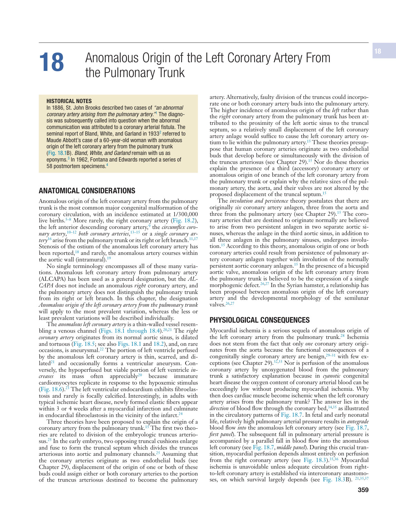

### Original PDF page 374

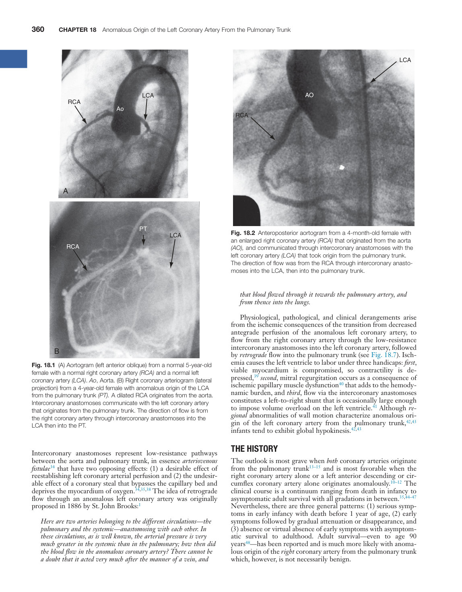

### Original PDF page 375

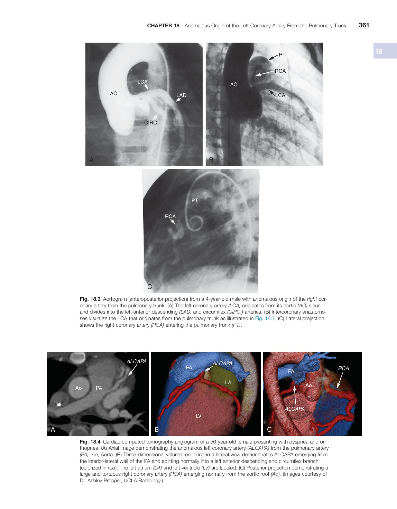

### Original PDF page 376

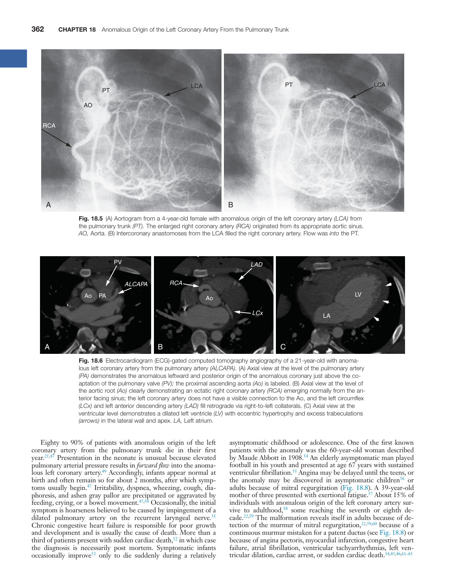

### Original PDF page 377

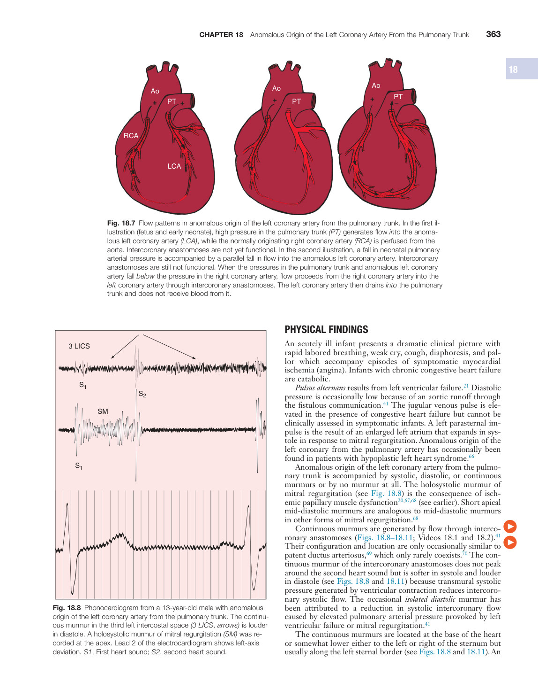

### Original PDF page 378

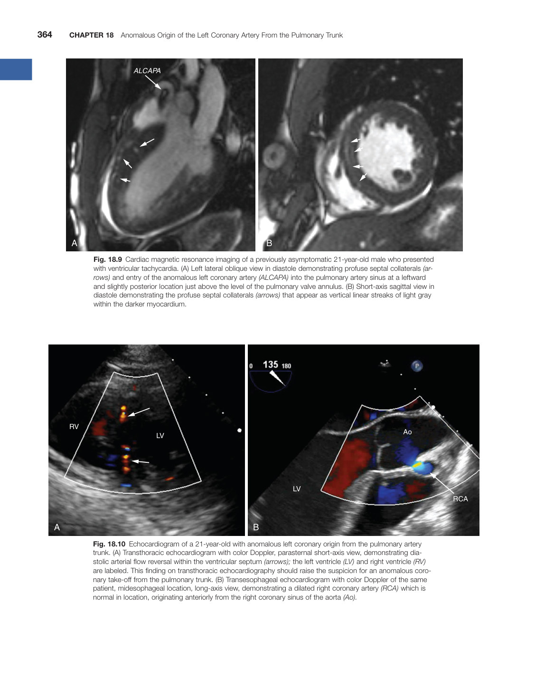

### Original PDF page 379

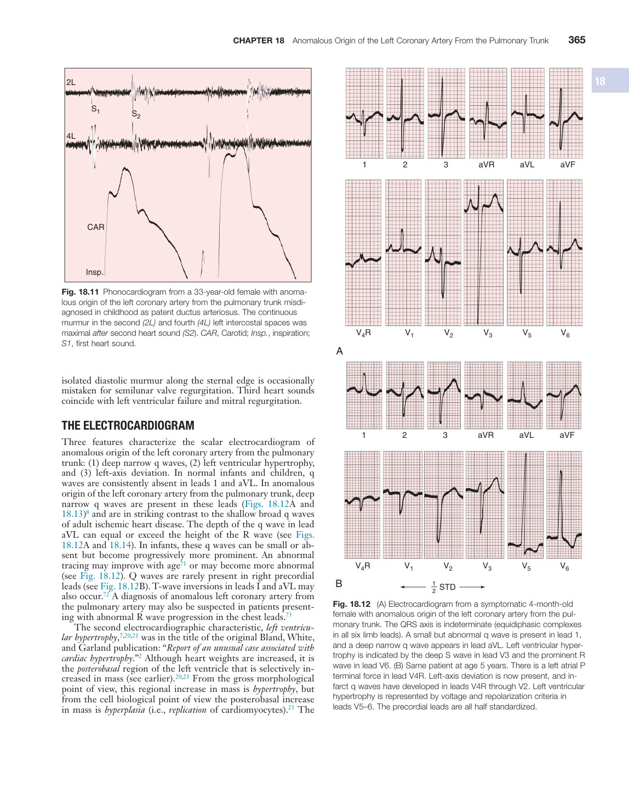

### Original PDF page 380

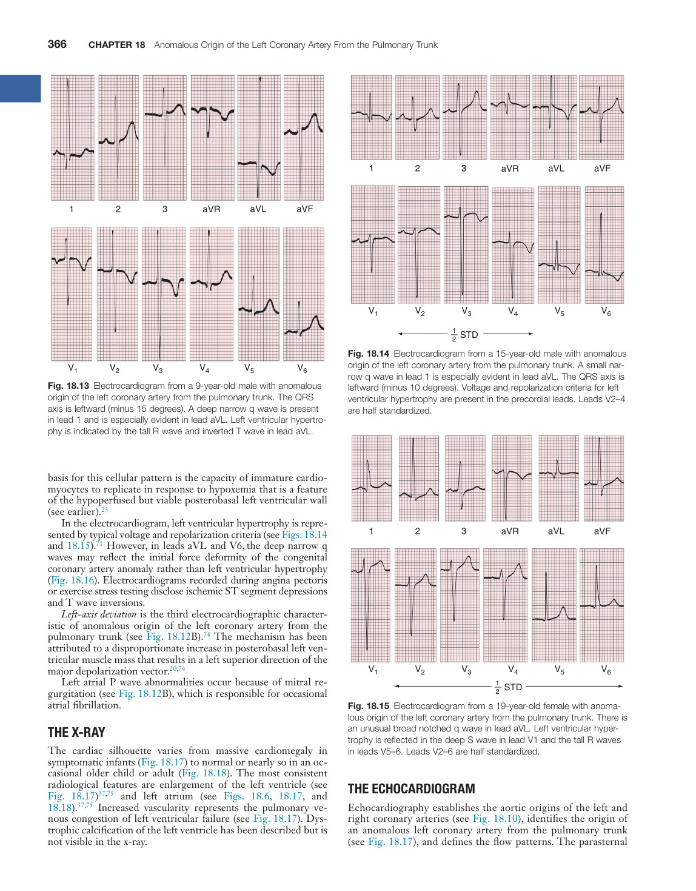

### Original PDF page 381

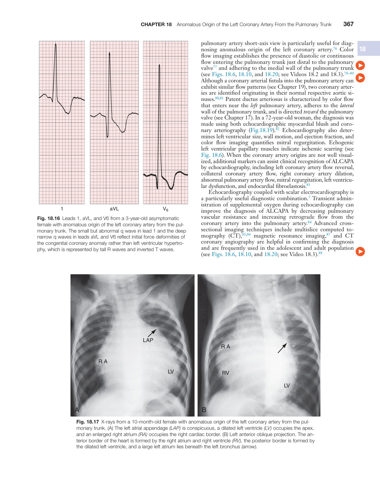

### Original PDF page 382

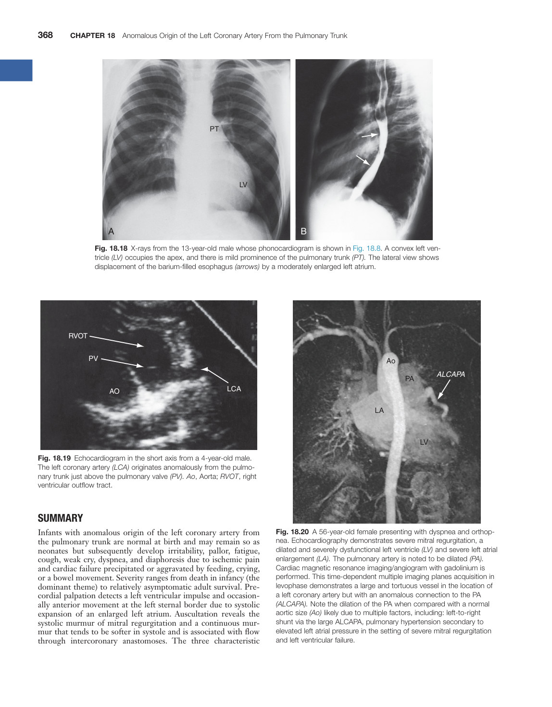

### Original PDF page 383

### Original PDF page 384

## Individual source figure views

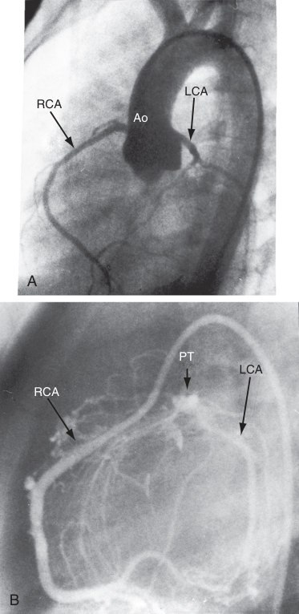

Fig. 18.1 ​(A) Aortogram (left anterior oblique) from a normal 5-year-old female with a normal right coronary artery (RCA) and a normal left coronary artery (LCA). Ao, Aorta. (B) Right coronary arteriogram (lateral projection) from a 4-year-old female with anomalous origin of the LCA from the pulmonary trunk (PT). A dilated RCA originates from the aorta. Intercoronary anastomoses communicate with the left coronary artery that originates from the pulmonary trunk. The direction of flow is from the right coronary artery through intercoronary anastomoses into the LCA then into the PT.

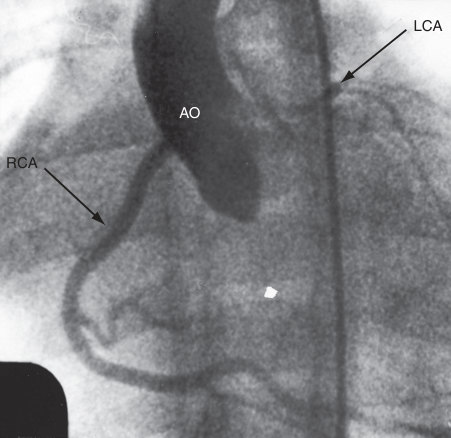

Fig. 18.2 ​Anteroposterior aortogram from a 4-month-old female with an enlarged right coronary artery (RCA) that originated from the aorta (AO), and communicated through intercoronary anastomoses with the left coronary artery (LCA) that took origin from the pulmonary trunk. The direction of flow was from the RCA through intercoronary anastomoses into the LCA, then into the pulmonary trunk.

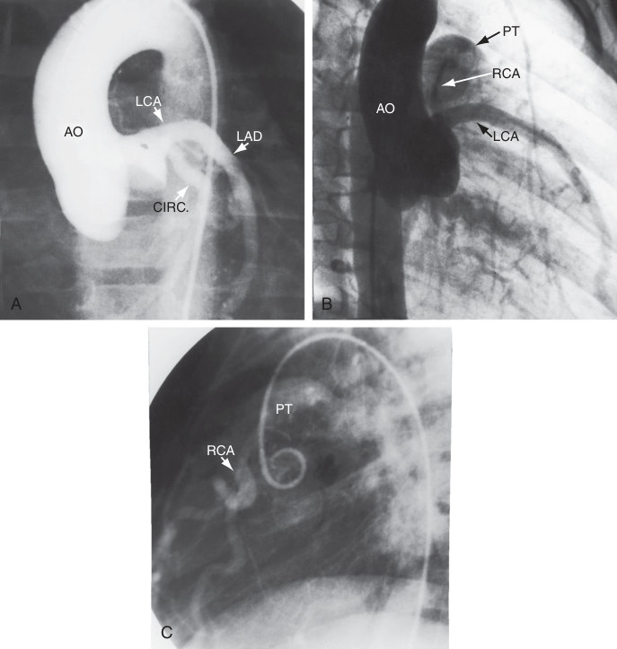

Fig. 18.3 ​Aortogram (anteroposterior projection) from a 4-year-old male with anomalous origin of the right coronary artery from the pulmonary trunk. (A) The left coronary artery (LCA) originates from its aortic (AO) sinus and divides into the left anterior descending (LAD) and circumflex (CIRC.) arteries. (B) Intercoronary anastomoses visualize the LCA that originates from the pulmonary trunk as illustrated in Fig. 18.7. (C) Lateral projection shows the right coronary artery (RCA) entering the pulmonary trunk (PT).

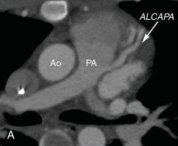

Fig. 18.4 Cardiac computed tomography angiogram of a 56-year-old female presenting with dyspnea and orthopnea. (A) Axial image demonstrating the anomalous left coronary artery (ALCAPA) from the pulmonary artery (PA). Ao, Aorta. (B) Three-dimensional volume rendering in a lateral view demonstrates ALCAPA emerging from the inferior-lateral wall of the PA and splitting normally into a left anterior descending and circumflex branch (colorized in red). The left atrium (LA) and left ventricle (LV) are labeled. (C) Posterior projection demonstrating a large and tortuous right coronary artery (RCA) emerging normally from the aortic root (Ao). (Images courtesy of Dr. Ashley Prosper, UCLA Radiology.)

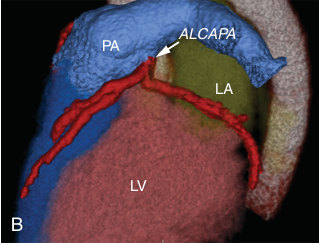

Fig. 18.4 Cardiac computed tomography angiogram of a 56-year-old female presenting with dyspnea and orthopnea. (A) Axial image demonstrating the anomalous left coronary artery (ALCAPA) from the pulmonary artery (PA). Ao, Aorta. (B) Three-dimensional volume rendering in a lateral view demonstrates ALCAPA emerging from the inferior-lateral wall of the PA and splitting normally into a left anterior descending and circumflex branch (colorized in red). The left atrium (LA) and left ventricle (LV) are labeled. (C) Posterior projection demonstrating a large and tortuous right coronary artery (RCA) emerging normally from the aortic root (Ao). (Images courtesy of Dr. Ashley Prosper, UCLA Radiology.)

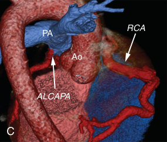

Fig. 18.4 Cardiac computed tomography angiogram of a 56-year-old female presenting with dyspnea and orthopnea. (A) Axial image demonstrating the anomalous left coronary artery (ALCAPA) from the pulmonary artery (PA). Ao, Aorta. (B) Three-dimensional volume rendering in a lateral view demonstrates ALCAPA emerging from the inferior-lateral wall of the PA and splitting normally into a left anterior descending and circumflex branch (colorized in red). The left atrium (LA) and left ventricle (LV) are labeled. (C) Posterior projection demonstrating a large and tortuous right coronary artery (RCA) emerging normally from the aortic root (Ao). (Images courtesy of Dr. Ashley Prosper, UCLA Radiology.)

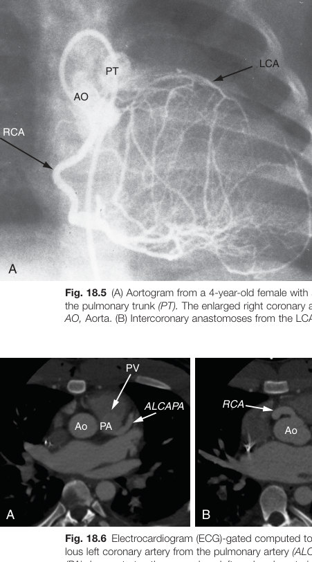

Unmatched source image; PDF page 376. Consult the original caption.

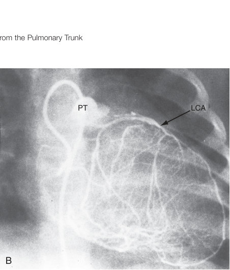

Fig. 18.5 ​(A) Aortogram from a 4-year-old female with anomalous origin of the left coronary artery (LCA) from the pulmonary trunk (PT). The enlarged right coronary artery (RCA) originated from its appropriate aortic sinus. AO, Aorta. (B) Intercoronary anastomoses from the LCA filled the right coronary artery. Flow was into the PT.

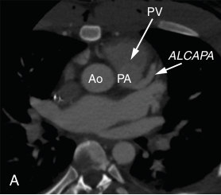

Fig. 18.6 ​Electrocardiogram (ECG)-gated computed tomography angiography of a 21-year-old with anomalous left coronary artery from the pulmonary artery (ALCAPA). (A) Axial view at the level of the pulmonary artery (PA) demonstrates the anomalous leftward and posterior origin of the anomalous coronary just above the coaptation of the pulmonary valve (PV); the proximal ascending aorta (Ao) is labeled. (B) Axial view at the level of the aortic root (Ao) clearly demonstrating an ectatic right coronary artery (RCA) emerging normally from the anterior facing sinus; the left coronary artery does not have a visible connection to the Ao, and the left circumflex (LCx) and left anterior descending artery (LAD) fill retrograde via right-to-left collaterals. (C) Axial view at the ventricular level demonstrates a dilated left ventricle (LV) with eccentric hypertrophy and excess trabeculations (arrows) in the lateral wall and apex. LA, Left atrium.

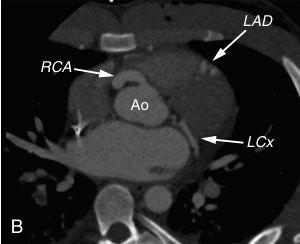

Fig. 18.6 ​Electrocardiogram (ECG)-gated computed tomography angiography of a 21-year-old with anomalous left coronary artery from the pulmonary artery (ALCAPA). (A) Axial view at the level of the pulmonary artery (PA) demonstrates the anomalous leftward and posterior origin of the anomalous coronary just above the coaptation of the pulmonary valve (PV); the proximal ascending aorta (Ao) is labeled. (B) Axial view at the level of the aortic root (Ao) clearly demonstrating an ectatic right coronary artery (RCA) emerging normally from the anterior facing sinus; the left coronary artery does not have a visible connection to the Ao, and the left circumflex (LCx) and left anterior descending artery (LAD) fill retrograde via right-to-left collaterals. (C) Axial view at the ventricular level demonstrates a dilated left ventricle (LV) with eccentric hypertrophy and excess trabeculations (arrows) in the lateral wall and apex. LA, Left atrium.

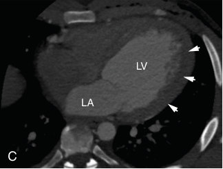

Fig. 18.6 ​Electrocardiogram (ECG)-gated computed tomography angiography of a 21-year-old with anomalous left coronary artery from the pulmonary artery (ALCAPA). (A) Axial view at the level of the pulmonary artery (PA) demonstrates the anomalous leftward and posterior origin of the anomalous coronary just above the coaptation of the pulmonary valve (PV); the proximal ascending aorta (Ao) is labeled. (B) Axial view at the level of the aortic root (Ao) clearly demonstrating an ectatic right coronary artery (RCA) emerging normally from the anterior facing sinus; the left coronary artery does not have a visible connection to the Ao, and the left circumflex (LCx) and left anterior descending artery (LAD) fill retrograde via right-to-left collaterals. (C) Axial view at the ventricular level demonstrates a dilated left ventricle (LV) with eccentric hypertrophy and excess trabeculations (arrows) in the lateral wall and apex. LA, Left atrium.

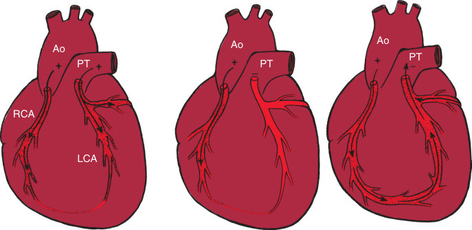

Fig. 18.7 ​Flow patterns in anomalous origin of the left coronary artery from the pulmonary trunk. In the first illustration (fetus and early neonate), high pressure in the pulmonary trunk (PT) generates flow into the anomalous left coronary artery (LCA), while the normally originating right coronary artery (RCA) is perfused from the aorta. Intercoronary anastomoses are not yet functional. In the second illustration, a fall in neonatal pulmonary arterial pressure is accompanied by a parallel fall in flow into the anomalous left coronary artery. Intercoronary anastomoses are still not functional. When the pressures in the pulmonary trunk and anomalous left coronary artery fall below the pressure in the right coronary artery, flow proceeds from the right coronary artery into the left coronary artery through intercoronary anastomoses. The left coronary artery then drains into the pulmonary trunk and does not receive blood from it.

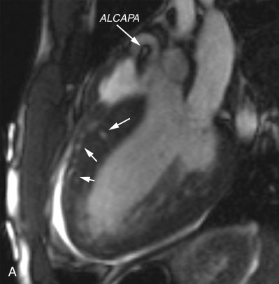

Fig. 18.9 ​Cardiac magnetic resonance imaging of a previously asymptomatic 21-year-old male who presented with ventricular tachycardia. (A) Left lateral oblique view in diastole demonstrating profuse septal collaterals (arrows) and entry of the anomalous left coronary artery (ALCAPA) into the pulmonary artery sinus at a leftward and slightly posterior location just above the level of the pulmonary valve annulus. (B) Short-axis sagittal view in diastole demonstrating the profuse septal collaterals (arrows) that appear as vertical linear streaks of light gray within the darker myocardium.

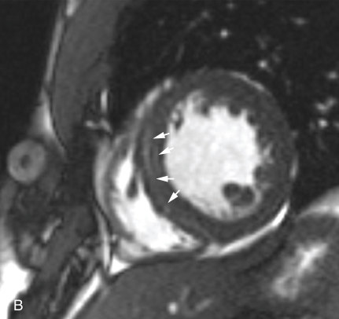

Fig. 18.9 ​Cardiac magnetic resonance imaging of a previously asymptomatic 21-year-old male who presented with ventricular tachycardia. (A) Left lateral oblique view in diastole demonstrating profuse septal collaterals (arrows) and entry of the anomalous left coronary artery (ALCAPA) into the pulmonary artery sinus at a leftward and slightly posterior location just above the level of the pulmonary valve annulus. (B) Short-axis sagittal view in diastole demonstrating the profuse septal collaterals (arrows) that appear as vertical linear streaks of light gray within the darker myocardium.

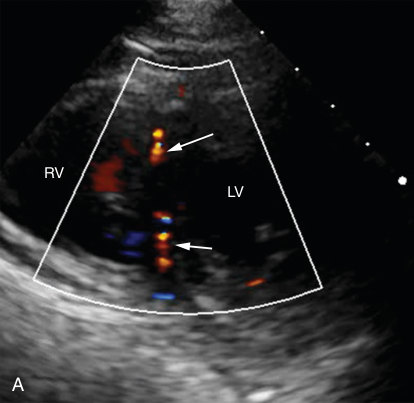

Fig. 18.10 ​Echocardiogram of a 21-year-old with anomalous left coronary origin from the pulmonary artery trunk. (A) Transthoracic echocardiogram with color Doppler, parasternal short-axis view, demonstrating diastolic arterial flow reversal within the ventricular septum (arrows); the left ventricle (LV) and right ventricle (RV) are labeled. This finding on transthoracic echocardiography should raise the suspicion for an anomalous coronary take-off from the pulmonary trunk. (B) Transesophageal echocardiogram with color Doppler of the same patient, midesophageal location, long-axis view, demonstrating a dilated right coronary artery (RCA) which is normal in location, originating anteriorly from the right coronary sinus of the aorta (Ao).

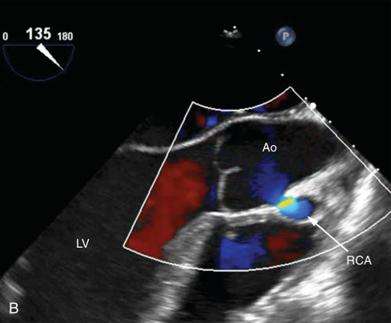

Fig. 18.10 ​Echocardiogram of a 21-year-old with anomalous left coronary origin from the pulmonary artery trunk. (A) Transthoracic echocardiogram with color Doppler, parasternal short-axis view, demonstrating diastolic arterial flow reversal within the ventricular septum (arrows); the left ventricle (LV) and right ventricle (RV) are labeled. This finding on transthoracic echocardiography should raise the suspicion for an anomalous coronary take-off from the pulmonary trunk. (B) Transesophageal echocardiogram with color Doppler of the same patient, midesophageal location, long-axis view, demonstrating a dilated right coronary artery (RCA) which is normal in location, originating anteriorly from the right coronary sinus of the aorta (Ao).

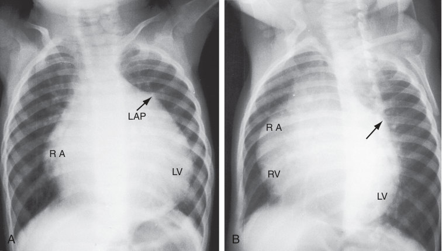

Fig. 18.17 ​X-rays from a 10-month-old female with anomalous origin of the left coronary artery from the pulmonary trunk. (A) The left atrial appendage (LAP) is conspicuous, a dilated left ventricle (LV) occupies the apex, and an enlarged right atrium (RA) occupies the right cardiac border. (B) Left anterior oblique projection. The anterior border of the heart is formed by the right atrium and right ventricle (RV), the posterior border is formed by the dilated left ventricle, and a large left atrium lies beneath the left bronchus (arrow).

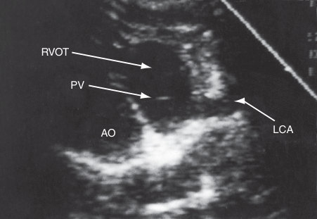

Fig. 18.19 ​Echocardiogram in the short axis from a 4-year-old male. The left coronary artery (LCA) originates anomalously from the pulmonary trunk just above the pulmonary valve (PV). Ao, Aorta; RVOT, right ventricular outflow tract.

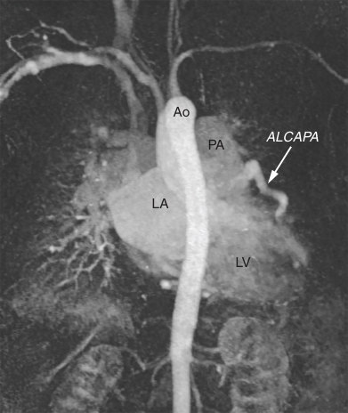

Fig. 18.20 ​A 56-year-old female presenting with dyspnea and orthopnea. Echocardiography demonstrates severe mitral regurgitation, a dilated and severely dysfunctional left ventricle (LV) and severe left atrial enlargement (LA). The pulmonary artery is noted to be dilated (PA). Cardiac magnetic resonance imaging/angiogram with gadolinium is performed. This time-dependent multiple imaging planes acquisition in levophase demonstrates a large and tortuous vessel in the location of a left coronary artery but with an anomalous connection to the PA (ALCAPA). Note the dilation of the PA when compared with a normal aortic size (Ao) likely due to multiple factors, including: left-to-right shunt via the large ALCAPA, pulmonary hypertension secondary to elevated left atrial pressure in the setting of severe mitral regurgitation and left ventricular failure.

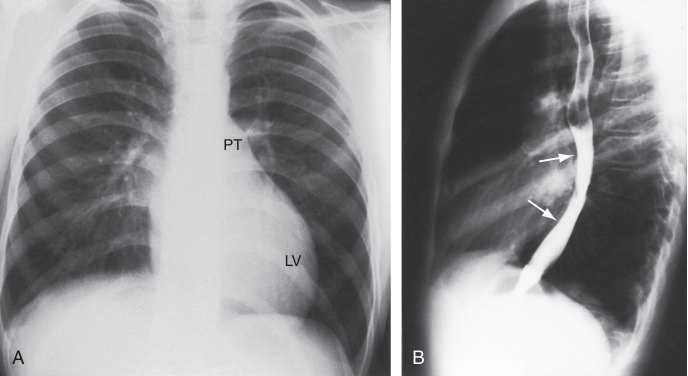

Fig. 18.18 ​X-rays from the 13-year-old male whose phonocardiogram is shown in Fig. 18.8. A convex left ventricle (LV) occupies the apex, and there is mild prominence of the pulmonary trunk (PT). The lateral view shows displacement of the barium-filled esophagus (arrows) by a moderately enlarged left atrium.

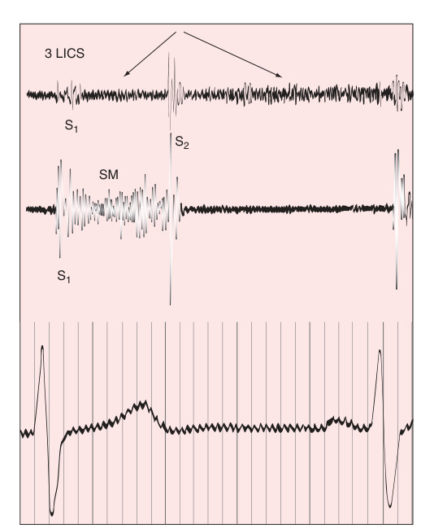

Fig. 18.8 ​Phonocardiogram from a 13-year-old male with anomalous origin of the left coronary artery from the pulmonary trunk. The continuous murmur in the third left intercostal space (3 LICS, arrows) is louder in diastole. A holosystolic murmur of mitral regurgitation (SM) was recorded at the apex. Lead 2 of the electrocardiogram shows left-axis deviation. S1, First heart sound; S2, second heart sound.

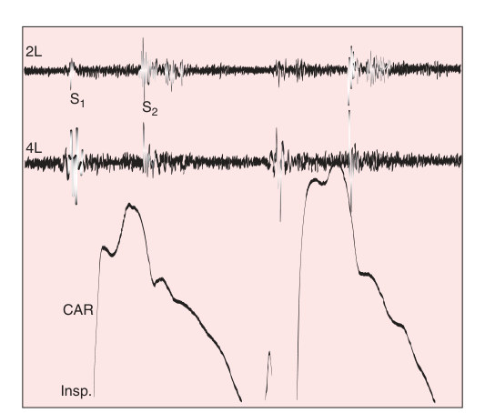

Fig. 18.11 ​Phonocardiogram from a 33-year-old female with anomalous origin of the left coronary artery from the pulmonary trunk misdiagnosed in childhood as patent ductus arteriosus. The continuous murmur in the second (2L) and fourth (4L) left intercostal spaces was maximal after second heart sound (S2). CAR, Carotid; Insp., inspiration; S1, first heart sound.

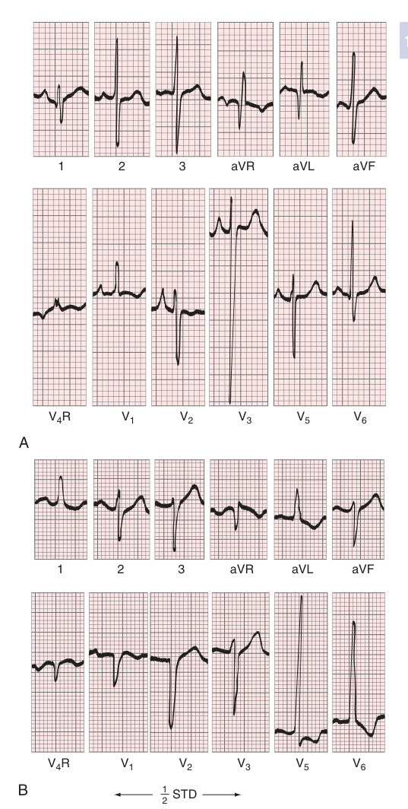

Fig. 18.12 ​ (A) Electrocardiogram from a symptomatic 4-month-old female with anomalous origin of the left coronary artery from the pulmonary trunk. The QRS axis is indeterminate (equidiphasic complexes in all six limb leads). A small but abnormal q wave is present in lead 1, and a deep narrow q wave appears in lead aVL. Left ventricular hypertrophy is indicated by the deep S wave in lead V3 and the prominent R wave in lead V6. (B) Same patient at age 5 years. There is a left atrial P terminal force in lead V4R. Left-axis deviation is now present, and infarct q waves have developed in leads V4R through V2. Left ventricular hypertrophy is represented by voltage and repolarization criteria in leads V5–6. The precordial leads are all half standardized.

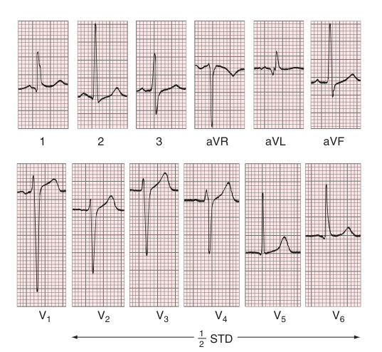

Fig. 18.15 ​Electrocardiogram from a 19-year-old female with anomalous origin of the left coronary artery from the pulmonary trunk. There is an unusual broad notched q wave in lead aVL. Left ventricular hypertrophy is reflected in the deep S wave in lead V1 and the tall R waves in leads V5–6. Leads V2–6 are half standardized.

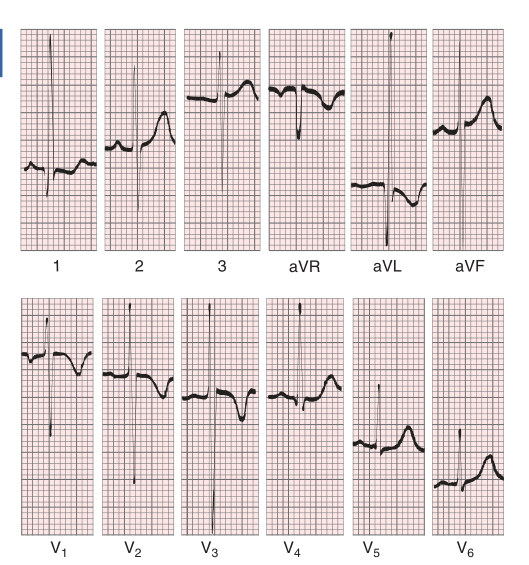

Fig. 18.13 ​Electrocardiogram from a 9-year-old male with anomalous origin of the left coronary artery from the pulmonary trunk. The QRS axis is leftward (minus 15 degrees). A deep narrow q wave is present in lead 1 and is especially evident in lead aVL. Left ventricular hypertrophy is indicated by the tall R wave and inverted T wave in lead aVL.

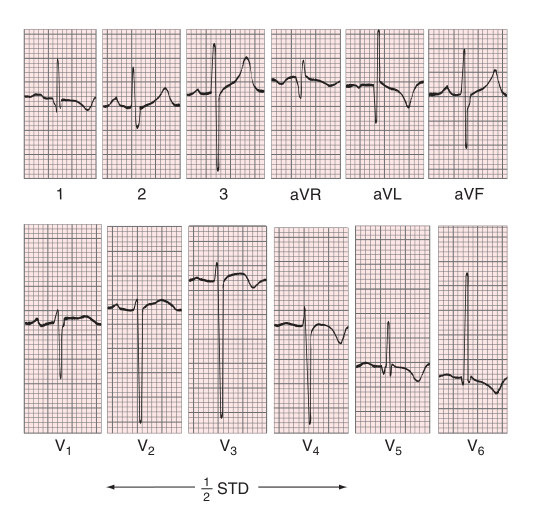

Fig. 18.14 ​Electrocardiogram from a 15-year-old male with anomalous origin of the left coronary artery from the pulmonary trunk. A small narrow q wave in lead 1 is especially evident in lead aVL. The QRS axis is leftward (minus 10 degrees). Voltage and repolarization criteria for left ventricular hypertrophy are present in the precordial leads. Leads V2–4 are half standardized.

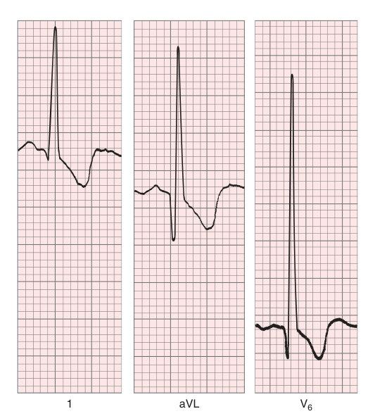

Fig. 18.16 ​Leads 1, aVL, and V6 from a 3-year-old asymptomatic female with anomalous origin of the left coronary artery from the pulmonary trunk. The small but abnormal q wave in lead 1 and the deep narrow q waves in leads aVL and V6 reflect initial force deformities of the congenital coronary anomaly rather than left ventricular hypertrophy, which is represented by tall R waves and inverted T waves.
