# 20. Congenital aneurysms of the sinuses of valsalva
> [Source credits](../../SOURCE_CREDITS.md).

## PDF page 396 | printed page 382

20 CONGENITAL ANEURYSMS OF THE SINUSES OF VALSALVA

### HISTORICAL NOTES

Antonio Maria Valsalva, anatomist and pathologist, was born in 1666 in the historic Emilia-Romagna region of northern Italy. The sinuses that bear Valsalva’s name consist of three small outpouchings in the wall of the aorta immediately above the attachments of each aortic cusp (Fig. 20.1). In 1839, James Hope published an account of a ruptured congenital aneurysm of a sinus of Valsalva: “a case of aneurysmal pouch of the aorta bursting into the right ventricle.”1 A year later, John Thurnam expanded Hope’s report by adding examples of unruptured aortic sinus aneurysms, and by naming the sinuses according to their relationship to the coronary arteries as the right coronary sinus, the left coronary sinus, and the noncoronary sinus (see Fig. 20.1).2 These designations appeared in Quain’s Elements of Anatomy,3 and remain in use today.4

### ANATOMIC CONSIDERATIONS

Aneurysms of the sinuses of Valsalva account for 1% of congenital anomalies of the heart and circulation.5 The aneurysms tend to be single, although exceptionally, more than one sinus is involved.6,7 An aneurysm may arise from each sinus of a bicuspid aortic valve,6,8 from each sinus of a trileaflet aortic valve,7 and rarely, from a quadricuspid aortic valve.9

The anatomic relationship of the sinuses of Valsalva to adjacent structures determines the site into which a given congenital aneurysm ruptures.4 Ninety to ninety-five percent originate in the right or noncoronary sinus and project into the right ventricle or right atrium, and less than 5% originate in the left coronary sinus (Fig. 20.2).4,10,11 Those arising in the noncoronary sinus almost always rupture into the right atrium (Fig. 20.3 and Video 20.1; see also Fig. 20.2), and those arising in the right coronary sinus rupture into the right ventricle or occasionally into the right atrium (Figs. 20.4 and 20.5, and Videos 20.2 and 20.3; see also Fig. 20.2).4 Rarely, rupture is into the pulmonary artery,10,12 left ventricle,4 left atrium,4 or pericardial space.4,13 Also rarely, a sinus aneurysm dissects into the interventricular septum where it remains unruptured, or perforates and ruptures into the left or right ventricle.5,14–16 A congenital etiology is questionable when an aneurysm originates in the left coronary sinus and ruptures into the left side of heart.4

A sinus of Valsalva aneurysm can cause aortic regurgitation by interfering with aortic leaflet coaptation, can enter the right atrium and cause tricuspid regurgitation,17 or can enter the right ventricular outflow tract and cause subpulmonary obstruction. A congenital aortic sinus aneurysm that is the site of infective endocarditis can be difficult to distinguish from aortic valve infective endocarditis that caused the aortic sinus to perforate.4,18–20 A large unruptured aneurysm can compress the superior vena cava, the right atrium, the right ventricle,21 or a coronary artery.

A congenital sinus of Valsalva aneurysm begins as a blind pouch or diverticulum at a localized site in an aortic sinus, and then protrudes as a finger-like or nipple-like projection that ruptures at its tip (see Figs. 20.2, 20.3, and 20.5; see also Videos 20.1 and 20.2).4,22,23 The fundamental histologic fault responsible for a coronary sinus aneurysm is discontinuity of the elastic layer in the aortic media at the juncture between the ascending aorta and aortic valve annulus, setting the stage for avulsion and aneurysm

formation.23,24 The histologic fault is present at birth, but with rare exception, the aneurysm is not.18,25,26 Marfan syndrome is associated with dilation of the ascending aorta and the sinuses of Valsalva, but dissection or rupture is in the ascending aorta, not in the sinuses.27 Dilation of the sinus of Valsalva may also occur in patients with bicuspid aortic valve, more commonly in males and patients with typical bicuspid aortic valve morphology.28 An aortico-cameral communication is a tortuous channel that originates in the ascending aorta above the left sinus of Valsalva and terminates in the right atrium without involving the aortic sinuses.29

### Physiologic Consequences

The physiologic consequences of rupture depend on three factors: (1) the amount of blood flowing through the rupture, (2) the rapidity with which the rupture develops, and (3) the chamber that receives the rupture. Irrespective of the right-sided receiving site, shunted blood must flow through the pulmonary circulation, the left atrium, and the left ventricle before returning to the aorta. When the right atrium receives the rupture, all four cardiac chambers are volume overloaded. A sudden large rupture provokes congestive failure because the heart cannot adapt rapidly to the acute hemodynamic burden. Conversely, small insidious perforations initially go unnoticed (Fig. 20.6). Deformity of aortic cusps caused by a ruptured or unruptured aneurysm causes regurgitation through the valve, while rupture of a sinus aneurysm into the left ventricle causes regurgitation through the rupture.30 Aneurysms that originate in the right sinus of Valsalva are typically associated with a supracristal ventricular septal defect (see Fig. 20.2).4,23,31–33

Unruptured congenital sinus of Valsalva aneurysms were recognized by Thurnam2 (see earlier). Before the advent of echocardiography, approximately 20% of unruptured aneurysms were chance findings at necropsy or at cardiac surgery. 34 However, occult unruptured congenital aortic sinus aneurysms are now readily imaged, even in older adults (Fig. 20.7).29,35 An unruptured aneurysm can compress a proximal coronary artery or can dissect into the ventricular septum and cause complete heart block.35 Protrusion of an aneurysm into the left ventricle is occasionally responsible for aortic regurgitation (see earlier)30 less commonly for obstruction to left ventricular outflow.

### THE HISTORY

Ruptured aortic sinus aneurysms typically announce themselves in young males after puberty, but before age 30 years. The male/female ratio as high as 4:1.22 Rupture rarely occurs in infancy or early childhood25,26,36 or as late as the seventh decade,37,38 and rarely occurs during pregnancy.39 The average age of rupture was 34 years in one large series, with an age range of 11 years to 67 years.37 An unruptured congenital aneurysm of the right coronary sinus was an incidental necropsy finding in an 82-year-old male,34 and an 85-year-old male came to attention because an occult unruptured aortic sinus aneurysm in the right ventricular outflow tract caused a to-and-fro murmur (see Fig. 20.7). Death from congestive heart failure typically occurs within a year after rupture.37 Sudden death follows perforation into the pericardium, and syncope and sudden death are occasional sequelae of complete heart block caused by a ruptured15 or unruptured35 aneurysm that

## PDF page 397 | printed page 383

Sinuses of Valsalva

Ao

RA

Left coronary sinus

Noncoronary sinus

LV

Right coronary sinus

RV

A

H I K

G

FIG. I.

E

L

F

F

d

d

e

c

FIG. II.

A

b

c

d

b b

c

b b

d

b

B

d

c

Fig. 20.1 (A) Illustration of the normal aortic root with locations of the sinuses of Valsalva. Ao, Aorta; LV, left ventricle; RA, right atrium; RV, right ventricle. (B) Illustration of the aortic sinuses from Antonio Valsalva’s Opera published in 1740.

dissects into the base of the ventricular septum.15,40 Conversely, long survival sometimes follows a small slowly progressive perforation (Fig. 20.8, and Videos 20.4–20.6; see also Fig. 20.6). One such individual lived for 30 years, another lived for 17 years,41 a 65-year-old male died of gastric carcinoma 10 years after rupture,38 and a rupture in infancy was followed by surgical repair 15 years later. Small perforations come to attention because of a continuous murmur (see Fig. 20.8),42 because of a diastolic murmur caused by aortic regurgitation, because of infective endocarditis,4,19 or during a diagnostic study for ventricular septal defect.43 A large unruptured saccular aneurysm filled with laminated thrombus came to light because of a prominent paracardiac density on a routine chest x-ray, and another unruptured aneurysm

20

Ao

PA

LCC

NCC

RCC

IV

I

RA

IIIa

II

supracristal VSD

TV

IIIv

RV

Fig. 20.2 Illustration of the various sinus of Valsalva aneurysm ruptures as classified by Sakakibara and Konno.4 Type 1—The aneurysm originates from the left-side border of the right sinus of Valsalva and ruptures into the right ventricular outflow tract just below the pulmonary valve. This type of aneurysm is often coexistent with a supracristal ventricular septal defect (VSD). This is the most common of the defects and accounts for 48% of cases. Type II—The aneurysm originates from the mid part of the right sinus of Valsalva and ruptures into the right ventricle (RV); a concurrent VSD is unlikely. This defect accounts for 34% of cases. Type III—The aneurysm originates from the mid portion of the right sinus and ruptures either into the right atrium (RA) (Type IIIa) or less commonly the RV (Type IIIv) just below the septal leaflet of the tricuspid valve. A VSD is rarely encountered. Type IIIa accounts for 13% of cases and type IIIv accounts for 6%. Type IV is the rarest of all and is the result of an aneurysm from the right-facing portion of the noncoronary sinus that ruptures into the RA. Ao, Aorta; LCC, left coronary cusp; NCC, noncoronary cusp; PA, pulmonary artery; RCC, right coronary cusp; TV, tricuspid valve.

announced itself by cerebral and retinal emboli.44 Compression of a coronary artery by an unruptured aneurysm is a rare cause of angina pectoris or myocardial infarction (see earlier). In 1957, a 27-year-old soldier with a large acute rupture underwent the first successful surgical repair with a polyvinyl prosthesis shaped as a golf tee. Three decades later, the patient dramatically reperforated45 (see second case history below).

Congenital sinus of Valsalva aneurysms come to attention because of the acute development of a large perforation, gradual progression of a small perforation, or because of an asymptomatic or symptomatic unruptured aneurysm. A large acute rupture is announced by the dramatic onset of severe retrosternal or upper abdominal pain and intractable dyspnea.32,37 The rupture often but not necessarily follows physical stress. The acute symptoms last for hours or days, sometimes subsiding gradually, leaving the patient temporarily improved, but congestive heart failure appears and progresses relentlessly. The following case histories are illustrative.

The first history describes a 45-year-old truck driver whose work included strenuous lifting of 50- to 100-pound sacks of plaster.32 He was in good health until three weeks before an alarming experience. While carrying a 100-lb. sack, he suddenly

## PDF page 398 | printed page 384

Ao

RA

RSVA

RCA

A

Fig. 20.3 A 19-year-old with rapid-onset shortness of breath and lower extremity edema is found to have a continuous murmur at the left sternal border. He undergoes cardiac catheterization demonstrating a pulmonaryto-systemic blood flow ratio of 2.5:1 and elevated biventricular filling pressure and pulmonary hypertension. (A) Aortography, anteroposterior projection, demonstrating a severely prolapsing ruptured noncoronary sinus of Valsalva aneurysm (RSVA) into a dilated right atrium (RA) (Sakakibara Type IV). A dominant right coronary artery is well opacified and demarcates the right sinus of Valsalva. (B) Lateral projection. Ao, Aorta; RCA , right coronary artery.

Sinus of Valsalva aneurysm

RA

PT Ao

RA

RV

RV

A B

Fig. 20.4 (A) Schematic illustration of a sinus of Valsalva aneurysm projecting into the right atrium (RA). The sinus itself is not dilated. The aneurysm appears as a finger-like or nipple-like projection with a perforation at its tip. (B) Specimen from a 27-year-old female whose heart was sectioned to correspond with the anatomic features in the schematic illustration. The ruptured sinus of Valsalva aneurysm (arrow) projects into the RA. (C) Aortogram from a 20-year-old woman with a congenital aneurysm (arrow) of the right sinus of Valsalva that ruptured into the RA. Ao, Aorta; PT , pulmonary trunk; RV , right ventricle.

became “out of breath” and fell to the floor. A raw sensation radiated from the epigastrium to the base of the neck. Despite severe weakness and shortness of breath, he carried 20 more sacks before consulting a doctor. When seen by us, he was relatively asymptomatic.

The second history is from the 27-year-old soldier (see earlier) who had been in excellent health and whose physical examinations in the military had been normal. While sitting at his desk, he suddenly experienced shortness of breath, chest pain, and epigastric discomfort. Because the symptoms persisted, he was admitted to an army hospital. The acute symptoms subsided following administration of digitalis and sodium restriction, but congestive heart failure persisted.

Ao

RSVA

RA

B

Ao

Ao

RA

C

The third history is from a 21-year-old woman who had previously been well. About 24 hours after her usual weekend hike in woods and hills, and shortly after eating pizza, she had an episode of nausea and retching. Later in the day, she experienced progressive dyspnea with severe retrosternal pressure radiating to the back followed by orthopnea and palpitations. These symptoms remained severe for a week, then gradually subsided, leaving mild residual retrosternal pain and dyspnea.

The initial pain is believed to be related to the rupture itself. Occasionally, the aneurysm compresses a coronary artery, so symptoms of myocardial ischemia or infarction coexist.46 Rupture may be announced by acute dyspnea rather than pain, or mild chest pain may occur for weeks before the onset of dyspnea

## PDF page 399 | printed page 385

Ao

RA

RSVA

TV

RV

A B

Fig. 20.5 Transesophageal echocardiogram of a 19-year-old with new-onset heart failure symptoms and a new continuous murmur at the mid and lower sternal border. (A) Ruptured right sinus of Valsalva aneurysm (RSVA) from the aortic root (Ao) into the right atrium (RA) just above the level of the tricuspid valve (TV). This is a Sakakibara Type IIIa defect. (B) Color Doppler in diastole demonstrating flow from Ao to RA. RV, Right ventricle.

RSVA

RV

Ao

LV

LA

A

Fig. 20.6 Cardiac magnetic resonance imaging of a 26-year-old with a ruptured sinus of Valsalva aneurysm (RSVA) from a prolapsing right sinus. (A) Long-axis view demonstrating diastolic flow from the aorta (Ao) to the right ventricle (RV). (B) Short-axis view clearly demonstrates a prolapsing aneurysmal sinus that has ruptured into the RV outflow tract. This patient was born with a supracristal ventricular septal defect that is now closed by the prolapsing aneurysm. LA, Left atrium; LV, left ventricle.

and tightness in the upper abdomen. If a patient with a ventricular septal defect suddenly develops chest pain, dyspnea, and a continuous murmur, the reason is likely to be rupture of a coexisting aortic sinus aneurysm (Fig. 20.9; see also Fig. 20.8) (see earlier).

Small insidious perforations that progress gradually initially go unnoticed (Fig. 20.10; see also Fig. 20.6). Mild dyspnea without pain sometimes precedes congestive heart failure by months or years.17 Patients sometimes present during a relatively asymptomatic interval with a continuous murmur mistaken for patent ductus arteriosus.

20

RV

RSVA Ao

B

Congenital aortic sinus aneurysms usually go unrecognized until they rupture.34 However, unruptured aneurysms can manifest themselves by a to-and-fro murmur due to flow in and out of the intact aneurysmal pouch (see Fig. 20.7), by the murmur of tricuspid regurgitation, by a midsystolic murmur of right ventricular outflow obstruction, by the pain of myocardial ischemia due to coronary artery compression, by aortic regurgitation caused by malapposition of aortic cusps,30 by superior vena caval obstruction,21 by a paracardiac mass in the chest x-ray, by systemic emboli,44 by complete heart block, by syncope, or by sudden death.15

## PDF page 400 | printed page 386

r v o t

s

v

a

p

a

ao

LA

Fig. 20.7 Black-and-white print of a color flow image from an asymptomatic 85-year-old man with an unruptured sinus of Valsalva aneurysm (sva) that presented as a to-and-fro murmur. Color flow imaging showed no rupture. Multiple small arrows identify the aneurysm that projected into the right ventricular outflow tract (long arrow, rvot). ao, Aorta; LA, left atrium; pa, pulmonary artery.

LA

LCC NCC

RA

PA

RCC

RV

A B

Fig. 20.8 (A) Transesophageal echocardiography, mid-esophageal level, en-face view of the three cusps of the aortic valve in diastole: the left coronary cusp (LCC), the noncoronary cusp (NCC), and the right coronary cusp (RCC). The arrow points to a ruptured sinus communicating between the RCC and the right ventricle (RV) outflow tract just below the pulmonary valve (Sakakibara Type I). (B) Continuous-flow Doppler demonstrating continuous high-velocity flow from the aortic root to the RV outflow tract. LA, Left atrium; PA, pulmonary artery; RA, right atrium.

### PHYSICAL FINDINGS

Because rupture rarely occurs before puberty (see earlier), growth and development are seldom affected by the catabolic effects of congestive heart failure. Aneurysm of the noncoronary sinus of Valsalva has been reported with the Klippel-Feil syndrome which is characterized by short neck, low posterior hairline, and restricted mobility of the upper spine caused by congenital fusion of any two cervical vertebrae.47 Giant aneurysms of the left and noncoronary sinuses have been reported with Noonan syndrome characterized by hypertelorism, down-slanting eyes, webbed neck, short stature, and chest deformity.48

All gradations of an aortic runoff are reflected in the arterial pulse irrespective of which chamber or side of the heart receives a ruptured sinus of Valsalva aneurysm (Fig. 20.11; see also Fig. 20.2). The pulse pressure may not be wide immediately after perforation because the left ventricle has not had time to adapt to the increase in volume and because left ventricular end diastolic pressure is elevated.49 If survival permits, the arterial pulse becomes bounding with a rapid rise, a rapid fall, a wide pulse pressure, and a bisferiens configuration. Carotid pulses are visible, Quincke pulses appear in the fingertips, and pistol shot sounds and Duroziez’s murmur are heard over the femoral arteries. When an aneurysm penetrates the base of the ventricular septum and causes complete heart block, the arterial pulse is slow.

The height and wave form of the jugular venous pulse depend on the size and rapidity of the rupture and on the presence and degree of right ventricular failure. A small insidious rupture leaves the jugular venous pulse normal irrespective of which chamber receives the rupture. A large sudden rupture into the right atrium or right ventricle is accompanied by congestive heart failure, an elevated mean jugular venous pressure, and tall A and V waves (Fig. 20.12). When an aortic sinus aneurysm projects into the right atrium and causes tricuspid regurgitation (see earlier), the V wave is selectively elevated. When an aneurysm causes obstruction of the superior vena cava, the mean jugular venous

## PDF page 401 | printed page 387

AoV

Ao

LV

RSVA

IVS

PV

RV

A

Fig. 20.9 Transesophageal echocardiogram from a 27-year-old male with progressive dyspnea on exertion and lower extremity edema. (A) Three-dimensional (3-D) long-axis view at the mid-esophageal level clearly demonstrating the ruptured sinus of Valsalva aneurysm (RSVA) of the right coronary sinus just above the level of the aortic valve (AoV) resulting in a communication between the aorta (Ao) and the right ventricle (RV) just below the level of the pulmonary valve (PV). The interventricular septum (IVS) and left ventricular (LV) are also labeled. (B) 3-D transesophageal echocardiogram with color Doppler in diastole demonstrating torrential flow from the Ao to the RV.

LA

LV

Ao

RV

A

Fig. 20.10 Transesophageal echocardiogram from an asymptomatic 32-year-old man with a continuous murmur. (A) The three unmarked oblique arrows (lower left) identify a sinus of Valsalva aneurysm that originated in the right sinus and projected into the right ventricular (RV) outflow tract. Ao, Aorta; LA, left atrium; LV, left ventricle. (B) Black and white print of a color flow image showing high-velocity flow from the right aortic sinus (curved arrow) into the right ventricular outflow tract (RV).

pressure is elevated, but the wave forms disappear. When an aneurysm results in obstruction to right ventricular outflow, the A wave selectively increases. Complete heart block is accompanied by the distinctive jugular pulse described in Chapter 4.

Precordial impulses depend on the size, rapidity, and duration of the rupture rather than on the recipient chamber, except when rupture is directly into the left ventricle. When rupture is into the right atrium or right ventricle, the right and left ventricles are both hyperdynamic because blood from the rupture circulates through all four chambers before reaching the aorta. An aortic sinus aneurysm that ruptures directly into the left ventricle or that causes aortic regurgitation by compromising aortic cusp

20

Ao

RSVA

RV

PV

B

Ao

RV

B

coaptation results in an isolated hyperdynamic left ventricular impulse. An unruptured aneurysm that obstructs right ventricular outflow is accompanied by an isolated right ventricular impulse and a systolic thrill generated across the obstruction. A continuous thrill that is more prominent in either systole or diastole coincides with a loud coarse murmur and a large acute rupture. The maximum location of thrills varies with murmur sites as described in the next section.

A hallmark of acute rupture of an aortic sinus aneurysm into the right side of the heart is the sudden appearance of a continuous murmur in a previously healthy individual, usually a young male.37 In a patient known to have a ventricular septal defect, the

## PDF page 402 | printed page 388

BA

20

0

Fig. 20.11 Brachial arterial (BA) pulse from a 17-year-old boy with a noncoronary sinus of Valsalva aneurysm that ruptured into the right atrium. Pulmonary blood flow was twice systemic. The upstroke of the brachial pulse is brisk. The diastolic pressure is reduced.

RA

A

C

V

2

0

Fig. 20.12 Right atrial (RA) pressure pulse from the 17-year-old boy with rupture of an aneurysm of the noncoronary sinus of Valsalva into the right atrium (see Fig. 20.11). The A and V waves are both elevated. The A wave is dominant, and the C wave is prominent.

sudden appearance of a continuous murmur is a feature of rupture of a coexisting aortic sinus aneurysm (see Fig. 20.8).31,37

When the right atrium receives the rupture, the continuous murmur is maximum along the right or left sternal border, or over the lower sternum (Fig. 20.13; see also Fig. 20.3 and Videos 20.1 and 20.2). When the rupture enters the body of the right ventricle, the continuous murmur is maximum at the mid to lower left sternal border (Fig. 20.14), and rupture into the outflow tract of the right ventricle results in a continuous murmur at the upper left sternal edge. The systolic component of continuous murmurs tends to be louder at higher thoracic sites, and the diastolic component tends to be louder at lower thoracic sites.

The quality, loudness, and configuration of the continuous murmur accompanying a sudden large rupture were well stated in early reports. Hope described “a very loud, superficial sawing murmur prolonged continuously over the first and second heart sounds (probably weaker during the period of repose).”1 Thurnam called attention to “a superficial, harsh murmur and a peculiarly intense sawing or blowing sound accompanied by an equally marked or purring tremor heard over the varicose orifice and in the circulation beyond it; this sound is continuous but is loudest during systole, less loud during diastole.”2 These descriptions carry an important message, namely, that the continuous murmur of a ruptured aortic sinus aneurysm does not peak around the second heart sound, in contrast to the continuous murmur of patent ductus arteriosus (Fig. 20.15; see also Fig. 20.14). Either the systolic or the diastolic portion of the murmur tends to be louder. Intensity may diminish around the second heart sound only to increase in diastole, creating a to-and-fro cadence. From time to time, the continuous murmur exhibits either systolic or diastolic accentuation

RA phono

4 LICS

CAR

Fig. 20.13 Right atrial intracardiac phonocardiogram (RA phono) with simultaneous thoracic wall phonocardiogram at the fourth left intercostal space (4 LICS) in the 17-year-old boy with rupture of an aneurysm of the noncoronary sinus of Valsalva into the right atrium (see Figs. 20.11 and 20.12). The continuous murmur within the right atrium and on the thoracic wall (4 LICS) exhibits systolic or diastolic accentuation from beat to beat but does not peak around the second heart sound. CAR, Carotid pulse.

## PDF page 403 | printed page 389

4 LICS

S2

CAR

Fig. 20.14 Phonocardiogram from the fourth left intercostal space (4 LICS) of a 28-year-old man with an aneurysm of the right sinus of Valsalva that ruptured into the right ventricle. The continuous murmur is much louder in systole (paired arrows). CAR, Carotid pulse; S2, second heart sound.

2 LICS

SM EDM

S2

CAR

Fig. 20.15 Phonocardiogram from the second left intercostal space (2 LICS) of a 24-year-old man with a right sinus of Valsalva aneurysm that ruptured into the left ventricle. There is a short systolic flow murmur (SM) in early systole, and an early diastolic murmur of aortic regurgitation (EDM). CAR, Carotid pulse.

(see Fig. 20.14). An aneurysm may be compressed by right ven- 20 tricular contraction, impeding systolic flow and accounting for diastolic accentuation of the continuous murmur. Rupture directly into the left ventricle results in an early diastolic murmur of aortic regurgitation, and in a short midsystolic murmur due to augmented flow into the aorta (see Fig. 20.15). An unruptured aneurysm may cause an isolated diastolic murmur of aortic regurgitation by compromising aortic cusp coaptation (see earlier).30

Variations in murmur patterns are better understood by examining intracardiac phonocardiograms recorded at sites in and around the rupture (see Fig. 20.13). Continuous murmurs are recovered from within the aneurysm itself. The systolic component might be more prominent in the proximal aortic portion of the aneurysm, and the diastolic component may be more prominent in the distal right atrial or right ventricular portion.

Tricuspid regurgitation,17 mitral regurgitation, and ventricular septal defect31 result in holosystolic murmurs. Short midsystolic murmurs are generated by rapid ejection across the aortic and pulmonary valves. An aneurysm may protrude into the right ventricular outflow tract and cause a longer midsystolic murmur or may compromise aortic cusp coaptation and cause the murmur of aortic regurgitation. However, these systolic and diastolic murmurs tend to be obscured by the louder continuous murmur through the rupture.

Unperforated aortic sinus aneurysms can be accompanied by prominent murmurs in both phases of the cardiac cycle as blood flows into and out of the unruptured aneurysmal pouch. These to-and-fro murmurs are auscultatory counterparts of the phasic expansion and relaxation of unruptured aneurysms imaged by two-dimensional echocardiography (see Fig. 20.7), and by signals recorded with pulsed Doppler echocardiography.35 An unperforated aneurysm that obstructs the right ventricular outflow tract results in a midsystolic murmur across the obstruction, and an unperforated aneurysm projecting into the right atrium can result in the murmur of tricuspid regurgitation. An unruptured aneurysm that protrudes into the left ventricular outflow tract or into the base of the ventricular septum can cause murmurs of aortic regurgitation30 and aortic stenosis.14

Third heart sounds originate in the right or left ventricle because of biventricular failure and increased atrioventricular flow. The second heart sound splits normally. The pulmonary component is loud because pulmonary artery pressure is elevated.

### THE ELECTROCARDIOGRAM

Small, slowly progressive aortic sinus ruptures are accompanied by normal electrocardiograms. The rhythm is normal sinus even when a large rupture is into the right atrium. The PR interval tends to be prolonged (Fig. 20.16). The QRS axis is normal or rightward, occasionally leftward. Atrioventricular conduction defects including complete heart block,50 right or left bundle branch block, or bifascicular block occur when a ruptured or unruptured aneurysm penetrates the base of the ventricular septum and injures the atrioventricular node or His bundle.50 A right atrial P wave abnormality is generated when the right atrium receives the rupture, or when an aortic sinus aneurysm causes tricuspid regurgitation. Increased flow through the left atrium accounts for a left atrial P wave abnormality.

Rupture into the right atrium or right ventricle results in volume overload of both ventricles, but the electrocardiogram usually shows left ventricular hypertrophy by voltage criteria and ST segment/T wave abnormalities (see Fig. 20.16).37 Right ventricular hypertrophy may coexist, but doesn’t occur alone,37 except with aneurysms that cause right ventricular outflow obstruction. An aneurysm that compresses a proximal coronary artery results in electrocardiographic changes of myocardial ischemia or infarction.46

## PDF page 404 | printed page 390

### THE X-RAY

Because the majority of patients with ruptured congenital aortic sinus aneurysms are otherwise healthy, previous x-rays are often unavailable for comparison. Small insidious perforations leave the x-ray unchanged. Large acute ruptures are followed by pulmonary venous congestion because of the steep rise in end diastolic pressure in an unprepared left ventricle (Fig. 20.17).

1 2 3 aVR aVL aVF

V1 V2 V3 V4 V5 V6

Fig. 20.16 Electrocardiogram from the 17-year-old boy with an aneurysm of the noncoronary sinus of Valsalva that ruptured into the right atrium (see Figs. 20.11, 20.12, and 20.13). The PR interval is prolonged. The QRS axis is normal. Left ventricular hypertrophy is characterized by deep S waves in leads V2–4 and prominent R waves and ST segment/T wave abnormalities in leads V5–6.

LV

Fig. 20.17 X-ray from a 21-year-old man with a right sinus of Valsalva aneurysm that ruptured into the right ventricle. Pulmonary venous congestion is evident. There is a small right pleural effusion (arrow). A moderately dilated left ventricle (LV) occupies the apex.

PT

RA

LV

Fig. 20.18 X-ray from the 17-year-old boy with a noncoronary sinus of Valsalva aneurysm that ruptured into the right atrium (see Figs. 20.11, 20.12, and 20.13). Increased venous vascularity is evident in the inner third of the lung fields. The pulmonary trunk (PT) is moderately dilated. An enlarged right atrium (RA) occupies the right lower cardiac border, and a dilated left ventricle (LV) occupies the apex.

Increased pulmonary arterial blood flow results in enlargement of the pulmonary trunk (Fig. 20.18).43,51 Moderate left atrial enlargement is seen in the lateral projection, and in the anteroposterior view, a right atrial convexity appears at the right lower cardiac border, and a moderately dilated left ventricle occupies the apex (see Fig. 20.18).43,51 When an aortic sinus aneurysm ruptures into the right side of the heart, volume overload of both ventricles and congestive heart failure account for the radiologic picture (see Fig. 20.17).43 Rupture into the left ventricle causes pulmonary venous congestion without increased pulmonary arterial blood flow, and with a selective increase in left ventricular size. Rarely, calcium is seen in the aneurysm. Also, rarely an aneurysm of the left aortic sinus presents as a localized convex radiologic prominence immediately below the pulmonary trunk, or a large saccular aneurysm of the right aortic sinus presents as a prominent right paracardiac density.

### THE ECHOCARDIOGRAM

Echocardiography with color flow imaging and Doppler interrogation establish the diagnosis of a ruptured or unruptured sinus of Valsalva aneurysm (see Figs. 20.5 and 20.7 through 20.10), and establish the presence of associated abnormalities that are either intrinsic features of the aneurysm or that are in addition to the aneurysm.52,53 Echocardiography identifies insidious asymptomatic ruptures manifested only by a continuous murmur (see Figs. 20.8 and 20.10). Two-dimensional imaging identifies the aneurysmal sac (see Figs. 20.5, 20.8, 20.9; Video 20.2), the aortic sinus of origin (see Figs. 20.5, 20.8, 20.9), the two normal sinuses, and a normal aorta above the aneurysm. A ruptured sinus of Valsalva aneurysm is characterized on echocardiography by a dilated and pulsatile thoracic aorta, and a reversal of diastolic flow.54 Color flow imaging identifies flow into the recipient chamber (see Figs. 20.5, 20.9, 20.10; Video 20.2). Pulsed Doppler (see Fig. 20.9) and continuous-wave Doppler (see Fig. 20.5) define the flow patterns in the ruptured aneurysm. Ruptures into the right ventricle are identified by an end diastolic opening of the pulmonary valve

## PDF page 405 | printed page 391

indicative of a rise in right ventricular diastolic pressure, and continuous unidirectional flow through the rupture that is visible on Doppler interrogation.54

8. Peszek-Przybyla E, Radwan K, Gruszka A, Krejca M, Buszman P,

A large unruptured aortic sinus aneurysm (see Fig. 20.7) is characterized by phasic expansion and relaxation, by to-and-fro pulsed Doppler signals at the site of origin from the aorta, but with no evidence of rupture.11 Doppler interrogation establishes the presence and degree of subpulmonary obstruction when an aneurysm protrudes into the right ventricular outflow tract (see Fig. 20.10). The presence and degree of aortic regurgitation are established, a coexisting ventricular septal defect is identified and characterized, and the physiologic consequences of rupture into the right atrium, right ventricle, or left ventricle are determined. Real-time imaging identifies ischemic regional left ventricular wall motion abnormalities that result from compression of a coronary artery by an aortic sinus aneurysm.

9. Pitta SR, Kondur A, Afonso L. Quadricuspid aortic valve associated

10. Heilman KJ 3rd, Groves BM, Campbell D, Blount SG Jr. Rupture of

11. Zannis K, Tzvetkov B, Deux J-F, Kirsch EW. Unruptured congenital

12. Scagliotti D, Fisher EA, Deal BJ, Gordon D, Chomka EV, Brundage

13. Watanabe M, Aoki M, Fujiwara T. Rare type of congenital aneurysm

14. Hands ME, Lloyd BL, Hung J. Cross-sectional echocardiographic

### SUMMARY

Acute rupture of a large sinus of Valsalva aneurysm is a clinically dramatic event. A previously healthy, young adult, usually male, develops sudden chest pain, dyspnea, and a loud continuous murmur. A period of temporary improvement is followed by relentless cardiac failure. The arterial pulse resembles aortic regurgitation, the jugular venous pulse is elevated, and dynamic biventricular impulses are palpable. A continuous murmur is maximum below the third intercostal space along the right or left sternal border, or over the lower sternum. The murmur is louder in either systole or diastole but does not peak around the second heart sound. The electrocardiogram shows biatrial P wave abnormalities and left ventricular or combined ventricular hypertrophy. The x-ray exhibits pulmonary venous congestion followed by increased pulmonary arterial blood flow with dilation of both ventricles and enlargement of the right and left atrium. Echocardiography with color flow imaging and Doppler interrogation establishes the diagnosis of a ruptured or unruptured congenital aortic sinus aneurysm, identifies the chamber that receives the rupture, establishes coexisting abnormalities that are intrinsic to or in addition to the aneurysm, and assesses the physiologic consequences.

15. Onat A, Ersanli O, Kanuni A, Aykan TB. Congenital aortic sinus

16. Raffa H, Mosieri J, Sorefan AA, Kayali MT. Sinus of Valsalva aneu-

17. Taylor FH, Sanger PW, Robicsek F, Ibrahim K. Herniation of ruptured

18. Bardy GH, Valenstein P, Stack RS, Baker JT, Kisslo JA. Two-

19. Datta BN, Berry JN, Khattri HN. Infected aneurysm of sinus of

20. Jick H, Kasarjian PJ, Barsky M. Rupture of aneurysm of aortic sinus

21. Okita Y, Miki S, Kusuhara K, et al. A giant aneurysm of the non-

22. Perloff JK. Sinus of Valsalva-right heart communications due to con-

Small ruptures that progress slowly are initially unrecognized, but ultimately come to light because of a continuous murmur. An unperforated aneurysm may generate a to-and-fro murmur due to flow into and out of the aneurysm and can cause obstruction to right ventricular outflow and aortic regurgitation. Ruptured or unruptured aneurysms that penetrate the base of the ventricular septum cause atrioventricular conduction disturbances, syncope, and sudden death.

23. Angelini P. Aortic sinus aneurysm and associated defects: can we ex-

24. Edwards JE, Burchell HB. Specimen exhibiting the essential lesion in

25. Ainger LE, Pate JW. Rupture of a sinus of Valsalva aneurysm in an

26. Perry LW, Martin GR, Galioto FM Jr, Midgley FM. Rupture of

REFERENCES 1. Hope J. A Treatise on the Diseases of the Heart and Great Vessels: Compris-

27. Milewicz DM, Dietz HC, Miller DC. Treatment of aortic disease in

ing a New View of the Physiology of the Heart’s Action, According to which the Physical Signs are Explained. London: J. Churchill & Sons; 1839. 2. Thurnam J. On aneurysms, and especially spontaneous varicose an-

28. Detaint D, Michelena HI, Nkomo VT, Vahanian A, Jondeau G,

eurysms of the ascending aorta. Trans R Med Chir Soc (Glasgow). 1840; 23:323. 3. Walmsley T. The heart. In: Quain’s Elements of Anatomy. London:

29. Tsai YC, Wang JN, Yang YJ, Wu JM. Aortico-cameral communica-

Longmans, Green & Company; 1929. 4. Sakakibara S, Konno S. Congenital aneurysm of the sinus of Valsalva.

Anatomy and classification. Am Heart J. 1962;63:405–424. 5. Wells T, Byrd B, Neirste D, Fleurelus C. Images in cardiovascular

30. London SB, London RE. Production of aortic regurgitation by un-

medicine. Sinus of Valsalva aneurysm with rupture into the interventricular septum and left ventricular cavity. Circulation. 1999;100(17): 1843–1844. 6. Chamsi-Pasha H, Musgrove C, Morton R. Echocardiographic

31. Sakakibara S, Konno S. Congenital aneurysm of the sinus of Valsalva

diagnosis of multiple congenital aneurysms of the sinus of Valsalva. Br Heart J. 1988;59(6):724–726. 7. Pomerance A, Davies MJ. Congenital aneurysms of all three sinuses

32. Szweda JA, Drake EH. Ruptured congenital aneurysms of the sinuses

of Valsalva. J Pathol Bacteriol. 1965;89:607–610.

20

Sosnowski M. Sinus of Valsalva aneurysm. Cardiol J. 2009;16(5): 455–457.

with unruptured sinus of Valsalva aneurysm. Eur J Echocardiogr. 2008;9(4):575–576.

left sinus of Valsalva aneurysm into the pulmonary artery. J Am Coll Cardiol. 1985;5(4):1005–1007.

aneurisms of the right and left sinuses of Valsalva. Eur Heart J. 2007; 28(13):1565.

BH. Congenital aneurysm of the left sinus of Valsalva with an aortopulmonary tunnel. J Am Coll Cardiol. 1986;7(2):443–445.

of the right sinus of Valsalva protruding superiorly into the pericardial space. Gen Thorac Cardiovasc Surg. 2009;57(3):151–152.

diagnosis of unruptured right sinus of Valsalva aneurysm dissecting into the interventricular septum. Int J Cardiol. 1985;9(3):380–383.

aneurysms with particular reference to dissection of the interventricular septum. Am Heart J. 1966;72(2):158–164.

rysm eroding into the interventricular septum. Ann Thorac Surg. 1991;51(6):996–998.

sinus Valsalva aneurysm through the tricuspid orifice: case report. Am Surg. 1965;31:171–174.

dimensional echocardiographic identification of sinus of Valsalvaright heart fistula due to infective endocarditis. Am Heart J. 1982; 103(6):1068–1071.

Valsalva. Report of a case with involvement of all three sinuses. Br Heart J. 1971;33(2):323–325.

of Valsalva associated with acute bacterial endocarditis. Circulation. 1959;19(5):745–749.

coronary sinus of Valsalva. Thorac Cardiovasc Surg. 1987;35(5): 316–317.

genital aortic sinus defects. Am Heart J. 1960;59:318–321.

trapolate a morphogenetic theory from pathologic findings? Tex Heart Inst J. 2005;32(4):560–562.

aneurysm of the aortic sinus. Proc Staff Meet Mayo Clin. 1956;31(14): 407–412.

infant. Surgical correction. Am J Cardiol. 1963;11:547–551.

congenital sinus of Valsalva aneurysm in a newborn. Am J Cardiol. 1991;68(11):1255–1256.

patients with Marfan syndrome. Circulation. 2005;111(11):e150-e157.

Sarano ME. Aortic dilatation patterns and rates in adults with bicuspid aortic valves: a comparative study with Marfan syndrome and degenerative aortopathy. Heart. 2014;100(2):126–134.

tion from left sinus Valsalva aneurysm to right atrium via a tortuous tunnel with aneurysmal dilatation. Pediatr Cardiol. 2002;23(1): 108–109.

perforated aneurysm of the sinus of Valsalva. Circulation. 1961;24: 1403–1406.

associated with ventricular septal defect. Anatomical aspects. Am Heart J. 1968;75(5):595–603.

of Valsalva: a report of two cases treated surgically. Circulation. 1962; 25:559.

## PDF page 406 | printed page 392

45. Hemp JR, Young JN, Harrell JE Jr, Woodworth GR. Late recurrent

33. Ishii M, Masuoka H, Emi Y, Mori T, Ito M, Nakano T. Ruptured

aneurysm of the sinus of Valsalva coexisting with a ventricular septal defect and single coronary artery. Circ J. 2003;67(5):470–472. 34. Fishbein MC, Obma R, Roberts WC. Unruptured sinus of Valsalva

46. Chipps HD. Aneurysm of the sinus of Valsalva causing coronary

aneurysm. Am J Cardiol. 1975;35(6):918–922. 35. Dev V, Shrivastava S. Echocardiographic diagnosis of unruptured

47. Kawano Y, Tamura A, Kadota J. Klippel-Feil syndrome accompanied

aneurysm of the sinus of Valsalva dissecting into the ventricular septum. Am J Cardiol. 1990;66(4):502–503. 36. Gleason MM, Hardy C, Chin AJ, Pigott JD. Ruptured sinus of

48. Purnell R, Williams I, Von Oppell U, Wood A. Giant aneurysms of

Valsalva aneurysm in childhood. Am Heart J. 1987;114(5):1235–1238. 37. Sakakibara S, Konno S. Congenital aneurysms of sinus of Valsalva. A

49. Morganroth J, Perloff JK, Zeldis SM, Dunkman WB. Acute severe

clinical study. Am Heart J. 1962;63:708–719. 38. Sorensen EW, Kolsaker L. Ruptured aneurysm of sinus of Valsalva.

Report of two cases. Acta Med Scand. 1962;172:369–374. 39. Cripps T, Pumphrey CW, Parker DJ. Rupture of the sinus of Valsalva

50. Ahmad RA, Sturman S, Watson RD. Unruptured aneurysm of the sinus

during pregnancy. Br Heart J. 1987;57(5):490–491. 40. Krieger OJ, Lee EB, Lee NK. Congenital aneurysm of the noncoro-

51. Davidsen HG, Petersen O, Thomsen G. Roentgenologic findings in

nary sinus of Valsalva leading to complete heart block: case report. Ann Intern Med. 1956;45(3):525–534. 41. Jones AM, Langley FA. Aortic sinus aneurysms. Br Heart J. 1949;

52. Chiang CW, Lin FC, Fang BR, Kuo CT, Lee YS, Chang CH. Dop-

11(4):325–341. 42. Peters P, Juziuk E, Gunther S. Doppler color flow mapping detection

of ruptured sinus of Valsalva aneurysm. J Am Soc Echocardiogr. 1989; 2(3):195–197. 43. Guo DW, Cheng TO, Lin ML, Gu ZQ. Aneurysm of the sinus of

53. Sahasakul Y, Panchavinnin P, Chaithiraphan S, Sakiyalak P. Echocar-

Valsalva: a roentgenologic study of 105 Chinese patients. Am Heart J. 1987;114(5):1169–1177. 44. Wortham DC, Gorman PD, Hull RW, Vernalis MN, Gaither NS.

54. Mahle WT, Kreeger J, Silverman NH. Echocardiography of the

Unruptured sinus of Valsalva aneurysm presenting with embolization. Am Heart J. 1993;125(3):896–898.

rupture of a sinus of Valsalva aneurysm. Am J Cardiol. 1989;63(11): 761–762.

occlusion. Arch Pathol. 1941;31:627–630.

by an aneurysm of the noncoronary sinus of Valsalva. Intern Med. 2006;45(20):1191–1192.

the sinuses of Valsalva and aortic regurgitation in a patient with Noonan’s syndrome. Eur J Cardiothorac Surg. 2005;28(2):346–348.

aortic regurgitation. Pathophysiology, clinical recognition, and management. Ann Intern Med. 1977;87(2):223–232.

of Valsalva presenting with isolated heart block: echocardiographic diagnosis and successful surgical repair. Br Heart J. 1989;61(4):375–377.

five cases of congenital aneurysm of the aortic sinuses (sinuses of Valsalva). Acta Radiol. 1958;49(3):205–217.

pler and two-dimensional echocardiographic features of sinus of Valsalva aneurysm. Am Heart J. 1988;116(5 Pt 1):1283–1288.

diographic diagnosis of a ruptured aneurysm of the sinus of Valsalva: operation without catheterisation in seven patients. Br Heart J. 1990; 64(3):195–198.

aortopulmonary window, aorto-ventricular tunnels, and aneurysm of the sinuses of Valsalva. Cardiol Young. 2010;20 Suppl 3:100–106.

## Complete original page views

Searchable extraction can lose mathematical symbols or reading order. These original pages preserve source layout, symbols and credits.

### Original PDF page 396

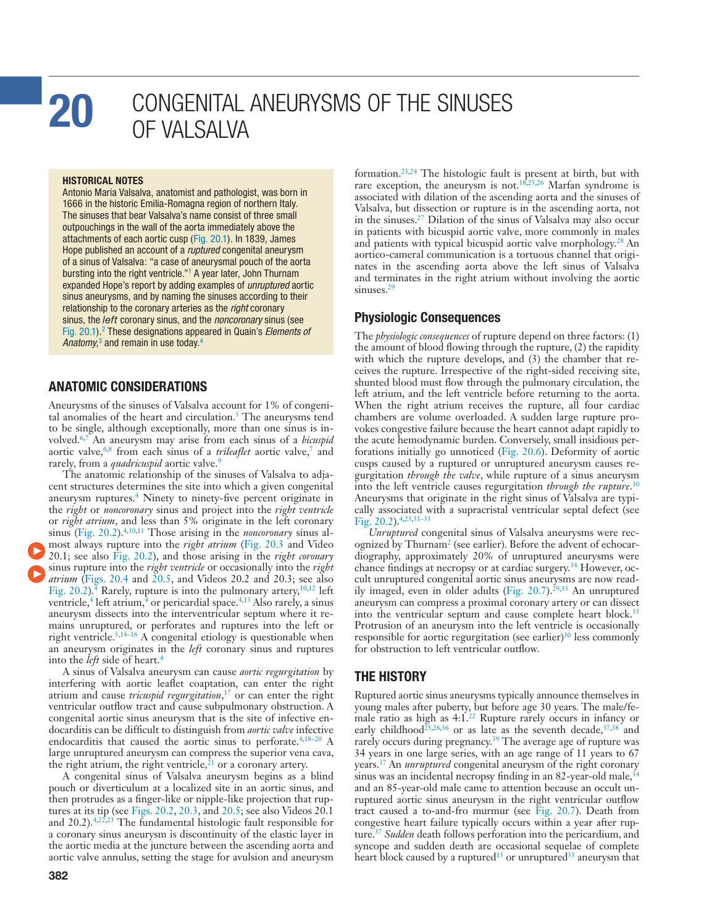

### Original PDF page 397

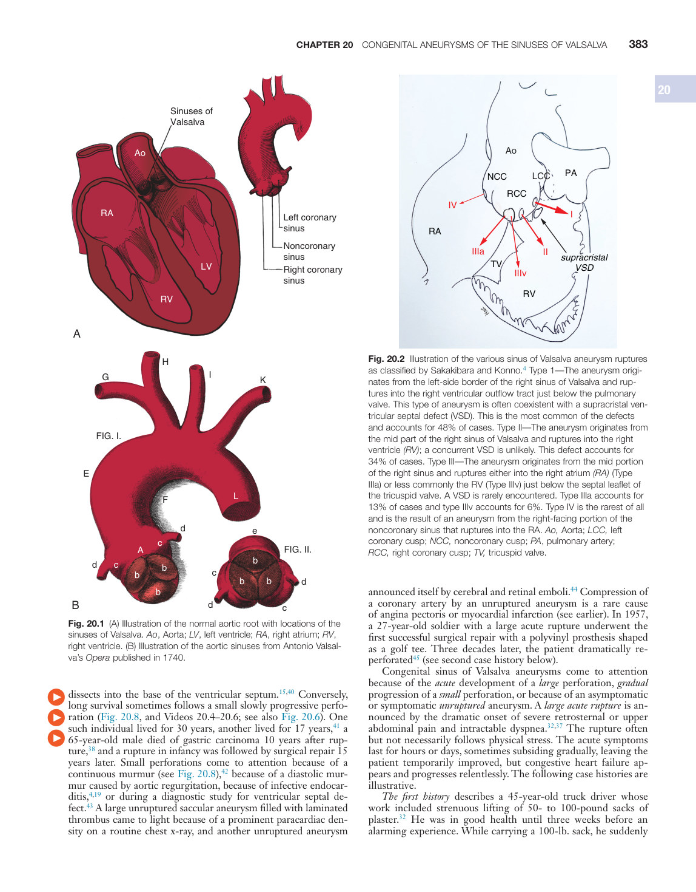

### Original PDF page 398

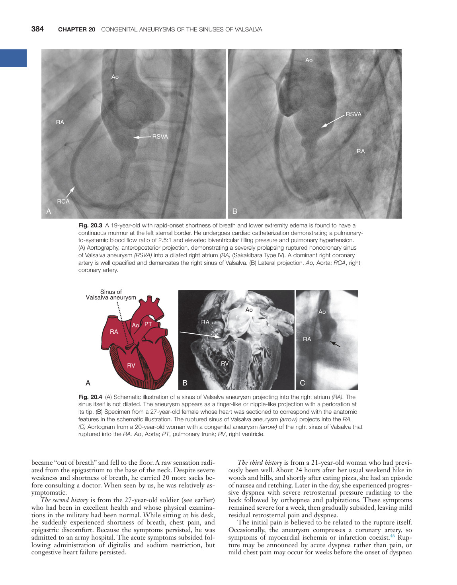

### Original PDF page 399

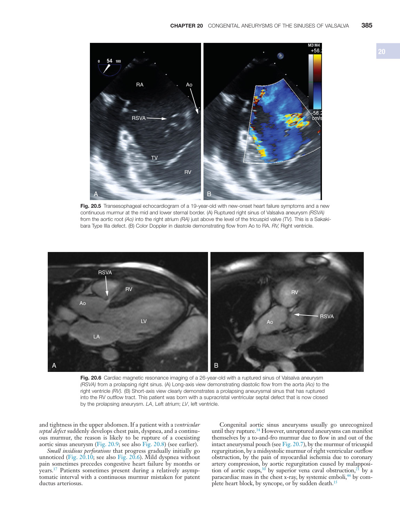

### Original PDF page 400

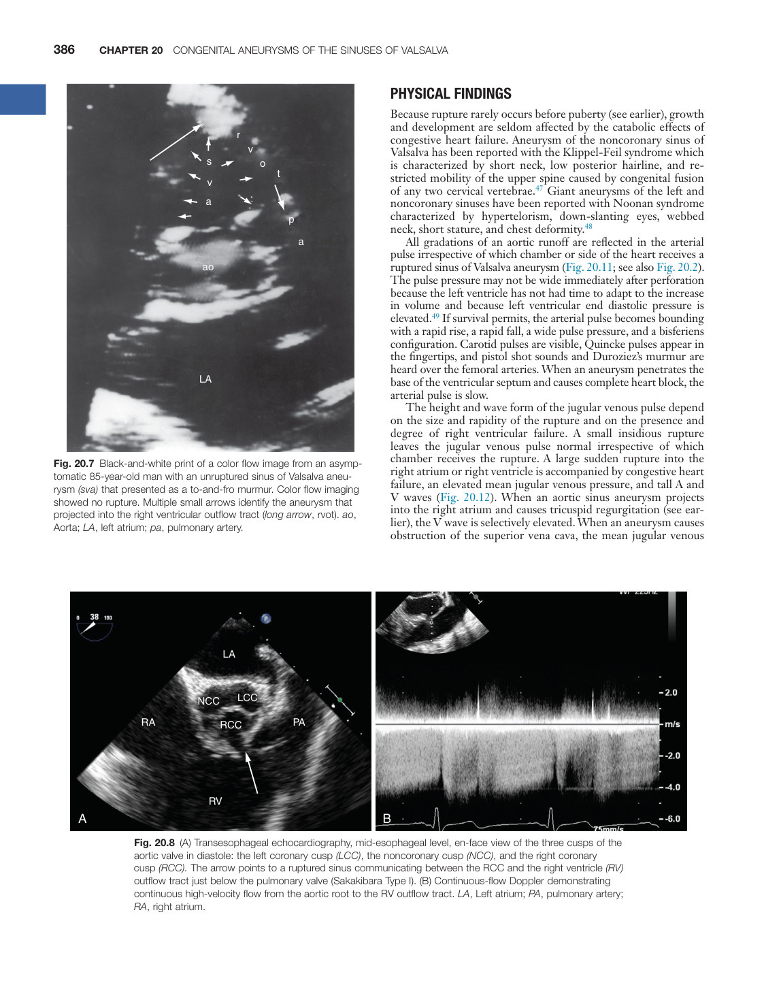

### Original PDF page 401

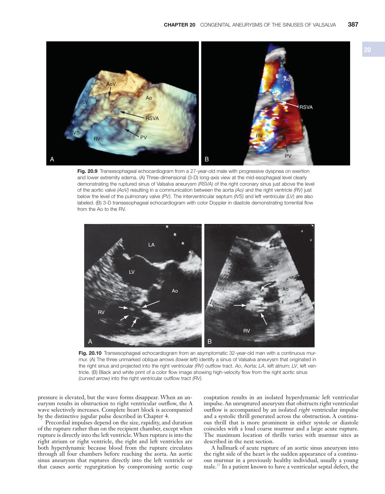

### Original PDF page 402

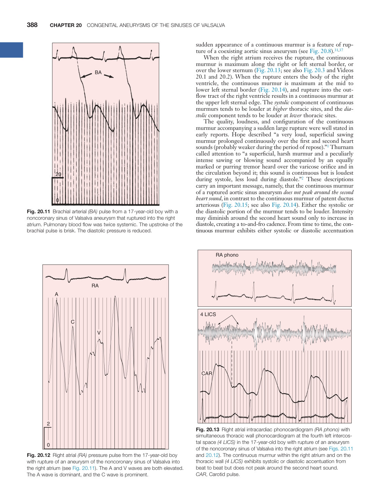

### Original PDF page 403

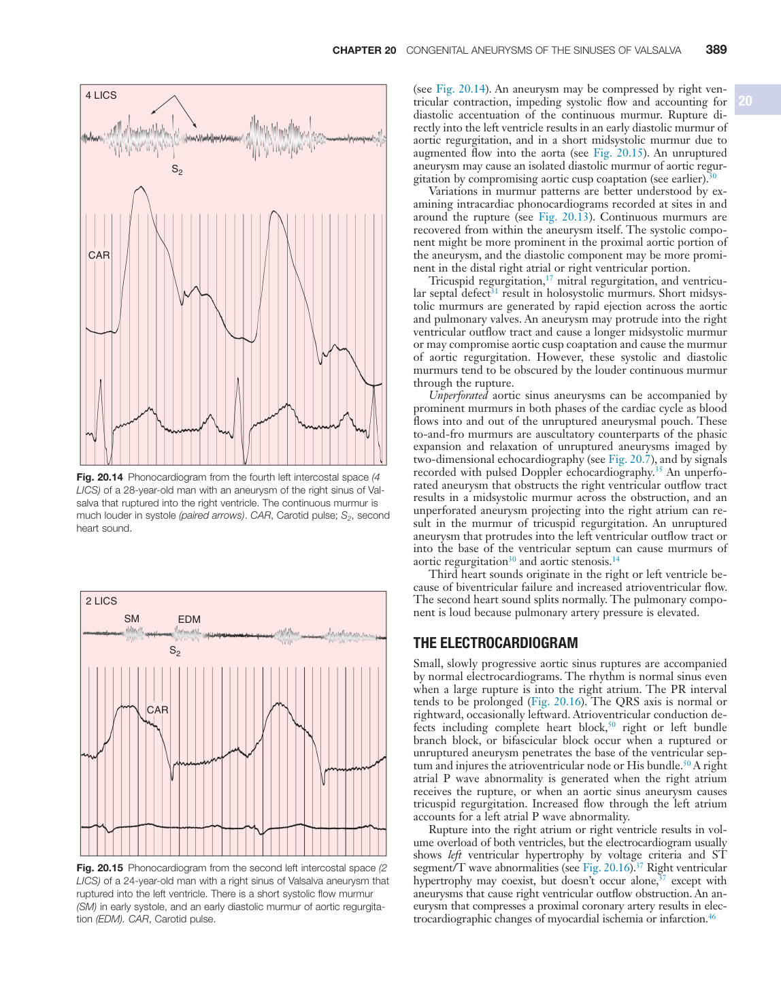

### Original PDF page 404

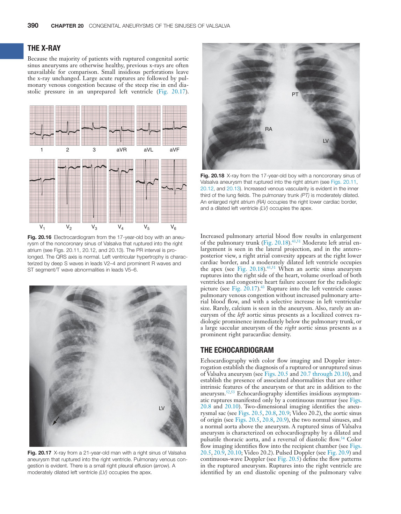

### Original PDF page 405

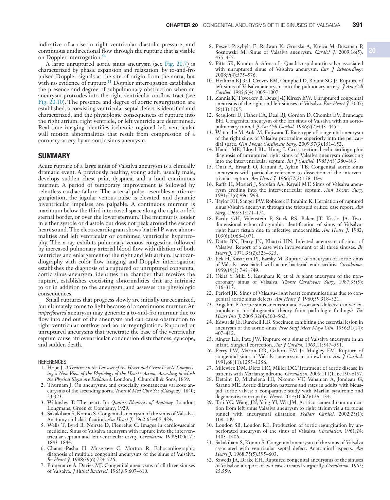

### Original PDF page 406

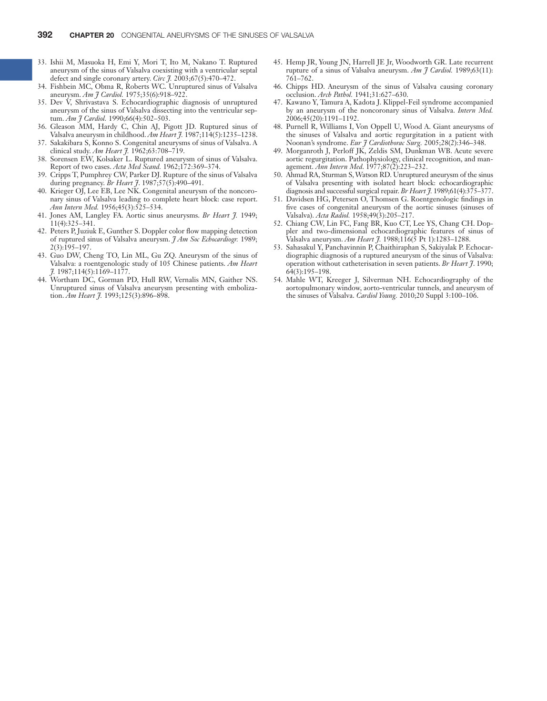

## Individual source figure views

Fig. 20.1 (A) Illustration of the normal aortic root with locations of the sinuses of Valsalva. Ao, Aorta; LV, left ventricle; RA, right atrium; RV, right ventricle. (B) Illustration of the aortic sinuses from Antonio Valsalva’s Opera published in 1740.

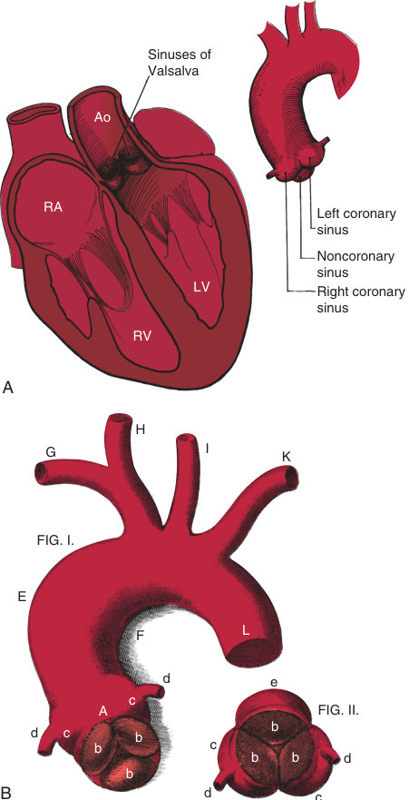

Fig. 20.1 (A) Illustration of the normal aortic root with locations of the sinuses of Valsalva. Ao, Aorta; LV, left ventricle; RA, right atrium; RV, right ventricle. (B) Illustration of the aortic sinuses from Antonio Valsalva’s Opera published in 1740.

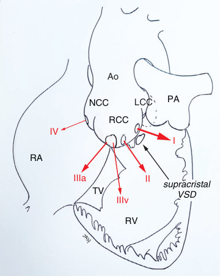

Fig. 20.2 Illustration of the various sinus of Valsalva aneurysm ruptures as classified by Sakakibara and Konno.4 Type 1—The aneurysm originates from the left-side border of the right sinus of Valsalva and ruptures into the right ventricular outflow tract just below the pulmonary valve. This type of aneurysm is often coexistent with a supracristal ventricular septal defect (VSD). This is the most common of the defects and accounts for 48% of cases. Type II—The aneurysm originates from the mid part of the right sinus of Valsalva and ruptures into the right ventricle (RV); a concurrent VSD is unlikely. This defect accounts for 34% of cases. Type III—The aneurysm originates from the mid portion of the right sinus and ruptures either into the right atrium (RA) (Type IIIa) or less commonly the RV (Type IIIv) just below the septal leaflet of the tricuspid valve. A VSD is rarely encountered. Type IIIa accounts for 13% of cases and type IIIv accounts for 6%. Type IV is the rarest of all and is the result of an aneurysm from the right-facing portion of the noncoronary sinus that ruptures into the RA. Ao, Aorta; LCC, left coronary cusp; NCC, noncoronary cusp; PA, pulmonary artery; RCC, right coronary cusp; TV, tricuspid valve.

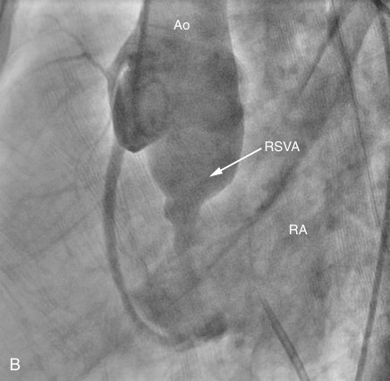

Fig. 20.3 A 19-year-old with rapid-onset shortness of breath and lower extremity edema is found to have a continuous murmur at the left sternal border. He undergoes cardiac catheterization demonstrating a pulmonaryto-systemic blood flow ratio of 2.5:1 and elevated biventricular filling pressure and pulmonary hypertension. (A) Aortography, anteroposterior projection, demonstrating a severely prolapsing ruptured noncoronary sinus of Valsalva aneurysm (RSVA) into a dilated right atrium (RA) (Sakakibara Type IV). A dominant right coronary artery is well opacified and demarcates the right sinus of Valsalva. (B) Lateral projection. Ao, Aorta; RCA , right coronary artery.

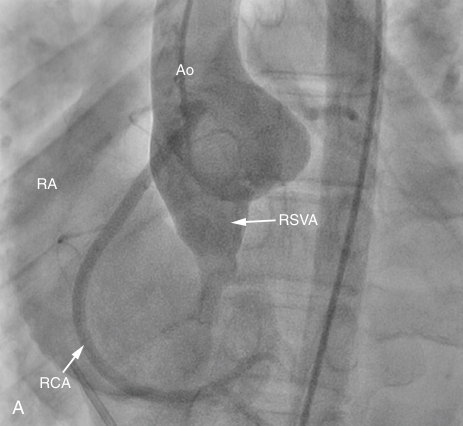

Fig. 20.3 A 19-year-old with rapid-onset shortness of breath and lower extremity edema is found to have a continuous murmur at the left sternal border. He undergoes cardiac catheterization demonstrating a pulmonaryto-systemic blood flow ratio of 2.5:1 and elevated biventricular filling pressure and pulmonary hypertension. (A) Aortography, anteroposterior projection, demonstrating a severely prolapsing ruptured noncoronary sinus of Valsalva aneurysm (RSVA) into a dilated right atrium (RA) (Sakakibara Type IV). A dominant right coronary artery is well opacified and demarcates the right sinus of Valsalva. (B) Lateral projection. Ao, Aorta; RCA , right coronary artery.

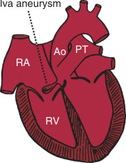

Fig. 20.4 (A) Schematic illustration of a sinus of Valsalva aneurysm projecting into the right atrium (RA). The sinus itself is not dilated. The aneurysm appears as a finger-like or nipple-like projection with a perforation at its tip. (B) Specimen from a 27-year-old female whose heart was sectioned to correspond with the anatomic features in the schematic illustration. The ruptured sinus of Valsalva aneurysm (arrow) projects into the RA. (C) Aortogram from a 20-year-old woman with a congenital aneurysm (arrow) of the right sinus of Valsalva that ruptured into the RA. Ao, Aorta; PT , pulmonary trunk; RV , right ventricle.

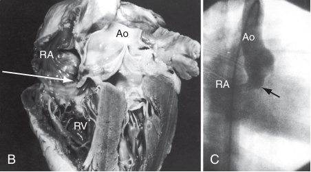

Fig. 20.4 (A) Schematic illustration of a sinus of Valsalva aneurysm projecting into the right atrium (RA). The sinus itself is not dilated. The aneurysm appears as a finger-like or nipple-like projection with a perforation at its tip. (B) Specimen from a 27-year-old female whose heart was sectioned to correspond with the anatomic features in the schematic illustration. The ruptured sinus of Valsalva aneurysm (arrow) projects into the RA. (C) Aortogram from a 20-year-old woman with a congenital aneurysm (arrow) of the right sinus of Valsalva that ruptured into the RA. Ao, Aorta; PT , pulmonary trunk; RV , right ventricle.

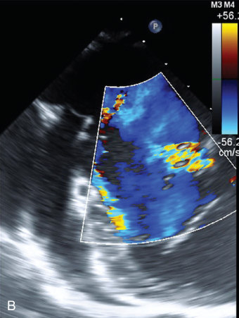

Fig. 20.5 Transesophageal echocardiogram of a 19-year-old with new-onset heart failure symptoms and a new continuous murmur at the mid and lower sternal border. (A) Ruptured right sinus of Valsalva aneurysm (RSVA) from the aortic root (Ao) into the right atrium (RA) just above the level of the tricuspid valve (TV). This is a Sakakibara Type IIIa defect. (B) Color Doppler in diastole demonstrating flow from Ao to RA. RV, Right ventricle.

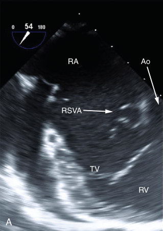

Fig. 20.5 Transesophageal echocardiogram of a 19-year-old with new-onset heart failure symptoms and a new continuous murmur at the mid and lower sternal border. (A) Ruptured right sinus of Valsalva aneurysm (RSVA) from the aortic root (Ao) into the right atrium (RA) just above the level of the tricuspid valve (TV). This is a Sakakibara Type IIIa defect. (B) Color Doppler in diastole demonstrating flow from Ao to RA. RV, Right ventricle.

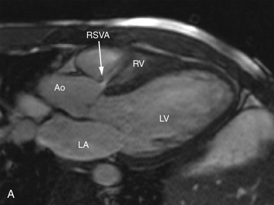

Fig. 20.6 Cardiac magnetic resonance imaging of a 26-year-old with a ruptured sinus of Valsalva aneurysm (RSVA) from a prolapsing right sinus. (A) Long-axis view demonstrating diastolic flow from the aorta (Ao) to the right ventricle (RV). (B) Short-axis view clearly demonstrates a prolapsing aneurysmal sinus that has ruptured into the RV outflow tract. This patient was born with a supracristal ventricular septal defect that is now closed by the prolapsing aneurysm. LA, Left atrium; LV, left ventricle.

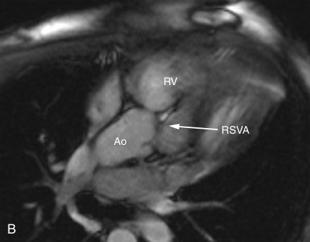

Fig. 20.6 Cardiac magnetic resonance imaging of a 26-year-old with a ruptured sinus of Valsalva aneurysm (RSVA) from a prolapsing right sinus. (A) Long-axis view demonstrating diastolic flow from the aorta (Ao) to the right ventricle (RV). (B) Short-axis view clearly demonstrates a prolapsing aneurysmal sinus that has ruptured into the RV outflow tract. This patient was born with a supracristal ventricular septal defect that is now closed by the prolapsing aneurysm. LA, Left atrium; LV, left ventricle.

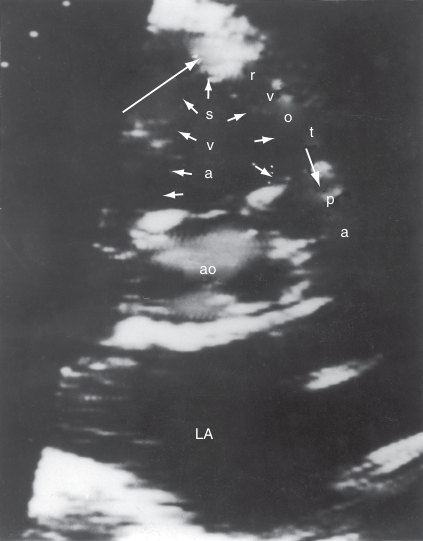

Fig. 20.7 Black-and-white print of a color flow image from an asymptomatic 85-year-old man with an unruptured sinus of Valsalva aneurysm (sva) that presented as a to-and-fro murmur. Color flow imaging showed no rupture. Multiple small arrows identify the aneurysm that projected into the right ventricular outflow tract (long arrow, rvot). ao, Aorta; LA, left atrium; pa, pulmonary artery.

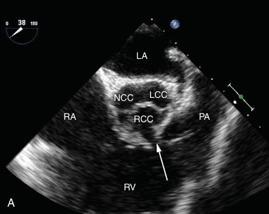

Fig. 20.8 (A) Transesophageal echocardiography, mid-esophageal level, en-face view of the three cusps of the aortic valve in diastole: the left coronary cusp (LCC), the noncoronary cusp (NCC), and the right coronary cusp (RCC). The arrow points to a ruptured sinus communicating between the RCC and the right ventricle (RV) outflow tract just below the pulmonary valve (Sakakibara Type I). (B) Continuous-flow Doppler demonstrating continuous high-velocity flow from the aortic root to the RV outflow tract. LA, Left atrium; PA, pulmonary artery; RA, right atrium.

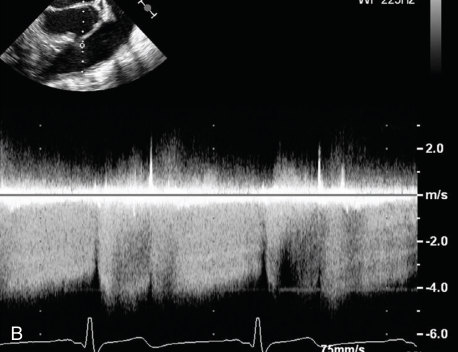

Fig. 20.8 (A) Transesophageal echocardiography, mid-esophageal level, en-face view of the three cusps of the aortic valve in diastole: the left coronary cusp (LCC), the noncoronary cusp (NCC), and the right coronary cusp (RCC). The arrow points to a ruptured sinus communicating between the RCC and the right ventricle (RV) outflow tract just below the pulmonary valve (Sakakibara Type I). (B) Continuous-flow Doppler demonstrating continuous high-velocity flow from the aortic root to the RV outflow tract. LA, Left atrium; PA, pulmonary artery; RA, right atrium.

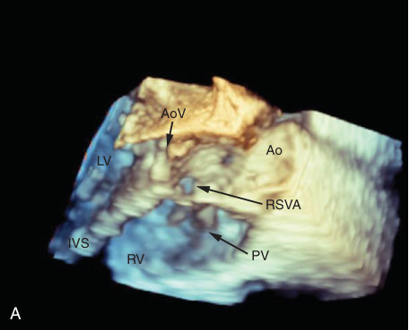

Fig. 20.9 Transesophageal echocardiogram from a 27-year-old male with progressive dyspnea on exertion and lower extremity edema. (A) Three-dimensional (3-D) long-axis view at the mid-esophageal level clearly demonstrating the ruptured sinus of Valsalva aneurysm (RSVA) of the right coronary sinus just above the level of the aortic valve (AoV) resulting in a communication between the aorta (Ao) and the right ventricle (RV) just below the level of the pulmonary valve (PV). The interventricular septum (IVS) and left ventricular (LV) are also labeled. (B) 3-D transesophageal echocardiogram with color Doppler in diastole demonstrating torrential flow from the Ao to the RV.

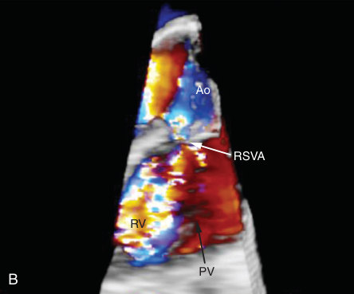

Fig. 20.9 Transesophageal echocardiogram from a 27-year-old male with progressive dyspnea on exertion and lower extremity edema. (A) Three-dimensional (3-D) long-axis view at the mid-esophageal level clearly demonstrating the ruptured sinus of Valsalva aneurysm (RSVA) of the right coronary sinus just above the level of the aortic valve (AoV) resulting in a communication between the aorta (Ao) and the right ventricle (RV) just below the level of the pulmonary valve (PV). The interventricular septum (IVS) and left ventricular (LV) are also labeled. (B) 3-D transesophageal echocardiogram with color Doppler in diastole demonstrating torrential flow from the Ao to the RV.

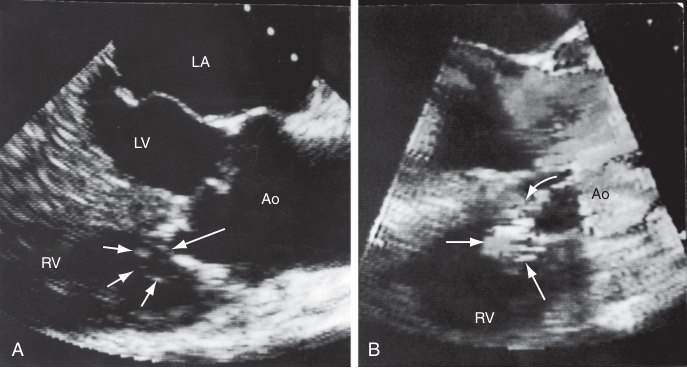

Fig. 20.10 Transesophageal echocardiogram from an asymptomatic 32-year-old man with a continuous murmur. (A) The three unmarked oblique arrows (lower left) identify a sinus of Valsalva aneurysm that originated in the right sinus and projected into the right ventricular (RV) outflow tract. Ao, Aorta; LA, left atrium; LV, left ventricle. (B) Black and white print of a color flow image showing high-velocity flow from the right aortic sinus (curved arrow) into the right ventricular outflow tract (RV).

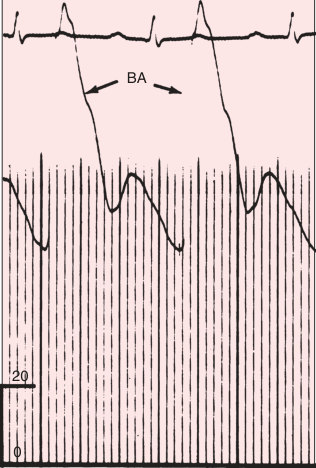

Fig. 20.11 Brachial arterial (BA) pulse from a 17-year-old boy with a noncoronary sinus of Valsalva aneurysm that ruptured into the right atrium. Pulmonary blood flow was twice systemic. The upstroke of the brachial pulse is brisk. The diastolic pressure is reduced.

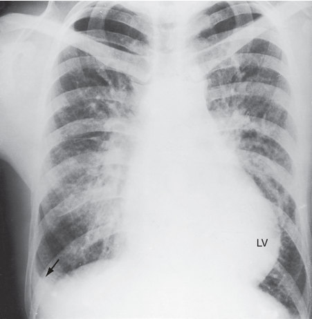

Fig. 20.17 X-ray from a 21-year-old man with a right sinus of Valsalva aneurysm that ruptured into the right ventricle. Pulmonary venous congestion is evident. There is a small right pleural effusion (arrow). A moderately dilated left ventricle (LV) occupies the apex.

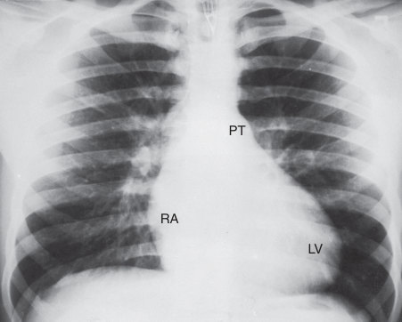

Fig. 20.18 X-ray from the 17-year-old boy with a noncoronary sinus of Valsalva aneurysm that ruptured into the right atrium (see Figs. 20.11, 20.12, and 20.13). Increased venous vascularity is evident in the inner third of the lung fields. The pulmonary trunk (PT) is moderately dilated. An enlarged right atrium (RA) occupies the right lower cardiac border, and a dilated left ventricle (LV) occupies the apex.

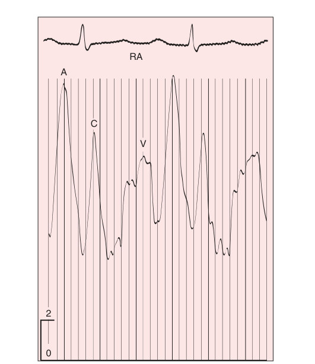

Fig. 20.12 Right atrial (RA) pressure pulse from the 17-year-old boy with rupture of an aneurysm of the noncoronary sinus of Valsalva into the right atrium (see Fig. 20.11). The A and V waves are both elevated. The A wave is dominant, and the C wave is prominent.

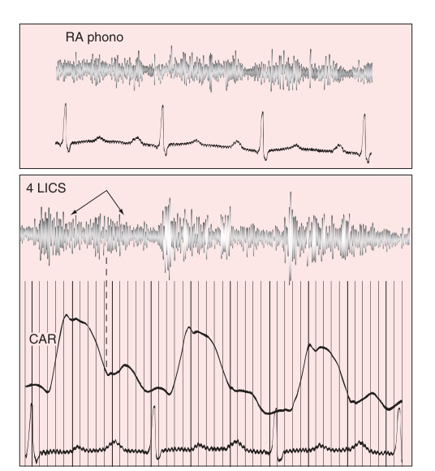

Fig. 20.13 Right atrial intracardiac phonocardiogram (RA phono) with simultaneous thoracic wall phonocardiogram at the fourth left intercostal space (4 LICS) in the 17-year-old boy with rupture of an aneurysm of the noncoronary sinus of Valsalva into the right atrium (see Figs. 20.11 and 20.12). The continuous murmur within the right atrium and on the thoracic wall (4 LICS) exhibits systolic or diastolic accentuation from beat to beat but does not peak around the second heart sound. CAR, Carotid pulse.

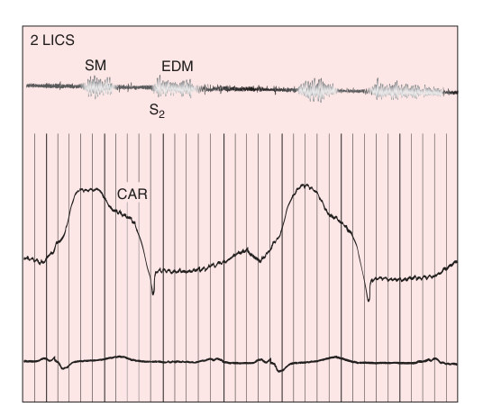

Fig. 20.15 Phonocardiogram from the second left intercostal space (2 LICS) of a 24-year-old man with a right sinus of Valsalva aneurysm that ruptured into the left ventricle. There is a short systolic flow murmur (SM) in early systole, and an early diastolic murmur of aortic regurgitation (EDM). CAR, Carotid pulse.

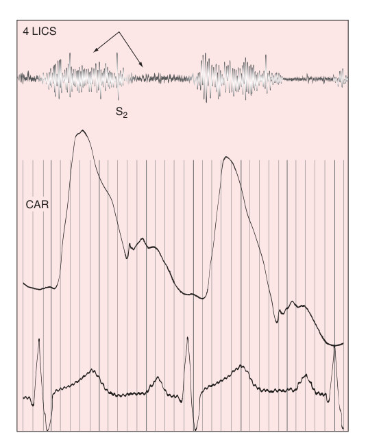

Fig. 20.14 Phonocardiogram from the fourth left intercostal space (4 LICS) of a 28-year-old man with an aneurysm of the right sinus of Valsalva that ruptured into the right ventricle. The continuous murmur is much louder in systole (paired arrows). CAR, Carotid pulse; S2, second heart sound.

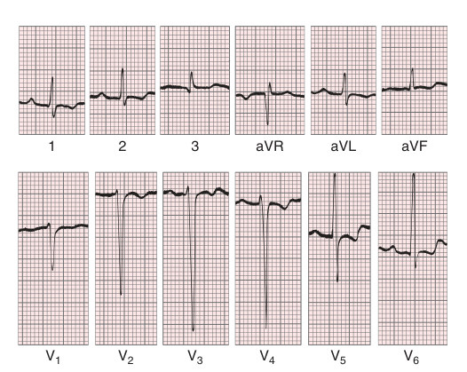

Fig. 20.16 Electrocardiogram from the 17-year-old boy with an aneurysm of the noncoronary sinus of Valsalva that ruptured into the right atrium (see Figs. 20.11, 20.12, and 20.13). The PR interval is prolonged. The QRS axis is normal. Left ventricular hypertrophy is characterized by deep S waves in leads V2–4 and prominent R waves and ST segment/T wave abnormalities in leads V5–6.
