# 28. Hypoplastic left heart
> [Source credits](../../SOURCE_CREDITS.md).

## PDF page 503 | printed page 489

28 Hypoplastic Left Heart

### HISTORICAL NOTES

In 1952, Lev called attention to congenital hypoplasia of major components of the left side of the heart.1 In 1958, Noonan and Nadas referred to these malformations as the hypoplastic left heart syndrome.2 At the severe end of the spectrum, the aortic and mitral valves are atretic, and the left ventricle is virtually nonexistent.3,4 At the mild end of the spectrum, the aortic and mitral valves are patent, and there is a lesser degree of left ventricular hypoplasia.4 The hypoplastic left heart syndrome is a genetically heterogeneous disorder that affects 1 in 5000 live births5 and accounts for 7.5% of infants with congenital heart disease.6

### ANATOMICAL CONSIDERATIONS

Aortic atresia is accompanied by a hypoplastic ascending aorta that serves as a common coronary artery (Figs. 28.1 and 28.2).7 A hypoplastic but patent mitral valve is accompanied by a hypoplastic but patent left ventricle (see Fig. 28.1). Mitral atresia is accompanied by a blind slit-like left ventricular cavity imbedded in the ventricular muscle (Figs. 28.3 and 28.4; see Fig. 28.2). An experimental model in chick embryos is represented by atresia or hypoplasia of the mitral valve, and of the left ventricle, aortic valve, and thoracic aorta.8 Hypoplasia or atresia of the mitral valve leaves the left atrium without an exit except a restrictive patent foramen ovale (see Figs. 28.1 and 28.2), which is further compromised by hypoplasia of the limbus that is rotated and deviated close to the orifice of the superior vena cava.9 An intact atrial septum is accompanied by either a thick muscular septal wall and a small left atrium, or by a thick septum secundum, a thin septum primum, and an enlarged left atrium.10 Leftward displacement of the septum primum is common.11 Alternative decompression pathways for the obstructed left atrium consist of vascular channels from a levo-atrial cardinal vein to the innominate vein, an accessory vein from left atrium to the superior vena cava, a venous connection from left atrium to hepatic veins, a coronary venous connection from left atrium to coronary sinus, and a coronary sino-septal defect.10

Vasoconstriction during early embryogenesis leads to decreased growth and development of pulmonary veins and to alveolar capillary dysplasia, forcing arterial blood to bypass the deficient capillary bed and drain through anomalous bronchial veins.12 Lymphatics are strikingly enlarged.10 Dilated pulmonary veins are thick and arterialized with multiple elastic laminae.10

The subject of the first section of this chapter is aortic atresia with a hypoplastic but perforate mitral valve (see Fig. 28.1). The second section deals with aortic atresia and mitral atresia (see Fig. 28.2). As a physiologic group, this cluster of lesions is known as hypoplastic left heart syndrome, a designation that denotes the clinical presentation and surgical management.

### AORTIC ATRESIA WITH HYPOPLASTIC BUT PERFORATE MITRAL VALVE

The pathway to the systemic circulation is a single arterial trunk represented by pulmonary artery/ductus/descending aortic continuity (see Fig. 28.1). A hypoplastic ascending aorta serves as a common coronary artery.3,13 Fifty percent to 75% of cases are accompanied by moderate coarctation of the aorta,14 located either proximal to

28

the ductus (preductal) or distal to the junction of the ductus and aortic arch (paraductal) (Fig. 28.5).14 The right ventricle is hypertrophied because it is the sole pumping chamber for the systemic and pulmonary circulations.3 It harbors histologic changes of ischemia and infarction.15 The blind hypoplastic left ventricle is thickwalled and lined with endocardial fibroelastosis.2,3 Histological abnormalities of the left ventricular myocardium include myocardial fibrosis and aortic elastic fragmentation.16 Rarely, the left ventricle is characterized by isolated apical hypoplasia with fatty replacement.17 Isovolumetric contraction causes myofiber disarray, but does not cause direct ventriculocoronary artery communications.18 Pinpoint neonatal aortic stenosis with small left ventricular cavity (see Chapter 7) is associated with intramyocardial sinusoids, but not with direct ventriculocoronary arterial communications. The left ventricle is adequately formed in the presence of a ventricular septal defect and a patent aortic valve.3,19

The tricuspid valve is abnormal in a distinct minority of patients.20 The leaflets may be dysplastic with nodular free edges, shortened chordae tendineae, obliterated interchordal spaces, and an accessory orifice, and only two leaflets may be identifiable.20 A major concern in hypoplastic left heart syndrome is that the brain is smaller and structurally less mature than normal,21 and abnormal cerebral structural and vascular development is detectable in utero.22 Scimitar syndrome has been reported in a child with a hypoplastic left heart.23

The coronary circulation has been a matter of lively interest.2,3, 7,15,24,25 A hypoplastic ascending aorta functions as a common coronary artery that receives retrograde systolic and diastolic flow from the patent ductus (see Figs. 28.1 and 28.5).2,3,15 The tubular, hypoplastic ascending aorta is not an impediment to retrograde flow into the common coronary artery, but the preductal coarctation (see Fig. 28.5) is an impediment.15 Intramyocardial coronary abnormalities analogous to those of pulmonary atresia with intact ventricular septum can be anticipated (see Chapter 21) because isovolumetric contraction generates excessive systolic pressure that acts as a driving force for direct ventriculocoronary arterial communications.7 However, the differences between pulmonary atresia with intact ventricular septum and aortic atresia with a hypoplastic but patent mitral valve are as great as the similarities.7 Myocardial sinusoids consist of restrictive vascular networks that spare the coronary arteries from the impact of high ventricular systolic pressure delivered through direct ventriculocoronary arterial communications.7 In aortic atresia with a hypoplastic but patent mitral valve (see Fig. 28.1), the intramyocardial communications are sinusoidal.7 Accordingly, epicardial and subepicardial coronary arteries do not receive the impact of high isovolumetric systolic pressure, and are spared the luminal obliterative features of pulmonary atresia with intact ventricular septum (see Chapter 21).7

### Physiologic Consequences

The physiologic consequences of hypoplastic left heart with aortic atresia and a hypoplastic but perforate mitral valve are determined by the size of the ductus arteriosus, the pulmonary vascular resistance, and the condition of the atrial septum. Constriction of the ductus compromises flow into the systemic circulation and into the hypoplastic ascending aorta, which functions as a common coronary artery (see earlier). Right ventricular function suffers because of the ischemic effects of inadequate coronary blood

## PDF page 504 | printed page 490

PDA

Asc ao

Desc ao

PT

LA

RA

MV

Aortic atresia

LV

RV

Fig. 28.1 ​Illustration of the essential anatomic and physiologic derangements in a hypoplastic left heart with aortic atresia, a hypoplastic but perforate mitral valve (MV), and a hypoplastic left ventricle (LV). There is retrograde filling of the hypoplastic ascending aorta (Asc ao) that functions as a common coronary artery. The right ventricle (RV) serves the pulmonary circulation through the pulmonary trunk (PT) and perfuses the systemic circulation through pulmonary trunk/ductus/ descending aortic continuity. A patent foramen ovale is the only exit for the left atrium (LA; curved arrow). Desc ao, descending aorta; PDA, patent ductus arteriosus; RA, right atrium.

PDA Asc ao Desc ao

PT LA

Mitral atresia

RA

LV

Aortic atresia

RV

Fig. 28.2 ​Illustration of the essential anatomic and physiologic derangements of a hypoplastic left heart with aortic atresia and mitral atresia. The left ventricular cavity (LV) is a rudimentary blind slit. The physiologic derangements are as described in Fig. 28.1. Asc ao, Ascending aorta; Desc ao, descending aorta; LA, left atrium; PDA, patent ductus; PT, pulmonary trunk; RA, right atrium; RV, right ventricle.

flow15,26 because of pulmonary hypertension caused by the nonrestrictive ductus, because of high pressure in the obstructed left atrium, and because a large left ventricular mass has disadvantageous effects on right ventricular end-diastolic volume and right ventricular wall motion. Right ventricular mechanics are negatively influenced by left ventricular endocardial fibroelastosis.27

*

PA LV

RV

A

PDA

LPA PA

* LA

RA

RV

B

Fig. 28.3 ​Echocardiogram from a 1-day-old male with aortic atresia and mitral atresia. (A) Subcostal short-axis view demonstrating a severely hypoplastic left ventricle (LV) which is a blind slit-like cavity. The right ventricle (RV) is the dominant ventricle and is enlarged and hypertrophied. The pulmonary artery (PA) emerges anteriorly from the RV. The aortic valve is atretic and the aortic root is hypoplastic (*) and serves as a conduit to the coronary arteries. (B) Subcostal long-axis view demonstrates the small posterior left atrium (LA) which an atrial septal defect allowing unimpeded communication with the right atrium (RA). The PA is seen emerging anteriorly from the RV and then branches with a well-formed left pulmonary artery (LPA) well visualized. There is a very large patent ductus arteriosus (PDA) that communicates the PA to the distal aortic arch.

Competence of the tricuspid valve is important for survival, yet tricuspid dysplasia with multiple papillary muscles is common (see earlier). Low pulmonary vascular resistance permits increased pulmonary arterial blood flow that is received by the obstructed left atrium from which the only effective egress is a restrictive patent foramen ovale (see earlier) (see Fig. 28.1). In the presence of an adequate interatrial communication, increased pulmonary blood flow makes a large volume of oxygenated left atrial blood available for mixing in the right atrium, so systemic arterial

## PDF page 505 | printed page 491

RV

TV

F

LV

*

MV

PV LA

A

RA

TV RV

* F

LA

PV

MA

B

Fig. 28.4 ​(A) ECG gated chest CT angiogram, axial view, of a 33-year-old with hypoplastic left heart syndrome that has undergone Fontan palliation. This patient has a hypoplastic left ventricle (LV) with a mildly hypoplastic mitral valve (MV). The right ventricle (RV) is a dilated and hypertrophied systemic ventricle, the tricuspid valve (TV) is well formed. There is a large nonrestrictive atrial level communication (*), the left atrium (LA) and a right sided pulmonary vein (PV) are labeled. The patient has a lateral tunnel Fontan (F) that connects the inferior vena cava to the pulmonary artery. (B) In contrast, this 26-year-old with hypoplastic left heart syndrome has complete mitral atresia (MA) and absence of the LV. This patient has undergone an extracardiac Fontan (F) that has a stent within it.

oxygen saturation is relatively high. However, preferential blood flow into the lungs through the ductus is accompanied by a recip - rocal fall in systemic blood flow and a shock-like state. When pulmonary vascular resistance is high, systemic blood flow is maintained at the price of increasing cyanosis.

### The History

Hypoplastic left heart comprises 7% to 8% of symptomatic heart disease in the first year of life28 and is responsible for 25% of

28

Ao

AV

Fig. 28.5 ​Lateral aortogram in a male neonate with atresia of the aortic valve (AV) and a hypoplastic but perforate mitral valve. The catheter is across a patent ductus arteriosus. The hypoplastic ascending aorta functioned as a common coronary artery. The large, unmarked arrow at the upper right identifies coarctation of the aorta (Ao).

cardiac deaths in the first week of life.6 The malformation has been called the most malignant form of congenital heart disease, a conclusion underscored by an average lifespan of only 5 to 14 days. 3,6 , 29 Precarious survival depends on three tenuous variables—patency of the ductus arteriosus, pulmonary vascular resistance, and an adequate interatrial communication.30 Tachypnea, tachycardia, and cyanosis are present during the brief interval of ductal patency.2 8 Risk is greatest during the period of normal ductal closure when systemic blood flow and coronary blood flow decrease or cease altogether. A fall in pulmonary vascular resistance diverts blood from the systemic circulation into the pulmonary circulation and augments flow into the obstructed left atrium. A rise in pulmonary vascular resistance improves systemic blood flow at the price of hypoxemia. Ninety-five percent of afflicted infants die within the first month of life.6,31 Two extraordinary survivals include a 22-year-old woman with a large patent ductus arteriosus and an adequate-sized atrial septal defect, and a 24-year-old man with a patent ductus arteriosus and a ventricular septal defect.3 2

There is male prevalence of 55% to 70% in aortic atresia with a hypoplastic but perforate mitral valve.2,3,33 Maternal age tends to be above average, with a mean of 31 years. First-degree relatives of probands have an increased prevalence of congenital heart dis - ease.28 The malformation is occasionally familial34,35 and has been reported in siblings as an autosomal recessive inheritance. 3 6 A mosaic chromosomal 22q11 deletion is associated with hypoplastic left heart,3 7, 38 and genetic disorders include Turner syndrome (see later), trisomy 13, trisomy 18, and trisomy 21.39–41 Concordance has been reported in a monochromic twin pregnancy.42

Reports of geographic clustering implicate environmental factors.4 3 Eastern Wisconsin has increased rates of hypoplastic left heart syndrome,44,45 a region in Baltimore, Maryland contains twice the expected frequency, 46 and the island of Malta has a de - creased incidence. 47

Hypoxemia and hypotension are associated with hypoxicischemic cerebral injury and intracranial hemorrhage. 4 8 Major

## PDF page 506 | printed page 492

and minor congenital central nervous system abnormalities include microcephaly, micrencephaly, abnormal cortical mantle, agenesis of the corpus callosum, and holoprosencephaly.49 The overall frequency of extracardiac anomalies, including central nervous system abnormalities, is 12% to 37%.39

### Physical Findings

Tachypnea and cyanosis are present even during the brief period of ductal patency (see earlier). Cyanosis is mildest when an adequate interatrial communication and a patent ductus are accompanied by low pulmonary vascular resistance and increased pulmonary blood flow. A fall in pulmonary vascular resistance is accompanied by systemic hypoperfusion and a shock-like state. Cyanosis is profound when pulmonary resistance is high and the ductus is restrictive.

The hypoplastic left heart syndrome can be associated with Turner syndrome (see Chapter 8),39–41,50 Rubenstein-Taybi syndrome—which is a Mendelian dominant disorder characterized by mental retardation, growth retardation, typical facies, cognitive defects, broad thumbs and toes, short stature,51,52—the abdominal distension of Hirschsprung’s disease,53 and Kubuki syndrome, characterized by eversion of the lower lateral eyelids, arched eyebrows with the lateral one-third dispersed or sparse, depressed nasal tip, prominent ears, skeletal anomalies, short stature, and mental retardation.54 Hypoplasia of the left heart is commonly observed in concurrence with left-sided congenital diaphragmatic hernia55 and intrathoracic herniation of the liver.56

Brachial and carotid arterial pulses remain palpable because the ascending aortic tubular hypoplasia does not include the arch (see Figs. 28.1 and 28.2).2 Femoral artery pulses are palpable because of pulmonary trunk/ductal/descending aortic continuity (see Figs. 28.1 and 28.2), and because coarctation is usually paraductal or mild preductal (see Fig. 28.5). When low pulmonary vascular resistance diverts blood from the systemic circulation, all arterial pulses diminish, if not vanish.

Increased right atrial A and V waves are not amenable to clinical assessment. Precordial palpation is dominated by a striking right ventricular impulse and a palpable pulmonary closure sound.

Auscultatory signs are unimpressive in contrast to the dramatic clinical picture. Murmurs are usually absent (Fig. 28.6),2,28 or a soft midsystolic murmur is generated by ejection into the dilated hypertensive pulmonary trunk. A long systolic murmur is likely to be caused by tricuspid regurgitation. The second heart sound is single because the aortic valve is atretic and is loud because of pulmonary hypertension (see Fig. 28.6). A triple rhythm is caused by summation of right ventricular third and fourth heart sounds (see Fig. 28.6).

### The Electrocardiogram

Tall peaked right atrial P waves are common (Figs. 28.7 and 28.8) but not invariable (Fig. 28.9). The PR interval is occasionally prolonged (see Fig. 28.7).57 Left axis deviation is uncommon despite abnormalities of the left bundle branch, and left bundle branch block is unknown.2,58 Alteration in the branching portion of the His bundle and the left bundle branch depend on the size of the left ventricular cavity, with major changes reserved for absence or virtual absence of a cavity.59 When the left ventricular cavity is small but not slit-like, the left bundle branch has a peripheral Purkinje network, and the right bundle branch is normal in size.59 Wolff-Parkinson-White bypass tracks are rare even though there are persistent connections of the left bundle branch to ventricular septal musculature with abundant Mahaim fibers.59 Q waves are occasionally absent from the lateral precordial and inferior leads.57

LSE 2 LICS

S1 S1 S2 S2

Fig. 28.6 ​ Phonocardiograms from a 9-day-old male with aortic atresia and a hypoplastic but perforate mitral valve. Necropsy findings were as illustrated in Figure 28.1. A loud filling sound (unmarked arrow) with after-vibrations at the lower left sternal edge (LSE) was caused by summation of right ventricular third and fourth heart sounds. The second heart sound (S2) in the second left intercostal space (2 LICS) was loud because of pulmonary hypertension, and single because the aortic valve was atretic. S1, First heart sound.

1

2 3 aVR aVL aVF

V3R V V2 V3 V4 V5 V6 1

Fig. 28.7 ​Electrocardiogram from the 9-day-old male with aortic atresia and a hypoplastic but perforate mitral valve. The phonocardiogram is shown in Fig. 28.6. Tall peaked right atrial P waves are present in leads 2, 3, aVF and V2–4. Right atrial enlargement is indicated by qR complexes in leads V3R and V1. The PR interval is prolonged. Right ventricular hypertrophy is reflected in and the tall monophasic R waves in right and mid precordial leads, and the vertical QRS axis. The splintered QRS in leads V5–6 is due to a right ventricular conduction defect. The left ventricle is not represented.

## PDF page 507 | printed page 493

1

2 3 aVR aVL aVF

V3R V V2 V3 V4 V5 V6 1

Fig. 28.8 ​Electrocardiogram from a 3-week-old male with aortic atresia and a hypoplastic but perforate mitral valve. Necropsy findings were as illustrated in Fig. 28.1. Tall peaked right atrial P waves are present in leads 2, 3, aVF and V1–3. Right ventricular dominance is indicated by the prominent R waves in leads V2–4, the upright T waves in right precordial leads, and the rightward QRS axis.

1

2 3 aVR aVL aVF

V1 V2 V3 V4 V5 V6

Fig. 28.9 ​ Electrocardiogram from a 4-week-old male with aortic atresia and a hypoplastic but perforate mitral valve. P waves are normal despite an enlarged right atrium and a high-pressure left atrium. Right ventricular hypertrophy is indicated by right axis deviation, a tall R wave in lead V1, and a deep S wave in lead V6. Large RS complexes in leads V2–5 suggest biventricular hypertrophy. The left ventricle at necropsy was thick-walled with a small cavity lined with endocardial fibroelastosis.

28

PT

RA

RV

A

PT

Ao

RV

B

Fig. 28.10 ​X-ray and angiocardiogram from a 2-day-old male with aortic atresia and a hypoplastic but perforate mitral valve. Necropsy findings were as illustrated in Fig. 28.1. (A) Pulmonary venous congestion is prominent. The right atrium (RA) and right ventricle (RV) are enlarged, the pulmonary trunk (PT) is dilated, and the ascending aorta is conspicuously absent. (B) The right ventricular angiocardiogram visualizes the large pulmonary trunk (PT) with pulmonary artery/ductus/ descending aortic continuity. Ao, Descending aorta.

The QRS reflects pure right ventricular hypertrophy (see Figs. 28.7 and 28.8), and common abnormalities include a widened QRS complex and abnormal frontal plane QRS axis.57 Left ventricular hypertrophy is infrequent despite an increase in mass because of the effect of a low end-diastolic volume on the magnitude of the QRS.60 Left ventricular forces are absent when the cavity is small but may be present when the cavity is more adequately developed (see Fig. 28.9).

### The X-Ray

Dilation of the right atrium and right ventricle are responsible for cardiac enlargement (Fig. 28.10).61 The shadow of the hypoplastic ascending aorta is necessarily absent, and the shadow of the dilated hypertensive pulmonary trunk is necessarily prominent (see Fig. 28.10). Pulmonary venous congestion is the rule,61 but the amount of lung available for assessment may be limited by remarkable cardiomegaly, even in the first 24 to 48 hours of life.

### The Echocardiogram

Echocardiography with color flow imaging and Doppler interrogation establishes the diagnosis of hypoplastic left heart with aortic atresia and a hypoplastic but perforate mitral valve.62,63 Fetal echocardiography permits the diagnosis as early as the 24th

## PDF page 508 | printed page 494

RV Ao

LV

LA MV

A

MV

LV

LA

RA

RV

B

Fig. 28.11 ​(A) Echocardiogram (parasternal long axis) from a male neonate with aortic atresia and a hypoplastic but perforate mitral valve (MV). The hypoplastic left ventricle (LV) is lined with endocardial fibroelastosis. The ascending aorta (Ao) is hypoplastic, the left atrium (LA) is thick-walled but not enlarged, and the right ventricle (RV) is dilated. (B) Subcostal four chamber view shows a hypoplastic patent MV, a hypoplastic left ventricular cavity with endocardial fibroelastosis, a nondilated left atrium, and a dilated right ventricle (RV) and right atrium (RA).

week of gestation.64 The four-chamber view can be used to visualize the hypoplastic left ventricle and assess tricuspid valve morphology and functionality.63 Flow patterns in the fetal ductus can be monitored,65 and the condition of the atrial septum can be determined. A hypoplastic but perforate mitral valve communicates with a small left ventricle that gives rise to an atretic aortic valve and a tubular hypoplastic ascending aorta (Fig. 28.11). The ventricular septum and the free wall of the hypoplastic left ventricle are thick and immobile, and the small cavity is lined with endocardial fibroelastosis (see Fig. 28.11). Coarctation is identified as a thin discrete posterior ledge extending across the lumen of the aorta at the level of the ductus arteriosus, or as kinking and narrowing at the site of ductal insertion. The left atrium is small and thick-walled (see Fig. 28.11). Function of the enlarged hypertrophied right ventricle, and competence of the tricuspid valve can be established (see Figs. 28.11 and 28.3),66,67 and ductus/pulmonary trunk/descending aortic continuity is confirmed by color flow imaging. Doppler interrogation establishes retrograde flow into the hypoplastic ascending aorta, and occasionally

identifies biphasic flow in the proximal coronary arteries. Direct ventriculocoronary arterial communications can be identified.68

### Summary

Hypoplastic left heart represented by aortic atresia and a hypoplastic but perforate mitral valve presents as a listless, tachypneic often moribund male neonate with mild to profound cyanosis. Brachiocephalic and femoral arterial pulses are palpable. A right ventricular impulse is conspicuous. Auscultation detects a soft pulmonary midsystolic murmur, a tricuspid regurgitant murmur, or, more often than not, no murmur at all. The electrocardiogram displays right atrial P waves and right ventricular hypertrophy. The x-ray discloses pulmonary venous congestion, dilatation of the right atrium, and right ventricle and pulmonary trunk, but conspicuous absence of the ascending aorta. Echocardiography with color flow imaging and Doppler interrogation identifies a hypoplastic perforate mitral valve, a hypoplastic left ventricle lined with endocardial fibroelastosis, a tubular hypoplastic ascending aorta guarded by an atretic aortic valve, and a single arterial trunk that consists of pulmonary artery/ductus/descending aortic continuity.

### HYPOPLASTIC LEFT HEART WITH AORTIC AND MITRAL ATRESIA

The major physiologic derangements are similar to those of aortic atresia with a hypoplastic but perforate mitral valve, but there are anatomic differences and subtle clinical differences. The attachment of the valve of the fossa ovalis may be misaligned relative to the muscular rim of the fossa. Mitral atresia is represented by an imperforate macroscopic membrane on the floor of the left atrium, or a microscopic fibrous remnant between the floor of the left atrium and a putative left ventricular cavity represented by a minute blind slit (see Fig. 28.2).3,69,70 Myofiber disarray does not occur because isovolumetric contraction does not occur.3,7,70 Because there is no left ventricular cavity to develop excessive systolic pressure, ventriculocoronary arterial connections do not develop, and epicardial and subepicardial coronary arteries are neither thickened nor tortuous.7 A ventricular septal defect or absence of the right ventricular sinus are associated with a wellformed left ventricle.3 The physiologic consequences are the same, and longevity patterns are similar,71 whether aortic atresia is accompanied by mitral atresia or by a hypoplastic but perforate mitral valve (see Figs. 28.1 and 28.2). Male sex predominates, although female twins have been reported.33

Subtle clinical points favor hypoplastic left heart with mitral atresia. The electrocardiogram shows pure right ventricular hypertrophy devoid of left ventricular potentials because a left ventricular cavity does not exist (Fig. 28.12).60 The left bundle branch does not develop a Purkinje network because there is no left ventricular cavity in which to do so.59 Mahaim fibers are the only extensions of the left bundle branch that maintain continuity with ventricular septal muscle.59 The right bundle branch enlarges because it is responsible for conduction to virtually all of the ventricular muscle mass.59 These unusual pathways of atrioventricular conduction and ventricular activation are not represented in the electrocardiogram. The echocardiogram and crosssectional imaging identify atresia of both the aortic and mitral valves, and occasionally identify the blind rudimentary left ventricular cavity (see Figs. 28.3 and 28.4).

## PDF page 509 | printed page 495

13. Lopez W. Aortic atresia without significant hypoplasia of the ascend-

14. Elzenga NJ, Gittenberger-de Groot AC. Coarctation and related

15. Lloyd TR, Marvin WJ Jr. Age at death in the hypoplastic left heart

16. Jiang Y, Xu Y, Tang J, Xia H. Assessment of structural and functional

1

2 3 aVR aVL aVF

17. Flett AS, Elliott PM, Moon JC. Images in cardiovascular medicine.

18. Bulkley BH, Weisfeldt ML, Hutchins GM. Isometric cardiac con-

19. Pellegrino PA, Thiene G. Aortic valve atresia with a normally devel-

20. Martinez R. Assessment of the tricuspid valve in hypoplastic left heart

21. Licht DJ, Shera DM, Clancy RR, et al. Brain maturation is delayed

22. Kinnear C, Haranal M, Shannon P, Jaeggi E, Chitayat D, Mital S.

V1 V2 V3 V4 V5 V6

23. McBride ME, Huddleston CB, Balzer DT, Goel D, Gazit AZ. Hypo-

Fig. 28.12 ​Electrocardiogram from a 3-week-old male with aortic atresia and mitral atresia. Necropsy findings were as illustrated in Fig. 28.2. Peaked right atrial P waves are present in leads 2 and 3. Right atrial enlargement is indicated by the qR pattern in lead V1. Pure right ventricular hypertrophy is reflected in tall monophasic R waves in leads V2–4 and the vertical and superior QRS axis.

24. Raghib G, Bloemendaal RD, Kanjuh VI, Edwards JE. Aortic atresia

25. Roberson DA, Cui W, Cuneo BF, Van Bergen AH, Javois AJ, Bharati

REFERENCES 1. Lev M. Pathologic anatomy and interrelationship of hypoplasia of

26. van der Horst RL, Hastreiter AR. Ascending aortic obstruction of

the aortic tract complexes. Lab Invest. 1952;1(1):61–70. 2. Noonan JA, Nadas AS. The hypoplastic left heart syndrome; an

27. Natarajan S, Szwast A, Tian Z, McCann M, Soffer D, Rychik J. Right

analysis of 101 cases. Pediatr Clin North Am. 1958;5(4):1029–1056. 3. Roberts WC, Perry LW, Chandra RS, Myers GE, Shapiro SR, Scott

28. Bailey LL, Gundry SR. Hypoplastic left heart syndrome. Pediatr Clin

LP. Aortic valve atresia: a new classification based on necropsy study of 73 cases. Am J Cardiol. 1976;37(5):753–756. 4. Tchervenkov CI, Jacobs JP, Weinberg PM, et al. The nomenclature,

29. Cohen DM, Allen HD. New developments in the treatment of hypo-

definition and classification of hypoplastic left heart syndrome. Cardiol Young. 2006;16(4):339–368. 5. Bondy CA. Hypoplastic left heart syndrome. N Engl J Med. 2010;

30. Hoshino K, Ogawa K, Hishitani T, Kitazawa R, Uehara R. Hypoplas-

362(21):2026–2028. 6. Fyler DC. Report of the New England Regional Infant Cardiac Pro-

31. Barron DJ, Kilby MD, Davies B, Wright JGC, Jones TJ, Brawn WJ.

gram. Pediatrics. 1980;65(2 Pt 2):375–461. 7. Baffa JM, Chen SL, Guttenberg ME, Norwood WI, Weinberg PM.

32. Maxwell P, Somerville J. Aortic atresia: survival to adulthood without

Coronary artery abnormalities and right ventricular histology in hypoplastic left heart syndrome. J Am Coll Cardiol. 1992;20(2):350–358. 8. Harh JY, Paul MH, Gallen WJ, Friedberg DZ, Kaplan S. Experimen-

33. Bjornstad PG, Michalsen H. Coexistent mitral and aortic valve atresia

34. Kojima H, Ogimi Y, Mizutani K, Nishimura Y. Hypoplastic-left-

tal production of hypoplastic left heart syndrome in the chick embryo. Am J Cardiol. 1973;31(1):51–56. 9. Remmell-Dow DR, Bharati S, Davis JT, Lev M, Allen HD. Hypopla-

35. Rao SS, Gootman N, Platt N. Familial aortic atresia. Report of a case

sia of the eustachian valve and abnormal orientation of the limbus of the foramen ovale in hypoplastic left heart syndrome. Am Heart J. 1995;130(1):148–152. 10. Rychik J, Rome JJ, Collins MH, DeCampli WM, Spray TL. The

36. Grobman W, Pergament E. Isolated hypoplastic left heart syndrome

37. Grossfeld PD. The genetics of hypoplastic left heart syndrome. Car-

hypoplastic left heart syndrome with intact atrial septum: atrial morphology, pulmonary vascular histopathology and outcome. J Am Coll Cardiol. 1999;34(2):554–560. 11. Park MV, Fedderly RT, Frommelt PC, et al. Leftward displacement

38. Consevage MW, Seip JR, Belchis DA, Davis AT, Baylen BG, Rogan

39. Natowicz M, Chatten J, Clancy R, et al. Genetic disorders and major

of septum primum in hypoplastic left heart syndrome. Pediatr Cardiol. 2013;34(4):942–947. 12. Rabah R, Poulik JM. Congenital alveolar capillary dysplasia with

40. Natowicz M, Kelley RI. Association of Turner syndrome with hypo-

misalignment of pulmonary veins associated with hypoplastic left heart syndrome. Pediatr Dev Pathol. 2001;4(2):167–174.

28

ing aorta. Am J Roentgenol Radium Ther Nucl Med. 1964;92:888–892.

aortic arch anomalies in hypoplastic left heart syndrome. Int J Cardiol. 1985;8(4):379–393.

syndrome: multivariate analysis and importance of the coronary arteries. Am Heart J. 1989;117(6):1337–1343.

abnormalities of the myocardium and the ascending aorta in fetus with hypoplastic left heart syndrome. Biomed Res Int. 2016;2016: 2616729.

Cardiovascular magnetic resonance of isolated left ventricular apical hypoplasia. Circulation. 2008;117(25):e504-e505.

traction. a possible cause of the disorganized myocardial pattern of idiopathic hypertrophic subaortic stenosis. N Engl J Med. 1977;296(3): 135–139.

oped left ventricle. Chest. 1976;69(1):121–122.

syndrome. Cardiol Young. 2004;14 Suppl 1:27–33.

in infants with complex congenital heart defects. J Thorac Cardiovasc Surg. 2009;137(3):529–536; discussion 536–537.

Abnormal fetal cerebral and vascular development in hypoplastic left heart syndrome. Prenat Diagn. 2019;39(1):38–44.

plastic left heart associated with scimitar syndrome. Pediatr Cardiol. 2009;30(7):1037–1038.

and premature closure of foramen ovale. Myocardial sinusoids and coronary arteriovenous fistula serving as outflow channel. Am Heart J. 1965;70(4):476–480.

S. Extensive left ventricular to coronary artery connections in hypoplastic left heart syndrome. Echocardiography. 2008;25(5):529–533.

retrograde coronary blood flow in aortic atresia. Am Heart J. 1981;101(3):345–346.

ventricular mechanics in the fetus with hypoplastic left heart syndrome. J Am Soc Echocardiogr. 2013;26(5):515–520.

North Am. 1990;37(1):137–150.

plastic left heart syndrome. Curr Opin Cardiol. 1997;12(1):44–50.

tic left heart syndrome: duration of survival without surgical intervention. Am Heart J. 1999;137(3):535–542.

Hypoplastic left heart syndrome. Lancet. 2009;374(9689):551–564.

surgery. Br Heart J. 1990;64(5):336–337.

with intact ventricular septum in sibs. Br Heart J. 1974;36(3):302–306.

heart syndrome in siblings. Lancet. 1969;2(7622):701.

of aortic atresia in siblings. Am J Dis Child. 1969;118(6):919–922.

in three siblings. Obstet Gynecol. 1996;88(4 Pt 2):673–675.

diol Young. 1999;9(6):627–632.

PK. Association of a mosaic chromosomal 22q11 deletion with hypoplastic left heart syndrome. Am J Cardiol. 1996;77(11):1023–1025.

extracardiac anomalies associated with the hypoplastic left heart syndrome. Pediatrics. 1988;82(5):698–706.

plastic left-heart syndrome. Am J Dis Child. 1987;141(2):218–220.

## PDF page 510 | printed page 496

41. van Egmond H, Orye E, Praet M, Coppens M, Devloo-Blancquaert

56. Stressig R, Fimmers R, Axt-Fliedner R, Gembruch U, Kohl T. Asso-

A. Hypoplastic left heart syndrome and 45X karyotype. Br Heart J. 1988;60(1):69–71. 42. Andrews RE, Cook AC, Yates RWM. Concordance for hypoplastic

left heart syndrome in a monochorionic twin pregnancy. Heart. 2003;89(4):e13. 43. Morris CD, Outcalt J, Menashe VD. Hypoplastic left heart syn-

57. Monaco MA, Liberman L, Starc TJ, Silver ES. Defining the electro-

drome: natural history in a geographically defined population. Pediatrics. 1990;85(6):977–983. 44. Davies B, d’Udekem Y, Ukoumunne OC, Algar EM, Newgreen DF,

58. Soloff LA. Congenital aortic atresia; report of the first case with left

Brizard CP. Differences in extra-cellular matrix and myocyte homeostasis between the neonatal right ventricle in hypoplastic left heart syndrome and truncus arteriosus. Eur J Cardiothorac Surg. 2008; 34(4):738–744. 45. Cronk CE, Pelech AN, Malloy ME, McCarver DG. Excess birth

59. Bharati S, Lev M. The conduction system in hypoplasia of the aortic

60. Voukydis PC. Effect of intracardiac blood on the electrocardiogram.

prevalence of hypoplastic left heart syndrome in eastern Wisconsin for birth cohorts 1997–1999. Birth Defects Research. 2004;70(3): 114–120. 46. Kuehl KS, Loffredo CA. A cluster of hypoplastic left heart malforma-

61. Bardo DM, Frankel DG, Applegate KE, Murphy DJ, Saneto RP.

62. Ludman P, Foale R, Alexander N, Nihoyannopoulos P. Cross sec-

tion in Baltimore, Maryland. Pediatr Cardiol. 2006;27(1):25–31. 47. Grech V. Decreased prevalence of hypoplastic left heart syndrome in

Malta. Pediatr Cardiol. 1999;20(5):355–357. 48. Glauser TA, Rorke LB, Weinberg PM, Clancy RR. Acquired neuro-

63. Nguyen T, Miller M, Gonzalez J, et al. Echocardiography of hypo-

pathologic lesions associated with the hypoplastic left heart syndrome. Pediatrics. 1990;85(6):991–1000. 49. Glauser TA, Rorke LB, Weinberg PM, Clancy RR. Congenital brain

64. Simpson JM. Hypoplastic left heart syndrome. Ultrasound Obstet

65. Rychik J, Gullquist SD, Jacobs ML, Norwood WI. Doppler echocar-

anomalies associated with the hypoplastic left heart syndrome. Pediatrics. 1990;85(6):984–990. 50. Reis PM, Punch MR, Bove EL, van de Ven CJ. Outcome of infants

with hypoplastic left heart and Turner syndromes. Obstet Gynecol. 1999;93(4):532–535. 51. Bartsch O, Wagner A, Hinkel GK, et al. FISH studies in 45 patients

66. Kimball TR, Witt SA, Khoury PR, Daniels SR. Automated echocar-

with Rubinstein-Taybi syndrome: deletions associated with polysplenia, hypoplastic left heart and death in infancy. Eur J Hum Genet. 1999; 7(7):748–756. 52. Hanauer D, Argilla M, Wallerstein R. Rubinstein-Taybi syndrome

67. Altmann K, Printz BF, Solowiejczky DE, Gersony WM, Quaegebeur

and hypoplastic left heart. Am J Med Genet. 2002;112(1):109–111. 53. Ahola J-A, Koivusalo A, Sairanen H, Jokinen E, Rintala RJ, Pakarinen

68. Bensky AS, Covitz W. Echocardiographic demonstration of a ven-

MP. Increased incidence of Hirschsprung’s disease in patients with hypoplastic left heart syndrome—a common neural crest-derived etiology? J Pediatr Surg. 2009;44(7):1396–1400. 54. Kung GC, Chang PM, Sklansky MS, Randolph LM. Hypoplastic left

69. Gittenberger-de Groot AC, Wenink AC. Mitral atresia. Morphologi-

heart syndrome in patients with Kabuki syndrome. Pediatr Cardiol. 2010;31(1):138–141. 55. Hautala J, Karstunen E, Ritvanen A, et al. Congenital diaphragmatic

70. Kanjuh V, Eliot RS, Edwards JE. Coexistent mitral and aortic valvu-

hernia with heart defect has a high risk for hypoplastic left heart syndrome and major extra-cardiac malformations: 10-year national cohort from Finland. Acta Obstet Gynecol Scand. 2018;97(2):204–211.

71. Ehrlich M, Bierman FZ, Ellis K, Gersony WM. Hypoplastic left

ciation of intrathoracic herniation of the liver with left heart hypoplasia in fetuses with a left diaphragmatic hernia but not in fetuses with a right diaphragmatic hernia. Ultraschall Med. 2011;32 Suppl 2:E151-E156.

cardiogram in the neonate with hypoplastic left heart syndrome. Pediatr Cardiol. 2015;36(5):1014–1018.

axis deviation of the electrocardiogram. Am Heart J. 1949;37(1): 123–128.

tract complex. Circulation. 1979;59(6):1324–1332.

N Engl J Med. 1974;291(12):612–616.

Hypoplastic left heart syndrome. Radiographics. 2001;21(3):705–717.

tional echocardiographic identification of hypoplastic left heart syndrome and differentiation from other causes of right ventricular overload. Br Heart J. 1990;63(6):355–361.

plastic left heart syndrome. Cardiol Young. 2011;21 Suppl 2:28–37.

Gynecol. 2000;15(4):271–278.

diographic analysis of flow in the ductus arteriosus of infants with hypoplastic left heart syndrome: relationship of flow patterns to systemic oxygenation and size of interatrial communication. J Am Soc Echocardiogr. 1996;9(2):166–173.

diographic analysis of systemic ventricular performance in hypoplastic left heart syndrome. J Am Soc Echocardiogr. 1996;9(5):629–636.

J, Apfel HD. Two-dimensional echocardiographic assessment of right ventricular function as a predictor of outcome in hypoplastic left heart syndrome. Am J Cardiol. 2000;86(9):964–968.

triculocoronary artery communication in a neonate with hypoplastic left heart syndrome. J Am Soc Echocardiogr. 1994;7(3 Pt 1):324–326.

cal details. Br Heart J. 1984;51(3):252–258.

lar atresia: a pathologic study of 14 cases. Am J Cardiol. 1965;15: 611–621.

heart syndrome: report of a unique survivor. J Am Coll Cardiol. 1986;7(2):361–365.

## Complete original page views

Searchable extraction can lose mathematical symbols or reading order. These original pages preserve source layout, symbols and credits.

### Original PDF page 503

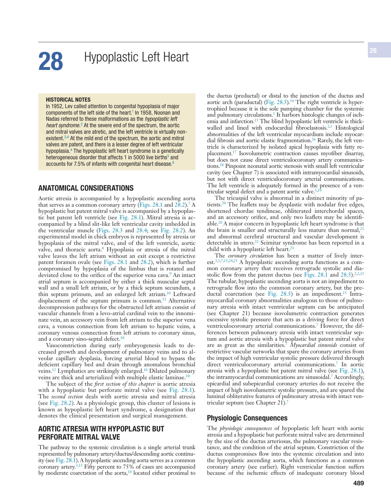

### Original PDF page 504

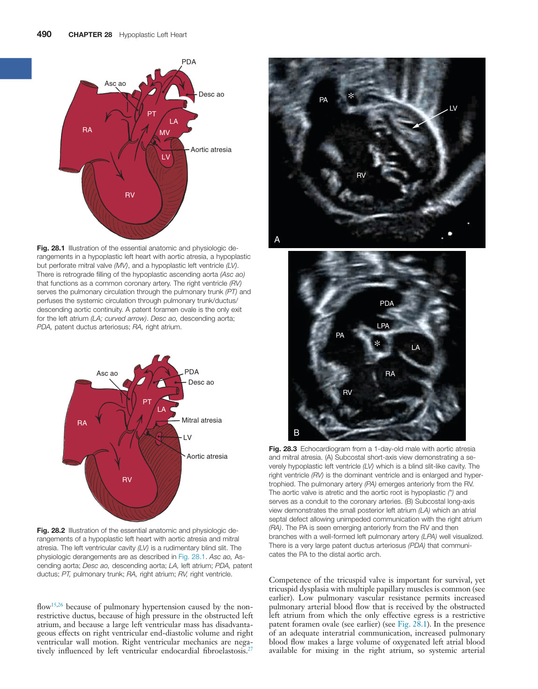

### Original PDF page 505

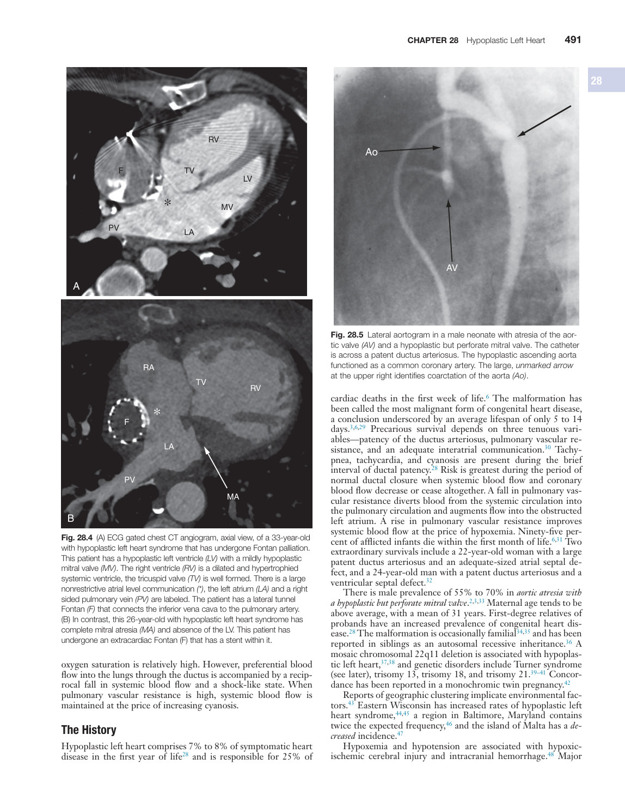

### Original PDF page 506

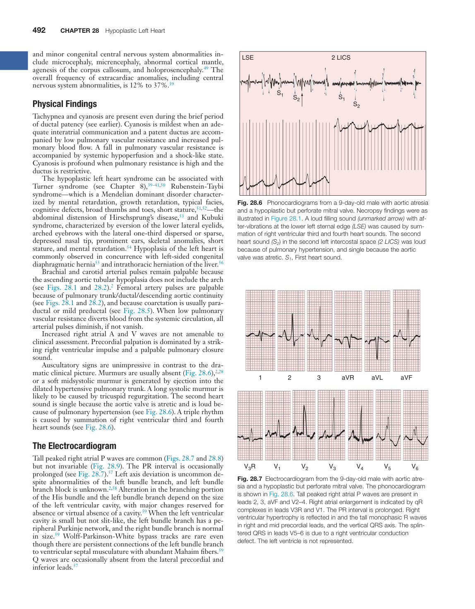

### Original PDF page 507

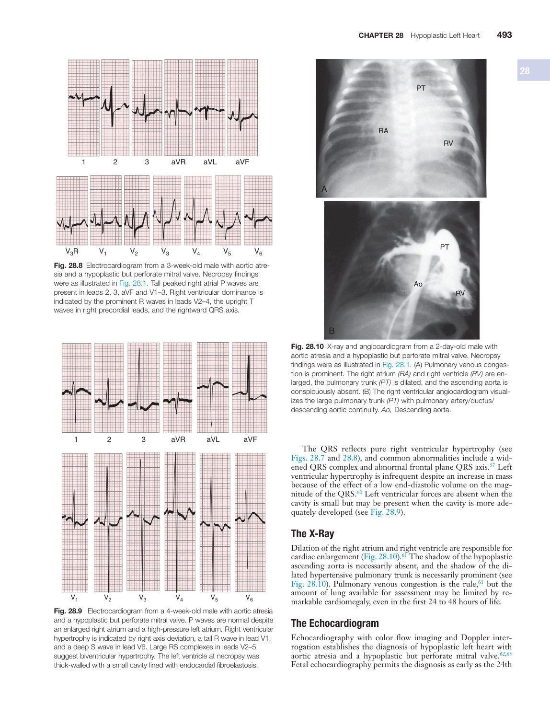

### Original PDF page 508

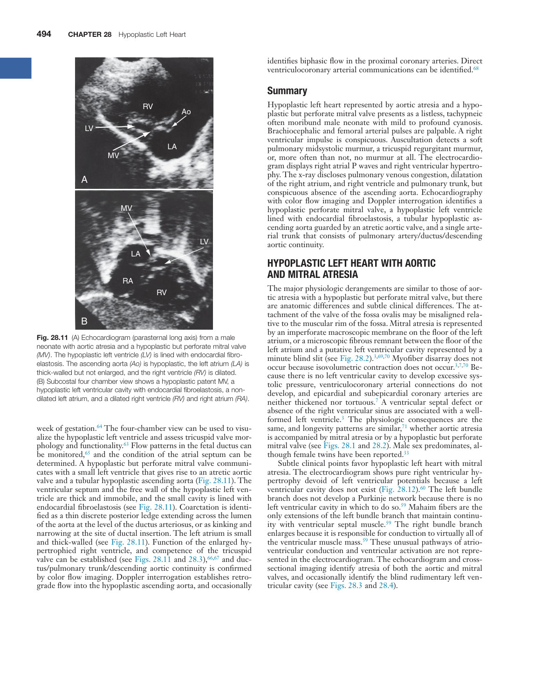

### Original PDF page 509

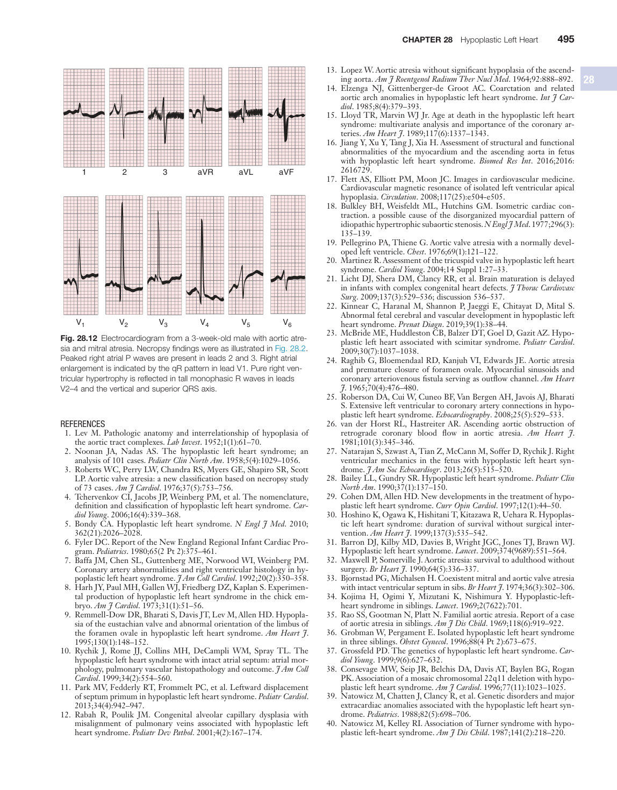

### Original PDF page 510

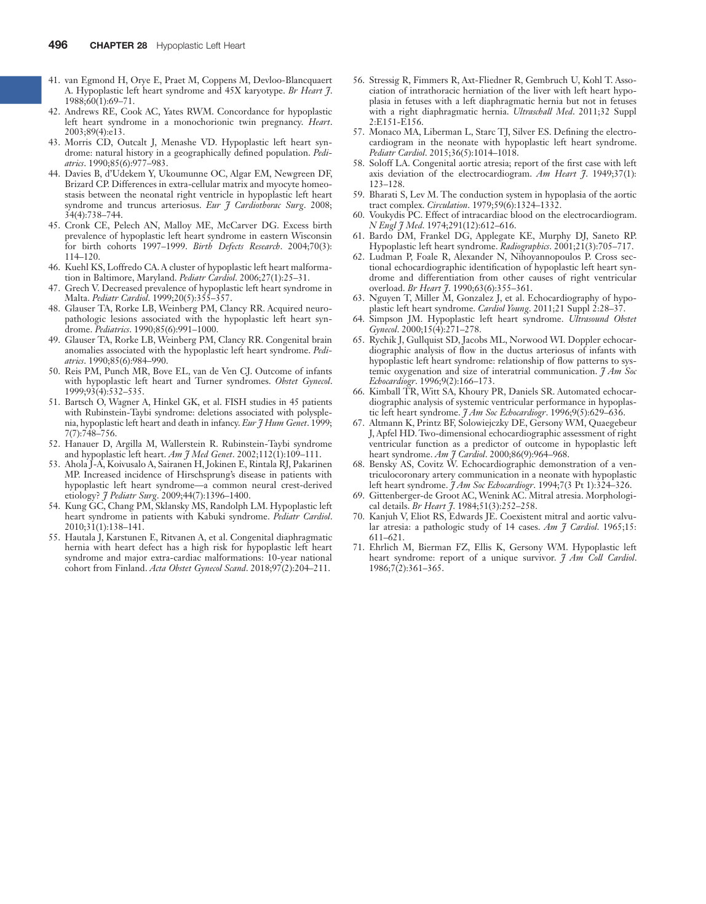

## Individual source figure views

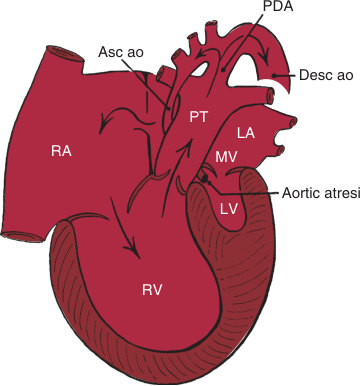

Fig. 28.1 ​Illustration of the essential anatomic and physiologic derangements in a hypoplastic left heart with aortic atresia, a hypoplastic but perforate mitral valve (MV), and a hypoplastic left ventricle (LV). There is retrograde filling of the hypoplastic ascending aorta (Asc ao) that functions as a common coronary artery. The right ventricle (RV) serves the pulmonary circulation through the pulmonary trunk (PT) and perfuses the systemic circulation through pulmonary trunk/ductus/ descending aortic continuity. A patent foramen ovale is the only exit for the left atrium (LA; curved arrow). Desc ao, descending aorta; PDA, patent ductus arteriosus; RA, right atrium.

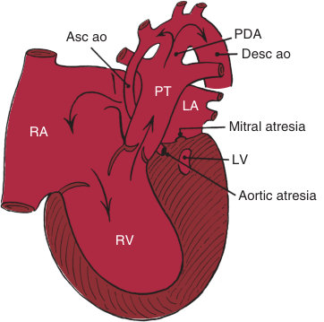

Fig. 28.2 ​Illustration of the essential anatomic and physiologic derangements of a hypoplastic left heart with aortic atresia and mitral atresia. The left ventricular cavity (LV) is a rudimentary blind slit. The physiologic derangements are as described in Fig. 28.1. Asc ao, Ascending aorta; Desc ao, descending aorta; LA, left atrium; PDA, patent ductus; PT, pulmonary trunk; RA, right atrium; RV, right ventricle.

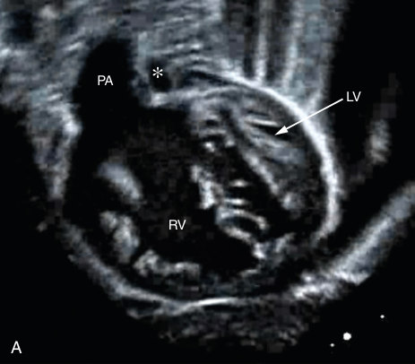

Fig. 28.3 ​Echocardiogram from a 1-day-old male with aortic atresia and mitral atresia. (A) Subcostal short-axis view demonstrating a severely hypoplastic left ventricle (LV) which is a blind slit-like cavity. The right ventricle (RV) is the dominant ventricle and is enlarged and hypertrophied. The pulmonary artery (PA) emerges anteriorly from the RV. The aortic valve is atretic and the aortic root is hypoplastic (*) and serves as a conduit to the coronary arteries. (B) Subcostal long-axis view demonstrates the small posterior left atrium (LA) which an atrial septal defect allowing unimpeded communication with the right atrium (RA). The PA is seen emerging anteriorly from the RV and then branches with a well-formed left pulmonary artery (LPA) well visualized. There is a very large patent ductus arteriosus (PDA) that communicates the PA to the distal aortic arch.

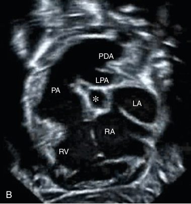

Fig. 28.3 ​Echocardiogram from a 1-day-old male with aortic atresia and mitral atresia. (A) Subcostal short-axis view demonstrating a severely hypoplastic left ventricle (LV) which is a blind slit-like cavity. The right ventricle (RV) is the dominant ventricle and is enlarged and hypertrophied. The pulmonary artery (PA) emerges anteriorly from the RV. The aortic valve is atretic and the aortic root is hypoplastic (*) and serves as a conduit to the coronary arteries. (B) Subcostal long-axis view demonstrates the small posterior left atrium (LA) which an atrial septal defect allowing unimpeded communication with the right atrium (RA). The PA is seen emerging anteriorly from the RV and then branches with a well-formed left pulmonary artery (LPA) well visualized. There is a very large patent ductus arteriosus (PDA) that communicates the PA to the distal aortic arch.

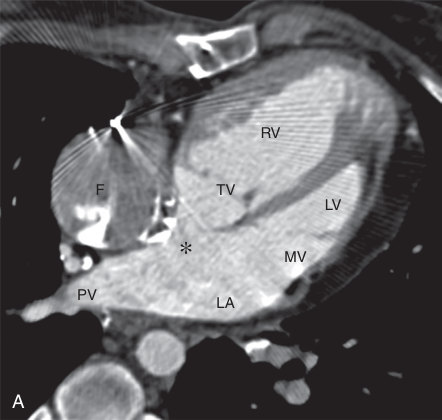

Fig. 28.4 ​(A) ECG gated chest CT angiogram, axial view, of a 33-year-old with hypoplastic left heart syndrome that has undergone Fontan palliation. This patient has a hypoplastic left ventricle (LV) with a mildly hypoplastic mitral valve (MV). The right ventricle (RV) is a dilated and hypertrophied systemic ventricle, the tricuspid valve (TV) is well formed. There is a large nonrestrictive atrial level communication (*), the left atrium (LA) and a right sided pulmonary vein (PV) are labeled. The patient has a lateral tunnel Fontan (F) that connects the inferior vena cava to the pulmonary artery. (B) In contrast, this 26-year-old with hypoplastic left heart syndrome has complete mitral atresia (MA) and absence of the LV. This patient has undergone an extracardiac Fontan (F) that has a stent within it.

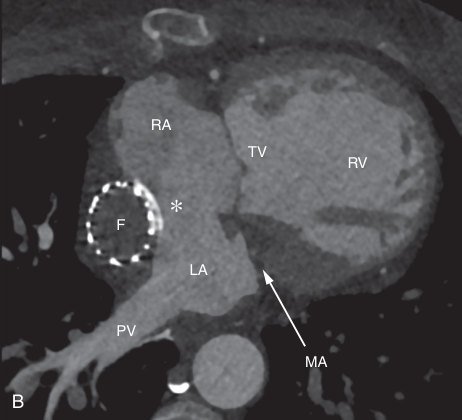

Fig. 28.4 ​(A) ECG gated chest CT angiogram, axial view, of a 33-year-old with hypoplastic left heart syndrome that has undergone Fontan palliation. This patient has a hypoplastic left ventricle (LV) with a mildly hypoplastic mitral valve (MV). The right ventricle (RV) is a dilated and hypertrophied systemic ventricle, the tricuspid valve (TV) is well formed. There is a large nonrestrictive atrial level communication (*), the left atrium (LA) and a right sided pulmonary vein (PV) are labeled. The patient has a lateral tunnel Fontan (F) that connects the inferior vena cava to the pulmonary artery. (B) In contrast, this 26-year-old with hypoplastic left heart syndrome has complete mitral atresia (MA) and absence of the LV. This patient has undergone an extracardiac Fontan (F) that has a stent within it.

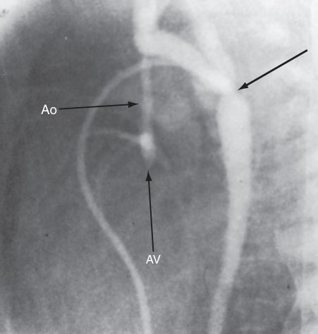

Fig. 28.5 ​Lateral aortogram in a male neonate with atresia of the aortic valve (AV) and a hypoplastic but perforate mitral valve. The catheter is across a patent ductus arteriosus. The hypoplastic ascending aorta functioned as a common coronary artery. The large, unmarked arrow at the upper right identifies coarctation of the aorta (Ao).

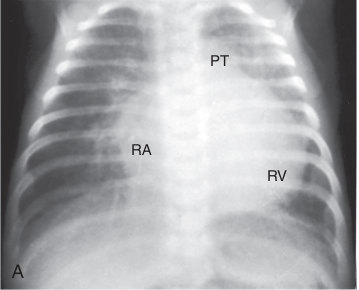

Fig. 28.10 ​X-ray and angiocardiogram from a 2-day-old male with aortic atresia and a hypoplastic but perforate mitral valve. Necropsy findings were as illustrated in Fig. 28.1. (A) Pulmonary venous congestion is prominent. The right atrium (RA) and right ventricle (RV) are enlarged, the pulmonary trunk (PT) is dilated, and the ascending aorta is conspicuously absent. (B) The right ventricular angiocardiogram visualizes the large pulmonary trunk (PT) with pulmonary artery/ductus/ descending aortic continuity. Ao, Descending aorta.

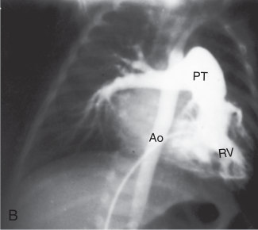

Fig. 28.10 ​X-ray and angiocardiogram from a 2-day-old male with aortic atresia and a hypoplastic but perforate mitral valve. Necropsy findings were as illustrated in Fig. 28.1. (A) Pulmonary venous congestion is prominent. The right atrium (RA) and right ventricle (RV) are enlarged, the pulmonary trunk (PT) is dilated, and the ascending aorta is conspicuously absent. (B) The right ventricular angiocardiogram visualizes the large pulmonary trunk (PT) with pulmonary artery/ductus/ descending aortic continuity. Ao, Descending aorta.

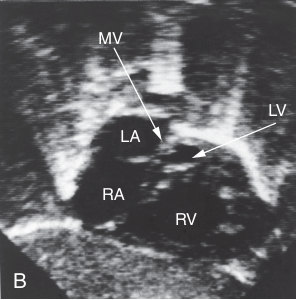

Fig. 28.11 ​(A) Echocardiogram (parasternal long axis) from a male neonate with aortic atresia and a hypoplastic but perforate mitral valve (MV). The hypoplastic left ventricle (LV) is lined with endocardial fibroelastosis. The ascending aorta (Ao) is hypoplastic, the left atrium (LA) is thick-walled but not enlarged, and the right ventricle (RV) is dilated. (B) Subcostal four chamber view shows a hypoplastic patent MV, a hypoplastic left ventricular cavity with endocardial fibroelastosis, a nondilated left atrium, and a dilated right ventricle (RV) and right atrium (RA).

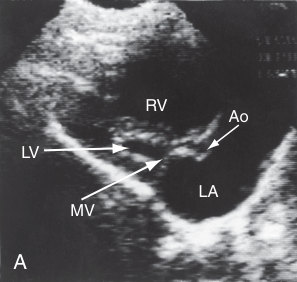

Fig. 28.11 ​(A) Echocardiogram (parasternal long axis) from a male neonate with aortic atresia and a hypoplastic but perforate mitral valve (MV). The hypoplastic left ventricle (LV) is lined with endocardial fibroelastosis. The ascending aorta (Ao) is hypoplastic, the left atrium (LA) is thick-walled but not enlarged, and the right ventricle (RV) is dilated. (B) Subcostal four chamber view shows a hypoplastic patent MV, a hypoplastic left ventricular cavity with endocardial fibroelastosis, a nondilated left atrium, and a dilated right ventricle (RV) and right atrium (RA).

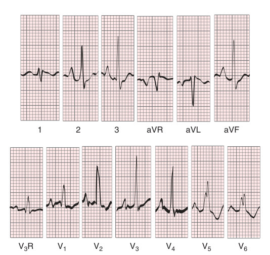

Fig. 28.7 ​Electrocardiogram from the 9-day-old male with aortic atresia and a hypoplastic but perforate mitral valve. The phonocardiogram is shown in Fig. 28.6. Tall peaked right atrial P waves are present in leads 2, 3, aVF and V2–4. Right atrial enlargement is indicated by qR complexes in leads V3R and V1. The PR interval is prolonged. Right ventricular hypertrophy is reflected in and the tall monophasic R waves in right and mid precordial leads, and the vertical QRS axis. The splintered QRS in leads V5–6 is due to a right ventricular conduction defect. The left ventricle is not represented.

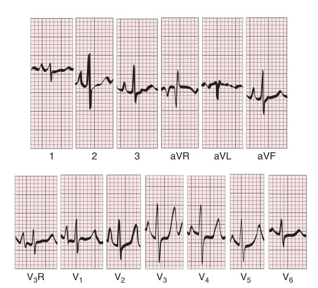

Fig. 28.8 ​Electrocardiogram from a 3-week-old male with aortic atresia and a hypoplastic but perforate mitral valve. Necropsy findings were as illustrated in Fig. 28.1. Tall peaked right atrial P waves are present in leads 2, 3, aVF and V1–3. Right ventricular dominance is indicated by the prominent R waves in leads V2–4, the upright T waves in right precordial leads, and the rightward QRS axis.

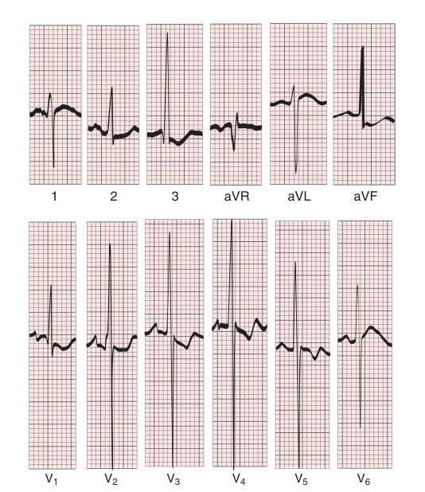

Fig. 28.9 ​ Electrocardiogram from a 4-week-old male with aortic atresia and a hypoplastic but perforate mitral valve. P waves are normal despite an enlarged right atrium and a high-pressure left atrium. Right ventricular hypertrophy is indicated by right axis deviation, a tall R wave in lead V1, and a deep S wave in lead V6. Large RS complexes in leads V2–5 suggest biventricular hypertrophy. The left ventricle at necropsy was thick-walled with a small cavity lined with endocardial fibroelastosis.

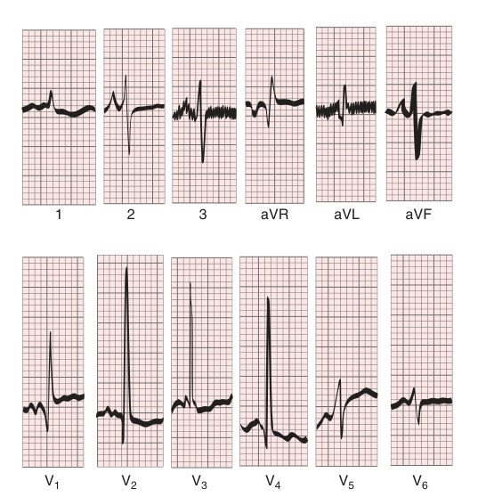

Fig. 28.12 ​Electrocardiogram from a 3-week-old male with aortic atresia and mitral atresia. Necropsy findings were as illustrated in Fig. 28.2. Peaked right atrial P waves are present in leads 2 and 3. Right atrial enlargement is indicated by the qR pattern in lead V1. Pure right ventricular hypertrophy is reflected in tall monophasic R waves in leads V2–4 and the vertical and superior QRS axis.
