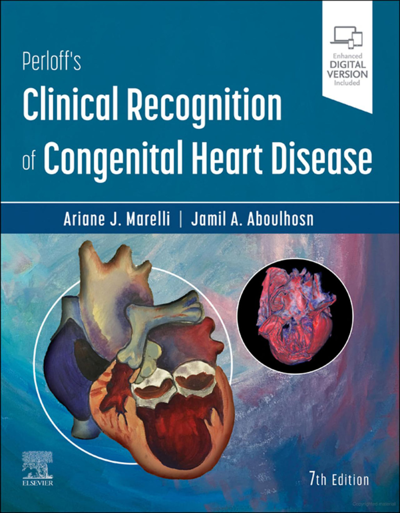
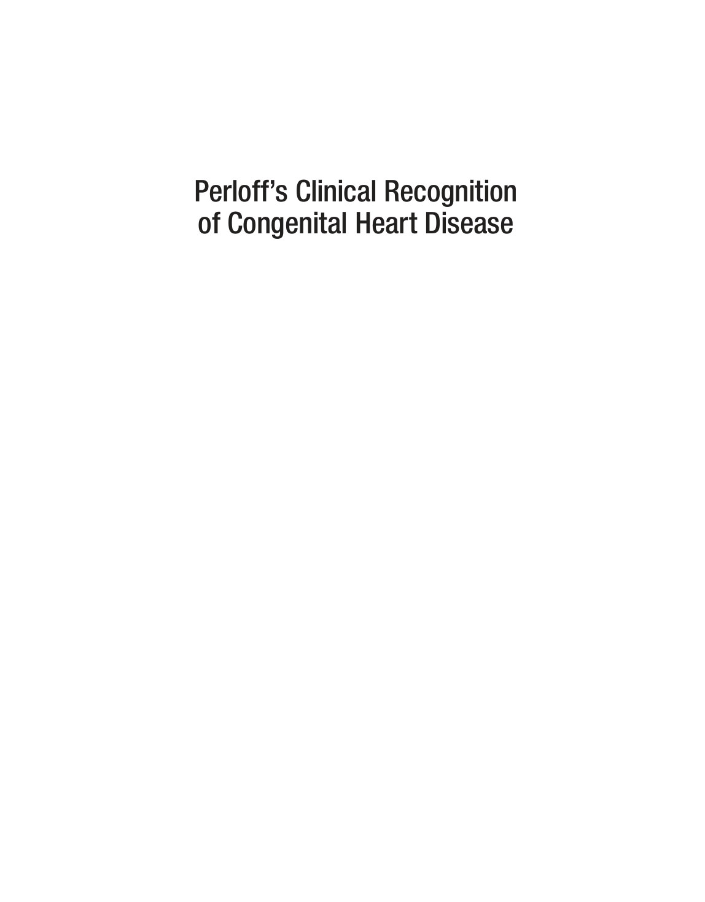
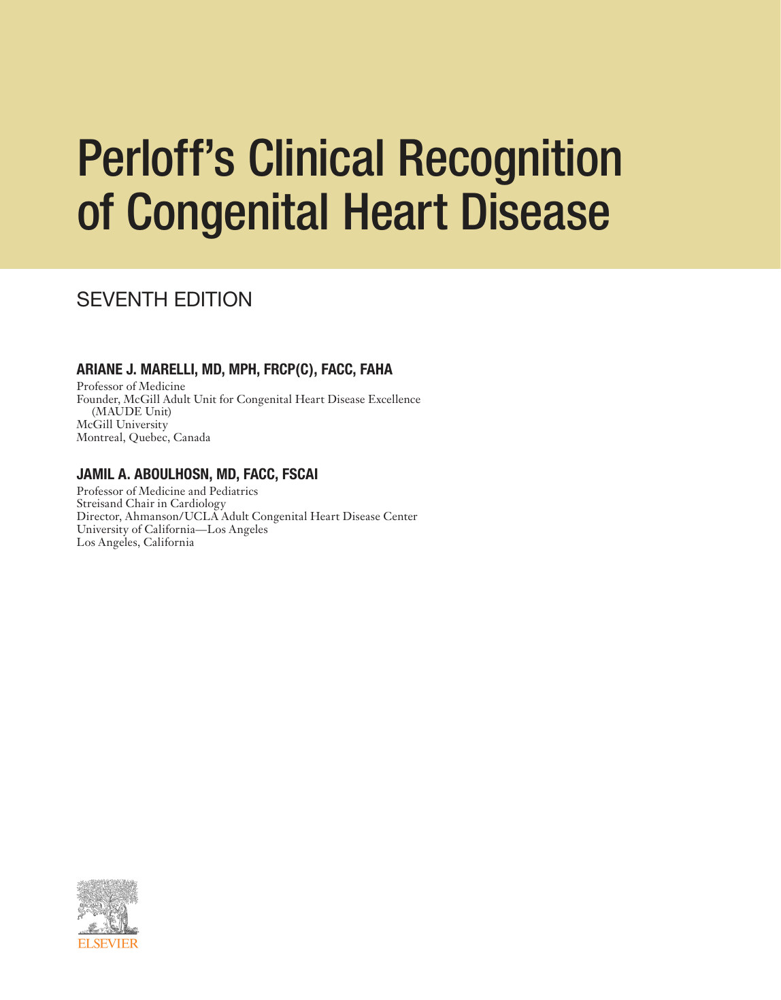
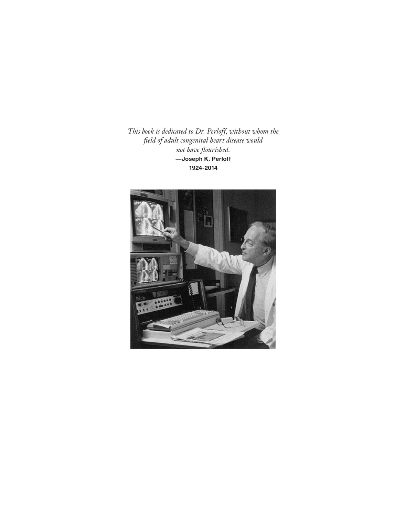
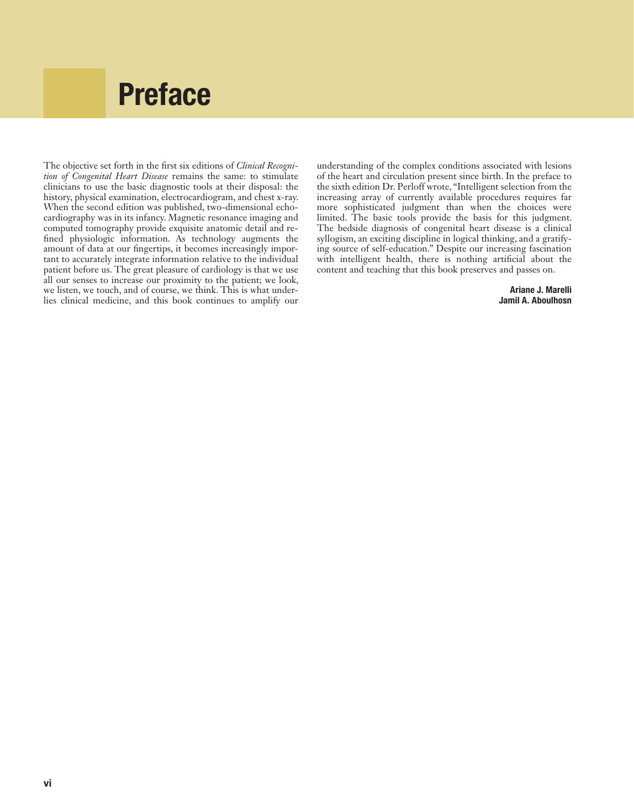
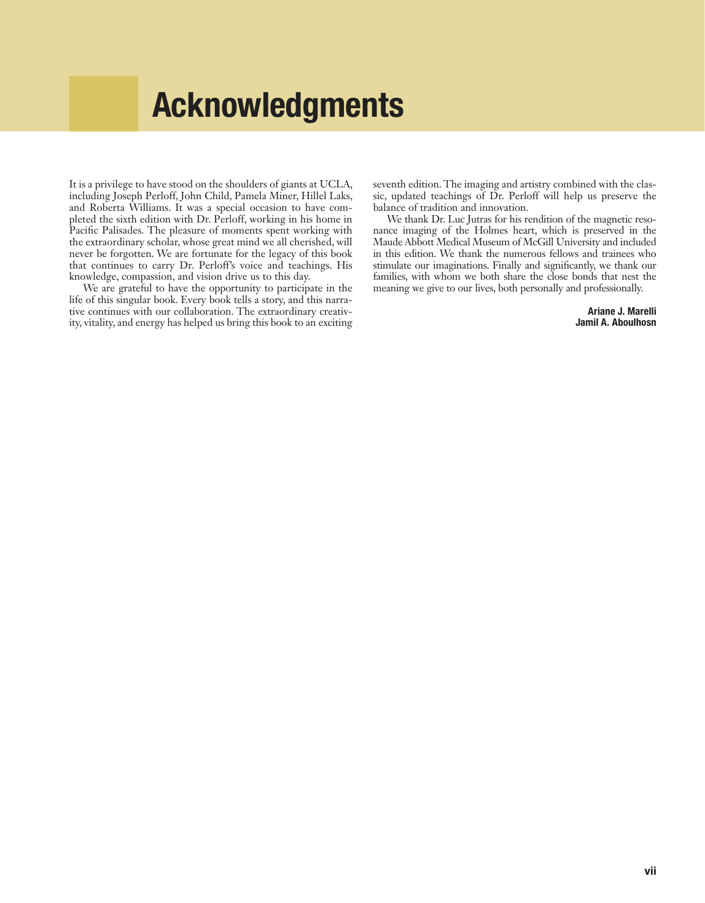
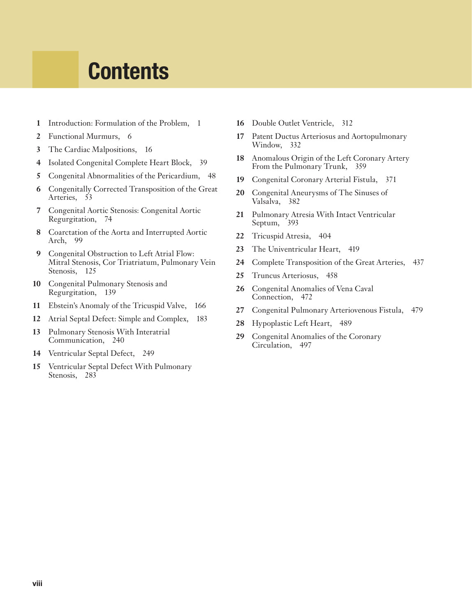

# Original front and back matter

Title, copyright, dedication, preface and other supplied front/back pages are retained here for source context.

## Source PDF page 1

## Source PDF page 2

Use of the current edition of the electronic version of this book (eBook) is subject to the terms of the nontransferable, limited license granted on 
expertconsult.inkling.com. Access to the eBook is limited to the first individual who redeems the PIN, located on the inside cover of this book, 
at expertconsult.inkling.com and may not be transferred to another party by resale, lending, or other means. 
Any screen.  
Any time.  
Anywhere.
Activate the eBook version  
of this title at no additional charge. 
Unlock your eBook today.
1.  Visit expertconsult.inkling.com/redeem
2.  Scratch box below to reveal your code
3.  Type code into “Enter Code” box
4.   Click “Redeem”
5.   Log in or Sign up
6.  Go to “My Library”
It’s that easy!
Elsevier eBooks for Practicing Clinicians gives you the power to browse and search 
content, view enhanced images, highlight and take notes—both online and offline.
For technical assistance:  
email expertconsult.help@elsevier.com 
call 1-800-401-9962 (inside the US)  
call +1-314-447-8300 (outside the US)
Place Peel Off 
Sticker Here
2020_PC
 

## Source PDF page 3

Perloff’s Clinical Recognition  
of Congenital Heart Disease
 

## Source PDF page 4

 

## Source PDF page 5

ARIANE J. MARELLI, MD, MPH, FRCP(C), FACC, FAHA
Professor of Medicine
Founder, McGill Adult Unit for Congenital Heart Disease Excellence 
(MAUDE Unit)
McGill University
Montreal, Quebec, Canada
JAMIL A. ABOULHOSN, MD, FACC, FSCAI
Professor of Medicine and Pediatrics
Streisand Chair in Cardiology
Director, Ahmanson/UCLA Adult Congenital Heart Disease Center
University of California—Los Angeles
Los Angeles, California
Perloff’s Clinical Recognition  
of Congenital Heart Disease 
SEVENTH EDITION
 

## Source PDF page 6

Elsevier
1600 John F. Kennedy Blvd.
Ste 1600
Philadelphia, PA 19103-2899
PERLOFF’S CLINICAL RECOGNITION OF CONGENITAL HEART DISEASE,  
SEVENTH EDITION 
ISBN: 978-0-323-52964-8
Copyright © 2023 by Elsevier Inc. All rights reserved.
No part of this publication may be reproduced or transmitted in any form or by any means, electronic or  
mechanical, including photocopying, recording, or any information storage and retrieval system, without  
permission in writing from the publisher. Details on how to seek permission, further information about the 
Publisher’s permissions policies and our arrangements with organizations such as the Copyright Clearance 
Center and the Copyright Licensing Agency, can be found at our website: ­www.elsevier.com/permissions.
This book and the individual contributions contained in it are protected under copyright by the Publisher 
(other than as may be noted herein).­
Acrylic painting on canvas of “Holmes’s Heart” as described by Andrew F. Holmes in 1824 consisting of the 
absence of the sinus (inflow tract) of the morphologic right ventricle, double inlet left ventricle, hypoplastic 
right ventricle serving as an infundibular outlet chamber, and normally related great arteries. Artist Jamil 
Aboulhosn, MD. Three-dimensional rendering with color mapping of the Holmes heart as imaged in its ­
 ­original glass container using magnetic resonance imaging. Image courtesy of Dr. Luc Jutras, Montreal ­
 ­Children’s Hospital of the McGill University Health Centre.”
Notice
Practitioners and researchers must always rely on their own experience and knowledge in evaluating  
and using any information, methods, compounds or experiments described herein. Because of rapid  
advances in the medical sciences, in particular, independent verification of diagnoses and drug dosages 
should be made. To the fullest extent of the law, no responsibility is assumed by Elsevier, authors, editors 
or contributors for any injury and/or damage to persons or property as a matter of products liability,  ­
negligence or otherwise, or from any use or operation of any methods, products, instructions, or ideas 
contained in the material herein. 
Executive Content Strategist: Robin Carter
Senior Content Development Specialist: Rae Robertson
Publishing Services Manager: ­Catherine Jackson
Senior Project Manager: Kate Mannix
Design Direction: ­Bridget Hoette
Printed in India
Last digit is the print number:
   9
   8
   7
   6
   5
   4
   3
   2
   1
 

## Source PDF page 7

This book is dedicated to Dr. Perloff, without whom the 
field of adult congenital heart disease would  
not have flourished.
—Joseph K. Perloff
1924-2014
 

## Source PDF page 8

The objective set forth in the first six editions of Clinical Recogni-
tion of Congenital Heart Disease remains the same: to stimulate 
clinicians to use the basic diagnostic tools at their disposal: the 
history, physical examination, electrocardiogram, and chest x-ray. 
When the second edition was published, two-dimensional echo-
cardiography was in its infancy. Magnetic resonance imaging and 
computed tomography provide exquisite anatomic detail and re-
fined physiologic information. As technology augments the 
amount of data at our fingertips, it becomes increasingly impor­-
tant to accurately integrate information relative to the individual 
patient before us. The great pleasure of cardiology is that we use 
all our senses to increase our proximity to the patient; we look, ­
we listen, we touch, and of course, we think. This is what under-
lies clinical medicine, and this book continues to amplify our 
understanding of the complex conditions associated with lesions 
of the heart and circulation present since birth. In the preface to ­
the sixth edition Dr. Perloff wrote, “Intelligent selection from the 
increasing array of currently available procedures requires far 
more sophisticated judgment than when the choices were 
limited. The basic tools provide the basis for this judgment. 
The bedside diagnosis of congenital heart disease is a clinical 
syllogism, an exciting discipline in logical thinking, and a gratify-­
ing source of self-education.” Despite our increasing fascination 
with intelligent health, there is nothing artificial about the 
content and teaching that this book preserves and passes on.
Ariane J. Marelli
Jamil A. Aboulhosn
Preface­
vi
 

## Source PDF page 9

Acknowledgments
It is a privilege to have stood on the shoulders of giants at UCLA, 
including Joseph Perloff, John Child, Pamela Miner, Hillel Laks, 
and Roberta Williams. It was a special occasion to have com-
pleted the sixth edition with Dr. Perloff, working in his home in 
Pacific Palisades. The pleasure of moments spent working with 
the extraordinary scholar, whose great mind we all cherished, will 
never be forgotten. We are fortunate for the legacy of this book 
that continues to carry Dr. Perloff’s voice and teachings. His 
knowledge, compassion, and vision drive us to this day.
We are grateful to have the opportunity to participate in the 
life of this singular book. Every book tells a story, and this narra-­
tive continues with our collaboration. The extraordinary creativ-
ity, vitality, and energy has helped us bring this book to an exciting 
seventh edition. The imaging and artistry combined with the clas­-
sic, updated teachings of Dr. Perloff will help us preserve the 
balance of tradition and innovation.
We thank Dr. Luc Jutras for his rendition of the magnetic reso-­
nance imaging of the Holmes heart, which is preserved in the 
Maude Abbott Medical Museum of McGill University and included 
in this edition. We thank the numerous fellows and trainees who 
stimulate our imaginations. Finally and significantly, we thank our 
families, with whom we both share the close bonds that nest the 
meaning we give to our lives, both personally and professionally.
Ariane J. Marelli
Jamil A. Aboulhosn
vii
 

## Source PDF page 10

Contents
 	 1 	 Introduction: Formulation of the Problem,   1
 	 2 	 Functional Murmurs,   6
 	 3 	 The Cardiac Malpositions,   16
 	 4 	 Isolated Congenital Complete Heart Block,   39
 	 5 	 Congenital Abnormalities of the Pericardium,   48
 	 6 	 Congenitally Corrected Transposition of the Great 
Arteries,­   53­
 	 7 	 Congenital Aortic Stenosis: Congenital Aortic 
Regurgitation,   74­
 	 8­ 	 Coarctation of the Aorta and Interrupted Aortic 
Arch,   99
 	 9 	 Congenital Obstruction to Left Atrial Flow: 
Mitral Stenosis, Cor Triatriatum, Pulmonary Vein ­
Stenosis,   125
 	10 	 Congenital Pulmonary Stenosis and 
Regurgitation,   139
 	11 	 Ebstein’s Anomaly of the Tricuspid Valve,   166
 	12 	 Atrial Septal Defect: Simple and Complex,   183
 	13 	 Pulmonary Stenosis With Interatrial ­
Communication,   240
 	14 	 Ventricular Septal Defect,   249
 	15 	 Ventricular Septal Defect With Pulmonary 
Stenosis,   283­
 	16­ 	 Double Outlet Ventricle,   312
 	17 	 Patent Ductus Arteriosus and Aortopulmonary 
Window,­   332­
 	18 	 Anomalous Origin of the Left Coronary Artery 
From the Pulmonary Trunk,
   359
 	19 	 Congenital Coronary Arterial Fistula,   371
 	20 	 Congenital Aneurysms of The Sinuses of 
Valsalva,­   382­
 	21 	 Pulmonary Atresia With Intact Ventricular 
Septum,   393
 	22 	 Tricuspid Atresia,   404
 	23 	 The Univentricular Heart,­   419­
 	24 	 Complete Transposition of the Great Arteries,   437­
 	25­ 	 Truncus Arteriosus,   458
 	26 	 Congenital Anomalies of Vena Caval 
Connection,   472
 	27 	 Congenital Pulmonary Arteriovenous Fistula,   479­
 	28­ 	 Hypoplastic Left Heart,   489­
 	29­ 	 Congenital Anomalies of the Coronary 
Circulation,   497
viii
 

## Source PDF page 535

Evidence-based answers, continually updated
Conf idence 
is ClinicalKey
The latest answers, always at your fingertips 
A subscription to ClinicalKey draws content from 
countless procedural videos, peer-reviewed journals, 
patient education materials, and books authored by 
the most respected names in medicine. 
Your patients trust you. You can trust ClinicalKey.
Equip yourself with trusted, current content that provides you with 
the clinical knowledge to improve patient outcomes.
Get to know ClinicalKey at store.clinicalkey.com.
2019v1.0
 

