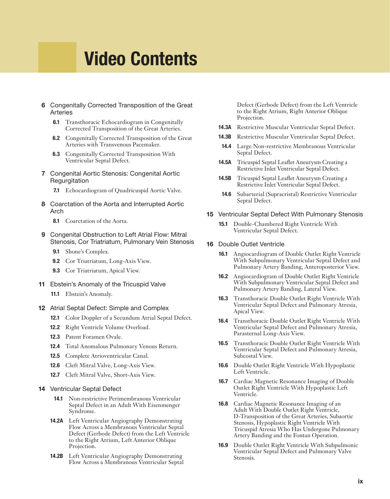
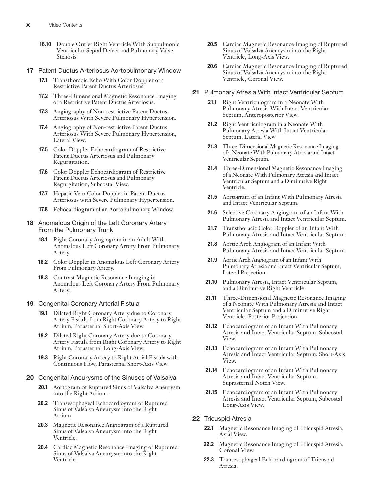
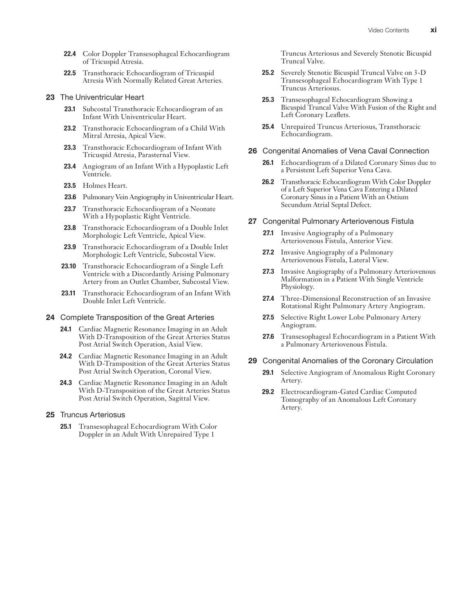

# Supplementary Videos

The supplied PDF contains a video catalog but no embedded video files. No playable publisher videos are bundled or claimed.

## Source PDF page11

Video Contents
 	 6 	 Congenitally Corrected Transposition of the Great 
Arteries
 	
6.1 	 Transthoracic Echocardiogram in Congenitally 
 ­Corrected Transposition of the Great Arteries.
 	
6.2 	 Congenitally Corrected Transposition of the Great 
Arteries with Transvenous Pacemaker.
 	
6.3 	 Congenitally Corrected Transposition With 
 ­Ventricular Septal Defect.
 	 7 	 Congenital Aortic Stenosis: Congenital Aortic 
Regurgitation
 	
7.1 	 Echocardiogram of Quadricuspid Aortic Valve.
 	 8 	 Coarctation of the Aorta and Interrupted Aortic 
Arch
 	
8.1 	 Coarctation of the Aorta.
 	 9 	 Congenital Obstruction to Left Atrial Flow: Mitral 
Stenosis, Cor Triatriatum, Pulmonary Vein Stenosis
 	
9.1 	 Shone’s Complex.
 	
9.2 	 Cor Triatriatum, Long-Axis View.
 	
9.3 	 Cor Triatriatum, Apical View.
 	11 	 Ebstein’s Anomaly of the Tricuspid Valve
 	
11.1 	 Ebstein’s Anomaly.
 	12 	 Atrial Septal Defect: Simple and Complex 
 	
12.1 	 Color Doppler of a Secundum Atrial Septal Defect.
 	
12.2 	 Right Ventricle Volume Overload.
 	
12.3 	 Patent Foramen Ovale.
 	
12.4 	 Total Anomalous Pulmonary Venous Return.
 	
12.5 	 Complete Atrioventricular Canal.
 	
12.6 	 Cleft Mitral Valve, Long-Axis View.
 	
12.7 	 Cleft Mitral Valve, Short-Axis View.
 	14 	 Ventricular Septal Defect 
 	
14.1 	 Non-restrictive Perimembranous Ventricular 
Septal Defect in an Adult With Eisenmenger 
Syndrome.
 	
14.2A 	 Left Ventricular Angiography Demonstrating 
Flow Across a Membranous Ventricular Septal 
Defect (Gerbode Defect) from the Left Ventricle 
to the Right Atrium, Left Anterior Oblique 
Projection.
 	
14.2B 	 Left Ventricular Angiography Demonstrating 
Flow Across a Membranous Ventricular Septal 
Defect (Gerbode Defect) from the Left Ventricle 
to the Right Atrium, Right Anterior Oblique 
Projection.
 	
14.3A 	 Restrictive Muscular Ventricular Septal Defect.
 	
14.3B 	 Restrictive Muscular Ventricular Septal Defect.
 	
14.4 	 Large Non-restrictive Membranous Ventricular 
Septal Defect.
 	
14.5A 	 Tricuspid Septal Leaflet Aneurysm Creating a 
Restrictive Inlet Ventricular Septal Defect.
 	
14.5B 	 Tricuspid Septal Leaflet Aneurysm Creating a 
Restrictive Inlet Ventricular Septal Defect.
 	
14.6 	 Subarterial (Supracristal) Restrictive Ventricular 
Septal Defect.
 	15 	 Ventricular Septal Defect With Pulmonary Stenosis
 	
15.1 	 Double-Chambered Right Ventricle With 
Ventricular Septal Defect.
 	16 	 Double Outlet Ventricle
 	
16.1 	 Angiocardiogram of Double Outlet Right Ventricle 
With Subpulmonary Ventricular Septal Defect and 
Pulmonary Artery Banding, Anteroposterior View.
 	
16.2 	 Angiocardiogram of Double Outlet Right Ventricle 
With Subpulmonary Ventricular Septal Defect and 
Pulmonary Artery Banding, Lateral View.
 	
16.3 	 Transthoracic Double Outlet Right Ventricle With 
Ventricular Septal Defect and Pulmonary Atresia, 
Apical View.
 	
16.4 	 Transthoracic Double Outlet Right Ventricle With 
Ventricular Septal Defect and Pulmonary Atresia, 
Parasternal Long-Axis View.
 	
16.5 	 Transthoracic Double Outlet Right Ventricle With 
Ventricular Septal Defect and Pulmonary Atresia, 
Subcostal View.
 	
16.6 	 Double Outlet Right Ventricle With Hypoplastic 
Left Ventricle.
 	
16.7 	 Cardiac Magnetic Resonance Imaging of Double 
Outlet Right Ventricle With Hypoplastic Left 
Ventricle.
 	
16.8 	 Cardiac Magnetic Resonance Imaging of an 
Adult With Double Outlet Right Ventricle, 
D-Transposition of the Great Arteries, Subaortic 
Stenosis, Hypoplastic Right Ventricle With 
Tricuspid Atresia Who Has Undergone Pulmonary 
Artery Banding and the Fontan Operation.
 	
16.9 	 Double Outlet Right Ventricle With Subpulmonic 
Ventricular Septal Defect and Pulmonary Valve 
Stenosis.
ix
 

## Source PDF page12

x
Video Contents
 	
20.5 	 Cardiac Magnetic Resonance Imaging of Ruptured 
Sinus of Valsalva Aneurysm into the Right 
Ventricle, Long-Axis View.
 	
20.6 	 Cardiac Magnetic Resonance Imaging of Ruptured 
Sinus of Valsalva Aneurysm into the Right 
Ventricle, Coronal View.
 	21 	 Pulmonary Atresia With Intact Ventricular Septum
 	
21.1 	 Right Ventriculogram in a Neonate With 
Pulmonary Atresia With Intact Ventricular 
Septum, Anteroposterior View.
 	
21.2 	 Right Ventriculogram in a Neonate With 
Pulmonary Atresia With Intact Ventricular 
Septum, Lateral View.
 	
21.3 	 Three-Dimensional Magnetic Resonance Imaging 
of a Neonate With Pulmonary Atresia and Intact 
Ventricular Septum.
 	
21.4 	 Three-Dimensional Magnetic Resonance Imaging 
of a Neonate With Pulmonary Atresia and Intact 
Ventricular Septum and a Diminutive Right 
Ventricle.
 	
21.5 	 Aortogram of an Infant With Pulmonary Atresia 
and Intact Ventricular Septum.
 	
21.6 	 Selective Coronary Angiogram of an Infant With 
Pulmonary Atresia and Intact Ventricular Septum.
 	
21.7 	 Transthoracic Color Doppler of an Infant With 
 ­Pulmonary Atresia and Intact Ventricular Septum.
 	
21.8 	 Aortic Arch Angiogram of an Infant With 
Pulmonary Atresia and Intact Ventricular Septum.
 	
21.9 	 Aortic Arch Angiogram of an Infant With 
 ­Pulmonary Atresia and Intact Ventricular Septum, 
Lateral Projection.
 	
21.10 	 Pulmonary Atresia, Intact Ventricular Septum, 
and a Diminutive Right Ventricle.
 	
21.11 	 Three-Dimensional Magnetic Resonance Imaging 
of a Neonate With Pulmonary Atresia and Intact 
Ventricular Septum and a Diminutive Right 
Ventricle, Posterior Projection.
 	
21.12 	 Echocardiogram of an Infant With Pulmonary 
Atresia and Intact Ventricular Septum, Subcostal 
View.
 	
21.13 	 Echocardiogram of an Infant With Pulmonary 
Atresia and Intact Ventricular Septum, Short-Axis 
View.
 	
21.14 	 Echocardiogram of an Infant With Pulmonary 
Atresia and Intact  ­Ventricular Septum, 
Suprasternal Notch View.
 	
21.15 	 Echocardiogram of an Infant With Pulmonary 
Atresia and Intact  ­Ventricular Septum, Subcostal 
Long-Axis View.
 	22 	 Tricuspid Atresia
 	
22.1 	 Magnetic Resonance Imaging of Tricuspid Atresia, 
Axial View.
 	
22.2 	 Magnetic Resonance Imaging of Tricuspid Atresia, 
Coronal View.
 	
22.3 	 Transesophageal Echocardiogram of Tricuspid 
Atresia.
 	
16.10 	 Double Outlet Right Ventricle With Subpulmonic 
Ventricular Septal Defect and Pulmonary Valve 
Stenosis.
 	17 	 Patent Ductus Arteriosus Aortopulmonary Window
 	
17.1 	 Transthoracic Echo With Color Doppler of a 
Restrictive Patent Ductus Arteriosus.
 	
17.2 	 Three-Dimensional Magnetic Resonance Imaging 
of a Restrictive Patent Ductus  ­Arteriosus.
 	
17.3 	 Angiography of Non-restrictive Patent Ductus 
Arteriosus With Severe Pulmonary Hypertension.
 	
17.4 	 Angiography of Non-restrictive Patent Ductus 
Arteriosus With Severe Pulmonary Hypertension, 
Lateral View.
 	
17.5 	 Color Doppler Echocardiogram of Restrictive 
Patent Ductus Arteriosus and Pulmonary 
Regurgitation.
 	
17.6 	 Color Doppler Echocardiogram of Restrictive 
Patent Ductus Arteriosus and Pulmonary 
Regurgitation, Subcostal View.
 	
17.7 	 Hepatic Vein Color Doppler in Patent Ductus 
 ­Arteriosus with Severe Pulmonary Hypertension.
 	
17.8 	 Echocardiogram of an Aortopulmonary Window.
 	18 	 Anomalous Origin of the Left Coronary Artery 
From the Pulmonary Trunk
 	
18.1 	 Right Coronary Angiogram in an Adult With 
Anomalous Left Coronary Artery From Pulmonary 
Artery.
 	
18.2 	 Color Doppler in Anomalous Left Coronary Artery 
From Pulmonary Artery.
 	
18.3 	 Contrast Magnetic Resonance Imaging in 
Anomalous Left Coronary Artery From Pulmonary 
Artery.
 	19 	 Congenital Coronary Arterial Fistula
 	
19.1 	 Dilated Right Coronary Artery due to Coronary 
Artery Fistula from Right Coronary Artery to Right 
Atrium, Parasternal Short-Axis View.
 	
19.2 	 Dilated Right Coronary Artery due to Coronary 
Artery Fistula from Right Coronary Artery to Right 
Atrium, Parasternal Long-Axis View.
 	
19.3 	 Right Coronary Artery to Right Atrial Fistula with 
Continuous Flow, Parasternal Short-Axis View.
 	20 	 Congenital Aneurysms of the Sinuses of Valsalva
 	
20.1 	 Aortogram of Ruptured Sinus of Valsalva Aneurysm 
into the Right Atrium.
 	
20.2 	 Transesophageal Echocardiogram of Ruptured 
Sinus of Valsalva Aneurysm into the Right  
Atrium.
 	
20.3 	 Magnetic Resonance Angiogram of a Ruptured 
Sinus of Valsalva Aneurysm into the Right 
Ventricle.
 	
20.4 	 Cardiac Magnetic Resonance Imaging of Ruptured 
Sinus of Valsalva Aneurysm into the Right 
Ventricle.
 

## Source PDF page13

xi
Video Contents
Truncus Arteriosus and Severely Stenotic Bicuspid 
Truncal Valve.
 	
25.2 	 Severely Stenotic Bicuspid Truncal Valve on 3-D 
Transesophageal Echocardiogram With Type 1 
Truncus Arteriosus.
 	
25.3 	 Transesophageal Echocardiogram Showing a 
Bicuspid Truncal Valve With Fusion of the Right and 
Left Coronary Leaflets.
 	
25.4 	 Unrepaired Truncus Arteriosus, Transthoracic 
Echocardiogram.
 	26 	 Congenital Anomalies of Vena Caval Connection
 	
26.1 	 Echocardiogram of a Dilated Coronary Sinus due to 
a Persistent Left Superior Vena Cava.
 	
26.2 	 Transthoracic Echocardiogram With Color Doppler 
of a Left Superior Vena Cava Entering a Dilated 
Coronary Sinus in a Patient With an Ostium 
Secundum Atrial Septal Defect.
 	27 	 Congenital Pulmonary Arteriovenous Fistula
 	
27.1 	 Invasive Angiography of a Pulmonary 
Arteriovenous Fistula, Anterior View.
 	
27.2 	 Invasive Angiography of a Pulmonary 
Arteriovenous Fistula, Lateral View.
 	
27.3 	 Invasive Angiography of a Pulmonary Arteriovenous 
Malformation in a Patient With Single Ventricle 
Physiology.
 	
27.4 	 Three-Dimensional Reconstruction of an Invasive 
Rotational Right Pulmonary Artery Angiogram.
 	
27.5 	 Selective Right Lower Lobe Pulmonary Artery 
Angiogram.
 	
27.6 	 Transesophageal Echocardiogram in a Patient With 
a Pulmonary Arteriovenous Fistula.
 	29 	 Congenital Anomalies of the Coronary Circulation
 	
29.1 	 Selective Angiogram of Anomalous Right Coronary 
Artery.
 	
29.2 	 Electrocardiogram-Gated Cardiac Computed 
Tomography of an Anomalous Left Coronary 
Artery.
 	
22.4 	 Color Doppler Transesophageal Echocardiogram 
of Tricuspid Atresia.
 	
22.5 	 Transthoracic Echocardiogram of Tricuspid 
Atresia With Normally Related Great Arteries.
 	23 	 The Univentricular Heart
 	
23.1 	 Subcostal Transthoracic Echocardiogram of an 
Infant With Univentricular Heart.
 	
23.2 	 Transthoracic Echocardiogram of a Child With 
Mitral Atresia, Apical View.
 	
23.3 	 Transthoracic Echocardiogram of Infant With 
 ­Tricuspid Atresia, Parasternal View.
 	
23.4 	 Angiogram of an Infant With a Hypoplastic Left 
Ventricle.
 	
23.5 	 Holmes Heart.
 	
23.6 	 Pulmonary Vein Angiography in Univentricular Heart.
 	
23.7 	 Transthoracic Echocardiogram of a Neonate 
With a Hypoplastic Right Ventricle.
 	
23.8 	 Transthoracic Echocardiogram of a Double Inlet 
Morphologic Left Ventricle, Apical View.
 	
23.9 	 Transthoracic Echocardiogram of a Double Inlet 
Morphologic Left Ventricle, Subcostal View.
 	
23.10 	 Transthoracic Echocardiogram of a Single Left 
Ventricle with a Discordantly Arising Pulmonary 
Artery from an Outlet Chamber, Subcostal View.
 	
23.11 	 Transthoracic Echocardiogram of an Infant With 
Double Inlet Left Ventricle.
 	24 	 Complete Transposition of the Great Arteries
 	
24.1 	 Cardiac Magnetic Resonance Imaging in an Adult 
With D-Transposition of the Great Arteries Status 
Post Atrial Switch Operation, Axial View.
 	
24.2 	 Cardiac Magnetic Resonance Imaging in an Adult 
With D-Transposition of the Great Arteries Status 
Post Atrial Switch Operation, Coronal View.
 	
24.3 	 Cardiac Magnetic Resonance Imaging in an Adult 
With D-Transposition of the Great Arteries Status 
Post Atrial Switch Operation, Sagittal View.
 	25 	 Truncus Arteriosus
 	
25.1 	 Transesophageal Echocardiogram With Color 
Doppler in an Adult With Unrepaired Type 1 
 

## Source PDF page14

 

