# 5. Congenital abnormalities of the pericardium
> [Source credits](../../SOURCE_CREDITS.md).

## Study pillars

### A focal left-border bulge

Herniation of the left atrial appendage through a partial left pericardial defect. Partial absence of the left pericardium may permit left atrial appendage herniation, producing the described convex left-border shadow.

PDF p. 63

### Mobility with complete absence

Loss of normal pericardial restraint. Complete absence can produce striking cardiac mobility, leftward/posterior displacement and interposed lung tissue.

PDF p. 64

### Confirm the anatomy

Thoracic CT or cardiac MRI. The source identifies CT and MRI as definitive modalities; echocardiography may suggest complete absence and identify coexisting defects.

PDF p. 64

### A cardiophrenic cyst pattern

A congenital pericardial cyst. A congenital pericardial cyst typically forms a smooth homogeneous density at the right cardiophrenic angle.

PDF p. 63

### Constraint and right-sided dimensions

Reduced pericardial restraint particularly affects the relatively thin-walled right-sided chambers. Loss of normal pericardial constraint particularly affects the right ventricle and right atrium and can alter systemic venous return and septal motion.

PDF p. 64

## Full source extraction

# 5. Congenital abnormalities of the pericardium
> [Source credits](../../SOURCE_CREDITS.md).

## PDF page 62 | printed page 48

5 Congenital Abnormalities of the Pericardium

### HISTORICAL NOTES

Congenital absence of the pericardium was recognized by M. Realdus Columbus in 1559,1 and by Matthew Baille in 1793,2 but it was not until 1959 that the anomaly was clinically diagnosed in a chest x-ray.3 The pericardial abnormality varies from a localized defect to complete absence.4–6 The sternum, abdominal wall, pericardium, and part of the diaphragm arise from somatic mesoderm. Morphogenesis of congenital defects of the left pericardium has been attributed to premature atrophy of the left duct of Cuvier, resulting in deficient blood supply to the left pleuropericardial membrane.7,8

The peri (around) cardium (heart) consists of two layers with nerves, lymphatics, and a blood supply. The layer attached to the surface of the heart is the visceral pericardium. The layer that is not attached to the surface of the heart is the parietal pericardium, which is separated from the visceral pericardium by 20 to 30 mL of a serous ultrafiltrate of plasma. It is with the parietal pericardium that this chapter is concerned.

Necropsy incidence of congenital absence of the pericardium has been estimated at 1 out of 14,000.9 About two-thirds of cases are represented by partial absence of the left pericardium (Fig. 5.1).9–11 Congenital absence of the right pericardium is rare (Fig. 5.2).6,12 Approximately one-third of congenital pericardial defects occur in conjunction with other congenital malformations, both cardiac (Fig. 5.3) and noncardiac.4,13,14 A case in point is the Cantrell syndrome described in 1958, also called the Cantrell-Heller-Ravitch syndrome,13 that consists of two major defects, ectopia cordis and epigastric omphalocele, and three lesser defects, cleft of the distal sternum and defects of the anterior diaphragm and diaphragmatic pericardium.13,15,16

The parietal pericardium exerts contact stress that contributes to ventricular diastolic pressure and limits acute dilatation.17 The stress is greater on the relatively thin right ventricle and right atrium whose dimensions and pressures depend chiefly on pericardial constraint.17 Accordingly, congenital complete absence of the parietal pericardium is accompanied by alterations in systemic venous return18 and an increase in right ventricular size.17 Alternans of the right ventricular diastolic pressure has been reported during cardiac catheterization in a patient with congenital complete absence of the pericardium.19

### THE HISTORY

Partial or complete absence of the pericardium usually comes to light because of an abnormality on the routine chest x-ray of an asymptomatic patient or in a chest x-ray taken as part of the cardiovascular evaluation of a symptomatic patient with coexisting cardiac defects.4,20,21 The most common symptom is chest pain that appears suddenly in a previously asymptomatic adult and that varies from mild and occasional to frequent, prolonged, and debilitating.4 The pain is stabbing, left-sided, brief if not fleeting, unrelated to exertion, but aggravated by position, especially the left lateral decubitus, awakening the patient from sleep, and relieved by an upright position.6,22 The pain associated with partial absence of the left pericardium (see Fig 5.1) is attributed to herniation of the left atrial appendage through the

pericardial defect. The pain associated with complete absence of the pericardium (see Fig. 5.2) is believed to originate from torsion of the thoracic inlet.22 In light of evidence of transient compression of coronary arteries, myocardial ischemia is also a consideration.23,24

Additional symptoms include dyspnea, palpitations, dizziness, syncope, and most ominously, sudden death.

Familial congenital partial absence of the left pericardium has been reported.7 The male/female prevalence is reportedly 3:1. Longevity is not affected by congenital partial absence of the pericardium22 but has not been established with congenital complete absence. However, one patient reportedly survived to the eighth decade.25

### PHYSICAL APPEARANCE

Congenital partial absence of the left pericardium has been reported with abnormal facies and growth hormone deficiency,26 and with VATER defects27 (V A T E R 5 v-ertebral defects, a-nal atresia, t-racheo e-sophageal fistula, r-adial atresia and r-enal dysplasia).

### THE ARTERIAL PULSE AND THE JUGULAR VENOUS PULSE

The arterial pulse is normal with congenital complete absence of the pericardium, despite alternans of diastolic pressure.19 The jugular venous pulse is normal with congenital partial absence of the pericardium, and is normal with congenital complete absence, despite the decrease in contact stress exerted on the right atrium and right ventricle.

Fig. 5.1 ​X-ray from a 12-year-old female with congenital partial absence of the pericardium. There is the typical localized convexity of a protruding left atrial appendage (arrows). The x-ray is otherwise normal.

## PDF page 63 | printed page 49

RA

RV

LA

Ao

LV

Fig. 5.2 ​Magnetic resonance image axial view from a 38-year-old woman with congenital complete absence of the pericardium and hypoplasia of the left lower lobe and the left pulmonary artery (see Fig. 5.3). The strikingly mobile heart is displaced far into the left thoracic cavity. Ao, Aorta; LA/RA, left and right atrium; LV/RV, left and right ventricle.

### PRECORDIAL MOVEMENT AND PALPATION

With congenital partial absence of the left pericardium, the position and movements of the heart are normal. With complete absence, there is striking mobility of the heart that shifts dramatically to the left (see Fig. 5.2), a position that can be detected

Ao RPA

PA

ANT

​

Fig. 5.3 Three-dimensional reconstruction of gadolinium-enhanced magnetic resonance angiography of the heart and great arteries from the 38-year-old female with congenital complete absence of the pericardium with hypoplasia of the left lower lobe and left pulmonary artery (see Fig. 5.2 for magnetic resonance image). The left anterior oblique view (LAO) discloses a hypoplastic left pulmonary artery (LPA). The anterior view (ANT) discloses a well-formed main pulmonary artery (PA) and a well-formed right pulmonary artery (RPA). Ao, Ascending aorta.

by percussion. Displacement is accompanied by major rotation (see Fig. 5.2),6 so identification of a left or right ventricular impulse is not feasible.

5

### AUSCULTATION

Congenital complete absence of the pericardium is accompanied by torsion of the thoracic inlet and great arteries that may generate basal mid systolic murmurs, especially in the left lateral decubitus position.

### THE ELECTROCARDIOGRAM

With congenital partial absence of the left pericardium, the electrocardiogram is normal because the heart is not displaced and is inherently normal apart from the pericardial defect. With congenital complete absence of the pericardium, standard precordial lead placements show delayed transition that reflects the leftward position of the heart.4 Axis deviation, generally right, probably results from rotation.4 Incomplete right bundle branch block is frequently mentioned.4 There are individual reports of complete heart block28 and sinus node dysfunction.29

### THE X-RAY

The posteroanterior chest x-ray is a major key to the diagnosis and was the basis for the earliest clinical recognition of congenital absence of the pericardium.3 Congenital partial absence of the left pericardium is accompanied by herniation of the left atrial appendage, represented in the x-ray by a convexity immediately below the pulmonary trunk, or if herniation is larger, by extension of the convexity to the second and third left interspaces (see Fig. 5.1). The heart is not displaced, and the cardiac silhouette is otherwise normal. The x-ray of an intrapericardial congenital aneurysm of the left atrial appendage30 (Fig. 5.4) is similar if not indistinguishable from the x-ray of partial absence of the left pericardium (see Fig. 5.1). A congenital pericardial cyst typically presents as a smooth homogeneous radiodensity in the right cardiophrenic angle, touching the anterior chest wall and the

LPA

PA

LAO

## PDF page 64 | printed page 50

A

Fig. 5.4 ​(A) X-ray from a 10-year-old female showing a relatively long left paracardiac convexity (arrows) caused by a congenital intrapericardial aneurysm of the left atrial appendage. (B) Schematic illustration of the congenital intrapericardial aneurysm of the left atrial appendage (LAA App).

A B

Fig. 5.5 ​(A) X-ray from a 23-year-old woman with an unusually large congenital pericardial cyst (arrows) that occupies the entire right cardiac border. (B) Magnetic resonance image from an 18-year-old male with a typical congenital pericardial cyst (arrows) that originated at the right cardiophrenic angle.

anterior portion of the right hemidiaphragm (Fig. 5.5).31 The distinction between congenital partial absence of the pericardium is less clear when the cyst presents along the left cardiac border above the left hemidiaphragm.31

Congenital complete absence of the pericardium is characterized by dramatic mobility of the heart, resulting in striking leftward and posterior displacement4 (see Fig. 5.5) that is even more striking if hypoplasia of the left pulmonary artery and left lung coexist (see Figs. 5.2 and 5.6). A cardiac shadow to the right of the vertebral column is absent. A tongue of lung tissue is typically interposed between the pulmonary trunk and aorta (see Fig. 5.6).4 The definitive clinical diagnosis is based on computed tomography (CT) and magnetic resonance imaging (MRI) (see Fig. 5.2).8,32,33

### THE ECHOCARDIOGRAM

The echocardiogram may strongly suggest the diagnosis of congenital absence of the pericardium and identify coexisting cardiac defects, but MRI and CT are definitive.34 Distinctive features of the echocardiogram in congenital complete absence of the pericardium are the unorthodox windows required for imaging, leftward and posterior displacement and rotation of the heart, hypermobility with an abnormal swinging movement, paradoxical motion of the ventricular septum, and enlargement of the right ventricle

LA

App

B

b

and right atrium.4,35 Lack of normal pericardial constraint has a greater effect on the relatively thin-walled right ventricle, which accounts for right ventricular dilation, for a selective increase in systemic venous return, and for paradoxical motion of the ven - tricular septum.4 ,18,35 Congenital partial absence of the pericardium is not an echocardiographic diagnosis. A fetal echocardiogram detected an intrapericardial aneurysm.36

### SUMMARY

Congenital absence of the pericardium can be partial or com - plete. Congenital partial absence is typically left-sided. The x-ray discloses a convex shadow in the topographic location of the left atrial appendage. The diagnosis is entertained when this abnormality is identified in a routine chest x-ray in an asymp - tomatic patient or in a patient who comes to attention because of chest pain. Right-sided partial absence of the pericardium is rare. Also rare is congenital complete absence, which typically presents in adulthood. The heart is strikingly mobile and markedly displaced to the left and posterior. Stabbing left-sided chest pain is provoked or aggravated by position, especially the left lateral decubitus. Additional symptoms include dyspnea, palpitations, dizziness, syncope, and most ominously, sudden death. Thoracic MRI and CT make a definitive diagnosis.

## PDF page 65 | printed page 51

A B

Fig. 5.6 ​X-rays from the 38-year-old female with congenital complete absence of the pericardium referred to in Figs. 5.2 and 5.3. (A) The frontal projection shows the marked leftward position of the mobile heart with no cardiac shadow to the right of the vertebral column. The leftward shift was exaggerated by hypoplasia of the left lung indicated by the elevated left hemidiaphragm (black arrows). The white arrow identifies a tongue of lung tissue interposed between the pulmonary trunk and aorta. (B) The lateral projection shows the striking posterior position of the mobile heart.

15. Vazquez-Jimenez JF, Muehler EG, Daebritz S, et al. Cantrell’s syn-

REFERENCES 1. Columbus MR. De re anatomica. Venice: Nicolo Bevilacqua, 1559:

265–269. 2. Baille M. On the want of a pericardium in the human body. Transac-

16. Meeker TM. Pentalogy of Cantrell: reviewing the syndrome with a

tions of the Society for Improved Medical and Chirurgical Knowledge. 1793;1:91. 3. Ellis K, Leeds NE, Himmelstein A. Congenital deficiencies in partial

17. Tyberg JV, Smith ER. Ventricular diastole and the role of the pericar-

pericardium: a review with two new cases including successful diagnosis by plain roentgenography. Am J Roentgenol Radium Ther Nucl Med. 1959;82(1):125–137. 4. Gatzoulis MA, Munk MD, Merchant N, Van Arsdell GS, McCrindle

18. Fukuda N, Oki T, Iuchi A, et al. Pulmonary and systemic venous flow

19. Shah RP. Diastolic pressure alternans: a new sign in congenital ab-

BW, Webb GD. Isolated congenital absence of the pericardium: clinical presentation, diagnosis, and management. Ann Thorac Surg. 2000;69(4):1209–1215. 5. Nasser WK, Helmen C, Tavel ME, Feigenbaum H, Fisch C. Con-

20. Lopez D, Asher CR. Congenital absence of the pericardium. Prog

21. Marta L, Ferreira AM, Santos KR. Congenital absence of pericar-

genital absence of the left pericardium. Clinical, electrocardiographic, radiographic, hemodynamic, and angiographic findings in six cases. Circulation. 1970;41(3):469–478. 6. Ratib O, Perloff JK, Williams WG. Congenital complete absence of

22. Beppu S, Naito H, Matsuhisa M, Miyatake K, Nimura Y. The effects

the pericardium. Circulation. 2001;103(25):3154-3155. 7. Taysi K, Hartmann AF, Shackelford GD, Sundaram V. Congenital

23. Bennett KR. Congenital foramen of the left pericardium. Ann Thorac

absence of left pericardium in a family. Am J Med Genet. 1985;21(1): 77–85. 8. Faridah Y, Julsrud PR. Congenital absence of pericardium revisited.

24. Rees AP, Risher W, McFadden PM, Ramee SR, White CJ. Partial

Int J Cardiovasc Imaging. 2002;18(1):67–73. 9. Southworth H, Stevenson CS. Congenital defects of the pericardium.

25. Hammoudeh AJ, Kelly ME, Mekhjian H. Congenital total absence of

Arch Intern Med. 1938;61(2):223–240. 10. Mehta SM, Myers JL. Congenital Heart Surgery Nomenclature and

Database Project: diseases of the pericardium. Ann Thorac Surg. 2000;69(4 Suppl):S191–S196. 11. Van Son JA, Danielson GK, Schaff HV, Mullany CJ, Julsrud PR,

26. Boscherini B, Galasso C, Bitti ML. Abnormal face, congenital ab-

Breen JF. Congenital partial and complete absence of the pericardium. Mayo Clin Proc. 1993;68(8):743–747. 12. Karakurt C, Oƒüuz D, Karademir S, Sungur M, Ocal B. Congenital

27. Lu C, Ridker PM. Echocardiographic diagnosis of congenital absence

partial pericardial defect and herniated right atrial appendage: a rare anomaly. Echocardiography. 2006;23(9):784–786. 13. Cantrell JR, Haller JA, Ravitch MM. A syndrome of congenital de-

28. Varriale P, Rossi P, Grace WJ. Congenital absence of the left pericar-

fects involving the abdominal wall, sternum, diaphragm, pericardium, and heart. Surg Gynecol Obstet. 1958;107(5):602–614. 14. Rais-Bahrami K, Granholm T, Short BL, Eichelberger MR. Absence

29. Hano O, Baba T, Hayano M, Yano K. Congenital defect of the left peri-

30. Tanabe T, Ishizaka M, Ohta S, Sugie S. Intrapericardial aneurysm of

of pericardium in an infant with congenital diaphragmatic hernia. Am J Perinatol. 1995;12(3):172–173.

5

drome: a challenge to the surgeon. Ann Thorac Surg. 1998;65(4): 1178–1185.

case report and nursing implications. J Perinat Neonatal Nurs. 2009; 23:186–194.

dium. Herz. 1990;15(6):354–361.

patterns assessed by transesophageal Doppler echocardiography in congenital absence of the pericardium. Am J Cardiol. 1995;75(17):1286–1288.

sence of the pericardium. Singapore Med J. 2001;42(2):78–79.

Cardiovasc Dis. 2017;59(4):398–406.

dium: a nomad heart. Cardiol Young. 2015;25(7):1415–1417.

of lying position on ventricular volume in congenital absence of the pericardium. Am Heart J. 1990;120(5):1159–1166.

Surg. 2000;70(3):993–998.

congenital defect of the left pericardium: angiographic diagnosis and treatment by thoracoscopic pericardiectomy: case report. Cathet Cardiovasc Diagn. 1993;283):231–234.

the pericardium: case report of a 72-year-old man and review of the literature. J Thorac Cardiovasc Surg. 1995;109(4):805–807.

sence of the left pericardium, mental retardation, and growth hormone deficiency. Am J Med Genet. 1994;49(1):111–113.

of the pericardium in a patient with VATER association defects. Clin Cardiol. 1994;17(9):503–504.

dium and complete heart block. Report of a case. Dis Chest. 1967;52(3): 405–410.

cardium with sick sinus syndrome. Am Heart J. 1996;132(6):1293–1295.

the left atrial appendage. Thorax. 1980;35(2):151–153.

## PDF page 66 | printed page 52

31. Feigin DS, Fenoglio JJ, McAllister HA, Madewell JE. Pericardial cysts.

A radiologic-pathologic correlation and review. Radiology. 1977;125(1): 15–20. 32. Bogaert J, Francone M. Cardiovascular magnetic resonance in peri-

35. Connolly HM, Click RL, Schattenberg TT, Seward JB, Tajik AJ.

cardial diseases. J Cardiovasc Magn Reson. 2009;11:14. 33. Kim JS, Kim HH, Yoon Y. Imaging of pericardial diseases. Clin Radiol.

36. Fountain-Dommer RR, Wiles HB, Shuler CO, Bradley SM, Shirali

2007;62(7):626–631. 34. Centola M, Longo M, De Marco F, Cremonesi G, Marconi M,

Danzi GB. Does echocardiography play a role in the clinical

diagnosis of congenital absence of pericardium? A case presentation and a systematic review. J Cardiovasc Med (Hagerstown). 2009;10(9): 687–692.

Congenital absence of the pericardium: echocardiography as a diagnostic tool. J Am Soc Echocardiogr. 1995;8(1):87–92.

GS. Recognition of left atrial aneurysm by fetal echocardiography. Circulation. 2000;102(18):2282–2283.

## Complete original page views

Searchable extraction can lose mathematical symbols or reading order. These original pages preserve source layout, symbols and credits.

### Original PDF page 62

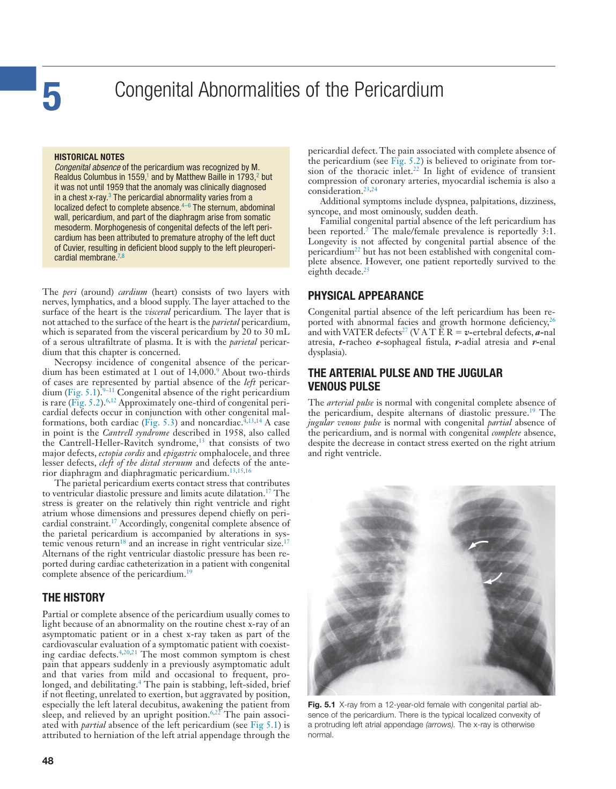

### Original PDF page 63

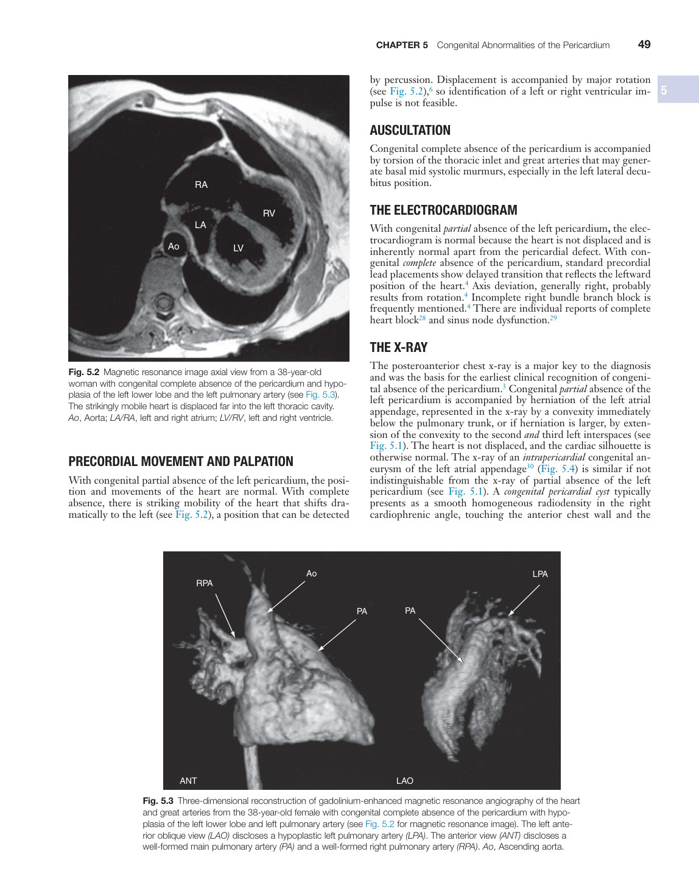

### Original PDF page 64

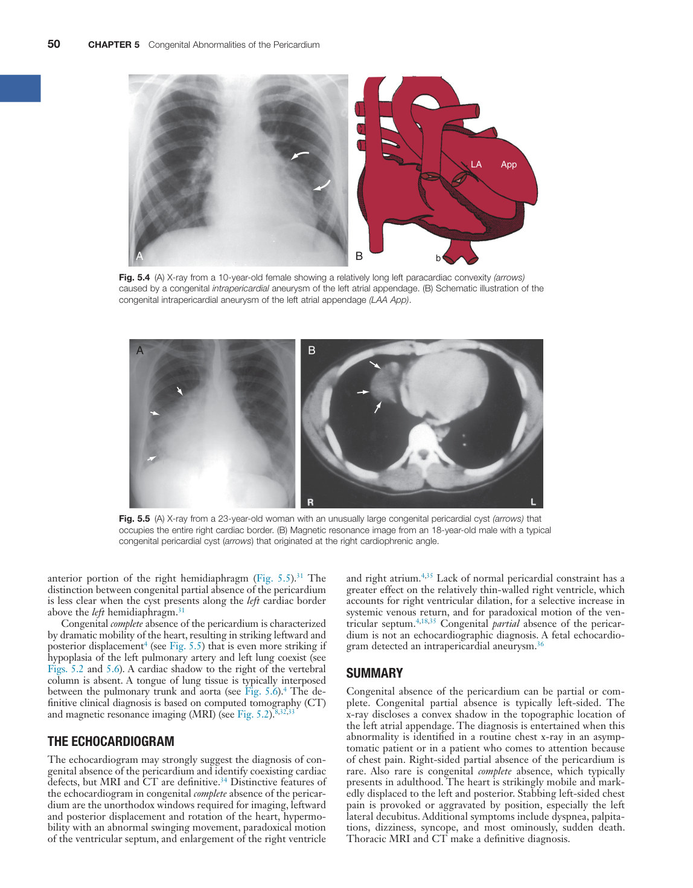

### Original PDF page 65

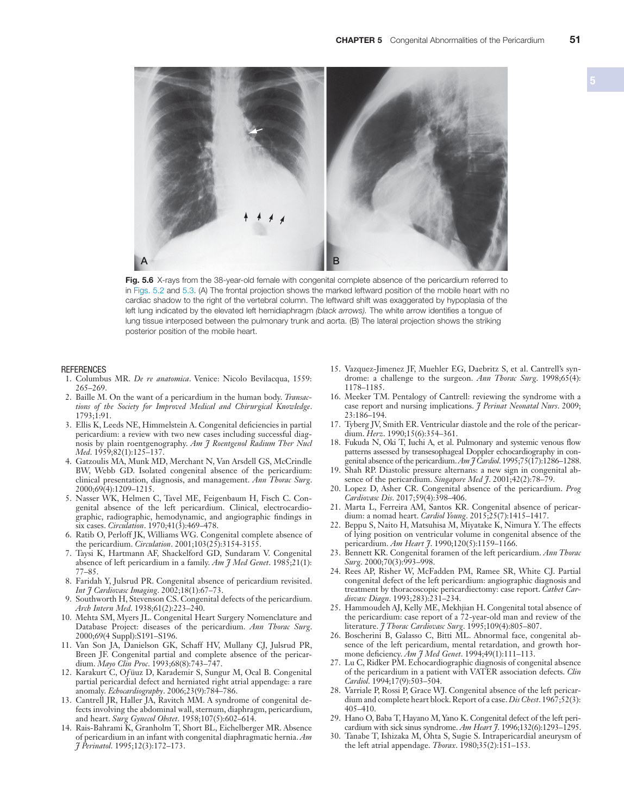

### Original PDF page 66

## Individual source figure views

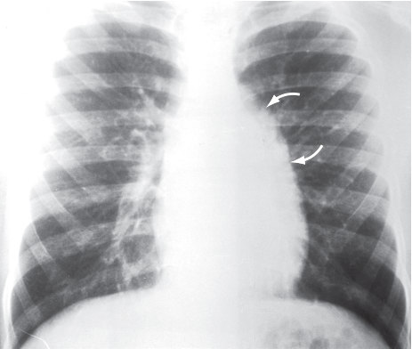

Fig. 5.1 ​X-ray from a 12-year-old female with congenital partial absence of the pericardium. There is the typical localized convexity of a protruding left atrial appendage (arrows). The x-ray is otherwise normal.

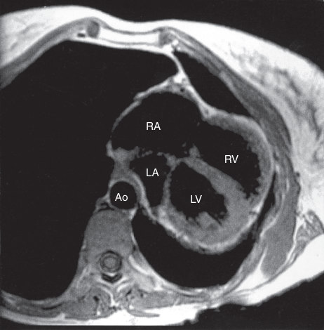

Fig. 5.2 ​Magnetic resonance image axial view from a 38-year-old woman with congenital complete absence of the pericardium and hypoplasia of the left lower lobe and the left pulmonary artery (see Fig. 5.3). The strikingly mobile heart is displaced far into the left thoracic cavity. Ao, Aorta; LA/RA, left and right atrium; LV/RV, left and right ventricle.

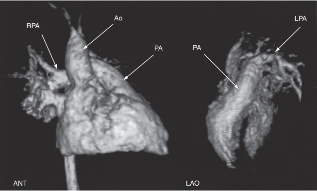

Fig. 5.3 Three-dimensional reconstruction of gadolinium-enhanced magnetic resonance angiography of the heart and great arteries from the 38-year-old female with congenital complete absence of the pericardium with hypoplasia of the left lower lobe and left pulmonary artery (see Fig. 5.2 for magnetic resonance image). The left anterior oblique view (LAO) discloses a hypoplastic left pulmonary artery (LPA). The anterior view (ANT) discloses a well-formed main pulmonary artery (PA) and a well-formed right pulmonary artery (RPA). Ao, Ascending aorta.

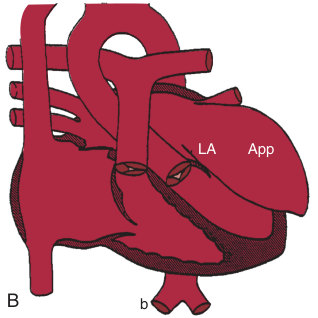

Fig. 5.4 ​(A) X-ray from a 10-year-old female showing a relatively long left paracardiac convexity (arrows) caused by a congenital intrapericardial aneurysm of the left atrial appendage. (B) Schematic illustration of the congenital intrapericardial aneurysm of the left atrial appendage (LAA App).

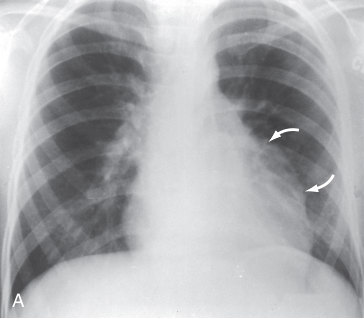

Fig. 5.4 ​(A) X-ray from a 10-year-old female showing a relatively long left paracardiac convexity (arrows) caused by a congenital intrapericardial aneurysm of the left atrial appendage. (B) Schematic illustration of the congenital intrapericardial aneurysm of the left atrial appendage (LAA App).

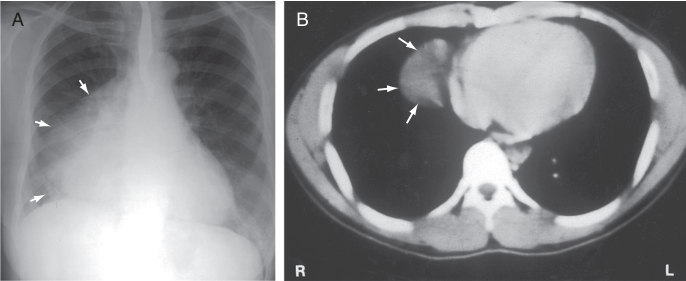

Fig. 5.5 ​(A) X-ray from a 23-year-old woman with an unusually large congenital pericardial cyst (arrows) that occupies the entire right cardiac border. (B) Magnetic resonance image from an 18-year-old male with a typical congenital pericardial cyst (arrows) that originated at the right cardiophrenic angle.

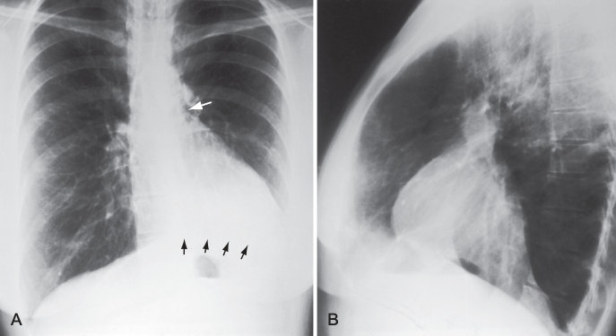

Fig. 5.6 ​X-rays from the 38-year-old female with congenital complete absence of the pericardium referred to in Figs. 5.2 and 5.3. (A) The frontal projection shows the marked leftward position of the mobile heart with no cardiac shadow to the right of the vertebral column. The leftward shift was exaggerated by hypoplasia of the left lung indicated by the elevated left hemidiaphragm (black arrows). The white arrow identifies a tongue of lung tissue interposed between the pulmonary trunk and aorta. (B) The lateral projection shows the striking posterior position of the mobile heart.
