# 19. Congenital coronary arterial fistula
> [Source credits](../../SOURCE_CREDITS.md).

## Study pillars

### Fistulous anatomy

Congenital coronary arterial fistula. A fistulous branch provides an abnormal drainage route despite usually appropriate coronary origins.

PDF p. 385

### Drainage and chamber load

Left-to-right recirculation with right and left ventricular volume loading. Blood enters the right atrium and traverses the right heart, lungs and left heart before returning to the aorta.

PDF p. 386

### Ischemia despite a small shunt

Low-resistance runoff can divert coronary blood away from myocardium. Myocardial steal depends on the low-resistance alternative pathway and the coronary territory involved, not only total pulmonary shunt size.

PDF p. 386

### Murmur localization

The chamber or vessel receiving the fistula. The drainage site determines the intracardiac sound source and corresponding thoracic location.

PDF p. 389

### Left ventricular drainage

Aortic-to-ventricular pressure difference favors diastolic fistulous flow. A coronary-to-left ventricular communication can produce an early diastolic murmur; systolic flow depends on the stoma and compression pattern.

PDF p. 390

## Full source extraction

# 19. Congenital coronary arterial fistula
> [Source credits](../../SOURCE_CREDITS.md).

## PDF page 385 | printed page 371

19 19 Congenital Coronary Arterial Fistula

### HISTORICAL NOTES

Congenital coronary arterial fistula was described by Krause in 18651 and confirmed by Abbott in 19082 and by Trevor in 1912.3

### ANATOMICAL CONSIDERATIONS

Coronary arterial fistulas are the most frequent functionally significant congenital malformations of the coronary circulation, comprising 14% of all congenital coronary artery anomalies and 0.2% to 0.4% of all congenital cardiac defects (see Chapter 29). The right and left coronary arteries arise from their appropriate aortic sinuses, but a fistulous branch of one or more than one drains into a cardiac chamber or into the pulmonary trunk, coronary sinus, vena cava, or a pulmonary vein.4 When the fistula drains into a right cardiac chamber or into the pulmonary trunk, it is arteriovenous, an appropriate term because the communication allows arterialized systemic blood—arterio—to mix with unoxygenated blood in the right side of the heart—venous. When the fistula drains into the left atrium or left ventricle, the appropriate term is coronary arterial rather than arteriovenous.

Approximately half of these fistulas arise from the right coronary artery, somewhat less from the left coronary artery, and only 5% from both coronary arteries.5 Even more rarely, all three coronary arteries are involved,6 or multiple fistulas arise from one of the three coronary arteries (right coronary artery, left anterior descending [LAD], or circumflex)7 or from a single origin coronary artery (both left and right emerging from a single ostium).8 Isolated reports have appeared of fistulas from the conus artery to the right atrium,9 from the coronary sinus to the left ventricle,10 from the left circumflex to the coronary sinus,11,12 or to the pulmonary artery,13 or of microfistulae to left ventricle.14 A significant minority of these fistulas are acquired (i.e., traumatic) because of intravascular, interventional, or surgical procedures.15–17 The contralateral coronary artery is absent in about 3% of congenital cases.

The drainage site of a coronary arterial fistula is more important than its site of origin and consists of a single vascular channel, multiple channels, or a maze of fine channels that form a diffuse network or plexus (spongy myocardium), a pattern especially likely when the left ventricle receives the fistula (Fig. 19.1B).14 Over 90% of congenital coronary arterial fistulas drain into the right side of the heart and are therefore arteriovenous (Fig. 19.2). A substantial majority, in approximate order of frequency, enter the right ventricle (40%) (Fig. 19.3), or right atrium (25%) (Figs. 19.2 and 19.4A), less commonly the pulmonary trunk (15%) (Fig. 19.5) or coronary sinus (7%) (see Fig. 19.4B),18 and rarely the hepatic vein,19 or superior vena cava.20–22 A dual right coronary artery has been accompanied by a fistulous communication.23 The coronary sinus that receives a fistula can be aneurysmal, especially if it receives fistulas from two coronary arteries (Fig. 19.6).5 A giant right coronary artery-to-superior vena caval fistula has been reported,24 as well as an aneurysmal coronary artery fistula in which the left main coronary connected to the right atrium.25 Bilateral coronary arterial fistulas usually drain into the pulmonary trunk. The relatively few that do not communicate with the right side of the heart drain into the left atrium (5%) (Fig. 19.7), left ventricle (3%) (Figs. 19.3, 19.1, and 19.8),26,27 pulmonary veins, or into both ventricles. A coronary artery–to–left

ventricular fistula is not the same as an aortic-to-left ventricular tunnel (see Chapter 7).27,28 Small coronary arterial fistulas without clinical evidence of their presence have been unexpectedly discovered during routine echocardiography (Fig. 19.9) and are incidental findings in 0.1% to 0.26% of patients undergoing routine coronary angiography.29 In a series of 14,708 coronary arteriograms, 19 congenital coronary arterial fistulas were found, and in a series of 11,000 coronary angiograms, 13 fistulas were identified.30 These incidentally found fistulas are characterized by one or more small channels that originate from the LAD coronary artery and form networks that communicate at sites in the pulmonary trunk (see Fig. 19.5).

The coronary artery that gives rise to the fistula is characteristically dilated, elongated, and tortuous (see Fig. 19.2),31 whereas the coronaries distal to the fistula are of normal caliber (see Fig. 19.2). A fistulous coronary artery may contain saccular aneurysms that reach an astonishing size and may rupture (see Figs. 19.2 and 19.5).32,33

An estimated 1% to 2% of coronary arterial fistulas close spontaneously in infants, children, and adults.34,35 Occlusion of an atherosclerotic coronary artery proximal to the fistula was responsible for closure in a 44-year-old woman. Occasionally, there is calcification of the wall of the fistula, and thrombi with embolization.

The embryogenesis of coronary arterial fistulas is uncertain. Fistulas entering the right ventricle have been related to persistence of primitive intramyocardial sinusoids36 or to the development of a rectiform vascular network in the distal branches of the involved coronary artery.18 Fistulas entering the left ventricle are believed to result from direct flow through thebesian venous channels.37 Interestingly, the veins of Thebesius were cited as evidence of direct passage of blood from one side of the heart to the other before William Harvey discovered the circulation (see Chapter 29).

Of the six coronary anlagen in the embryo, three are in the developing aorta and three are in the developing pulmonary artery (see Chapter 18).38 These anlagen normally involute except for the two from the right and left aortic sinuses. The relatively high incidence of bilateral coronary arterial–to–pulmonary arterial fistulas is in accord with this observation. A coronary arterial–to–pulmonary artery fistula may result from persistence of one or more of the pulmonary arterial anlagen, hence the term accessory coronary artery, which is either a single large channel (see Fig. 19.5), one or more smaller channels, multiple tortuous channels, or a plexiform arrangement.

### PHYSIOLOGICAL CONSEQUENCES

The physiological consequences of coronary arterial fistulas depend on the volume of blood flowing through them, the chamber or vascular bed into which they drain, and the myocardial ischemia that results from a coronary steal caused by low-resistance vascular channels. About 10% of blood from the aortic root normally enters the coronary circulation, but in the presence of a coronary arterial fistula, the volume is considerably larger. A fistula that drains into the right atrium, right ventricle or coronary sinus constitutes a left-to-right shunt. A coronary artery fistula with a left-to-right shunt may result in pulmonary hypertension and right ventricular dysfunction.39 If drainage is into the right ventricular outflow tract, pulmonary trunk (see Fig. 19.5), left atrium (see Fig. 19.1), or left ventricle (see Fig. 19.3), the hemodynamic burden is borne by the left ventricle alone.26 A fistulous coronary

## PDF page 386 | printed page 372

LAD

Circ.

Diag.

LV

A

Fig. 19.1 ​Coronary arteriograms from a 70-year-old asymptomatic female who came to medical attention because of a diastolic murmur at the left sternal border. Left ventricular ejection fraction was 58%. (A) The left anterior descending (LAD), diagonal (Diag.), circumflex (Circ.), and right coronary artery (RCA see B) were all dilated. (B) The three dilated coronary arteries gave rise to a maze of tortuous fistulae that drained into the left ventricle (LV) through a fine intramural plexus. RAO, Right anterior oblique.

RCA

RA

A

Fig. 19.2 ​(A) Selective right coronary artery (RCA) angiogram, anteroposterior view, from a 10-year-old girl with an echocardiogram demonstrating right atrial and right ventricular enlargement and an aneurysmal structure abutting the right atrium suspicious for coronary artery fistula or aneurysm. Note the dilated RCA with an aneurysmal fistulous communication with the right atrium (RA). An occluder device has been placed proximal to the fistulous entry to the RA. Note that the marginal branches of the RCA are diminutive in comparison to the ectatic proximal portion (arrowheads). (B) Lateral projection of the same angiogram.

artery receives blood during systole when its stoma is large.26,40 If the fistula drains into the inflow tract of the right ventricle, volume overload of the right ventricle coexists. If drainage is directly into the right atrium or indirectly through the coronary sinus (see Fig. 19.4), volume overload of right ventricle exists in addition to overload of the left side of the heart.

Pulmonary-to-systemic flow ratios are typically small, even negligible regardless of patient age. Shunts in excess of 2:1 are unusual, but an occasional neonate experiences congestive heart failure (Fig. 19.10, Videos 19.1–19.3) when an exceptionally large fistula drains into the left or right side of the heart.36,40

Myocardial ischemia is incurred when a coronary arterial fistula functions as a low-resistance pathway that constitutes a

RCA

LV

RCA

B

RAO

RCA

RA

B

coronary steal.26 The coronary artery that gives rise to the fistula then assumes an important role because steal from a major branch of the left coronary artery is more significant than steal from a smaller right coronary artery. Acquired coronary artery stenosis distal to a congenital coronary arterial fistula aggravates the perfusion deficit because the fistula acts as a low-resistance alternative to the acquired obstruction.

### THE HISTORY

The initial suspicion of a congenital coronary arterial fistula in an asymptomatic child or young adult is likely to be a continuous murmur. A small acoustically silent coronary arterial fistula is

## PDF page 387 | printed page 373

RV fistula

RCA

A

Fig. 19.3 ​(A) A 32-year-old with surgically repaired pulmonary atresia with intact ventricular septum undergoing transcatheter valve replacement. Right coronary angiogram (RAO projection) demonstrating a tortuous fistulous communication between the right coronary artery (RCA) and the right ventricle (RV). (B) Left coronary arteriogram from a 62-year-old woman with chest pressure and abnormal stress test. The left anterior descending (LAD) is dilated proximal to the fistulous communication with the RV, which is opacified by the contrast.

CIRC

RA

CS

A

Fig. 19.4 ​(A) Left coronary arteriogram in an 8-year-old boy. The dilated circumflex coronary artery (CIRC) is narrow (unlabeled paired arrows) as it joins the coronary sinus (CS), which drains into a dilated right atrium (RA). (B) Left coronary arteriogram in an 18-year-old female with a coronary arterial fistula from a dilated circumflex artery CIRC to a dilated coronary sinus (Cor. Sinus).

usually discovered during routine echocardiography or coronary angiography (see earlier). When a coronary arterial fistula drains into the low-pressure right or left atrium, the continuous murmur dates from birth because the pressure gradient responsible for the murmur is present in utero. Conversely, coronary arterial fistulas that drain into the right ventricle or pulmonary trunk do not generate continuous murmurs until after the neonatal fall in pulmonary vascular resistance. The continuous murmur is overlooked when it is soft and localized to an atypical site. An isolated

19

LAD

RV

fistula

B

Cor. Sinus

Circ.

B

diastolic murmur may be heard but misinterpreted. Coronary arterial fistulas are mistaken for patent ductus arteriosus (Fig. 19.11), which occasionally coexists.41, 42 A coronary arteriovenous fistula may present with angina, 26,43 and occasionally with a pericardial effusion,13 or infective endocarditis.22

The male/female ratio is about equal. Survival into adulthood is expected, but lifespan is not normal.18 Longevity has been reported in the sixth to ninth decade (Fig. 19.12),13,44 and the diagnosis was made as late as the seventh to ninth decade. 45

## PDF page 388 | printed page 374

PA

Cx

F

OM1

An

D1

LAD

A

Fig. 19.5 ​(A) A 28-year-old with atypical chest pain, electrocardiogram-gated cardiac computed tomography, left anterior oblique (LAO) cranial projection, demonstrates a fistula from the left anterior descending (LAD) to the pulmonary artery (PA); note the aneurysm (An) within the fistula. The other left coronary segments are labeled, 1st diagonal artery (D1), circumflex artery (Cx), and the first obtuse marginal artery (OM1). (B) Lateral posterior oblique projection.

3 LICS S1 S2

A B

Fig. 19.6 ​Phonocardiograms from a 37-year-old female with a coronary arterial fistula between the right coronary artery and outflow tract of the right ventricle. (A) A continuous murmur that peaked before and after the second heart sound (S2) was mistaken for a patent ductus murmur even though the maximum location was the third left intercostal space (3 LICS) and even though the murmur changed configuration from beat to beat (A, B, C).

A 68-year-old professional athlete was undiagnosed until acquired coronary artery disease prompted coronary angiography, which disclosed bilateral coronary arterial fistulas.

The majority of patients, especially those younger than 20 years of age, are asymptomatic when the coronary arterial fistula is first diagnosed.18 An uncommon if not rare exception is the infant with an exceptionally large fistula (see Fig. 19.10).36,40 Symptoms and complications, in approximate order of frequency, include dyspnea, fatigue, myocardial ischemia,26 congestive heart failure, sudden death,46 infective endocarditis,22,47 and rupture.48 Obstruction of the superior vena cava has been caused by a large fistulous saccular aneurysm, one of which ruptured at age 82 years.49 Atrial fibrillation that accompanies drainage into the right or left atrium or coronary sinus heralds congestive heart failure (see Fig. 19.12). A coronary steal may be the cause of myocardial ischemia and angina pectoris (see earlier), and ischemia has an undesirable effect on left

B

C

ventricular function.26,50 Spontaneous closure of a coronary arterial fistula is uncommon but not rare (see earlier).34,35

### PHYSICAL FINDINGS

Catabolic effects of congestive heart failure are reserved for the rare occurrence of large fistulas in infants.

The arterial pulse is normal because flow through the fistula is usually small. However, when the right ventricle, right atrium, or left atrium receives a large fistula, the arterial pulse is brisk and the pulse pressure is wide because a fall in aortic diastolic pressure caused by flow into low-pressure drainage sites is accompanied by a rise in systolic pressure caused by an increase in left ventricular stroke volume and ejection velocity (Fig. 19.13). When a large fistula drains into the left ventricle, the hemodynamic response is analogous to aortic regurgitation.

## PDF page 389 | printed page 375

Ao

LA

RCA

Fig. 19.7 ​Aortogram (Ao) from an 11-month-old boy with a coronary arterial fistula that arose from the right coronary artery (RCA) and drained into the left atrium (LA).

LCA

Ao

LV

A

Fig. 19.8 ​(A) Aortogram (Ao) from a 5-year-old girl with a coronary arterial fistula that originated from the proximal left coronary artery (LCA) and drained into the left ventricle (LV). The proximal left coronary is dilated because it fed the fistula (unmarked left arrow). (B) A left coronary arteriogram (LCA) visualized the dilated tortuous fistula (unmarked arrows) that drained into the LV.

The jugular pulse is normal even when a small or moderate- 19 sized fistula drains directly into the right atrium. With the advent of congestive heart failure induced by a large fistula (see Fig. 19.12B), the mean right atrial pressure rises. Obstruction of the superior vena cava by the saccular aneurysm of a fistula that drained into the right atrium elevated the mean jugular venous pressure and damped the A and V waves. A giant left atrium caused by a large coronary arterial–to–left atrial fistula in a 64-year-old male contributed to inferior vena caval obstruction.

A large fistula results in a hyperdynamic left ventricular impulse because left ventricular volume overload accompanies all drainage sites. If the fistula drains into the left atrium or left ventricle or into the pulmonary artery, an isolated left ventricular impulse is palpated. If the fistula drains into the right atrium or into the right ventricular inflow tract, volume overload is imposed on both ventricles, so right and left ventricular impulses are both palpated.

A continuous murmur that is an auscultatory hallmark of coronary arterial fistulas (Figs. 19.14 through 19.16)51–54 may be mistaken for the continuous murmur of patent ductus arteriosus.41,42 The distinction is based on the configuration of the murmur (see Fig. 19.11) and on its precordial location that is determined by the drainage site of the fistula, not by its coronary artery of origin (Fig. 19.17). Whether the fistula drains directly into the right atrium or drains into the right atrium indirectly through the coronary sinus (see Fig. 19.4), intracardiac phonocardiography records the murmur within the right atrial cavity (see Fig. 19.14), and the thoracic wall site is topographically appropriate at the right upper or lower sternal border or over the sternum (see Fig. 19.16).35,41 When a left circumflex coronary arterial fistula drains into the coronary sinus (see Fig. 19.4A), the continuous murmur is heard in the back between the spine and left scapula. When the fistula drains into the inflow tract of the right ventricle, the murmur sites are along the mid to lower

LCA

LV

B

## PDF page 390 | printed page 376

Coronary artery fistula

RV

LCA

RA Ao

Fig. 19.9 ​Transthoracic echocardiogram, parasternal short-axis view with color Doppler in a patient with a silent, incidentally discovered left coronary artery (LCA) to pulmonary artery fistula. The fistula enters the pulmonary artery just above the level of the pulmonary valve annulus and can be mistaken for pulmonary regurgitation given that most of the flow through the fistula is in diastole. Ao, Aorta; RA, right atrium; RV, right ventricle.

left sternal border, over the lower sternum, or subxiphoid (see Fig. 19.17). When the fistula drains into the outflow tract of the right ventricle, the murmur is maximum along the upper to mid left sternal border (see Figs. 19.11 and 19.17).52 With drainage into the pulmonary trunk, the continuous murmur is prominent at the upper left sternal border (see Fig. 19.17).51 A small or plexiform pulmonary arterial fistula discovered incidentally at coronary angiography (see Fig. 19.3B) is not accompanied by a chest wall murmur. When a fistula drains into the left atrium, the murmur is maximum along the upper left sternal border (see Fig. 19.17) and may radiate toward the left anterior auxiliary line. A fistula that drains into a left superior vena cava is accompanied by a continuous murmur at the upper to mid left sternal edge.21,22 The coronary arterial fistulas that are especially mistaken for patent ductus arteriosus are those that drain into the pulmonary trunk, left atrium, or right ventricular outflow tract. Because the majority of coronary arterial fistulas drain into the body of the right ventricle or into the right atrium, the accompanying continuous murmur is heard at sites remote from the ductus location. Spontaneous closure of a coronary arterial fistula (see earlier) is accompanied by diminution or disappearance of the murmur.34

Coronary arterial fistulas that drain into the right atrium, left atrium, or right ventricle generate continuous murmurs because pressure differences between the aortic root and the low-pressure receiving chambers are continuous (i.e., without interruption from systole into diastole). The configuration of continuous murmurs from these different fistulous sources differs from each other and differs from the continuous murmur of patent ductus arteriosus. When the fistula drains into the right atrium, coronary sinus, or left atrium, pressure gradients between aortic root and receiving chamber are much larger during systole than during diastole, so the murmur is louder in systole (see Fig. 19.15). When the fistula communicates with the pulmonary trunk, the continuous murmur may envelope the second heart sound as in patent ductus, but there are no eddy sounds.53,54 Flow patterns are more complex when the fistula drains into the right ventricle, because right ventricular contraction compresses the fistula during its transmural course (see Fig. 19.11). Compression that is

.48

V

5

RV

RCA

−.48

Ao

10

LV

LA

15

A

46 1:2 HR

.48

V

5

RVOT

−.48

10

RCA

Fistula AO

RA

15

B 47 2:2 HR

Fig. 19.10 ​(A) Echocardiogram (parasternal short axis) with color Doppler from a 3-week-old girl presenting with congestive heart failure and a continuous murmur. Note the severely dilated proximal right coronary artery (RCA), which should arouse suspicion for either a coronary artery fistula or an anomalous left coronary artery from the pulmonary artery (refer to Chapter 18). Note that the left atrium (LA), left ventricle (LV), and right ventricle (RV) are enlarged, suggesting that the fistulous communication is proximal to the tricuspid valve or within the body of the RV. (B) Parasternal short-axis view with color Doppler demonstrates continuous flow through the fistula into a dilated right atrium (RA). Note that the right ventricular outflow tract (RVOT) is dilated. This type of large coronary to right atrial fistula should be suspected in a patient with a continuous murmur and enlargement of all cardiac chambers, the other diagnosis on the differential would be a ruptured sinus of Valsalva aneurysm into the right atrium (refer to Chapter 20). AO, Aorta.

sufficient to reduce systolic flow softens the systolic portion of the murmur (see Fig. 19.11C). Less compression increases the intramural systolic gradient, so the systolic portion of the continuous murmur is louder (see Figs. 19.13 and 19.11B).55 A wide aortic pulse pressure (high systolic, low diastolic) reinforces the systolic portion of the continuous murmur (see Fig. 19.13). When congestive heart failure elevates right ventricular diastolic pressure, a continuous murmur becomes only systolic because elevated diastolic pressure decreases diastolic flow.

An early diastolic murmur is generated when a fistula drains into the left ventricle. Blood flow into the fistula during systole may generate a systolic murmur when a large fistulous stoma remains widely patent during left ventricular contraction. When drainage is through Thebesian venous channels, a coronary arterial-to-left ventricular fistula is silent.37

## PDF page 391 | printed page 377

RA phono

Fig. 19.11 ​Phonocardiogram from within the right atrium (RA phono) of a 27-year-old male with a coronary arterial fistula between the right coronary artery and right atrium. In the first cycle, the continuous murmur is louder in systole (vertical arrow). In the second cycle, the murmur is equal in systole and diastole (paired arrows).

.48

V

5 RCA

−.48

Ao

10

53 2:2 HR

Fig. 19.12 ​Echocardiogram (short axis) from a female neonate with congestive heart failure caused by a large right coronary arterial fistula that drained into outflow tract of the right ventricle. The proximal right coronary artery (RCA) is markedly dilated. Ao, Aorta.

Because coronary arterial fistulas usually deliver relatively small blood volumes through narrow pathways, the accompanying continuous murmur is relatively localized, medium to moderately high frequency, and grade 3 or less. Large fistulas generate coarse harsh rough murmurs that radiate and are accompanied by thrills. The Valsalva maneuver causes a coronary arterial-to-right ventricular fistulous murmur to soften as systolic pressure in the right ventricle rises. Occasionally, a coronary arterial-to-right atrial fistulous continuous murmur diminishes appreciably during held inspiration and becomes tumultuous during exhalation.

The second heart sound splits normally during respiration even when the right atrium receives the fistula. This is so for two reasons: first, the shunt volume is shared equally by the right and left sides of the heart because shunted blood must traverse both ventricles on its way back to the aorta. Second, inspiration results in an increase in right ventricular stroke volume and a decrease in left ventricular stroke volume because the shunt into the right atrium occurs with an intact atrial septum (see Chapter 12).

3 LICS

19

S2

CAR

Fig. 19.13 ​Phonocardiogram and carotid pulse (CAR) from a 47-year-old man with a coronary arterial fistula between the right coronary artery and outflow tract of the right ventricle. The continuous murmur was much louder in systole (paired arrows) and was maximum in the third left intercostal space (3 LICS). S2, Second heart sound. The pulse pressure was wide (170/68 mm Hg). Pulmonary-to-systemic flow ratio was 1.7 to 1.

### THE ELECTROCARDIOGRAM

Electrocardiographic abnormalities are related chiefly to the chamber receiving the shunt and to the volume of blood flowing through the fistula. Fistulas that drain into the right atrium or coronary sinus result in biatrial P wave abnormalities; drainage into the right ventricle, pulmonary trunk, or left atrium result in left atrial P wave abnormalities (Fig. 19.18), and drainage into the right atrium or coronary sinus result in right atrial P wave abnormalities. Atrial fibrillation occasionally occurs in older patients when fistulas drain into the right atrium, left atrium, or coronary sinus (see Fig. 19.12B).5 Fistulas into the right ventricular outflow tract, pulmonary trunk, left atrium, or left ventricle cause left ventricular hypertrophy (see Fig. 19.18). Biventricular hypertrophy occurs with drainage into the right atrium or into the body of the right ventricle because shunted blood circulates through both ventricles. A coronary steal (see earlier) induces ischemic ST segment and T wave changes at rest or during exercise stress testing. An ischemic pattern is more likely to occur if the coronary steal involves a major branch of the left coronary artery. Myocardial infarction is rarely a feature of the electrocardiogram, although a fistula may aggravate the perfusion deficit of coexisting acquired coronary artery disease (see earlier).

## PDF page 392 | printed page 378

2 LICS

2 RICS

Fig. 19.14 ​Phonocardiograms from an 8-year-old boy with a coronary arterial fistula from the circumflex coronary artery to the coronary sinus (see angiogram, Fig. 19.4A). The continuous murmur was louder in systole and maximum in the second and third right intercostal spaces (2 RICS) which was topographically appropriate for the drainage site. 2 LICS, Second left intercostal space. The electrocardiogram shows an incidental delta wave.

3 RICS

S1 S2 4 LICS

CAR

Fig. 19.15 ​Phonocardiograms from a 23-year-old woman with a right coronary arterial fistula to the right atrium. A continuous murmur was loudest in the third right intercostal space (3 RICS). 4 LICS, Fourth left intercostal space; CAR, carotid pulse; S1 and S2, first and second heart sounds.

### THE X-RAY

The radiological features of coronary arterial fistulas reflect the volume and duration of flow and the site of drainage. Young patients with small fistulas have normal x-rays. Infants with large fistulas and congestive heart failure have appreciable cardiomegaly.36,40 A large

Into PA or LA

Into RA

Into RV

Fig. 19.16 ​Schematic illustration of precordial murmur locations as determined by the site of coronary arterial fistula drainage. (Adapted from Sakakibara S, Yokoyama M, Takao A, et al. Coronary arteriovenous fistula. Nine operated cases. Am Heart J. 1966;72(3):307–314.)

3 2 1 aVL aVF aVR

V1 V2 V3 V4 V5 V6

Fig. 19.17 ​Electrocardiogram from a 47-year-old man with a right coronary arterial fistula that entered the outflow tract of the right ventricle. The phonocardiogram and carotid pulse are shown in Fig. 19.13. P waves are slightly bifid in leads 1, 2, and aVR, and the P terminal force is abnormal in lead V1. There are voltage and repolarization criteria for left ventricular hypertrophy in leads V5-6.

fistula that drains into the right atrium or coronary sinus is accompanied by increased pulmonary vascularity and a convex pulmonary trunk with biventricular and biatrial enlargement (see Figs. 19.12 and 19.19).18 Drainage into the right ventricle results in a similar picture but without dilation of the right atrium. When a coronary arterial fistula drains into the pulmonary trunk or left atrium, chamber enlargement is confined to the left ventricle and left atrium. A giant left atrium was reported in a 64-year-old man with a right coronary arterial-to-left atrial fistula.

Multiple saccular aneurysms of an enlarged tortuous coronary arterial fistula are occasionally recognized in the x-ray as an irregular silhouette along the right or left cardiac border. A giant aneurysm associated with a left coronary artery-to-pulmonary artery fistula presented as a calcified mediastinal mass.56 Calcification in the wall of a fistula is only occasionally visible.

## PDF page 393 | printed page 379

PT

RA

Fig. 19.18 ​X-ray from a 23-year-old woman with a right coronary arterial fistula that drained into the right atrium (RA). The fistula reveals itself as a shadow to the right of the vertebral column (white and black arrows). The pulmonary trunk (PT) is moderately dilated. The phonocardiogram is shown in Fig. 19.15.

RA

LV

A

Fig. 19.19 ​(A) X-ray from a 64-year-old man with a large right coronary arterial-to-right atrial fistula. Pulmonary vascularity is increased. The unmarked white arrow identifies the prominent cross-section of an intrapulmonary artery reflecting increased flow. A dilated right atrium (RA) occupies the lower right cardiac border, and a moderately dilated left ventricle (LV) occupies the apex. (B) X-ray from the same patient after the onset of atrial fibrillation at age 75 years. The size of the right atrium (RA) has increased dramatically. The LV is much larger and extends below the left hemidiaphragm. There is a small right pleural effusion.

### THE ECHOCARDIOGRAM

19

Transthoracic and transesophageal echocardiography with color flow imaging and Doppler interrogation identify the origin and drainage site of coronary arterial fistulas and assess their functional consequences.57–59 Most drainage sites are characterized by continuous turbulent flow, but some are visible only during diastole.60 The stoma of a fistulous coronary artery considerably exceeds in size the origin of a normal coronary artery (see Fig. 19.10).58 The drainage site can be identified by color flow imaging (see Figs. 19.5 and 19.9),57 whereas Doppler interrogation establishes systolic and diastolic flow patterns58 that shed light on the configuration of accompanying murmurs.

Coronary arterial fistulas drain into the pulmonary trunk immediately distal to the pulmonary valve, and flow proceeds upward along the medial wall (see Fig. 19.9). Alternatively, a small fistula that drains into the pulmonary artery at a site more distal to the pulmonary valve may exhibit only diastolic flow (see Fig. 19.9).

Color flow imaging distinguishes a coronary arterial fistula that drains into the right atrium or right ventricle from a ruptured sinus of Valsalva aneurysm (see Chapter 20). A coronary arterial fistula that drains into the pulmonary trunk can be distinguished from a patent ductus arteriosus (see Chapter 17) and from anomalous origin of the left coronary artery from the pulmonary trunk (see Chapter 18), and a fistula that drains into the left ventricle can be distinguished from an aortic-to-left ventricular tunnel (see Chapter 7).

Echocardiography characterizes the hemodynamic response to flow through a coronary arterial fistula and characterizes the response of the left ventricle to potential ischemic effects of a coronary steal. The coronary sinus is dilated when it receives one or more fistulas (see Figs. 19.4B and 19.6). Left ventricular ejection fraction reflects the volume overload delivered through the fistula, and global and regional wall motion reflect potentially adverse ischemic effects of a coronary steal.

RA

LV

B

## PDF page 394 | printed page 380

### SUMMARY

17. Renard VP, Vandenbogaerde J. Fistula between the left internal

The physical appearance, arterial pulse, and jugular venous pulse are usually normal. Precordial palpation detects the impulse(s) of either or both ventricles, depending on the drainage site of the fistula. A precordial continuous murmur located inappropriately for a patent ductus arteriosus is often the first index of suspicion of a congenital coronary arterial fistula in an asymptomatic child or young adult. Suspicion is heightened if the murmur peaks in either systole or diastole but not immediately before and after the second heart sound. The electrocardiogram reflects the volume of blood delivered through the fistula to individual recipient chambers. Angina due to a coronary steal stands out in young patients. The x-ray reflects the response of individual chambers to the volume of the left-to-right shunt. Distinctive but rarely seen in the x-ray are the shadows of saccular aneurysms of a coronary arterial fistula as it courses along the right or left cardiac border. Echocardiography identifies the origin and drainage site of the fistula and establishes the physiological consequences of the left-to-right shunt and the potential ischemic effects of a coronary steal.

18. Ogden JA. Congenital anomalies of the coronary arteries. Am J

19. Gorgulu S, Nurkalem Z, Eren M. Right coronary artery hepatic vein

20. Galbraith AJ, Werner D, Cutforth RH. Fistula between left coronary

21. Marcus B, Sivazlian K, Gordon LS. Echocardiographic detection of left

22. Stansel HC Jr, Fenn JE. Coronary arteriovenous fistula between the

23. Huang ZQ, Chen SJ, Chen J. Dual right coronary artery associated

24. Lapenna E, Torracca L, De Bonis M, Alfieri O. A giant right coronary

25. Shiga Y, Tsuchiya Y, Yahiro E, et al. Left main coronary trunk con-

26. Cheng TO. Left coronary artery-to-left ventricular fistula: demonstration

27. Takeda K, Okuda Y, Matsumura K, Sakuma H, Tagami T, Nakagawa

REFERENCES 1. Krause W. Ueber den ursprung einer accessorischen A. Coronaria

Cordis aus der. A Pulmonis Z Rationelle Med. 1865;24:225. 2. Abbott M. Anomalies of the coronary arteries. In: Osier W, ed. Mod-

28. Sung CS, Leachman RD, Zerpa F, Angelini P, Lufschanowski R.

ern Medicine. Philadelphia: Lea & Febiger; 1908. 3. Trevor RS. Aneurysm of the descending branch of the right coronary

29. Phillips PA, Libanoff AJ. Arteriovenous communication associated

artery, situated in the wall of the right ventricle, and opening into the cavity of the ventricle, associated with great dilatation of the right coronary artery and non-valvular infective endocarditis. Proc R Soc Med. 1912;5(Sect Study Dis Child):20–26. 4. Liberthson RR, Sagar K, Berkoben JP, Weintraub RM, Levine FH.

30. Said SA, Landman GH. Coronary-pulmonary fistula: long-term follow-

31. Muir CS. Coronary arterio-cameral fistula. Br Heart J. 1960;22:374–384. 32. Braudo JL, Javett SN, Zion MM, Adler DI. Congenital coronary

Congenital coronary arteriovenous fistula. Report of 13 patients, review of the literature and delineation of management. Circulation. 1979;59(5):849–854. 5. Duerinckx AJ, Perloff JK, Currier JW. Arteriovenous fistulas of the

33. Lim CH, Tan NC, Tan L, Seah CS, Tan D. Giant congenital aneu-

circumflex and right coronary arteries with drainage into an aneurysmal coronary sinus. Circulation. 1999;99(21):2827–2828. 6. Reddy K, Gupta M, Hamby RI. Multiple coronary arteriosystemic

34. Mahoney LT, Schieken RM, Lauer RM. Spontaneous closure of a coro-

35. Farooki ZQ, Nowlen T, Hakimi M, Pinsky WW. Congenital coro-

fistulas. Am J Cardiol. 1974;33(2):304–306. 7. Schamroth CL, Sareli P, Curcio A, Barlow JB. Multiple coronary ar-

tery-right ventricle fistulas. Am Heart J. 1985;109(6):1388–1390. 8. Gupta PD, Rahimtoola SH, Miller RA. Single coronary artery—right

36. Verani MS, Lauer RM. Echocardiographic findings in right coronary

ventricle fistula. Br Heart J. 1972;34(7):755–757. 9. Lipoff JI. Anomalous origin of the left main coronary artery from the

37. Cha SD, Singer E, Maranhao V, Goldberg H. Silent coronary artery-

right sinus of Valsalva with coronary AV fistula of the conus artery. Chest. 1988;93(1):203–204. 10. Gnanapragasam JP, Houston AB, Lilley S. Congenital fistula between

38. Heifetz SA, Robinowitz M, Mueller KH, Virmani R. Total anomalous

the left ventricle and coronary sinus: elucidation by colour Doppler flow mapping. Br Heart J. 1989;62(5):406–408. 11. Aoyagi S, Fukunaga S, Ishihara K, Egawa N, Hosokawa Y, Nakamura

39. Chang YP, Chan SW, Chai JW, et al. Pulmonary hypertension and

E. Coronary artery fistula from the left circumflex to the coronary sinus. Int Heart J. 2006;47(1):147–152. 12. Hayabuchi Y. Coronary arteriovenous fistula: direct connection of

the proximal circumflex artery to the coronary sinus. Pediatr Cardiol. 2010;31(1):168–169. 13. Bellisarii FI, Marchetti M, Caputo M, De Caterina R. Coronary ar-

40. Starc TJ, Bowman FO, Hordof AJ. Congestive heart failure in a

teriovenous fistula presenting as chronic pericardial effusion. J Cardiovasc Med (Hagerstown). 2006;7(6):449–453. 14. Cartoni D, Salvini P, De Rosa R, Cortese A, Nazzaro MS, Tanzi P.

41. Bosher LH Jr, Vasli S, Mc Cue CM, Belter LF. Congenital coronary

Images in cardiovascular medicine. Multiple coronary artery-left ventricle microfistulae and spongy myocardium: the eagerly awaited link? Circulation. 2007;116(3):e81-e84. 15. Tabrah F, Aintablian A, Hamby RI. Coronary arteriovenous fistula

42. Shaffer AB, St Ville J, Mackler SA. Coronary arteriovenous fistula

43. Said SA, van der Werf T. Dutch survey of coronary artery fistulas in

complicating aortocoronary bypass surgery. Am Heart J. 1973;85(4): 534–537. 16. Wexberg P, Gottsauner-Wolf M, Kiss K, Steurer G, Glogar D. An

44. Brack MJ, Hubner PJ, Firmin RK. Successful operation on a coro-

iatrogenic coronary arteriovenous fistula causing a steal phenomenon: an intracoronary Doppler study. Clin Cardiol. 2001;24(9): 630–632.

45. Ben-Gal T, Herz I, Solodky A, Snir E, Birnbaum Y. Coronary artery-

thoracic artery and the coronary sinus. N Engl J Med. 2000;343(2): 149–150.

Cardiol. 1970;25(4):474–479.

fistula: a case report. Echocardiography. 2006;23(10):869–871.

artery and superior vena cava. Br Heart J. 1981;46(1):99–100.

circumflex coronary artery to left superior vena cava fistula by use of Doppler color flow mapping. J Am Soc Echocardiogr. 1991;4(4):405–407.

left coronary artery and persistent left superior vena cava complicated by bacterial endocarditis. Ann Surg. 1964;160:292–296.

coronary artery fistula. Eur Heart J. 2008;29(8):968.

artery-to-superior vena cava fistula. Eur J Cardiothorac Surg. 2007; 31(3):546.

necting into right atrium with an aneurysmal coronary artery fistula. Int J Cardiol. 2008;123(2):e28–e30.

of coronary steal phenomenon. Am Heart J. 1982;104(4 Pt 1):870–872.

T. Giant fistula between the right coronary artery and the left ventricle: diagnostic significance of right posterior oblique chest radiograph. AJR Am J Roentgenol. 1992;159(5):1087–1090.

Aortico-left ventricular tunnel. Am Heart J. 1979;98(1):87–93.

with obstructive arteriosclerotic coronary artery disease and myocardial infarction. Chest. 1974;65(1):106–108.

up in operated and non-operated patients. Int J Cardiol. 1990;27(2): 203–210.

arteriovenous fistula. Br Med J. 1962;1(5278):601–604.

rysm of the right coronary artery. Am J Cardiol. 1977;39(5):751–753.

nary artery fistula in childhood. Pediatr Cardiol. 1982;2(4):311–312.

nary artery fistulae: a review of 18 cases with special emphasis on spontaneous closure. Pediatr Cardiol. 1993;14(4):208–213.

arterial-right ventricular fistula. Report of a neonate with fatal congestive heart failure. Am J Cardiol. 1975;35(3):444–447.

left ventricular fistula: a disorder of the thebesian system? Angiology. 1978;29(2):169–173.

origin of the coronary arteries from the pulmonary artery. Pediatr Cardiol. 1986;7(1):11–18.

right ventricular dysfunction in patients with left to right shunt coronary artery fistula: evaluation with cardiac CT. Int J Cardiovasc Imaging. 2016;32 Suppl 1:91–104.

newborn secondary to coronary artery-left ventricular fistula. Am J Cardiol. 1986;58(3):366–367.

arteriovenous fistula associated with large patent ductus. Circulation. 1959;20(2):254–261.

with patent ductus arteriosus. Am Heart J. 1963;65:758–765.

adults: congenital solitary fistulas. Int J Cardiol. 2006;106(3):323–332.

nary arteriovenous fistula in a 74 year old woman. Br Heart J. 1991; 65(2):107–108.

main pulmonary artery fistula. Clin Cardiol. 1999;22(4):310.

## PDF page 395 | printed page 381

54. Nunn DB, Thrower WB, Boone JA, Lipton M. Coronary arteriove-

46. Lau G. Sudden death arising from a congenital coronary artery fistula.

Forensic Sci Int. 1995;73(2):125–130. 47. Tsagaris TJ, Hecht HH. Coronary artery aneurysm and subacute

55. Puyau FA, Collins HA. Congenital coronary arteriovenous fistula.

bacterial endarteritis. Ann Intern Med. 1962;57:116–121. 48. Habermann JH, Howard ML, Johnson ES. Rupture of the coronary

56. Okita Y, Miki S, Kusuhara K, et al. Aneurysm of coronary arteriove-

sinus with hemopericardium. A rare complication of coronary arteriovenous fistula. Circulation. 1963;28:1143–1144. 49. Bauer HH, Allmendinger PD, Flaherty J, Owlia D, Rossi MA, Chen C.

57. Trask JL, Bell A, Usher BW. Doppler color flow imaging in detection

Congenital coronary arteriovenous fistula: spontaneous rupture and cardiac tamponade. Ann Thorac Surg. 1996;62(5):1521–1523. 50. Said SA, van der Werf T. Dutch survey of congenital coronary artery

58. Velvis H, Schmidt KG, Silverman NH, Turley K. Diagnosis of coro-

fistulas in adults: coronary artery-left ventricular multiple micro-fistulas multi-center observational survey in the Netherlands. Int J Cardiol. 2006;110(1):33–39. 51. Biorck G, Crafoord C. Arteriovenous aneurysm on the pulmonary artery

59. Zahn EM, Smallhorn JF, Egger G, Burrows PE, Rebecca IM, Free-

simulating patent ductus arteriosus botalli. Thorax. 1947;2(2):65–74. 52. Davis C Jr, Dillon RF, Fell EH, Gasul BM. Anomalous coronary ar-

tery simulating patent ductus arteriosus. J Am Med Assoc. 1956;160(12): 1047–1050. 53. Ernst CB, Klassen KP, Ryan JM. Vascular malformation overlying the

60. Vitarelli A, De Curtis G, Conde Y, et al. Assessment of congenital

pulmonary artery simulating a patent ductus arteriosus. Circulation. 1961;23:759–761.

19

nous fistula simulating patent ductus arteriosus. Am Surg. 1962;28: 476–482.

Am J Dis Child. 1963;106:65–72.

nous fistula presenting as a calcified mediastinal mass. Ann Thorac Surg. 1992;54(4):771–773.

and mapping of left coronary artery fistula to right ventricle and atrium. J Am Soc Echocardiogr. 1990;3(2):131–134.

nary artery fistula by two-dimensional echocardiography, pulsed Doppler ultrasound and color flow imaging. J Am Coll Cardiol. 1989; 14(4):968–976.

dom RM. Echocardiographic diagnosis of fistula between the left circumflex coronary artery and the left atrium. Pediatr Cardiol. 1992; 13(3):178–180.

coronary artery fistulas by transesophageal color Doppler echocardiography. Am J Med. 2002;113(2):127–133.

## Complete original page views

Searchable extraction can lose mathematical symbols or reading order. These original pages preserve source layout, symbols and credits.

### Original PDF page 385

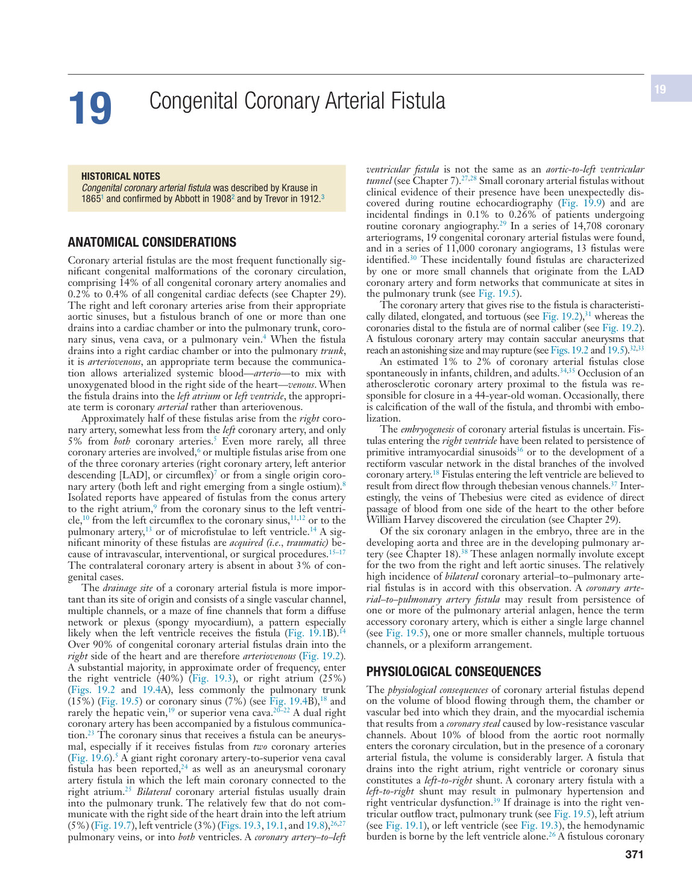

### Original PDF page 386

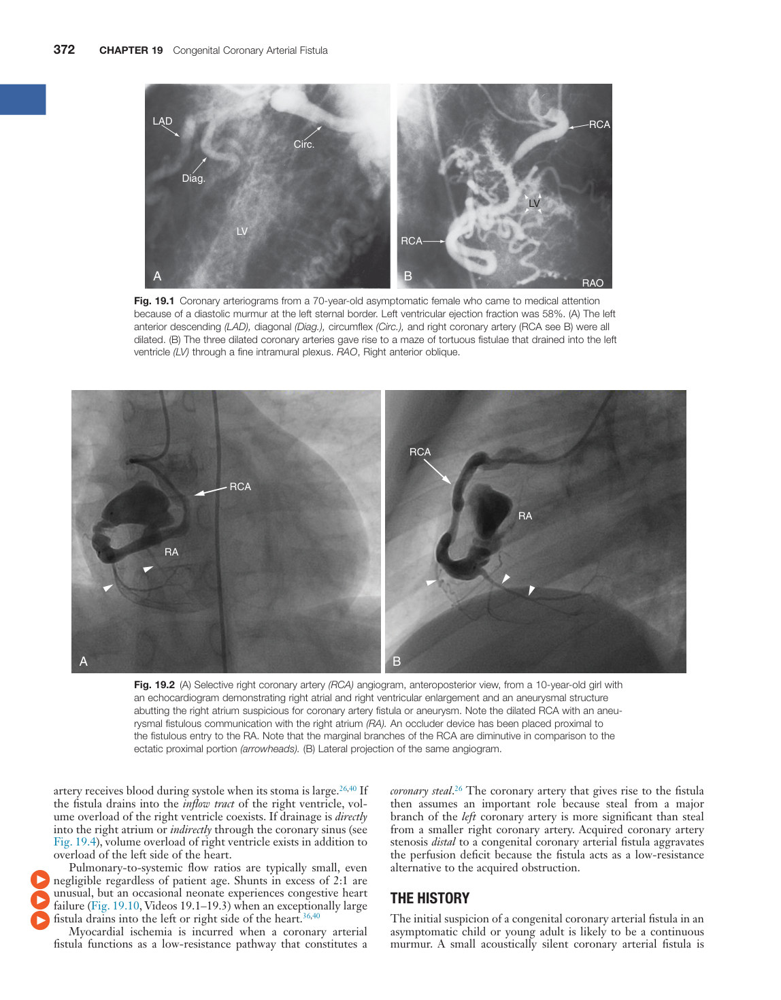

### Original PDF page 387

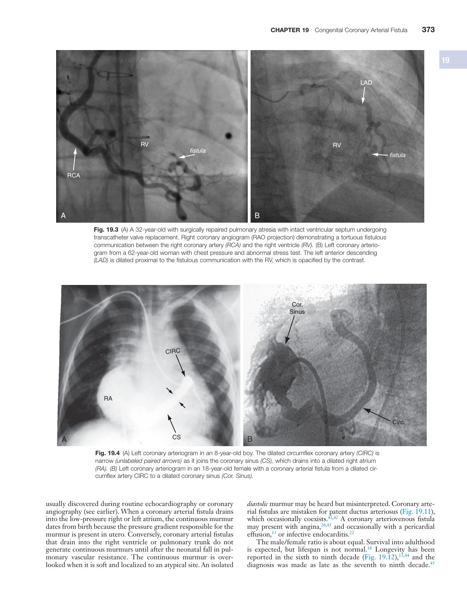

### Original PDF page 388

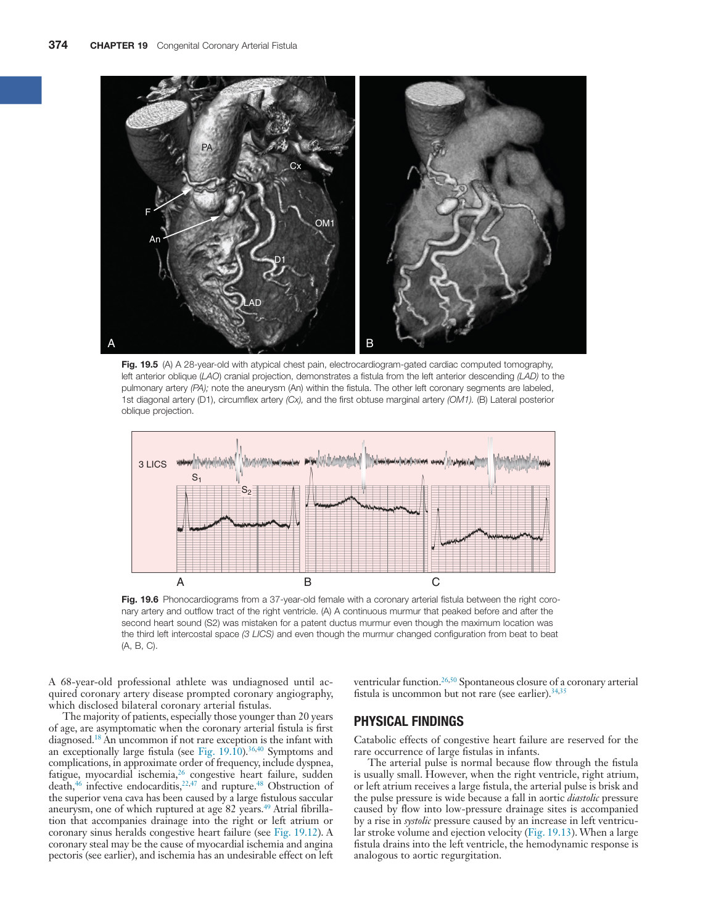

### Original PDF page 389

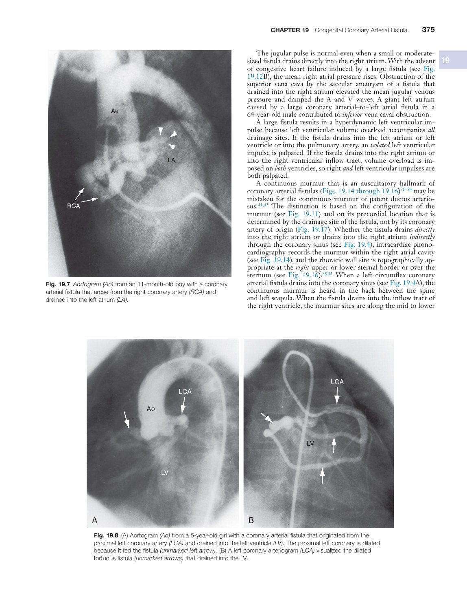

### Original PDF page 390

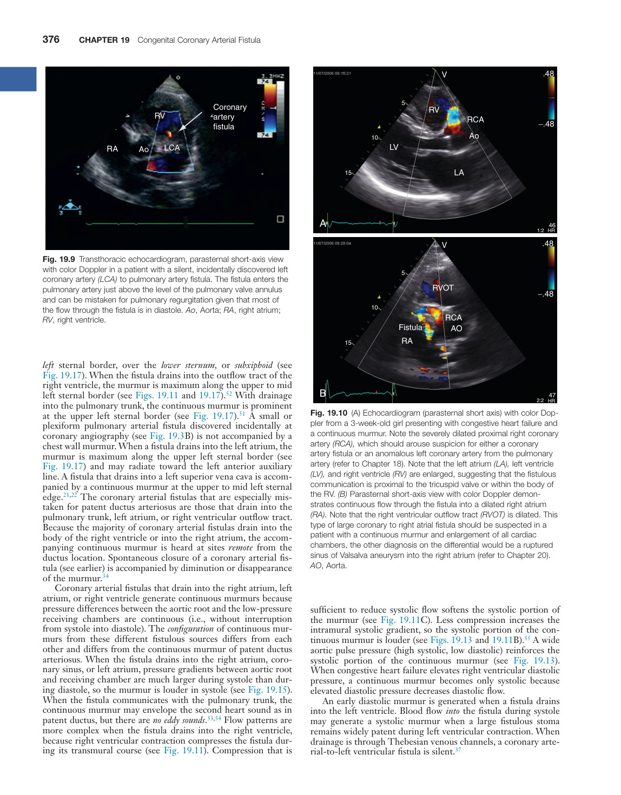

### Original PDF page 391

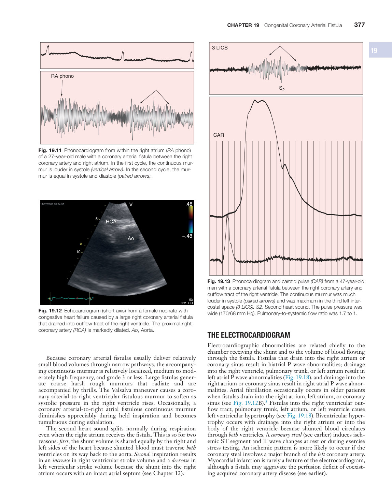

### Original PDF page 392

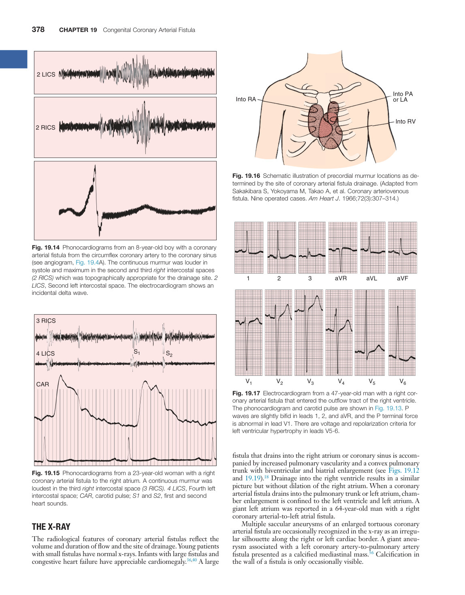

### Original PDF page 393

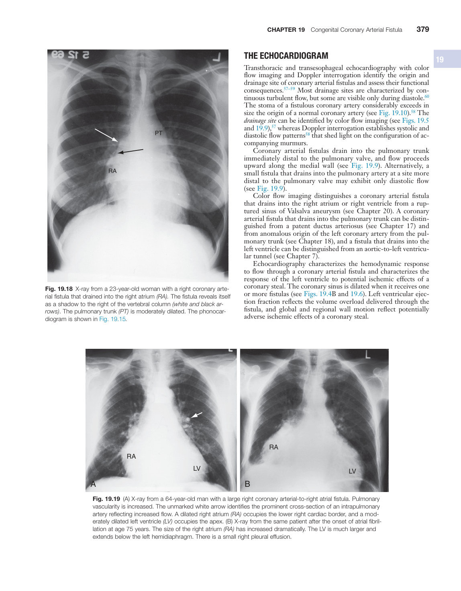

### Original PDF page 394

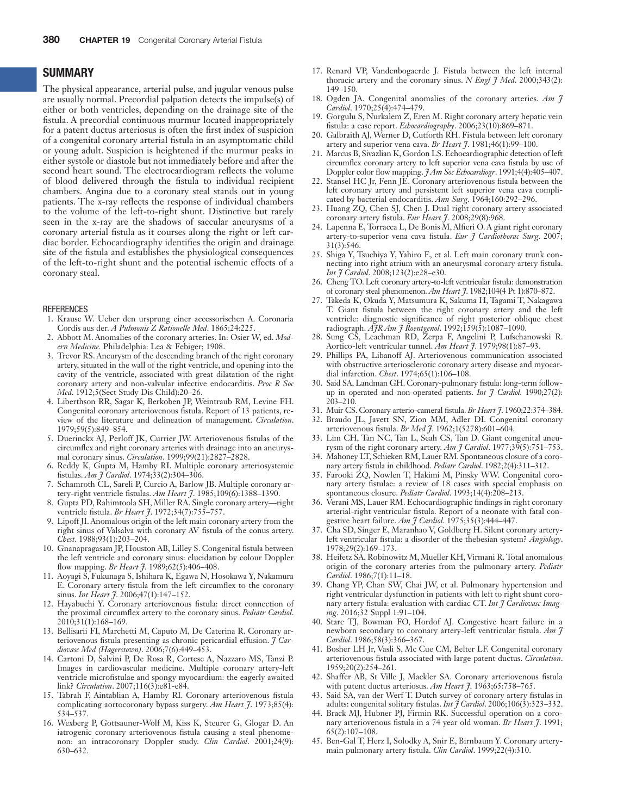

### Original PDF page 395

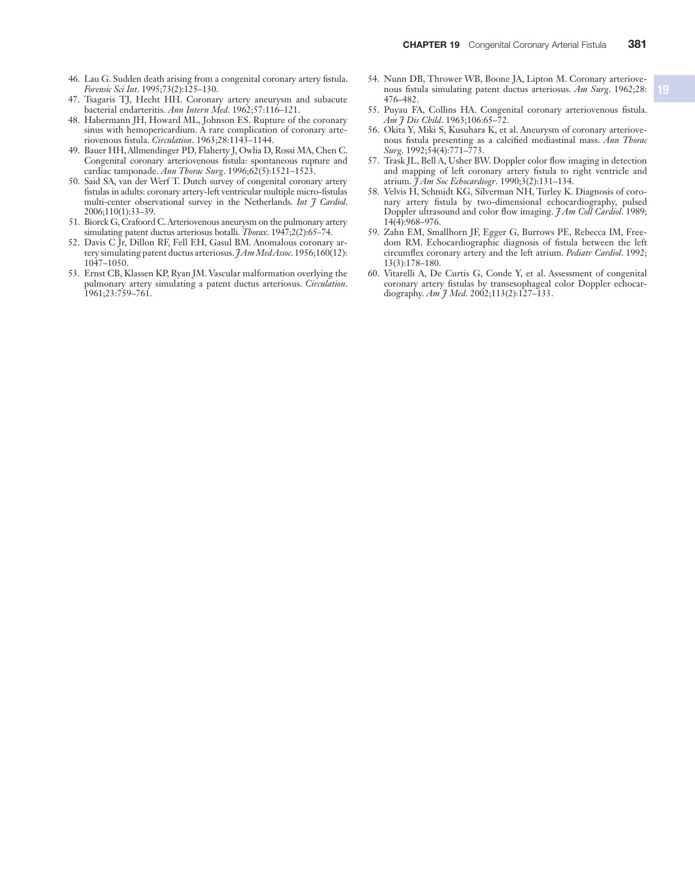

## Individual source figure views

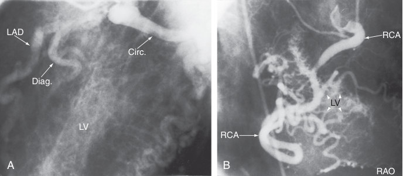

Fig. 19.1 ​Coronary arteriograms from a 70-year-old asymptomatic female who came to medical attention because of a diastolic murmur at the left sternal border. Left ventricular ejection fraction was 58%. (A) The left anterior descending (LAD), diagonal (Diag.), circumflex (Circ.), and right coronary artery (RCA see B) were all dilated. (B) The three dilated coronary arteries gave rise to a maze of tortuous fistulae that drained into the left ventricle (LV) through a fine intramural plexus. RAO, Right anterior oblique.

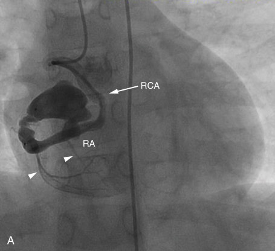

Fig. 19.2 ​(A) Selective right coronary artery (RCA) angiogram, anteroposterior view, from a 10-year-old girl with an echocardiogram demonstrating right atrial and right ventricular enlargement and an aneurysmal structure abutting the right atrium suspicious for coronary artery fistula or aneurysm. Note the dilated RCA with an aneurysmal fistulous communication with the right atrium (RA). An occluder device has been placed proximal to the fistulous entry to the RA. Note that the marginal branches of the RCA are diminutive in comparison to the ectatic proximal portion (arrowheads). (B) Lateral projection of the same angiogram.

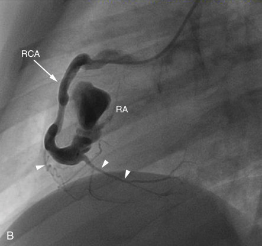

Fig. 19.2 ​(A) Selective right coronary artery (RCA) angiogram, anteroposterior view, from a 10-year-old girl with an echocardiogram demonstrating right atrial and right ventricular enlargement and an aneurysmal structure abutting the right atrium suspicious for coronary artery fistula or aneurysm. Note the dilated RCA with an aneurysmal fistulous communication with the right atrium (RA). An occluder device has been placed proximal to the fistulous entry to the RA. Note that the marginal branches of the RCA are diminutive in comparison to the ectatic proximal portion (arrowheads). (B) Lateral projection of the same angiogram.

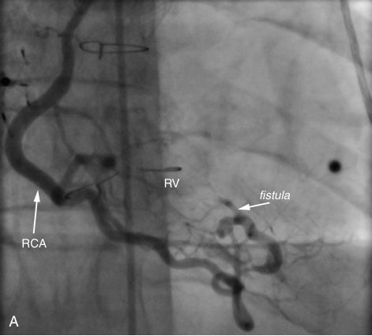

Fig. 19.3 ​(A) A 32-year-old with surgically repaired pulmonary atresia with intact ventricular septum undergoing transcatheter valve replacement. Right coronary angiogram (RAO projection) demonstrating a tortuous fistulous communication between the right coronary artery (RCA) and the right ventricle (RV). (B) Left coronary arteriogram from a 62-year-old woman with chest pressure and abnormal stress test. The left anterior descending (LAD) is dilated proximal to the fistulous communication with the RV, which is opacified by the contrast.

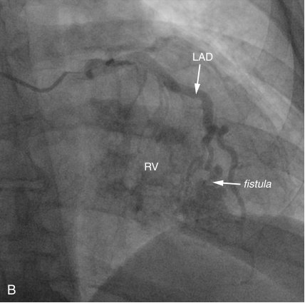

Fig. 19.3 ​(A) A 32-year-old with surgically repaired pulmonary atresia with intact ventricular septum undergoing transcatheter valve replacement. Right coronary angiogram (RAO projection) demonstrating a tortuous fistulous communication between the right coronary artery (RCA) and the right ventricle (RV). (B) Left coronary arteriogram from a 62-year-old woman with chest pressure and abnormal stress test. The left anterior descending (LAD) is dilated proximal to the fistulous communication with the RV, which is opacified by the contrast.

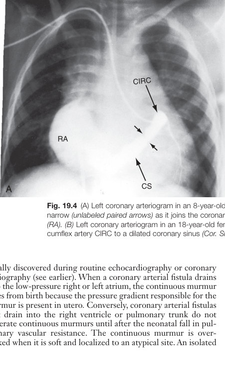

Unmatched source image; PDF page 387. Consult the original caption.

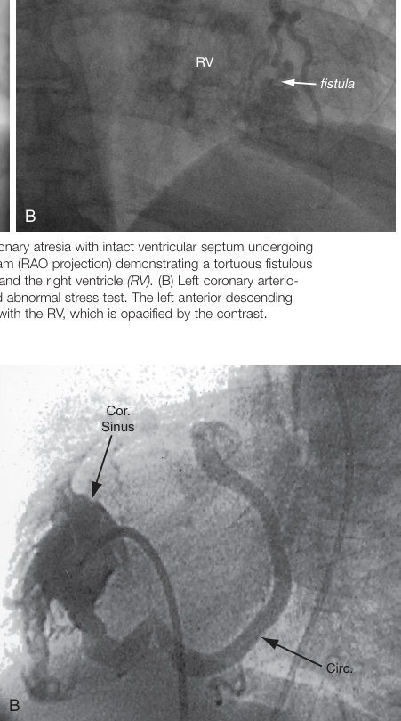

Fig. 19.4 ​(A) Left coronary arteriogram in an 8-year-old boy. The dilated circumflex coronary artery (CIRC) is narrow (unlabeled paired arrows) as it joins the coronary sinus (CS), which drains into a dilated right atrium (RA). (B) Left coronary arteriogram in an 18-year-old female with a coronary arterial fistula from a dilated circumflex artery CIRC to a dilated coronary sinus (Cor. Sinus).

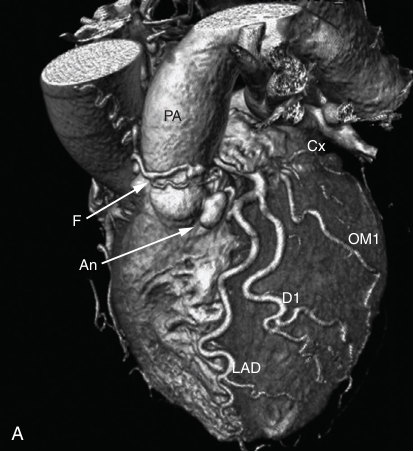

Fig. 19.5 ​(A) A 28-year-old with atypical chest pain, electrocardiogram-gated cardiac computed tomography, left anterior oblique (LAO) cranial projection, demonstrates a fistula from the left anterior descending (LAD) to the pulmonary artery (PA); note the aneurysm (An) within the fistula. The other left coronary segments are labeled, 1st diagonal artery (D1), circumflex artery (Cx), and the first obtuse marginal artery (OM1). (B) Lateral posterior oblique projection.

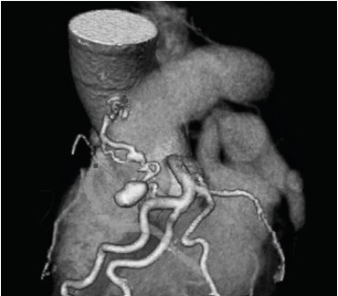

Fig. 19.5 ​(A) A 28-year-old with atypical chest pain, electrocardiogram-gated cardiac computed tomography, left anterior oblique (LAO) cranial projection, demonstrates a fistula from the left anterior descending (LAD) to the pulmonary artery (PA); note the aneurysm (An) within the fistula. The other left coronary segments are labeled, 1st diagonal artery (D1), circumflex artery (Cx), and the first obtuse marginal artery (OM1). (B) Lateral posterior oblique projection.

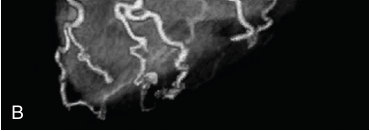

Fig. 19.5 ​(A) A 28-year-old with atypical chest pain, electrocardiogram-gated cardiac computed tomography, left anterior oblique (LAO) cranial projection, demonstrates a fistula from the left anterior descending (LAD) to the pulmonary artery (PA); note the aneurysm (An) within the fistula. The other left coronary segments are labeled, 1st diagonal artery (D1), circumflex artery (Cx), and the first obtuse marginal artery (OM1). (B) Lateral posterior oblique projection.

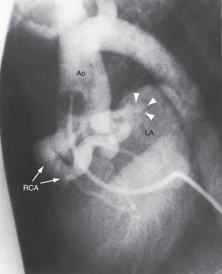

Fig. 19.7 ​Aortogram (Ao) from an 11-month-old boy with a coronary arterial fistula that arose from the right coronary artery (RCA) and drained into the left atrium (LA).

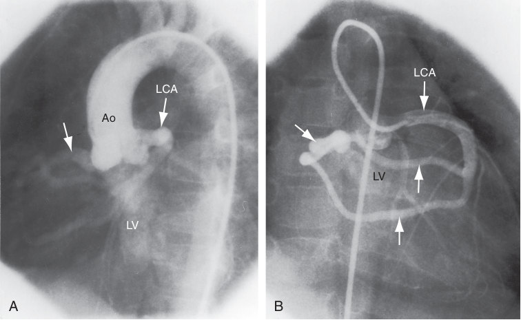

Fig. 19.8 ​(A) Aortogram (Ao) from a 5-year-old girl with a coronary arterial fistula that originated from the proximal left coronary artery (LCA) and drained into the left ventricle (LV). The proximal left coronary is dilated because it fed the fistula (unmarked left arrow). (B) A left coronary arteriogram (LCA) visualized the dilated tortuous fistula (unmarked arrows) that drained into the LV.

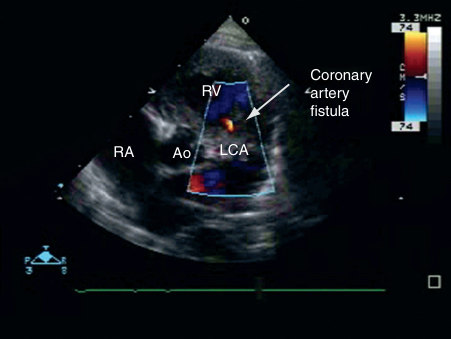

Fig. 19.9 ​Transthoracic echocardiogram, parasternal short-axis view with color Doppler in a patient with a silent, incidentally discovered left coronary artery (LCA) to pulmonary artery fistula. The fistula enters the pulmonary artery just above the level of the pulmonary valve annulus and can be mistaken for pulmonary regurgitation given that most of the flow through the fistula is in diastole. Ao, Aorta; RA, right atrium; RV, right ventricle.

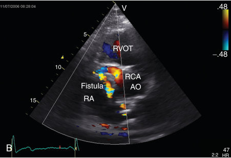

Fig. 19.10 ​(A) Echocardiogram (parasternal short axis) with color Doppler from a 3-week-old girl presenting with congestive heart failure and a continuous murmur. Note the severely dilated proximal right coronary artery (RCA), which should arouse suspicion for either a coronary artery fistula or an anomalous left coronary artery from the pulmonary artery (refer to Chapter 18). Note that the left atrium (LA), left ventricle (LV), and right ventricle (RV) are enlarged, suggesting that the fistulous communication is proximal to the tricuspid valve or within the body of the RV. (B) Parasternal short-axis view with color Doppler demonstrates continuous flow through the fistula into a dilated right atrium (RA). Note that the right ventricular outflow tract (RVOT) is dilated. This type of large coronary to right atrial fistula should be suspected in a patient with a continuous murmur and enlargement of all cardiac chambers, the other diagnosis on the differential would be a ruptured sinus of Valsalva aneurysm into the right atrium (refer to Chapter 20). AO, Aorta.

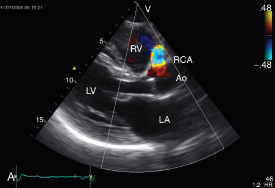

Fig. 19.10 ​(A) Echocardiogram (parasternal short axis) with color Doppler from a 3-week-old girl presenting with congestive heart failure and a continuous murmur. Note the severely dilated proximal right coronary artery (RCA), which should arouse suspicion for either a coronary artery fistula or an anomalous left coronary artery from the pulmonary artery (refer to Chapter 18). Note that the left atrium (LA), left ventricle (LV), and right ventricle (RV) are enlarged, suggesting that the fistulous communication is proximal to the tricuspid valve or within the body of the RV. (B) Parasternal short-axis view with color Doppler demonstrates continuous flow through the fistula into a dilated right atrium (RA). Note that the right ventricular outflow tract (RVOT) is dilated. This type of large coronary to right atrial fistula should be suspected in a patient with a continuous murmur and enlargement of all cardiac chambers, the other diagnosis on the differential would be a ruptured sinus of Valsalva aneurysm into the right atrium (refer to Chapter 20). AO, Aorta.

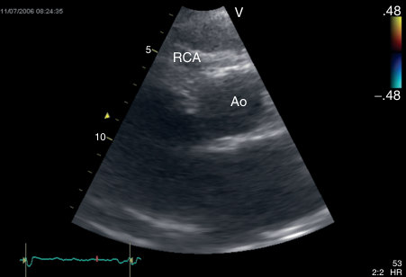

Fig. 19.12 ​Echocardiogram (short axis) from a female neonate with congestive heart failure caused by a large right coronary arterial fistula that drained into outflow tract of the right ventricle. The proximal right coronary artery (RCA) is markedly dilated. Ao, Aorta.

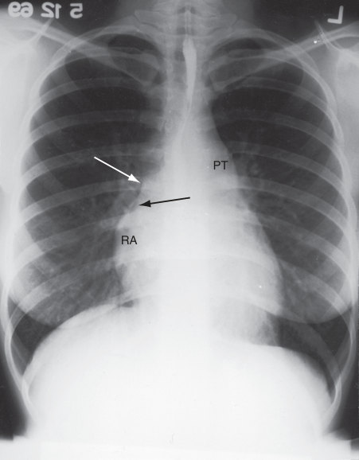

Fig. 19.18 ​X-ray from a 23-year-old woman with a right coronary arterial fistula that drained into the right atrium (RA). The fistula reveals itself as a shadow to the right of the vertebral column (white and black arrows). The pulmonary trunk (PT) is moderately dilated. The phonocardiogram is shown in Fig. 19.15.

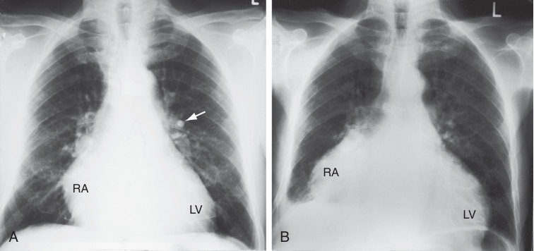

Fig. 19.19 ​(A) X-ray from a 64-year-old man with a large right coronary arterial-to-right atrial fistula. Pulmonary vascularity is increased. The unmarked white arrow identifies the prominent cross-section of an intrapulmonary artery reflecting increased flow. A dilated right atrium (RA) occupies the lower right cardiac border, and a moderately dilated left ventricle (LV) occupies the apex. (B) X-ray from the same patient after the onset of atrial fibrillation at age 75 years. The size of the right atrium (RA) has increased dramatically. The LV is much larger and extends below the left hemidiaphragm. There is a small right pleural effusion.

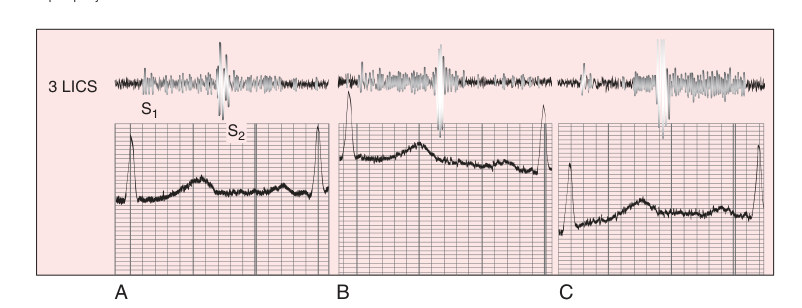

Fig. 19.6 ​Phonocardiograms from a 37-year-old female with a coronary arterial fistula between the right coronary artery and outflow tract of the right ventricle. (A) A continuous murmur that peaked before and after the second heart sound (S2) was mistaken for a patent ductus murmur even though the maximum location was the third left intercostal space (3 LICS) and even though the murmur changed configuration from beat to beat (A, B, C).

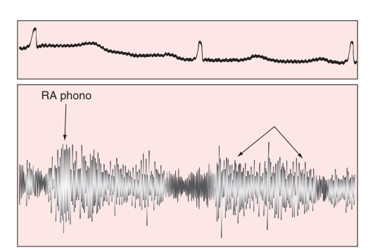

Fig. 19.11 ​Phonocardiogram from within the right atrium (RA phono) of a 27-year-old male with a coronary arterial fistula between the right coronary artery and right atrium. In the first cycle, the continuous murmur is louder in systole (vertical arrow). In the second cycle, the murmur is equal in systole and diastole (paired arrows).

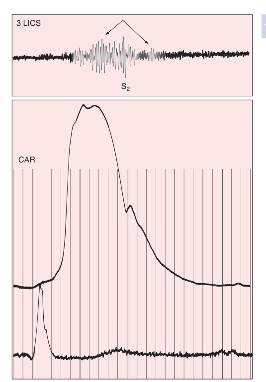

Fig. 19.13 ​Phonocardiogram and carotid pulse (CAR) from a 47-year-old man with a coronary arterial fistula between the right coronary artery and outflow tract of the right ventricle. The continuous murmur was much louder in systole (paired arrows) and was maximum in the third left intercostal space (3 LICS). S2, Second heart sound. The pulse pressure was wide (170/68 mm Hg). Pulmonary-to-systemic flow ratio was 1.7 to 1.

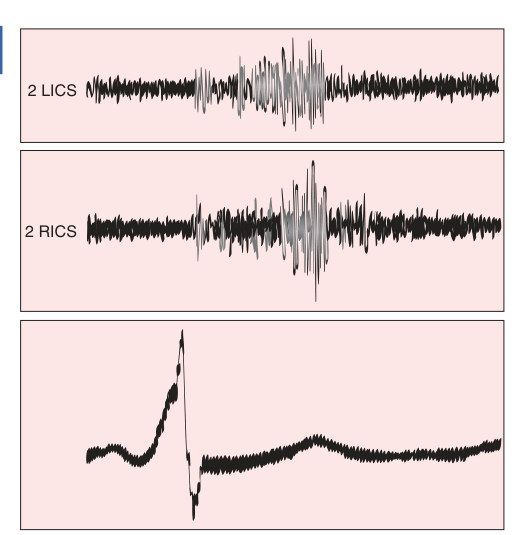

Fig. 19.14 ​Phonocardiograms from an 8-year-old boy with a coronary arterial fistula from the circumflex coronary artery to the coronary sinus (see angiogram, Fig. 19.4A). The continuous murmur was louder in systole and maximum in the second and third right intercostal spaces (2 RICS) which was topographically appropriate for the drainage site. 2 LICS, Second left intercostal space. The electrocardiogram shows an incidental delta wave.

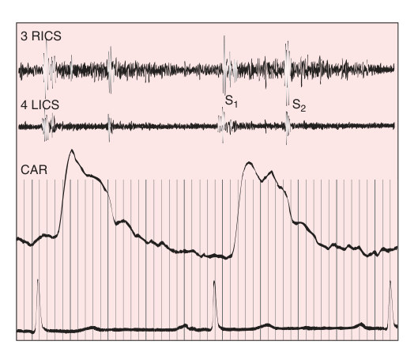

Fig. 19.15 ​Phonocardiograms from a 23-year-old woman with a right coronary arterial fistula to the right atrium. A continuous murmur was loudest in the third right intercostal space (3 RICS). 4 LICS, Fourth left intercostal space; CAR, carotid pulse; S1 and S2, first and second heart sounds.

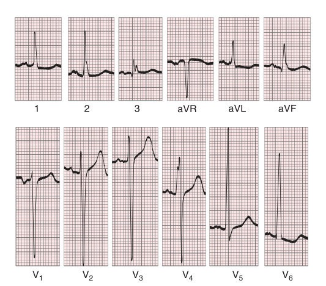

Fig. 19.17 ​Electrocardiogram from a 47-year-old man with a right coronary arterial fistula that entered the outflow tract of the right ventricle. The phonocardiogram and carotid pulse are shown in Fig. 19.13. P waves are slightly bifid in leads 1, 2, and aVR, and the P terminal force is abnormal in lead V1. There are voltage and repolarization criteria for left ventricular hypertrophy in leads V5-6.
