# 21. Pulmonary atresia with intact ventricular septum
> [Source credits](../../SOURCE_CREDITS.md).

## Study pillars

### Obligatory atrial pathway

Right-to-left flow through an interatrial communication. The interatrial communication is the right atrium’s exit to the left heart; its restriction can add to the circulatory problem.

PDF p. 410

### Pulmonary blood supply

Effective pulmonary blood flow can cease. The ductus supplies the pulmonary circuit in the usual anatomy; systemic-to-pulmonary collaterals are generally inadequate.

PDF p. 410

### Variable right-heart anatomy

Both patterns occur, and tricuspid competence helps explain their different appearances. The chapter describes a common small-ventricle pattern and a less common dilated pattern associated with an incompetent dysplastic or Ebstein-like valve.

PDF p. 407

### Pressure-dependent coronary perfusion

High right ventricular systolic pressure drives retrograde coronary flow. When aortic access is obstructed, myocardial perfusion can depend on suprasystemic right ventricular pressure supplying the coronary bed.

PDF p. 410

### ECG and the small ventricle

The small cavity can generate little right ventricular electrical amplitude despite its thick wall. The source describes absent prominent RV hypertrophy voltage in the small-ventricle pattern; chamber geometry and cavity size matter.

PDF p. 414

## Full source extraction

# 21. Pulmonary atresia with intact ventricular septum
> [Source credits](../../SOURCE_CREDITS.md).

## PDF page 407 | printed page 393

21 21 PULMONARY ATRESIA WITH INTACT VENTRICULAR SEPTUM

### HISTORICAL NOTES

Thomas Peacock, in his first edition of Malformations of the Human Heart1, wrote:

... the orifice or trunk of the pulmonary artery is entirely impervious. A case of this description was described by John Hunter in 1783.2 The child was born at the eighth month, was very livid ... and died in convulsions on the thirteenth day. The pulmonary artery was found entirely impervious. The septum of the ventricles was entire, and the right ventricle had scarcely any cavity left, while the left ventricle was large and powerful. The foramen ovale continued open, and the pulmonary branches received their supply of blood from the aorta, through the medium of the arterial duct.

### ANATOMIC CONSIDERATIONS

Peacock referred to what is now called pulmonary atresia with intact ventricular septum, a malformation in which an imperforate pulmonary valve completely obstructs forward flow into the pulmonary trunk (Fig. 21.1). The ventricular septum is, by definition, intact, and a restrictive interatrial communication is the only exit from the right atrium. The imperforate pulmonary valve consists of three fused but well-formed cusps with triradiate commissural ridges that converge at the center of a sealed orifice that is structurally similar if not identical to pinpoint pulmonary valve stenosis (see Chapter 10).3 Less commonly, commissural ridges are confined to the periphery of the valve which has an imperforate dimple at the center.3 The atresia is valvular, that is, membranous, in 75% of cases, and muscular (infundibular) in the remainder.4,5 Muscular obliteration within the right ventricle results in a “unipartite, bipartite, or tripartite” ventricular chamber with an obliterated apex (Figs. 21.2–21.4; Videos 21.1–21.4).4,5 Muscular pulmonary atresia is associated with right ventricular dependent coronary circulation and coronary ostial atresia (Figs. 21.2 and 21.5–21.7; Videos 21.1, 21.2, and 21.5–21.7).6

The reported incidence of pulmonary atresia with intact ventricular septum is 1 per 22,000 live births7 to 4.2 per 100,000 live births.5,8 A well-developed pulmonary trunk (see Fig. 21.1) implies that forward flow once occurred across a pulmonary valve that was stenotic but patent during much if not most of fetal life. A normally formed ductus arteriosus implies that intrauterine blood flow was from the right ventricle into the pulmonary trunk through the ductus and into the aorta (see Figs. 21.3, 21.6, and 21.8; Videos 21.3, 21.8, and 21.9), in contrast to Fallot’s tetralogy with pulmonary atresia in which a long tortuous ductus functions in utero as a systemic artery that carries blood from the aorta into the pulmonary artery (see Chapter 15).

The normal right ventricle consists of an inlet portion that is part of the diastolic filling mechanism, and a trabecular and an infundibular portion that are parts of the systolic pump mechanism. Over three quarters of cases of pulmonary atresia with intact ventricular septum are characterized by a small thick-walled right ventricle (see Figs. 21.1A, 21.5A and B, and 21.3) that is equipped with all three of these morphologic portions9,10 together with fiber disarray, capillary disorganization, and endocardial fibroelastosis.11,12 Pinpoint pulmonary valve stenosis in the neonate occasionally exists with a diminutive right ventricular cavity analogous to pulmonary atresia with intact ventricular septum.

When the right ventricle is small and thick-walled, the tricuspid annulus is also small, and houses a small, thickened valve with poorly delineated chordal attachments and hypoplastic papillary muscles. When the right ventricle is dilated and thin walled, the tricuspid valve is incompetent and either resembles Ebstein’s malformation or is dysplastic with normally attached tricuspid leaflets. Functional pulmonary atresia has been used to refer to a dilated mechanically inadequate right ventricle with tricuspid regurgitation that cannot generate sufficient systolic pressure to open a stenotic but nonatretic pulmonary valve.13 Functional pulmonary atresia also occurs during transient neonatal tricuspid regurgitation.14 In a small subset of patients with florid tricuspid regurgitation, the right ventricle and right atrium are enormous—”wall-to-wall hearts” (see the section on x-ray).15 Rarely, a right ventricle with suprasystemic systolic pressure causes leftward displacement of the ventricular septum and obstruction to left ventricular outflow.16,17

The coronary circulation in pulmonary atresia with intact ventricular septum and small right ventricle has long been the focus of lively interest.12,18–24 Intramyocardial sinusoids were described in 192625 and play important roles in the pathogenesis of right ventricular-to-coronary artery communications (see Figs. 21.2 and 21.5; Videos 21.1, 21.2, and 21.7).18,19 Morphogenetic studies have shed new light on coronary vascular bed abnormalities in this malformation (see Chapter 29).20,26 Normal coronary circulation develops in an orderly sequence of blood islands, coronary venous connections, and coronary artery-to-aortic connections. The blood islands proliferate and coalesce to form networks of vascular channels that have no connection with other blood islands or with the ventricular cavity. Suprasystemic systolic pressure from the small isovolumetrically contracting right ventricle drives blood through primitive vascular channels that are composed of thickened intima and fibroelastic walls, 20 and that connect the right ventricular cavity to epicardial coronary arteries (see Figs. 21.2 and 21.5B; Videos 21.1, 21.2, and 21.7).19,20 Abnormalities of the coronary vascular bed occur in 50% of patients with pulmonary atresia, intact ventricular septum, and a small right ventricle, and are either secondary to the hemodynamic derangements of the malformation or are co-existing morphologic abnormalities19,23 such as ostial atresia24,27 or fibromuscular dysplasia with focal luminal narrowing.18 Myocardial sinusoids are rarely primary developmental faults.28 Epicardial veins may be prominent and thick-walled.20 Ventriculocoronary arterial connections are located chiefly in the region of the apex of right ventricle, and communicate chiefly with the distal left anterior descending coronary arterial system (see Figs. 21.2 and 21.5A and B; Videos 21.1, 21.2, and 21.7).20 Intramyocardial channels that end blindly punctuate the endocardium of the thick-walled right ventricle, creating the appearance of a highly trabeculated muscular wall (see Figs. 21.2–21.3, and 21.4; Videos 21.1, 21.2, and 21.7).20

Ventriculocoronary arterial communications have been found in the inverted left ventricle of congenitally corrected transposition of the great arteries with pulmonary atresia and intact ventricular septum.29 ,30 Left ventricular-to-coronary arterial connections in aortic atresia with intact ventricular septum differ from right ventricular-to-coronary arterial connections in pulmonary atresia with intact ventricular septum (see Chapters 28 and 29).20,31,32

## PDF page 408 | printed page 394

Ao

PT LA RA

RV LV

A B

Fig. 21.1 Illustrations of two varieties of pulmonary atresia with intact ventricular septum. In both varieties the pulmonary valve is by definition imperforate. The pulmonary trunk (PT) is well-formed. A restrictive foramen ovale is the only exit from the right atrium (RA). Pulmonary blood flow depends on tenuous patency of a ductus arteriosus. (A) In this more common variety, the right ventricle (RV) is small and thick-walled, the tricuspid valve is small but competent, and the right atrium is moderately enlarged. Ao, Aorta; LA, left atrium; LV, left ventricle. (B) In this less common variety, the right ventricle is thin-walled and normal in size or enlarged. The tricuspid valve is incompetent because of an Ebstein-like malformation, so the right atrium is dilated.

RVOT

RA RV

A

Fig. 21.2 ​Right ventriculogram from a 1-day-old boy with pulmonary atresia intact ventricular septum. (A) Anteroposterior projection demonstrating a small right ventricular (RV) cavity consisting of an inlet portion and a small and severely hypertrophied right ventricular outflow tract (RVOT) tachycardias. Note the blind ending intramyocardial sinusoids and the filling of coronary arterial segments (arrowheads). There is tricuspid regurgitation into a dilated right atrium (RA). (B) Lateral view of the same injection demonstrates a hypoplastic tricuspid annulus with contrast regurgitation into a severely dilated RA.

Myocardial ischemia is an important sequela of ventriculocoronary arterial connections.19,20 Large unobstructed connections (see Fig. 21.5) function as a fistulous steal because blood from the aortic root flows freely into the right ventricular cavity during diastole. More commonly and more importantly, ischemia and occasionally myocardial infarction result from obstructing luminal abnormalities that range from mild medial and intimal thickening to luminal obliteration, and that extend from the

Ao

RA PT LA

LV RV

RVOT

RV

RA

B

origins of the intramyocardial connections to the coronary artery ostia in the aortic sinuses (see Fig. 21.6; Videos 21.6 and 21.10).18–20 Luminal obstructive lesions that originate in the fetus and neonate can evolve into severe stenoses or obliteration.19,20 Proximal discontinuity of a coronary artery is the most egregious form of this prejudicial coronary circulation, and is the result of acquired ostial obliteration or congenital atresia of an aortic sinus ostium. Left ventricular aneurysm10 and right ventricular rupture33,34 are

## PDF page 409 | printed page 395

Ao

PA

3

1 RA 2

LV

RV

A

Fig. 21.3 ​Three-dimensional volume rendered reconstruction of a cardiac magnetic resonance imaging with ferumoxytol used as an intravenous contrast agent resulting in opacification of both the venous and arterial blood pools. This is a 2-day-old female with pulmonary atresia and intact ventricular septum. (A) Slight left anterior oblique angulation demonstrates a mildly hypoplastic tripartite right ventricle (RV) with a well-formed inlet portion (1), apical portion (2) and outflow portion (3). The right atrium is enlarged (RA). The pulmonary artery (PA) is visualized and there is a well-formed left ventricle (LV) and aorta (Ao). (B) Lateral projection clearly demonstrates the long segment atresia (double-headed arrow) between the RV and main pulmonary artery (MPA). In addition, a large nonrestrictive patent ductus arteriosus (PDA) allows for unrestricted pulmonary blood flow, the right pulmonary artery (RPA) is visualized as are normal right-sided pulmonary venous (RPV) segments returning to the left atrium.

PDA

MPA

Ao

LV RA

RV

A

Fig. 21.4 ​Three-dimensional volume rendered reconstruction of a cardiac magnetic resonance imaging with ferumoxytol used as an intravenous contrast agent resulting in opacification of both the venous and arterial blood pools. The patient is a 3-day-old girl with pulmonary atresia, intact ventricular septum, and a diminutive right ventricle (RV). (A) Anterosuperior projection demonstrating an enlarged right atrium (RA), a diminutive RV with only an inlet portion, long segment RV outflow tract and pulmonary valve atresia (double-headed arrow), and a well-formed main pulmonary artery (MPA) fed by a large patent ductus arteriosus (PDA). The left ventricle (LV) and aorta (Ao) are well formed. (B) Posterior projection showing the large tortuous PDA connecting the Ao and MPA above the left atrium (LA).

21

PDA

RPA

MPA

RPV

RV

B

Ao

PDA

LA

B

## PDF page 410 | printed page 396

Circ.

LAD

RV

PDA A

Circ

C

Fig. 21.5 ​(A) Right ventriculogram from a 3-year-old girl with pulmonary atresia and intact ventricular septum. The metal sutures are from a bi-directional Glenn operation. The small right ventricle (RV) ends blindly. The left anterior descending (LAD), circumflex (Circ.), and posterior descending (PDA) coronary arteries visualized through ventriculocoronary arterial communications. The luminal irregularities were non-obstructive. The circumflex coronary artery outlines an enlarged left ventricle. (B) and (C) Angiograms from a 4-year-old boy with pulmonary atresia, intact ventricular septum, and a small right ventricle (Rv). (B) The large circumflex coronary artery (Circ.), the left anterior descending (LAD), and marginal (Marg.) coronary arteries were visualized through right ventricular sinusoids. (C) Contrast material injected into the left aortic sinus visualized the large circumflex coronary artery and the left anterior descending and marginal coronary arteries.

consequences of myocardial ischemia and infarction which are largely responsible for the high mortality.19 Proximal discontinuity and luminal obstruction set the stage for a right ventricular-dependent coronary circulation in which suprasystemic systolic pressure is required to generate retrograde coronary blood flow upon which myocardial perfusion depends (see Fig. 21.7 and Video 21.7).33

The right atrium enlarges only moderately when the right ventricle is diminutive, but when the right ventricle is dilated and tricuspid regurgitation is severe, the right atrium can be aneurysmal. The left atrium enlarges because it receives venous return from both the systemic and pulmonary circulations (see Fig. 21.4 and Video 21.11). The left ventricle is initially large and powerful as Peacock described (Fig. 21.9 and Video 21.12),1 but its compliance and ejection fraction diminish because it pumps the entire output for both circulations.35 The course of the atrioventricular conduction system is normal.36

### PHYSIOLOGIC CONSEQUENCES

The physiologic derangements in pulmonary atresia with intact ventricular septum are implicit consequences of the anatomic features of the malformation. Physiologic classification is based on

LAD

Rv

Marg

CIRC

B

LAD

Marg.

the tripartite morphology of the right ventricle, and on whether the right ventricular hypoplasia is mild, moderate, or severe. Venous blood reaches the systemic circulation via an interatrial communication that is usually a restrictive patent foramen ovale which is the only exit from the right atrium (see Fig. 21.1) (see earlier). Unoxygenated right atrial blood mixes with oxygenated left atrial blood and flows into the left ventricle and into the aorta, so systemic arterial oxygen saturation is reduced. Blood from the aorta reaches the pulmonary circulation through a tenuously patent ductus arteriosus upon which survival depends (see Figs. 21.1, 21.3, 21.4, 21.8, 21.10, and 21.11; Videos 21.8, 21.9, 21.13, and 21.14).37 When the ductus closes, effective pulmonary blood flow ceases.37 Systemic-to-pulmonary collaterals are inadequate for survival.37

These physiologic pathways from the right atrium to the left side of the heart are relatively constant from patient to patient, but the patterns in the right side of the heart vary considerably. When the right ventricle is small, little blood enters or leaves its cavity because the diminutive chamber and the diminutive tricuspid valve obstruct right atrial flow which is further compromised by a thick ventricular wall and endocardial fibroelastosis. Whatever blood enters the right ventricle during diastole is trapped

## PDF page 411 | printed page 397

Ao

PDA

RPA

LPA

MPA

LCA

A

Fig. 21.6 ​Seven-day-old infant boy with pulmonary atresia with intact ventricular septum. (A) Ascending aortogram (Ao), slight left anterior oblique and superior angulation, demonstrates a well-visualized left coronary artery (LCA); note the right coronary artery is not opacified. The patient has a tubular patent ductus arteriosus (PDA) with left-to-right flow into a well-formed main pulmonary artery (MPA) with opacification of the left and right pulmonary arteries (LPA and RPA). (B) Selective right coronary angiogram demonstrates minimal filling of a true RCA except for a superior conus branch.

LV

RV

Fig. 21.7 ​Transthoracic echocardiogram with color Doppler, subcostal view, of a 3-day-old with pulmonary atresia and intact ventricular septum. The right ventricular cavity (RV) is diminutive whereas the left ventricle (LV) is normal in size. There is RV dependent coronary circulation with retrograde filling of a coronary arterial branch (arrowheads) from the RV sinusoids.

during systole except for the small portion that exits through ventriculocoronary arterial connections. When the right ventricle is dilated and thin-walled, and the tricuspid valve is incompetent, right atrial blood copiously enters the ventricular cavity during diastole only to be returned to the right atrium during the next systole. Systolic pressure is comparatively low when the

21

RCA

B

right ventricle and right atrium communicate freely across an incompetent tricuspid valve. Although right atrial blood readily flows into the right ventricle, no useful purpose is served because forward flow into the pulmonary trunk is impossible. Back-andforth movement of blood across the tricuspid orifice results in progressive enlargement of the right side of the heart which becomes massive (see earlier).15

### THE HISTORY

Pulmonary atresia with intact ventricular septum is equally prevalent in males and females.38 There are reports of the malformation in siblings,39,40 in first cousins,41 and in monozygotic twins,42 but familial recurrence is rare. Over half of newborns die in the first month of life, a considerable majority die within the first three months, and very few live beyond the first year. Survival hinges on tenuous patency of the ductus arteriosus and on the adequacy of the interatrial communication which is usually restrictive.37 Cyanosis begins immediately after birth, and the degree depends on patency of the ductus arteriosus.37 Pulmonary blood flow diminishes as the ductus involutes, and when the ductus closes, pulmonary blood flow ceases. Despite this ominous outlook, isolated examples of survival have been reported to age 3.5 years43 and 14 years,44 and four patients lived for 20 to 21 years.45–48 The 21-year-old patient had a closed ductus arteriosus at necropsy, but had instead a sizable connection between the aortic root and pulmonary trunk, and a large atrial septal defect.48 Another 21-year-old woman survived without a patent ductus because the anterior descending branch of the left coronary artery originated from the pulmonary trunk and provided pulmonary blood flow via intercoronary anastomoses.49

Birth weights are normal and neonatal physical appearance is normal except for cyanosis. Survival beyond the newborn period is accompanied by increasing cyanosis, progressive dyspnea, right-sided heart failure, and physical underdevelopment.

The arterial pulse is normal or diminished. Large A waves are generated by powerful right atrial contraction when the right ventricle and tricuspid valve are small. Large systolic venous waves are not necessarily generated when an Ebstein tricuspid

## PDF page 412 | printed page 398

Ao

LPA

PV PDA RPA

A

Fig. 21.8 ​Seven-day-old male with pulmonary atresia and intact ventricular septum. (A) Mechanical contrast injection within the aortic arch (Ao) demonstrates a large patent ductus arteriosus with left-to-right flow and opacification of the left and right pulmonary arterial circulations (RPA and LPA). Note the rudimentary atretic pulmonary valve (PV). (B) Lateral projection clearly demonstrating the atretic PV. PDA, Patent ductus arteriosus.

MV

LA

IAS

LV

RA

RV TV

A

Fig. 21.9 ​Transthoracic echocardiogram of the 1-day-old patient described in Figs. 21.10 and 21.11. (A) Subcostal long-axis view demonstrating a severely hypoplastic right ventricle (RV) and tricuspid valve (TV) whereas the left ventricle (LV) is mildly enlarged and the mitral valve (MV) is not hypoplastic. Note that the interatrial septum (IAS) between the right (RA) and left atrium (LA) is intact. (B) Subcostal short-axis view demonstrates an enlarged LV and severely hypoplastic RV.

valve is incompetent, because a very large right atrium damps the venous pressure pulse.

A right ventricular impulse is necessarily absent when pulmonary atresia with intact ventricular septum occurs with a small right ventricle. The impulse of an enlarged left ventricle occupies the apex (see Figs. 21.3 and 21.9; Video 21.15). When the right ventricle is dilated and the tricuspid valve is incompetent, a right ventricular impulse is readily palpable. The thrill of tricuspid regurgitation may be present at the lower left sternal edge. A very large right atrium with severe tricuspid regurgitation generates a

PDA

Ao

PV

LPA

B

LV

RV

B

visible and palpable systolic impulse at the right sternal border and over the liver.

When the right ventricle is small, the hypoplastic tricuspid valve mechanism generates no closure sound, so the first heart sound consists of the single mitral component. When the right ventricle is dilated, audibility of the tricuspid component of the first heart sound depends on mobility of the anterior leaflet, as in Ebstein’s anomaly (Fig. 21.12).

A soft transient systolic murmur has been ascribed to flow through the patent ductus prior to its involution, and a soft

## PDF page 413 | printed page 399

Atretic PV

MPA

AAo

PDA

RPA

DAo

A

B

Fig. 21.10 ​Transthoracic echocardiography, high parasternal short-axis view of a 1-day-old with pulmonary atresia and intact ventricular septum. (A) Two-dimensional (2D) image demonstrating the atretic pulmonary valve (atretic pulmonary valve [PV]) but a well-formed main pulmonary artery (MPA) and right pulmonary artery (RPA). There is a large tortuous patent ductus arteriosus (PDA) from the descending aorta (DAo) to the MPA. The ascending aorta (AAo) is well visualized and normal in position. (B) Color Doppler demonstrating flow from the DAo via the PDA to the MPA and RPA. (C) Continuous-wave Doppler demonstrates continuous left-to-right flow through the PDA with a peak systolic velocity of 3.2 m/s.

RPA

Ao

RA

LA

PDA

IAS

A

Fig. 21.11 ​Transthoracic echocardiogram, suprasternal notch view of the 1-day-old patient described in Fig. 21.10. (A) 2D echocardiogram demonstrates a well-developed aorta (Ao) with a large tortuous patent ductus arteriosus (PDA) connecting to the pulmonary artery. The right pulmonary artery (RPA) is seen running below the aortic arch. The right atrium (RA) and left atrium (LA) are visualized with an intact atrial septum (IAS) noted. (B) Color Doppler demonstrates flow from the Ao via the PDA to the pulmonary arterial circuit.

mid-systolic aorta flow murmur occasionally results from increased left ventricular stroke volume.37 The murmur of tricuspid regurgitation is present at birth when the right ventricle is dilated and the malformed tricuspid valve is incompetent (see Fig. 21.12). The murmur is medium frequency and decrescendo because right ventricular systolic pressure is relatively low. Maximum intensity is along the lower left sternal edge toward the apex, topographically

21

C

B

coinciding with the displaced tricuspid valve, but the murmur may radiate to the right side of the chest and even to the right axilla when a very large right atrium receives tricuspid regurgitant flow (see Fig. 21.2; Videos 21.1 and 21.2).

Continuous murmurs originating in the ductus arteriosus are rare because ductal patency is transient (see Fig. 21.10). In the 21-year-old woman referred to earlier, a continuous murmur was

## PDF page 414 | printed page 400

SM

S3 S4 S1

S2

Fig. 21.12 ​Phonocardiogram recorded at the lower left sternal border of a 2-day-old boy with pulmonary atresia, intact ventricular septum, a normal-sized right ventricle, and tricuspid regurgitation. A long crescendo systolic murmur (SM) goes up to a prominent single second heart sound (S2) which was aortic valve closure. S1, First heart sound; S3, third heart sound; S4, fourth heart sound.

1 2 3 aVR aVL aVF

V1 V2 V3 V4 V5 V6

Fig. 21.13 ​Electrocardiogram from a 15-hour-old boy with pulmonary atresia, intact ventricular septum, and a diminutive right ventricle. There is a tall peaked right atrial P wave in lead 2. The QRS axis is rightward, depolarization is clockwise, and there is adult progression of the QRS in the precordial leads.

generated, not by a ductus, but by flow through intercoronary anastomoses between the right coronary artery and the anterior descending branch of the left coronary artery.49 In the other 21-year-old woman, a systolic/diastolic murmur originated in a communication between the aortic root and the pulmonary trunk.48 A 2-month-old girl with bidirectional ventriculocoronary arterial flow had a to-and-fro murmur.50

The second heart sound is necessarily single because there is only one functional semilunar valve. Third and fourth heart sounds occur with tricuspid regurgitation because of rapid middiastolic filling and an increased force of right atrial contraction transmitted into an unobstructed right ventricle (see Fig. 21.12).

### THE ELECTROCARDIOGRAM

The electrocardiogram is a key to the clinical recognition of pulmonary atresia with intact ventricular septum and a small right ventricle because it calls attention to the combination of

1 2 3 aVR aVL aVF

V1 V2 V3 V4 V5 V6

Fig. 21.14 ​Electrocardiogram from a 2-week-old girl with pulmonary atresia, intact ventricular septum, and a small right ventricle. There are tall peaked right atrial P waves in lead 2 and in leads V1–3. The QRS axis is vertical, depolarization is clockwise, and there is adult QRS progression in the precordial leads.

cyanosis with a dominant left ventricle. The electrocardiogram also distinguishes this malformation from tricuspid atresia, which it physiologically resembles (see Chapter 22).

When the right ventricle is small, peaked right atrial P waves appear in limb leads and in right precordial leads (Figs. 21.13 and 21.14).51 Biatrial P waves occasionally emerge because the left atrium receives systemic and pulmonary venous return.51 The QRS mean axis is normal or rightward with clockwise depolarization (see Figs. 21.13 and 21.14),51 which is a useful means of distinguishing pulmonary atresia with intact ventricular septum and small right ventricle from tricuspid atresia, which is characterized by left axis deviation and counterclockwise depolarization of the QRS.51 Precordial leads display an adult QRS pattern (see Figs. 21.13 and 21.14).9,51 Right ventricular hypertrophy is conspicuously absent. The small right ventricle does not generate large precordial QRS amplitudes despite its thick wall because the cavity contains so little blood.51 Similar electrocardiographic patterns can occur in neonates with pinpoint pulmonary stenosis and diminutive right ventricle (see Chapter 10). Left ventricular hypertrophy is manifested by the voltage,51 but ST segment abnormalities reflect left ventricular ischemia rather than hypertrophy.

In the first week of life, the electrocardiogram does not reliably distinguish pulmonary atresia with intact ventricular septum and small right ventricle from pulmonary atresia with intact ventricular septum and a large right ventricle. Soon, however, the electrocardiogram associated with a dilated right ventricle and tricuspid regurgitation reveals itself because of a rightward QRS axis and right ventricular hypertrophy in precordial leads (Fig. 21.15).9,51,52 Right atrial enlargement is reflected in exceptionally tall P waves and a qR complex in lead V1 (see Fig. 21.15).

### THE X-RAY

When the right ventricle is small, the cardiac silhouette at birth may be normal or nearly so (Fig. 21.16).52 The pulmonary artery segment is normal because the pulmonary trunk develops normally despite pulmonary valve atresia (Fig. 21.17). The ascending aorta is enlarged (see Figs. 21.10 and 21.17).43 The right atrial shadow is moderately prominent (see Fig. 21.17). A well-formed convex left ventricle occupies the apex (see Figs. 21.3, 21.9, 21.16, and 21.17).43

The x-ray differs appreciably when the right ventricle is dilated and the tricuspid valve is incompetent.43 The cardiac

## PDF page 415 | printed page 401

1 2 3 aVR aVL aVF

V1 V2 V3 V4 V5 V6

Fig. 21.15 ​Electrocardiogram from a 1-day-old female with pulmonary atresia, intact ventricular septum, a dilated right ventricle, severe tricuspid regurgitation, and a large right atrium. Exceptionally tall right atrial P waves appear in lead 1 and in right precordial leads. Right atrial enlargement is indicated by the qR pattern in lead V1. Tall R waves in V1–3 reflect the enlarged right ventricle.

LV

Fig. 21.16 ​X-ray from a 2-day-old girl with pulmonary atresia, intact ventricular septum, and a diminutive right ventricle. The lung fields are oligemic. An enlarged convex left ventricle (LV) occupies the apex. Thymus (arrows) obscures the base of the heart.

silhouette virtually fills the chest—”wall-to-wall”15—because of remarkable enlargement of the right atrium and right ventricle (Figs. 21.18 and 21.19).

### THE ECHOCARDIOGRAM

Echocardiography with color flow imaging and Doppler interrogation establishes the diagnosis of pulmonary atresia with intact ventricular septum, identifies the atretic pulmonary valve and the well-formed pulmonary trunk, and distinguishes a small right

21

Ao

LV

A

Ao

LV

B

Fig. 21.17 ​(A) X-ray from a 3-week-old girl with pulmonary atresia, intact ventricular septum, and a small right ventricle. The lung fields are oligemic. The ascending aorta (Ao) is enlarged, the main pulmonary artery segment (arrow) is normal, and an enlarged convex left ventricle (LV) occupies the apex. (B) Angiogram visualizes the enlarged LV and dilated ascending aorta (Ao).

Fig. 21.18 ​X-ray from a 5-month-old male with pulmonary atresia, intact ventricular septum, a dilated right ventricle, and severe tricuspid regurgitation. The immense cardiac silhouette—literally wall-to-wall—is the result of remarkable enlargement of the right atrium and right ventricle. The largely obscured lung fields are oligemic.

## PDF page 416 | printed page 402

RA

RV

A

RA

Tr.V RV

B

Fig. 21.19 ​(A) X-ray from a 7-day-old girl with pulmonary atresia, intact ventricular septum, a dilated right ventricle, and severe tricuspid regurgitation. The cardiac silhouette is immense because of striking enlargement of the right atrium (RA) and right ventricle (RV). (B) Contrast injection into the RV identified the displaced tricuspid valve leaflets (Tr.V) and the huge RA.

ventricle with a small tricuspid valve from a dilated right ventricle with tricuspid regurgitation.13,14,38 Color flow imaging with Doppler interrogation across the right ventricular outflow tract distinguishes between anatomical pulmonary atresia and functional pulmonary atresia, suggested by the presence of pulmonary regurgitation (see Fig. 21.10 and Video 21.13).53 The malformation can be recognized in utero,54 and fetal echocardiography can be used to detect tricuspid regurgitation, right ventricular dilation, and the absence of subaortic stenosis.53

Hypoplasia of the right ventricle is judged as mild, moderate, or severe (see Fig. 21.9; Videos 21.12 and 21.15), and the inlet, trabecular, and outlet portions can be imaged.38 Deep endocardial recesses represent blind penetrations of the proximal segments of ventriculocoronary arterial communications (see Fig. 21.12 and Video 21.7). Retrograde flow into the aorta is detected with pulsed Doppler, or can be suspected because of dilation of a proximal coronary artery. Retrograde flow in the coronary arteries can be indicative of right ventricular-dependent coronary circulation.55 Color flow imaging with Doppler interrogation confirms the absence of flow across the atretic pulmonary valve which appears as an immobile dense line that moves but fails to open. Initial patency of the ductus is identified with color flow imaging which also detects a right-to-left shunt across a restrictive interatrial communication. Speckle-tracking echocardiography reveals ventricular systolic dysfunction, including decreased strain in both the left and right ventricle.56

When the right ventricle is dilated, echocardiography identifies the Ebstein-like malformation of the tricuspid valve with displacement and immobility of the septal and posterior leaflets.

Color flow imaging establishes the degree of tricuspid regurgitation. The right atrium can be immense. Ebstein’s anomaly with functional pulmonary atresia in which a patent but stenotic pulmonary valve fails to open can be distinguished from anatomic pulmonary atresia and a malformed Ebstein-like tricuspid valve.13

### SUMMARY

Pulmonary atresia with intact ventricular septum is a diagnostic consideration in neonates and infants with cyanosis, a dominant left ventricle, and reduced pulmonary blood flow. When the right ventricle is small, the physical examination reveals an isolated left ventricular impulse and either no murmur at all or a soft aortic mid-systolic flow murmur. The electrocardiogram shows right atrial P waves, a vertical QRS axis with clockwise depolarization, and adult QRS progression in the precordial leads. An initially normal radiologic cardiac silhouette increases because of moderate enlargement of the right atrium and left ventricle. The lung fields are oligemic, and the main pulmonary artery segment is normal. Echocardiography with color flow imaging and Doppler interrogation identifies an imperforate pulmonary valve, a wellformed pulmonary trunk, a small thick-walled right ventricle, a small tricuspid valve, and moderate enlargement of the right atrium and left ventricle.

A dilated right ventricle with tricuspid regurgitation is characterized on physical examination by a right ventricular impulse and a tricuspid regurgitant murmur that radiates to the right of the sternum. The electrocardiogram shows strikingly tall peaked right atrial P waves. The QRS axis is rightward with clockwise depolarization. Right ventricular hypertrophy is reflected in tall right precordial R waves. The x-ray reveals a cardiac silhouette that virtually fills the chest because of massive dilatation of the right atrium and right ventricle. The echocardiogram with color flow imaging and Doppler interrogation identifies a dilated right ventricle, an Ebstein-like malformation of the tricuspid valve, severe tricuspid regurgitation, and striking enlargement of the right atrium.

REFERENCES 1. Peacock TB. On Malformations of the Human Heart: with Original

Cases. London: John Churchill & Sons; 1858. 2. Hunter J. Medical Observations and Inquiries: Society of Physicians in

London; 1784. 3. Braunlin EA, Formanek AG, Moller JH, Edwards JE. Angio-

pathological appearances of pulmonary valve in pulmonary atresia with intact ventricular septum. Interpretation of nature of right ventricle from pulmonary angiography. Br Heart J. 1982;47(3):281–289. 4. Daubeney PE, Delany DJ, Anderson RH, et al. Pulmonary atresia

with intact ventricular septum: range of morphology in a populationbased study. J Am Coll Cardiol. 2002;39(10):1670–1679. 5. Shinebourne EA, Rigby ML, Carvalho JS. Pulmonary atresia with in-

tact ventricular septum: from fetus to adult: congenital heart disease. Heart. 2008;94(10):1350–1357. 6. Kipps AK, Powell AJ, Levine JC. Muscular infundibular atresia is as-

sociated with coronary ostial atresia in pulmonary atresia with intact ventricular septum. Congenit Heart Dis. 2011;6(5):444–450. 7. Daubeney PE, Sharland GK, Cook AC, Keeton BR, Anderson RH,

Webber SA. Pulmonary atresia with intact ventricular septum: impact of fetal echocardiography on incidence at birth and postnatal outcome. UK and Eire Collaborative Study of Pulmonary Atresia with Intact Ventricular Septum. Circulation. 1998;98(6):562–566. 8. Ekman J, Sunnegardh J, Hanseus K. Outcome of children born with

pulmonary atresia and intact septum in Sweden from 1980 to 1990. Scand Cardiovasc J. 2001;35(3):192–198. 9. Shams A, Fowler RS, Trusler GA, Keith JD, Mustard WT. Pulmo-

nary atresia with intact ventricular septum: report of 50 cases. Pediatrics. 1971;47(2):370–377. 10. Zuberbuhler JR, Anderson RH. Morphological variations in pulmo-

nary atresia with intact ventricular septum. Br Heart J. 1979;41(3): 281–288.

## PDF page 417 | printed page 403

11. Bulkley BH, D’Amico B, Taylor AL. Extensive myocardial fiber disar-

33. Powell AJ, Mayer JE, Lang P, Lock JE. Outcome in infants with

ray in aortic and pulmonary atresia. Relevance to hypertrophic cardiomyopathy. Circulation. 1983;67(1):191–198. 12. Oosthoek PW, Moorman AF, Sauer U, Gittenberger-de Groot AC.

Capillary distribution in the ventricles of hearts with pulmonary atresia and intact ventricular septum. Circulation. 1995;91(6):1790–1798. 13. Smallhorn JF, Izukawa T, Benson L, Freedom RM. Noninvasive

34. Hubbard JF, Girod DA, Caldwell RL, Hurwitz RA, Mahony LA,

recognition of functional pulmonary atresia by echocardiography. Am J Cardiol. 1984;54(7):925–956. 14. Gewillig M, Dumoulin M, Van der Hauwaert LG. Transient neonatal

35. Scognamiglio R, Daliento L, Razzolini R, et al. Pulmonary atresia

tricuspid regurgitation: a Doppler echocardiographic study of three cases. Br Heart J. 1988;60(5):446–451. 15. Freedom RM, Jaeggi E, Perrin D, Yoo SJ, Anderson RH. The “wall-

36. Ansari A, Goltz D, McCarthy KP, Cook A, Ho SY. The conduction

to-wall” heart in the patient with pulmonary atresia and intact ventricular septum. Cardiol Young. 2006;16(1):18–29. 16. Amin P, Levi DS, Likes M, Laks H. Pulmonary atresia with intact

37. Venables AW. The patterns of pulmonary circulation in pulmonary

ventricular septum causing severe left ventricular outflow tract obstruction. Pediatr Cardiol. 2009;30(6):851–854. 17. Peraira Moral JR, Burguens Valero M, Garcia-Guereta Silva L. Pul-

38. Leung MP, Mok CK, Hui PW. Echocardiographic assessment of

monary valve atresia with intact ventricular septum and severe aortic stenosis. Pediatr Cardiol. 2005;26(1):117–118. 18. L’Ecuyer TJ, Poulik JM, Vincent JA. Myocardial infarction due to

39. Chitayat D, McIntosh N, Fouron JC. Pulmonary atresia with intact

coronary abnormalities in pulmonary atresia with intact ventricular septum. Pediatr Cardiol. 2001;22(1):68–70. 19. Kasznica J, Ursell PC, Blanc WA, Gersony WM. Abnormalities of the

40. Eriksen NL, Buttino L Jr, Juberg RC. Congenital pulmonary atresia

coronary circulation in pulmonary atresia and intact ventricular septum. Am Heart J. 1987;114(6):1415–1420. 20. O’Connor WN, Stahr BJ, Cottrill CM, Todd EP, Noonan JA. Ven-

41. Grossfeld PD, Lucas VW, Sklansky MS, Kashani IA, Rothman A.

triculocoronary connections in hypoplastic right heart syndrome: autopsy serial section study of six cases. J Am Coll Cardiol. 1988;11(5): 1061–1072. 21. Craver RD, Caspi J. Pulmonary atresia, intact ventricular septum,

42. De Stefano D, Li P, Xiang B, Hui P, Zambrano E. Pulmonary atresia

right ventricle-dependent coronary artery circulation, and systemic collateral arteries supplying the left coronary artery. Pediatr Dev Pathol. 2006;9(2):152–156. 22. Dyamenahalli U, McCrindle BW, McDonald C, et al. Pulmonary

43. Kieffer SA, Carey LS. Radiological aspects of pulmonary atresia with

44. Allanby KD, Brinton WD, Campbell M, Garnder F. Pulmonary atre-

atresia with intact ventricular septum: management of, and outcomes for, a cohort of 210 consecutive patients. Cardiol Young. 2004;14(3): 299–308. 23. Sandor GG, Cook AC, Sharland GK, Ho SY, Potts JE, Anderson RH.

45. Abbott M. Atlas of Congenital Cardiac Diseases. New York: American

46. Bostoen H, Robicsek F, Sanger PW. Atresia of the pulmonary valve

Coronary arterial abnormalities in pulmonary atresia with intact ventricular septum diagnosed during fetal life. Cardiol Young. 2002;12(5): 436–444. 24. Sarkola T, Boldt T, Happonen J-M, Karikoski R, Eronen M. Atresia

47. Costa A. Atresia congenita dell’ostio della polmonare, con setto inter-

of proximal coronary arteries in pulmonary atresia with intact ventricular septum - fetal and neonatal findings. Fetal Diagn Ther. 2008; 24(4):413–415. 25. Grant R. An unusual anomaly of the coronary vessels in the mal-

48. Robicsek F, Bostoen H, Sanger PW. Atresia of the pulmonary valve

formed heart of a child. Heart. 1926;13:273–283. 26. Hutchins GM, Kessler-Hanna A, Moore GW. Development of the

49. McArthur JD, Munsi SC, Sukumar IP, Cherian G. Pulmonary valve

coronary arteries in the embryonic human heart. Circulation. 1988;77(6):1250–1257. 27. Wald RM, Juraszek AL, Pigula FA, Geva T. Echocardiographic diag-

50. Ogden JA. Secondary coronary arterial fistulas. J Pediatr. 1971;78(1):

nosis and management of bilateral coronary ostial atresia in a patient with pulmonary atresia and intact ventricular septum. J Am Soc Echocardiogr. 2006;19(7):939.e1-e3. 28. Engberding R, Bender F. Identification of a rare congenital anomaly

51. Gamboa R, Gersony WM, Nadas AS. The electrocardiogram in tri-

of the myocardium by two-dimensional echocardiography: persistence of isolated myocardial sinusoids. Am J Cardiol. 1984;53(11): 1733–1734. 29. Shimizu T, Ando M, Takao A. Pulmonary atresia and intact ventricu-

52. Celermajer JM, Bowdler JD, Gengos DC, Cohen DH, Stuckey DS.

53. Chikkabyrappa SM, Loomba RS, Tretter JT. Pulmonary atresia with

lar septum and corrected transposition of the great arteries. Br Heart J. 1981;45(4):471–474. 30. Steeg CN, Ellis K, Bransilver B, Gersony WM. Pulmonary atresia

54. Patel CR, Shah DM, Dahms BB. Prenatal diagnosis of a coronary

and intact ventricular septum complicating corrected transposition of the great vessels. Am Heart J. 1971;82(3):382–386. 31. Baffa JM, Chen SL, Guttenberg ME, Norwood WI, Weinberg PM.

55. Peterson RE, Freire G, Marino CJ, Jureidini SB. Transthoracic echo-

Coronary artery abnormalities and right ventricular histology in hypoplastic left heart syndrome. J Am Coll Cardiol. 1992;20(2):350–358. 32. Sauer U, Gittenberger-de Groot AC, Geishauser M, Babic R,

Bühlmeyer K. Coronary arteries in the hypoplastic left heart syndrome. Histopathologic and histometrical studies and implications for surgery. Circulation. 1989;80(3 Pt 1):I168-I176.

56. Cohen J, Binka E, Woldu K, et al. Myocardial strain abnormalities in

21

pulmonary atresia, intact ventricular septum, and right ventricledependent coronary circulation. Am J Cardiol. 2000;86(11): 1272–1274, A9.

Waller BF. Right ventricular infarction with cardiac rupture in an infant with pulmonary valve atresia with intact ventricular septum. J Am Coll Cardiol. 1983;2(2):363–368.

with intact ventricular septum: a quantitative cineventriculographic study of the right and left ventricular function. Pediatr Cardiol. 1986;7(4):183–187.

system in hearts with pulmonary atresia and intact ventricular septum. Ann Thorac Surg. 2003;75(5):1502–1505.

atresia. Br Heart J. 1964;26:760–769.

neonates with pulmonary atresia and intact ventricular septum. J Am Coll Cardiol. 1988;12(3):719–725.

ventricular septum and hypoplastic right heart in sibs: a single gene disorder? Am J Med Genet. 1992;42(3):304–306.

with intact ventricular septum, tricuspid insufficiency, and patent ductus arteriosus in two sibs. Am J Med Genet. 1989;32(2):187–188.

Familial occurrence of pulmonary atresia with intact ventricular septum. Am J Med Genet. 1997;72(3):294–296.

with intact ventricular septum (PA-IVS) in monozygotic twins. Am J Med Genet A. 2008;146A(4):525–528.

intact ventricular septum. Br Heart J. 1963;25:655–662.

sia and the collateral circulation to the lungs. Guys Hosp Rep. 1950; 99(2–3):110–152.

Heart Association; 1936.

with normal pulmonary artery and intact ventricular septum in a 21 year old woman. Coll Works Cardiopulm Dis. 1966;11:753–758.

ventricolare chiuso e dotto di Botallo persistente in uomodi 20 anni. Clin Med Ital. 1930;61:567.

with normal pulmonary artery and intact ventricular septum in a 21-year-old woman. Angiology. 1966;17(12):896–901.

atresia with intact ventricular septum. Report of a case with long survival and pulmonary blood supply from an anomalous coronary artery. Circulation. 1971;44(4):740–745.

78–85.

cuspid atresia and pulmonary atresia with intact ventricular septum. Circulation. 1966;34(1):24–37.

Pulmonary valve fusion with intact ventricular septum. Am Heart J. 1968;76(4):452–465.

an intact ventricular septum: preoperative physiology, imaging, and management. Semin Cardiothorac Vasc Anesth. 2018;22(3):245–255.

fistula in a fetus with pulmonary atresia with intact ventricular septum and trisomy 18. J Ultrasound Med. 1999;18(6):429–431.

cardiographic assessment of coronary flow in the diagnosis of right ventricular-dependent coronary circulation in pulmonary atresia with intact ventricular septum. Pediatr Cardiol. 2018;39(5):967–975.

fetuses with pulmonary atresia and intact ventricular septum. Ultrasound Obstet Gynecol. 2019;53(4):512–519.

## Complete original page views

Searchable extraction can lose mathematical symbols or reading order. These original pages preserve source layout, symbols and credits.

### Original PDF page 407

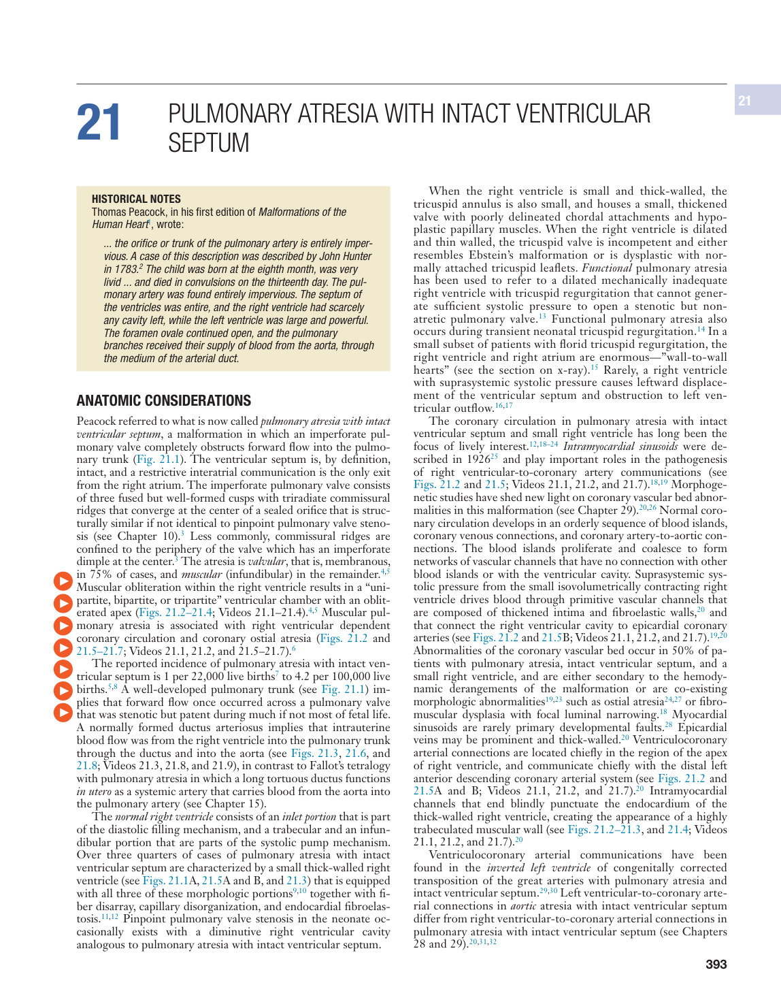

### Original PDF page 408

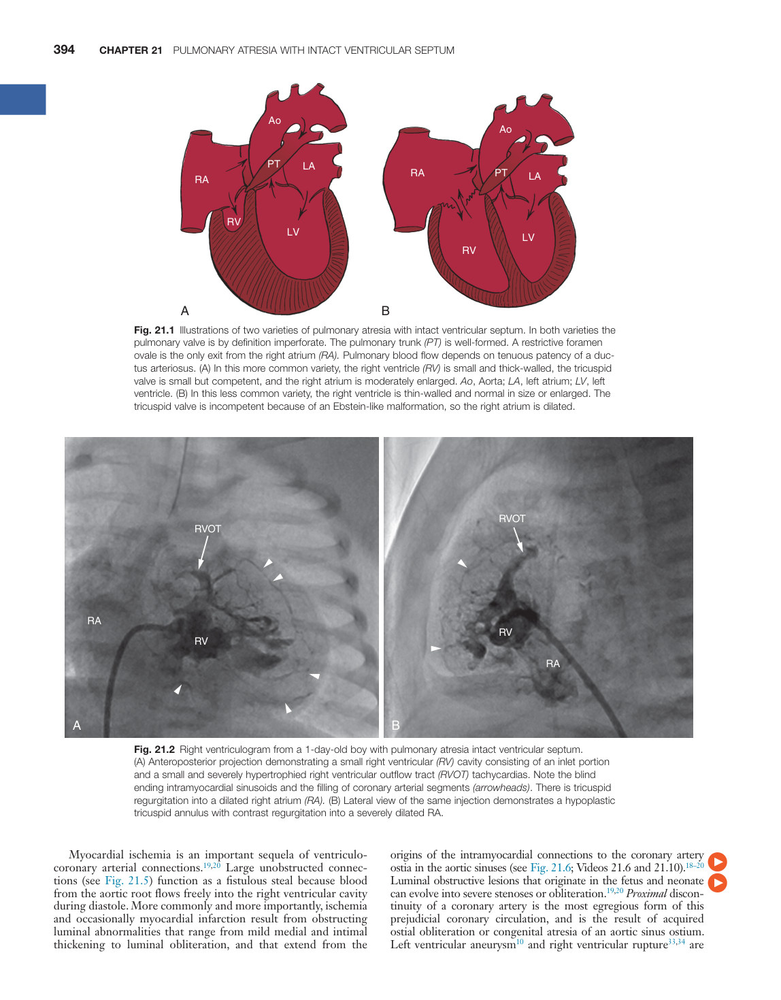

### Original PDF page 409

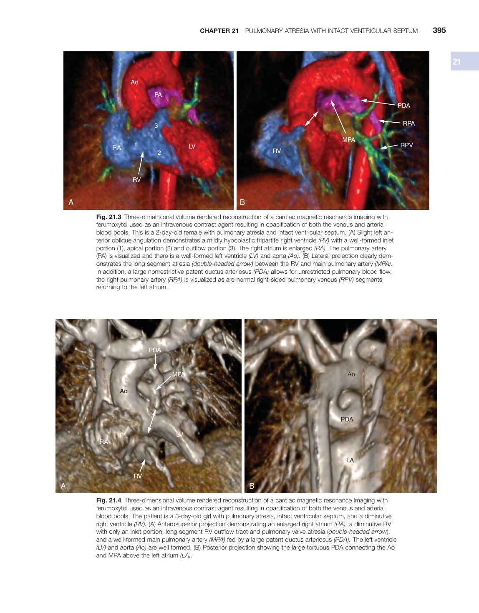

### Original PDF page 410

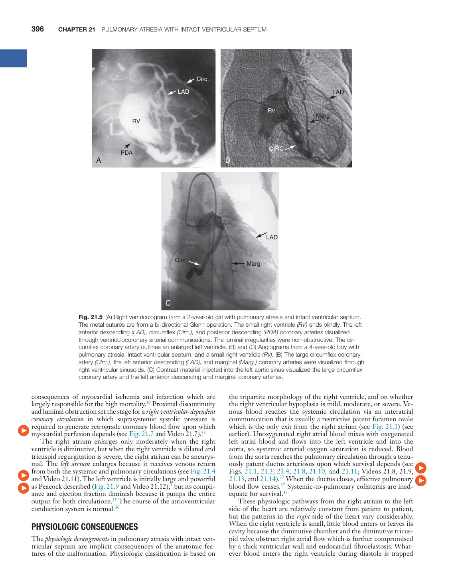

### Original PDF page 411

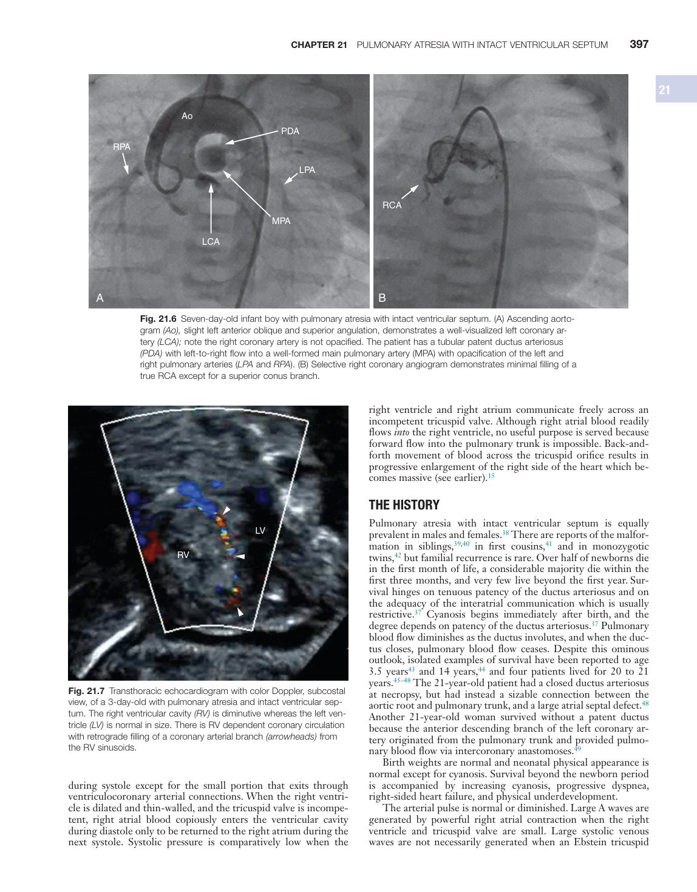

### Original PDF page 412

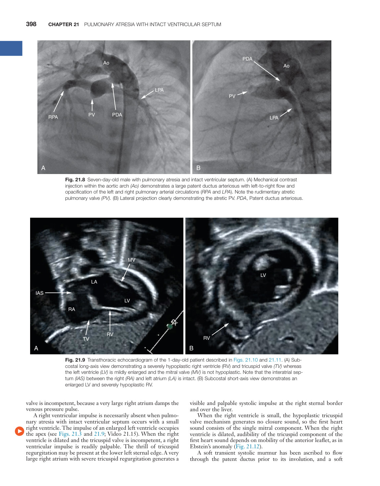

### Original PDF page 413

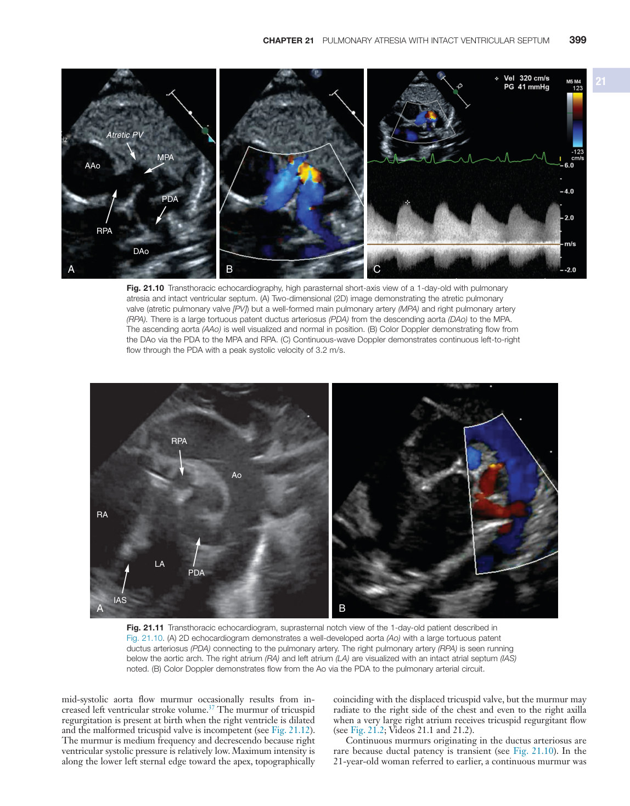

### Original PDF page 414

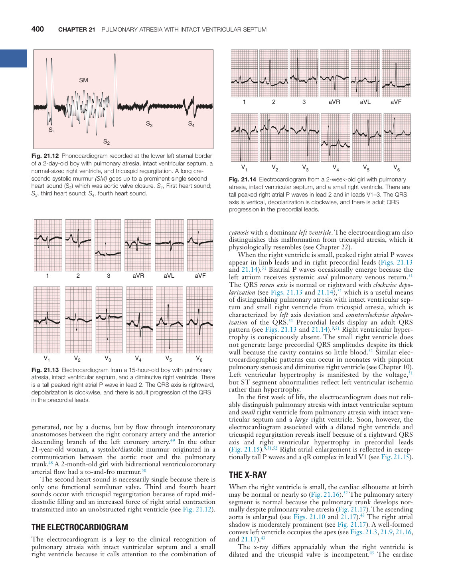

### Original PDF page 415

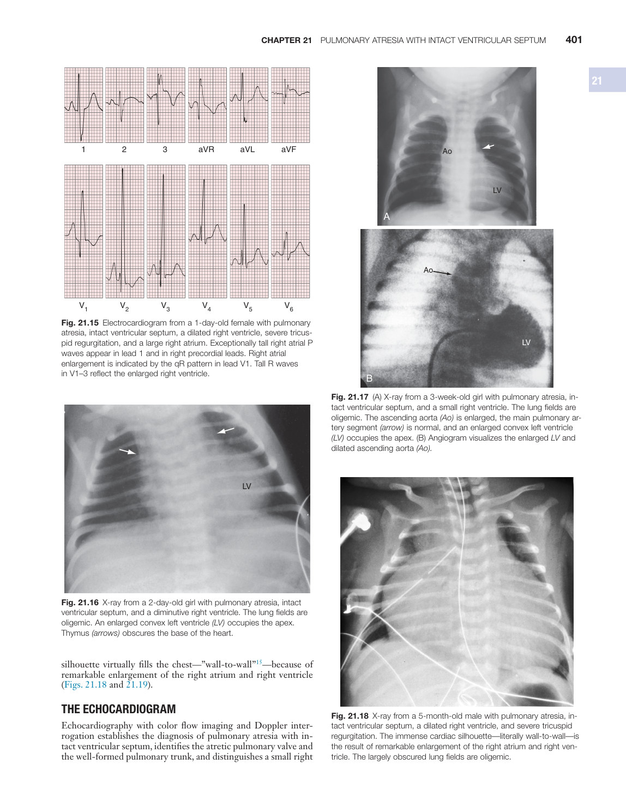

### Original PDF page 416

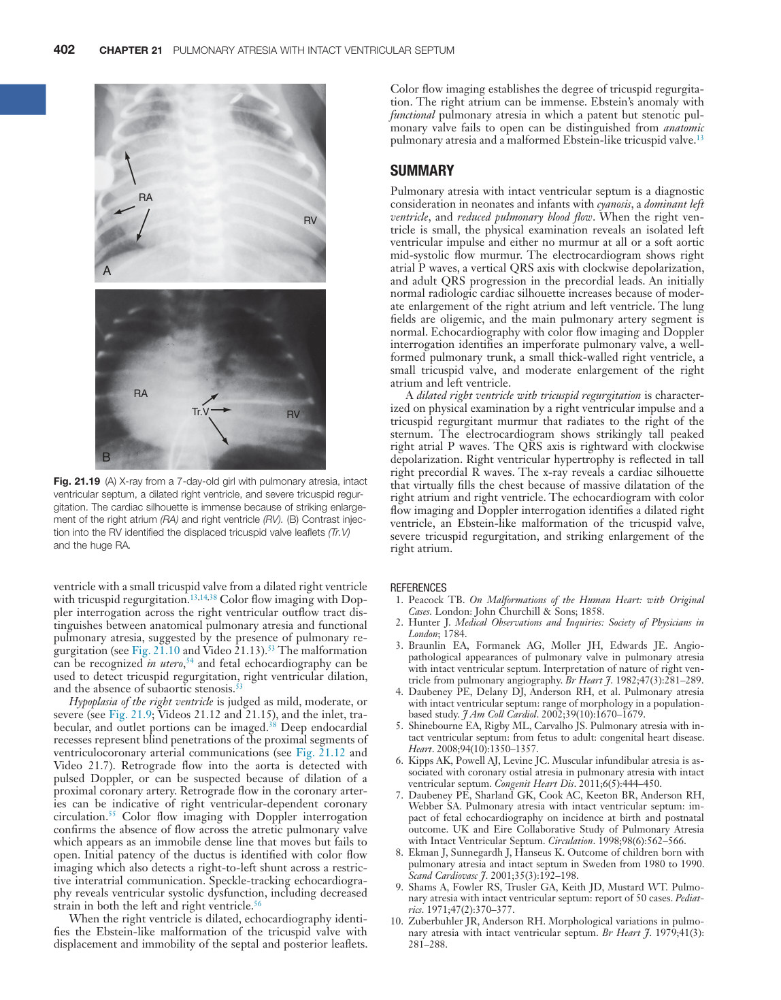

### Original PDF page 417

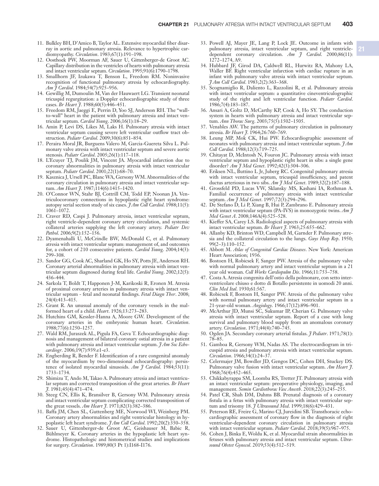

## Individual source figure views

Fig. 21.1 Illustrations of two varieties of pulmonary atresia with intact ventricular septum. In both varieties the pulmonary valve is by definition imperforate. The pulmonary trunk (PT) is well-formed. A restrictive foramen ovale is the only exit from the right atrium (RA). Pulmonary blood flow depends on tenuous patency of a ductus arteriosus. (A) In this more common variety, the right ventricle (RV) is small and thick-walled, the tricuspid valve is small but competent, and the right atrium is moderately enlarged. Ao, Aorta; LA, left atrium; LV, left ventricle. (B) In this less common variety, the right ventricle is thin-walled and normal in size or enlarged. The tricuspid valve is incompetent because of an Ebstein-like malformation, so the right atrium is dilated.

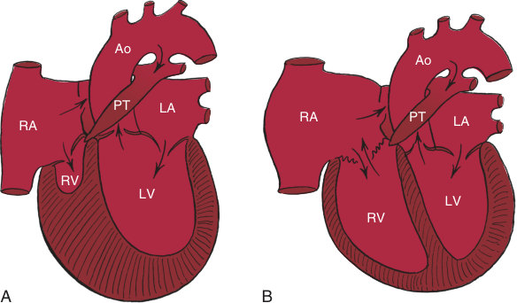

Fig. 21.1 Illustrations of two varieties of pulmonary atresia with intact ventricular septum. In both varieties the pulmonary valve is by definition imperforate. The pulmonary trunk (PT) is well-formed. A restrictive foramen ovale is the only exit from the right atrium (RA). Pulmonary blood flow depends on tenuous patency of a ductus arteriosus. (A) In this more common variety, the right ventricle (RV) is small and thick-walled, the tricuspid valve is small but competent, and the right atrium is moderately enlarged. Ao, Aorta; LA, left atrium; LV, left ventricle. (B) In this less common variety, the right ventricle is thin-walled and normal in size or enlarged. The tricuspid valve is incompetent because of an Ebstein-like malformation, so the right atrium is dilated.

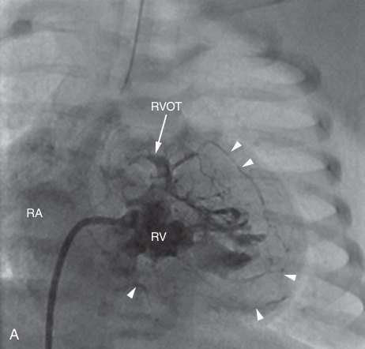

Fig. 21.2 ​Right ventriculogram from a 1-day-old boy with pulmonary atresia intact ventricular septum. (A) Anteroposterior projection demonstrating a small right ventricular (RV) cavity consisting of an inlet portion and a small and severely hypertrophied right ventricular outflow tract (RVOT) tachycardias. Note the blind ending intramyocardial sinusoids and the filling of coronary arterial segments (arrowheads). There is tricuspid regurgitation into a dilated right atrium (RA). (B) Lateral view of the same injection demonstrates a hypoplastic tricuspid annulus with contrast regurgitation into a severely dilated RA.

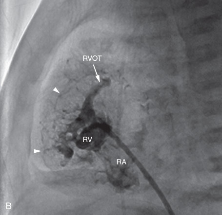

Fig. 21.2 ​Right ventriculogram from a 1-day-old boy with pulmonary atresia intact ventricular septum. (A) Anteroposterior projection demonstrating a small right ventricular (RV) cavity consisting of an inlet portion and a small and severely hypertrophied right ventricular outflow tract (RVOT) tachycardias. Note the blind ending intramyocardial sinusoids and the filling of coronary arterial segments (arrowheads). There is tricuspid regurgitation into a dilated right atrium (RA). (B) Lateral view of the same injection demonstrates a hypoplastic tricuspid annulus with contrast regurgitation into a severely dilated RA.

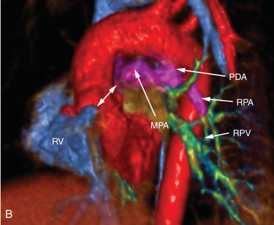

Fig. 21.3 ​Three-dimensional volume rendered reconstruction of a cardiac magnetic resonance imaging with ferumoxytol used as an intravenous contrast agent resulting in opacification of both the venous and arterial blood pools. This is a 2-day-old female with pulmonary atresia and intact ventricular septum. (A) Slight left anterior oblique angulation demonstrates a mildly hypoplastic tripartite right ventricle (RV) with a well-formed inlet portion (1), apical portion (2) and outflow portion (3). The right atrium is enlarged (RA). The pulmonary artery (PA) is visualized and there is a well-formed left ventricle (LV) and aorta (Ao). (B) Lateral projection clearly demonstrates the long segment atresia (double-headed arrow) between the RV and main pulmonary artery (MPA). In addition, a large nonrestrictive patent ductus arteriosus (PDA) allows for unrestricted pulmonary blood flow, the right pulmonary artery (RPA) is visualized as are normal right-sided pulmonary venous (RPV) segments returning to the left atrium.

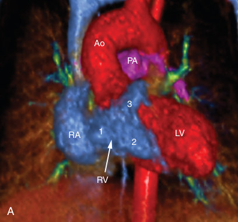

Fig. 21.3 ​Three-dimensional volume rendered reconstruction of a cardiac magnetic resonance imaging with ferumoxytol used as an intravenous contrast agent resulting in opacification of both the venous and arterial blood pools. This is a 2-day-old female with pulmonary atresia and intact ventricular septum. (A) Slight left anterior oblique angulation demonstrates a mildly hypoplastic tripartite right ventricle (RV) with a well-formed inlet portion (1), apical portion (2) and outflow portion (3). The right atrium is enlarged (RA). The pulmonary artery (PA) is visualized and there is a well-formed left ventricle (LV) and aorta (Ao). (B) Lateral projection clearly demonstrates the long segment atresia (double-headed arrow) between the RV and main pulmonary artery (MPA). In addition, a large nonrestrictive patent ductus arteriosus (PDA) allows for unrestricted pulmonary blood flow, the right pulmonary artery (RPA) is visualized as are normal right-sided pulmonary venous (RPV) segments returning to the left atrium.

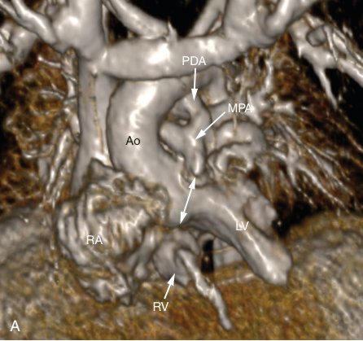

Fig. 21.4 ​Three-dimensional volume rendered reconstruction of a cardiac magnetic resonance imaging with ferumoxytol used as an intravenous contrast agent resulting in opacification of both the venous and arterial blood pools. The patient is a 3-day-old girl with pulmonary atresia, intact ventricular septum, and a diminutive right ventricle (RV). (A) Anterosuperior projection demonstrating an enlarged right atrium (RA), a diminutive RV with only an inlet portion, long segment RV outflow tract and pulmonary valve atresia (double-headed arrow), and a well-formed main pulmonary artery (MPA) fed by a large patent ductus arteriosus (PDA). The left ventricle (LV) and aorta (Ao) are well formed. (B) Posterior projection showing the large tortuous PDA connecting the Ao and MPA above the left atrium (LA).

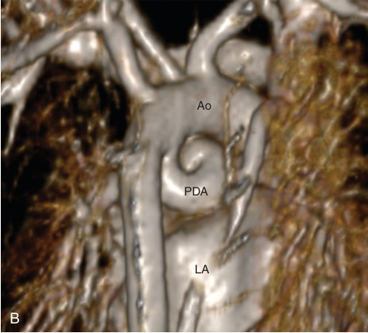

Fig. 21.4 ​Three-dimensional volume rendered reconstruction of a cardiac magnetic resonance imaging with ferumoxytol used as an intravenous contrast agent resulting in opacification of both the venous and arterial blood pools. The patient is a 3-day-old girl with pulmonary atresia, intact ventricular septum, and a diminutive right ventricle (RV). (A) Anterosuperior projection demonstrating an enlarged right atrium (RA), a diminutive RV with only an inlet portion, long segment RV outflow tract and pulmonary valve atresia (double-headed arrow), and a well-formed main pulmonary artery (MPA) fed by a large patent ductus arteriosus (PDA). The left ventricle (LV) and aorta (Ao) are well formed. (B) Posterior projection showing the large tortuous PDA connecting the Ao and MPA above the left atrium (LA).

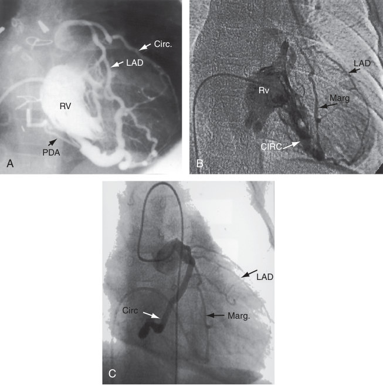

Fig. 21.5 ​(A) Right ventriculogram from a 3-year-old girl with pulmonary atresia and intact ventricular septum. The metal sutures are from a bi-directional Glenn operation. The small right ventricle (RV) ends blindly. The left anterior descending (LAD), circumflex (Circ.), and posterior descending (PDA) coronary arteries visualized through ventriculocoronary arterial communications. The luminal irregularities were non-obstructive. The circumflex coronary artery outlines an enlarged left ventricle. (B) and (C) Angiograms from a 4-year-old boy with pulmonary atresia, intact ventricular septum, and a small right ventricle (Rv). (B) The large circumflex coronary artery (Circ.), the left anterior descending (LAD), and marginal (Marg.) coronary arteries were visualized through right ventricular sinusoids. (C) Contrast material injected into the left aortic sinus visualized the large circumflex coronary artery and the left anterior descending and marginal coronary arteries.

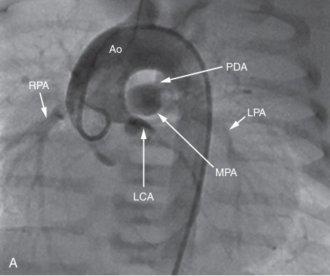

Fig. 21.6 ​Seven-day-old infant boy with pulmonary atresia with intact ventricular septum. (A) Ascending aortogram (Ao), slight left anterior oblique and superior angulation, demonstrates a well-visualized left coronary artery (LCA); note the right coronary artery is not opacified. The patient has a tubular patent ductus arteriosus (PDA) with left-to-right flow into a well-formed main pulmonary artery (MPA) with opacification of the left and right pulmonary arteries (LPA and RPA). (B) Selective right coronary angiogram demonstrates minimal filling of a true RCA except for a superior conus branch.

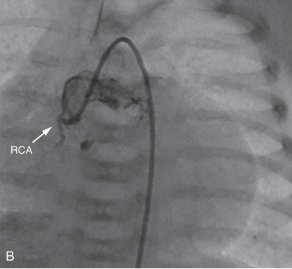

Fig. 21.6 ​Seven-day-old infant boy with pulmonary atresia with intact ventricular septum. (A) Ascending aortogram (Ao), slight left anterior oblique and superior angulation, demonstrates a well-visualized left coronary artery (LCA); note the right coronary artery is not opacified. The patient has a tubular patent ductus arteriosus (PDA) with left-to-right flow into a well-formed main pulmonary artery (MPA) with opacification of the left and right pulmonary arteries (LPA and RPA). (B) Selective right coronary angiogram demonstrates minimal filling of a true RCA except for a superior conus branch.

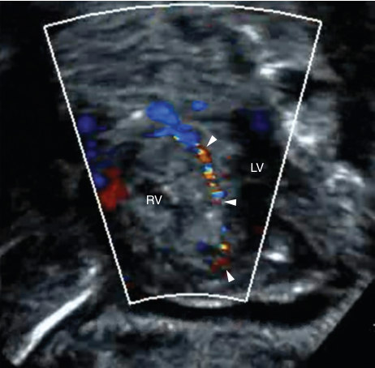

Fig. 21.7 ​Transthoracic echocardiogram with color Doppler, subcostal view, of a 3-day-old with pulmonary atresia and intact ventricular septum. The right ventricular cavity (RV) is diminutive whereas the left ventricle (LV) is normal in size. There is RV dependent coronary circulation with retrograde filling of a coronary arterial branch (arrowheads) from the RV sinusoids.

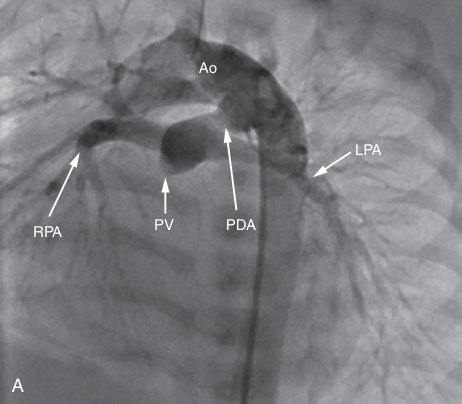

Fig. 21.8 ​Seven-day-old male with pulmonary atresia and intact ventricular septum. (A) Mechanical contrast injection within the aortic arch (Ao) demonstrates a large patent ductus arteriosus with left-to-right flow and opacification of the left and right pulmonary arterial circulations (RPA and LPA). Note the rudimentary atretic pulmonary valve (PV). (B) Lateral projection clearly demonstrating the atretic PV. PDA, Patent ductus arteriosus.

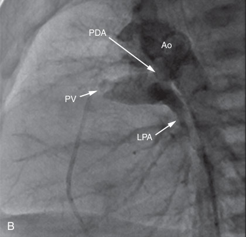

Fig. 21.8 ​Seven-day-old male with pulmonary atresia and intact ventricular septum. (A) Mechanical contrast injection within the aortic arch (Ao) demonstrates a large patent ductus arteriosus with left-to-right flow and opacification of the left and right pulmonary arterial circulations (RPA and LPA). Note the rudimentary atretic pulmonary valve (PV). (B) Lateral projection clearly demonstrating the atretic PV. PDA, Patent ductus arteriosus.

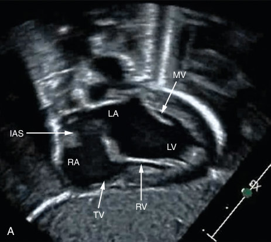

Fig. 21.9 ​Transthoracic echocardiogram of the 1-day-old patient described in Figs. 21.10 and 21.11. (A) Subcostal long-axis view demonstrating a severely hypoplastic right ventricle (RV) and tricuspid valve (TV) whereas the left ventricle (LV) is mildly enlarged and the mitral valve (MV) is not hypoplastic. Note that the interatrial septum (IAS) between the right (RA) and left atrium (LA) is intact. (B) Subcostal short-axis view demonstrates an enlarged LV and severely hypoplastic RV.

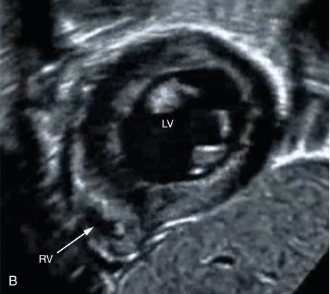

Fig. 21.9 ​Transthoracic echocardiogram of the 1-day-old patient described in Figs. 21.10 and 21.11. (A) Subcostal long-axis view demonstrating a severely hypoplastic right ventricle (RV) and tricuspid valve (TV) whereas the left ventricle (LV) is mildly enlarged and the mitral valve (MV) is not hypoplastic. Note that the interatrial septum (IAS) between the right (RA) and left atrium (LA) is intact. (B) Subcostal short-axis view demonstrates an enlarged LV and severely hypoplastic RV.

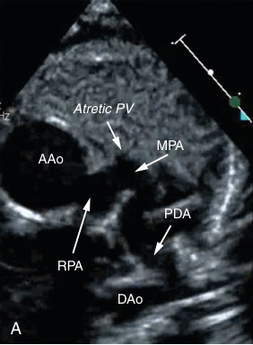

Fig. 21.10 ​Transthoracic echocardiography, high parasternal short-axis view of a 1-day-old with pulmonary atresia and intact ventricular septum. (A) Two-dimensional (2D) image demonstrating the atretic pulmonary valve (atretic pulmonary valve [PV]) but a well-formed main pulmonary artery (MPA) and right pulmonary artery (RPA). There is a large tortuous patent ductus arteriosus (PDA) from the descending aorta (DAo) to the MPA. The ascending aorta (AAo) is well visualized and normal in position. (B) Color Doppler demonstrating flow from the DAo via the PDA to the MPA and RPA. (C) Continuous-wave Doppler demonstrates continuous left-to-right flow through the PDA with a peak systolic velocity of 3.2 m/s.

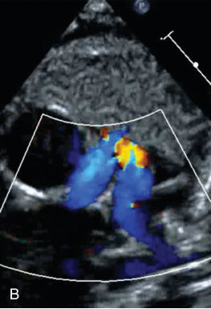

Fig. 21.10 ​Transthoracic echocardiography, high parasternal short-axis view of a 1-day-old with pulmonary atresia and intact ventricular septum. (A) Two-dimensional (2D) image demonstrating the atretic pulmonary valve (atretic pulmonary valve [PV]) but a well-formed main pulmonary artery (MPA) and right pulmonary artery (RPA). There is a large tortuous patent ductus arteriosus (PDA) from the descending aorta (DAo) to the MPA. The ascending aorta (AAo) is well visualized and normal in position. (B) Color Doppler demonstrating flow from the DAo via the PDA to the MPA and RPA. (C) Continuous-wave Doppler demonstrates continuous left-to-right flow through the PDA with a peak systolic velocity of 3.2 m/s.

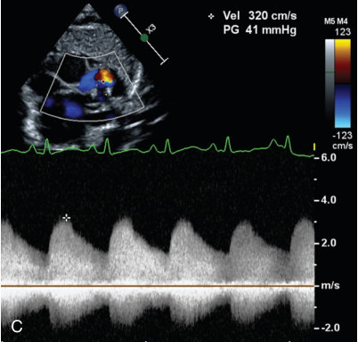

Fig. 21.10 ​Transthoracic echocardiography, high parasternal short-axis view of a 1-day-old with pulmonary atresia and intact ventricular septum. (A) Two-dimensional (2D) image demonstrating the atretic pulmonary valve (atretic pulmonary valve [PV]) but a well-formed main pulmonary artery (MPA) and right pulmonary artery (RPA). There is a large tortuous patent ductus arteriosus (PDA) from the descending aorta (DAo) to the MPA. The ascending aorta (AAo) is well visualized and normal in position. (B) Color Doppler demonstrating flow from the DAo via the PDA to the MPA and RPA. (C) Continuous-wave Doppler demonstrates continuous left-to-right flow through the PDA with a peak systolic velocity of 3.2 m/s.

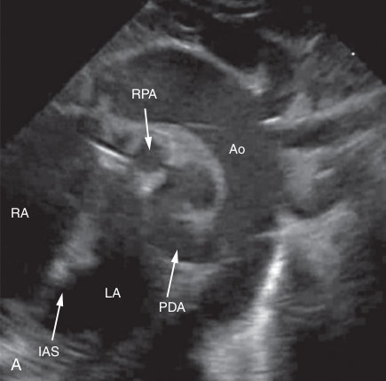

Fig. 21.11 ​Transthoracic echocardiogram, suprasternal notch view of the 1-day-old patient described in Fig. 21.10. (A) 2D echocardiogram demonstrates a well-developed aorta (Ao) with a large tortuous patent ductus arteriosus (PDA) connecting to the pulmonary artery. The right pulmonary artery (RPA) is seen running below the aortic arch. The right atrium (RA) and left atrium (LA) are visualized with an intact atrial septum (IAS) noted. (B) Color Doppler demonstrates flow from the Ao via the PDA to the pulmonary arterial circuit.

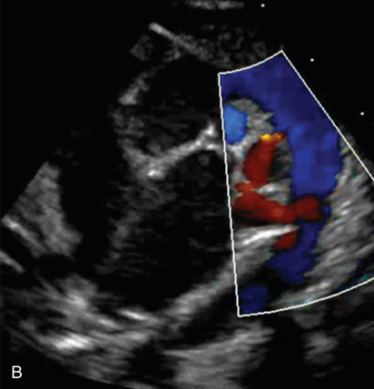

Fig. 21.11 ​Transthoracic echocardiogram, suprasternal notch view of the 1-day-old patient described in Fig. 21.10. (A) 2D echocardiogram demonstrates a well-developed aorta (Ao) with a large tortuous patent ductus arteriosus (PDA) connecting to the pulmonary artery. The right pulmonary artery (RPA) is seen running below the aortic arch. The right atrium (RA) and left atrium (LA) are visualized with an intact atrial septum (IAS) noted. (B) Color Doppler demonstrates flow from the Ao via the PDA to the pulmonary arterial circuit.

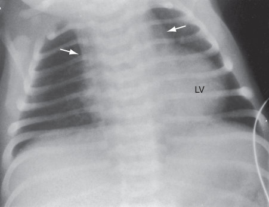

Fig. 21.16 ​X-ray from a 2-day-old girl with pulmonary atresia, intact ventricular septum, and a diminutive right ventricle. The lung fields are oligemic. An enlarged convex left ventricle (LV) occupies the apex. Thymus (arrows) obscures the base of the heart.

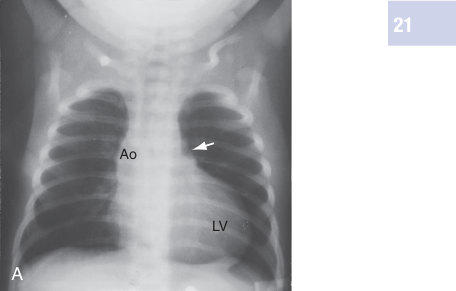

Fig. 21.17 ​(A) X-ray from a 3-week-old girl with pulmonary atresia, intact ventricular septum, and a small right ventricle. The lung fields are oligemic. The ascending aorta (Ao) is enlarged, the main pulmonary artery segment (arrow) is normal, and an enlarged convex left ventricle (LV) occupies the apex. (B) Angiogram visualizes the enlarged LV and dilated ascending aorta (Ao).

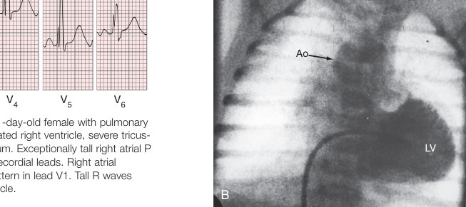

Fig. 21.17 ​(A) X-ray from a 3-week-old girl with pulmonary atresia, intact ventricular septum, and a small right ventricle. The lung fields are oligemic. The ascending aorta (Ao) is enlarged, the main pulmonary artery segment (arrow) is normal, and an enlarged convex left ventricle (LV) occupies the apex. (B) Angiogram visualizes the enlarged LV and dilated ascending aorta (Ao).

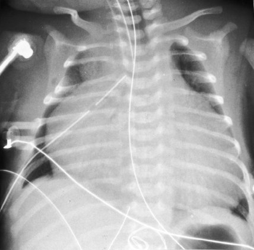

Fig. 21.18 ​X-ray from a 5-month-old male with pulmonary atresia, intact ventricular septum, a dilated right ventricle, and severe tricuspid regurgitation. The immense cardiac silhouette—literally wall-to-wall—is the result of remarkable enlargement of the right atrium and right ventricle. The largely obscured lung fields are oligemic.

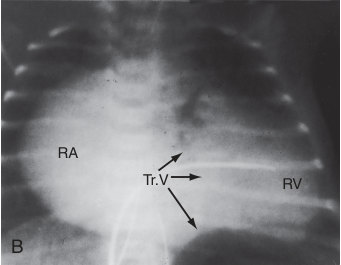

Fig. 21.19 ​(A) X-ray from a 7-day-old girl with pulmonary atresia, intact ventricular septum, a dilated right ventricle, and severe tricuspid regurgitation. The cardiac silhouette is immense because of striking enlargement of the right atrium (RA) and right ventricle (RV). (B) Contrast injection into the RV identified the displaced tricuspid valve leaflets (Tr.V) and the huge RA.

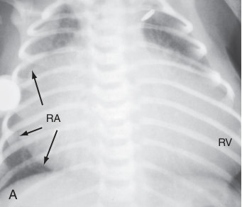

Fig. 21.19 ​(A) X-ray from a 7-day-old girl with pulmonary atresia, intact ventricular septum, a dilated right ventricle, and severe tricuspid regurgitation. The cardiac silhouette is immense because of striking enlargement of the right atrium (RA) and right ventricle (RV). (B) Contrast injection into the RV identified the displaced tricuspid valve leaflets (Tr.V) and the huge RA.

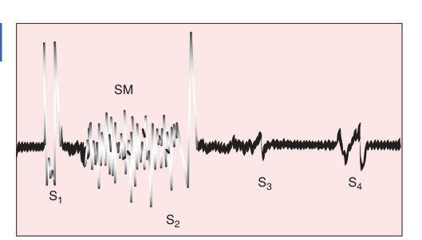

Fig. 21.12 ​Phonocardiogram recorded at the lower left sternal border of a 2-day-old boy with pulmonary atresia, intact ventricular septum, a normal-sized right ventricle, and tricuspid regurgitation. A long crescendo systolic murmur (SM) goes up to a prominent single second heart sound (S2) which was aortic valve closure. S1, First heart sound; S3, third heart sound; S4, fourth heart sound.

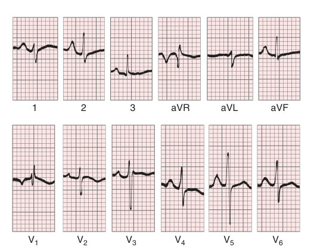

Fig. 21.13 ​Electrocardiogram from a 15-hour-old boy with pulmonary atresia, intact ventricular septum, and a diminutive right ventricle. There is a tall peaked right atrial P wave in lead 2. The QRS axis is rightward, depolarization is clockwise, and there is adult progression of the QRS in the precordial leads.

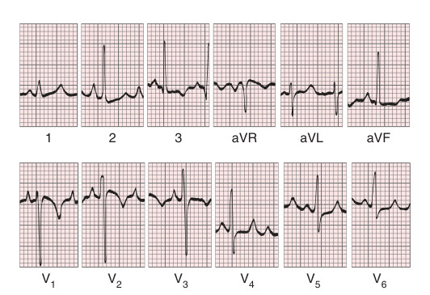

Fig. 21.14 ​Electrocardiogram from a 2-week-old girl with pulmonary atresia, intact ventricular septum, and a small right ventricle. There are tall peaked right atrial P waves in lead 2 and in leads V1–3. The QRS axis is vertical, depolarization is clockwise, and there is adult QRS progression in the precordial leads.

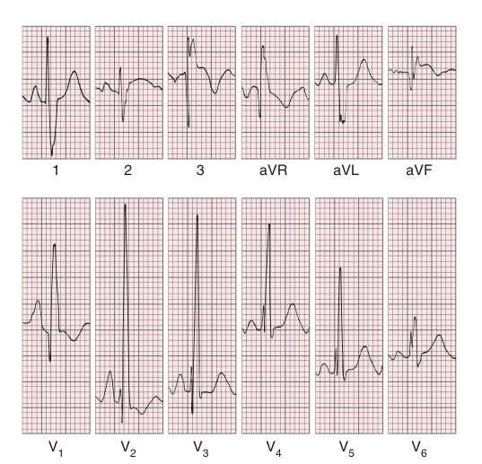

Fig. 21.15 ​Electrocardiogram from a 1-day-old female with pulmonary atresia, intact ventricular septum, a dilated right ventricle, severe tricuspid regurgitation, and a large right atrium. Exceptionally tall right atrial P waves appear in lead 1 and in right precordial leads. Right atrial enlargement is indicated by the qR pattern in lead V1. Tall R waves in V1–3 reflect the enlarged right ventricle.
