# 26. Congenital anomalies of vena caval connection
> [Source credits](../../SOURCE_CREDITS.md).

## Study pillars

### Benign venous route

The route is usually physiologically harmless despite coronary sinus dilation. Blood still reaches the right atrium through the coronary sinus, so an isolated connection need not create a physiologic derangement.

PDF p. 486

### Shunt direction

Left atrium to left SVC, across the bridge and into the right SVC. A freely communicating bridge can permit left-to-right flow from left atrium through the venous pathway to right atrium, reversing the expected cyanotic pattern.

PDF p. 486

### Interrupted inferior cava

Azygos continuation, which can be physiologically insignificant in isolation. The interrupted inferior caval flow continues through a dilated azygos system to the right SVC; isolated cases need not cause a shunt.

PDF p. 486

### Coronary sinus clue

Persistent left superior vena cava. An unexpectedly enlarged coronary sinus can be the clue to an unsuspected left SVC; color and contrast studies define the route.

PDF p. 490

### Cyanosis without RV overload

Right-heart flow is normal or reduced because some systemic venous blood bypasses it. Anomalous caval return bypasses the right heart, unlike lesions with major RV pressure or volume overload.

PDF p. 490

## Full source extraction

# 26. Congenital anomalies of vena caval connection
> [Source credits](../../SOURCE_CREDITS.md).

## PDF page 486 | printed page 472

26 Congenital Anomalies of Vena Caval Connection

Anomalous vena caval connections comprise a wide range of malformations that vary from minor to major, and that occur in isolation or with coexisting congenital heart disease. Persistent left superior vena cava occurs in 0.3% of the general population and in 4.3% of congenital heart disease.1 A left-sided inferior vena cava occurs in 0.2% to 0.5% of the general population.1 (This chapter focuses on isolated anomalous vena caval connections in situs solitus hearts [Box 26.1].) Anomalies of vena caval connection with cardiac malpositions or with atrial isomerism are dealt with in Chapter 3.

### ANATOMICAL CONSIDERATIONS

In early embryonic development, the common cardinal veins are bilaterally symmetric and are potentially responsible for bilateral superior vena cavae.2 The left common cardinal vein initially drains into the left portion of the sinus venosus which becomes the coronary sinus.2 Failure of obliteration of the left common cardinal vein results in persistent connection of a left superior vena cava to the coronary sinus2 (Fig. 26.1), a relatively common anomaly estimated at 0.3% to 0.5% of the general population and 1.5% to 10% of patients with congenital heart disease.3 An isolated left superior vena cava in itself produces no physiologic derangements when it drains harmlessly into the right atrium via the coronary sinus (see Fig. 26.1). However, the coronary sinus dilates, sometimes appreciably,4 especially if there is atresia of its right atrial orifice5 or absence of the right superior vena cava.6,7 When the right superior cava is absent, the sinus node pacemaker is absent because the pacemaker is normally located at the junction of the right superior vena cava and the morphologic right atrium.8–11 A persistent left superior vena cava is a significant anomaly when it connects to the left atrium (Figs. 26.2 and 26.3).12–14 The coronary sinus is usually absent15 with partial or complete unroofing of its anterosuperior wall. Unroofing results in a connection between the left atrium and the right atrium—a coronary sinus type of atrial septal defect (see Chapter 12).16 Persistent left superior vena cava with absence of the coronary sinus may also occur in heterotaxy syndrome.17 A right-to-left shunt coexists through the left superior vena cava to left atrial connection.14,18 An absent coronary sinus with bilateral superior vena cavae (right superior cava connected to the right atrium, left superior cava connected to the left atrium) is believed to represent a developmental complex.19 If the right superior vena cava is absent or atretic (see Fig. 26.3), the innominate vein crosses the midline and terminates in the left superior vena cava.20 The left atrium occasionally receives the azygos vein, the hepatic vein, or the coronary sinus,14 variations that are not considered in this chapter.

Direct connections between vena cavae and left atrium are uncommon.7,21,22 Rarely, a right superior vena cava connects to the left atrium.23–25 Still more rarely, a right superior vena cava connects to the left atrium, and a left superior vena cava connects to the right atrium.26 Connection of a right superior vena cava to the left atrium must be distinguished from drainage of a right superior vena cava into both atria caused by a contiguous superior vena caval sinus venosus atrial septal defect (see Chapter 12).21 When a right superior vena cava is congenitally absent (see Fig. 26.3), brachiocephalic veins join a left superior vena cava that connects to the coronary sinus.6,27

Bilateral superior vena cavae3 are illustrated in Fig. 26.2. The innominate bridge that connects the two superior cavae may be widely patent, narrow, or atretic (see Fig. 26.2), and the size of the left superior vena cava ranges from large to rudimentary.3 Bilateral superior vena cavae with atrial isomerism are dealt with in Chapter 3.

Anomalous connection of the inferior vena cava to the left atrium consists of a morphogenic spectrum represented by combinations of persistence of the valve of the right sinus venosus, fusion of the valve with the septum secundum, and incomplete development of the atrial septum.28 The inferior vena cava penetrates the diaphragm at its expected site. An enlarged azygos vein may arise from the anomalous inferior cava and convey inferior caval blood into the right atrium (Fig. 26.4).22,29,30 An isolated left-sided abdominal inferior vena cava usually crosses to the right after receiving the renal veins, then penetrates the diaphragm and enters the right atrium at the normal site. A distinction must be made between connection of the inferior vena cava to the left atrium and anomalous inferior vena caval drainage into the left atrium due to persistence of a large eustachian valve (right valve of the sinus venosus) that directs flow toward a patent foramen ovale or across an ostium secundum atrial septal defect (see Chapter 12).28

Inferior vena caval interruption with azygous continuation is rare as an isolated malformation and is of no physiologic significance but can be mistaken for the descending thoracic aorta (Fig. 26.5).31 Interruption is immediately proximal to the renal veins and continues into a dilated azygos vein that enters the thorax to the right of the aorta, runs in the posterior mediastinum, and connects to a right superior vena cava (see Fig. 26.5). There is an association with congenital absence of the portal vein.32 Inferior vena caval interruption with azygos continuation and left isomerism are dealt with in Chapter 3.

Anomalous connection of either vena cava to the left atrium is rare enough, but connection of the right superior vena cava and the inferior vena cava to the left atrium — total anomalous systemic venous connection—is even rarer (Figs. 26.6 and 26.7).7,21,33 Survival depends on adequate mixing through an interatrial communication.

### PHYSIOLOGIC CONSEQUENCES

The physiologic consequences of anomalous vena caval connections to the left atrium take into account two variables: (1) the direction and volume of blood flow through the connection, and (2) the effect of the connection on the amount of blood flow entering the right and left sides of the heart. Flow patterns are complex when a persistent left superior vena cava communicates with the left atrium (see Fig. 26.2).14,18 The left superior vena cava may be the only superior cava (see Fig. 26.3), or bilateral superior cavae may fail to communicate with each other because of stenosis or atresia of the innominate bridge (see Fig. 26.2B and C). All or nearly all of left superior vena caval blood is then channeled into the left atrium (see Fig. 26.2B and C), so cyanosis is obligatory. Alternatively, when bilateral superior vena cavae communicate freely through a nonrestrictive innominate bridge, the direction of blood flow is from the left atrium into the anomalous left superior vena cava, across the innominate bridge and into the right superior vena cava (see Fig. 26.2A).18,34 The pathway constitutes a left-to-right shunt, so cyanosis is absent.14 With this exception,

## PDF page 487 | printed page 473

### BOX 26.1 Congenital Anomalies of Vena Caval Connection

1. Left superior vena cava: a. Connected to coronary sinus b. Connected to left atrium 2. Right superior vena cava: a. Absent b. Connected to left atrium 3. Bilateral superior vena cavae 4. Inferior vena cava: a. Connected to left atrium b. Interruption with azygous continuation 5. Superior and inferior vena cavae both connected to left atrium

(total anomalous systemic venous connection)

RSVC

LSVC

RA

LA

Cor. sinus

A IVC B

Fig. 26.1 ​(A) Persistent left superior vena cava (LSVC) draining into the right atrium (RA) via the coronary sinus. The right superior vena cava (RSVC) and the inferior vena cava (IVC) drain normally into the right atrium. (B) Left superior vena cava draining into the coronary sinus (Cor. sinus) in a 3-year-old child. LA, Left atrium.

LSVC RSVC

LSVC RSVC

Bridge

Bridge

RA LA

RA LA

IVC

IVC

A B

Fig. 26.2 ​(A) Persistent left superior vena cava (LSVC) communicating directly with the left atrium (LA). The right superior vena cava (RSVC) and the inferior vena cava (IVC) drain normally into the right atrium (RA). The bilateral superior vena cavae communicate through a large innominate bridge. The direction of blood flow is from the left atrium into the anomalous left superior vena cava and then across the innominate bridge into the right superior vena cava. These pathways constitute a left-to-right shunt. (B) A restrictive innominate bridge offers resistance so that left superior vena caval blood is diverted into the left atrium with only a small portion flowing across the bridge. (C) An atretic innominate bridge diverts left superior vena caval blood entirely into the left atrium. PV, Pulmonary vein.

communications between vena cavae and left atrium result in right-to-left shunts and in a decrease in systemic arterial oxygen saturation. When a right superior vena cava connects to the left atrium, caval blood flow is into the left atrium, so cyanosis is inevitable. When the inferior vena cava connects to the left atrium, unoxygenated blood is directed into the left atrium despite a large azygos vein, so cyanosis is obligatory (see Fig. 26.4).

26

Now consider the relative volume of blood flowing through the two sides of the heart in the presence of vena caval-to-left atrial connections. Normally, the entire systemic venous return from the superior and inferior vena cavae enters the right side of the heart, while the entire pulmonary venous return from the pulmonary veins enters the left side of the heart. If one vena cava connects to the left atrium, the right side of the heart is effectively bypassed, so right ventricular output and pulmonary blood

LSVC

RA

LSVC RSVC

Bridge

PVs RA LA

IVC

C

## PDF page 488 | printed page 474

LSVC

LA RA

IVC

Fig. 26.3 ​Persistent left superior vena cava (LSVC) connecting directly to the left atrium (LA). The right superior vena cava is absent. The inferior vena cava (IVC) drains normally into the right atrium (RA).

RSVC

RA LA PVs

IVC Azygos vein

Fig. 26.4 ​Inferior vena cava (IVC) connecting directly to the left atrium (LA). An anomalous inferior vena cava gives rise to an enlarged azygos vein that joins a normal right superior vena cava (RSVC). A small portion of inferior vena caval blood is diverted through the azygos vein into the right superior vena cava and into the right atrium (RA). PV, Pulmonary vein.

flow fall reciprocally.35 Left ventricular output theoretically remains unchanged because the increment in anomalous caval flow into the left atrium is matched by the reciprocal decrement in pulmonary venous flow. Accordingly, as systemic venous return to the left atrium increases, pulmonary venous return to the left atrium decreases by the same amount, so total blood flow to the left side of the heart remains unchanged. In the absence of compensatory mechanisms, anomalous caval connections to the left atrium should be associated with reduced pulmonary flow and normal systemic flow ,35 patterns that should pertain irrespective of whether the superior or inferior vena cava connects anomalously. Do these circulatory patterns really exist? Clinical and experimental observations indicate that right atrial and right

Az

SVC

Az

Az

Az

A B

IVC

Fig. 26.5 ​(A) Inferior vena cavagram from a 28-year-old woman with isolated inferior vena caval interruption (IVC) and azygos (Az) continuation to a right superior vena cava (SVC). (B) X-ray from the same patient showing the azygos vein ascending along the right side of the vertebral column (lower Az) and forming a knuckle as it joins the right superior cava (upper Az).

1 2 3 aVR aVL aVF

V1 V2 V3 V4 V5 V6

Fig. 26.6 ​Electrocardiogram from a 28-year-old woman in whom the superior and inferior vena cavae both joined the left atrium–total anomalous systemic venous connection. A large ostium secundum atrial septal defect permitted interatrial mixing upon which survival depended. The sinus node was absent because a junction between the superior vena cava and right atrium was absent. The P wave axis is directed upward and to the left, indicating an ectopic atrial focus. Broad notched P waves in leads 1, 3 and aVL reflect total caval drainage into the left atrium. The T wave abnormalities are nonspecific.

ventricular pressures are normal or low35 and pulmonary blood flow is usually,3 5 but not always, reduced. Necropsy descriptions of a small right atrium and a small right ventricle are relevant.36 However, left ventricular output tends to be moderately increased.35 The mechanisms responsible for these deviations from theoretical blood flow patterns are not known.

When the superior vena cava and inferior vena cava both con - nect to the left atrium—total anomalous systemic venous connection— flow patterns are modified by obligatory mixing at atrial level.

## PDF page 489 | printed page 475

A

Fig. 26.7 ​X-rays from the 28-year-old woman with total anomalous systemic venous connection whose electrocardiogram is shown in Fig. 26.6. (A) The size and configuration of the heart are normal. Pulmonary vascularity is not reduced. Increased markings in the left lower lung fields are superimposed breast tissue. (B) In the lateral projection, the inferior vena caval shadow is absent (arrow).

The left atrium receives blood from both cavae and from the pulmonary veins. Part of this mixture reaches the left ventricle directly across the mitral valve, and the remainder enters the right side of the heart across an atrial septal defect. Pulmonary blood flow is not increased even in the presence of a nonrestrictive atrial septal defect and normal pulmonary vascular resistance (see Fig. 26.7).

The inferior vena cava normally carries about twice the volume of systemic venous return as the superior vena cava. Accordingly, an anomalously connecting inferior cava delivers a larger proportion of blood to the left atrium than an anomalously connecting superior vena cava. However, the magnitude of systemic blood flow (cardiac output) does not depend on which vena cava delivers its return to the left atrium, provided that pulmonary venous return falls by an equivalent amount.

### THE HISTORY

Isolated anomalous vena caval connection to the left atrium has an equal sex distribution. Cyanosis dates from birth or infancy21,28 unless bilateral superior cavae are connected by a nonrestrictive innominate bridge (see Fig. 26.2A). Despite conspicuous cyanosis, there are a paucity of symptoms.22,28 Adult survival is expected, with longevities recorded in the sixth, seventh, and eighth decades.12,21 Effort intolerance, dyspnea, and light-headedness develop late, if at all, and are generally mild.21,22 One man tolerated training in the armed forces.28 Brain abscess and paradoxical embolus have been reported.21,24

The cause of death is usually unrelated to the isolated congenital anomalies of vena caval connection. However, unexplained sudden death has been reported with isolated left superior vena caval connection to the coronary sinus, especially if the right superior vena cava is absent.9

### PHYSICAL FINDINGS

Cyanosis and clubbing are the only abnormalities of physical appearance.21 Cyanosis increases with effort because caval venous return increases. Cyanosis is greater when the inferior vena cava connects to the left atrium because approximately twice as much blood is delivered to the heart via the inferior vena cava

26

B

(see earlier).35,37 A large azygos venous system allows substantial inferior vena caval flow into the right atrium and proportionately less flow into the left atrium (see Fig. 26.4), so cyanosis is relatively mild.22 A superior vena cava that connects to the left atrium (see Fig. 26.3) is accompanied by conspicuous cyanosis. When a nonrestrictive innominate bridge joins bilateral superior vena cavae, cyanosis is absent because the direction of flow is from the left atrium into the anomalous left superior vena cava (see Fig. 26.2A).18

The arterial pulse is normal because left ventricular stroke volume increases little, if at all. Attention has been called to a new physical sign, namely, relative prominence of the left internal jugular venous pulse because of persistence of the left superior vena cava. When there is congenital absence of the right superior vena cava, the jugular venous pulse is confined to the left side of the neck.

The left ventricular impulse is normal or only moderately increased, reflecting the normal or only moderate increase in systemic output. A right ventricular impulse is absent. These physical signs indicate that cyanosis is occurring with a dominant left ventricle—an important observation in the clinical recognition of cyanotic congenital heart disease.

Left ventricular stroke volume is seldom sufficient to generate a flow murmur into the aorta.21,22 The second heart sound is single because decreased right ventricular stroke volume and decreased pulmonary capacitance result in early pulmonary valve closure and synchrony, or near synchrony, of the two components.21 The intensity of the pulmonary component is normal or reduced because pulmonary arterial pressure is normal or low.35

### THE ELECTROCARDIOGRAM

When a left superior vena cava connects to the coronary sinus (see Fig. 26.1), the atrial rhythm may be ectopic, and abnormalities of atrioventricular conduction may coexist.2,8,9 When a right superior vena cava is absent or connects to the left atrium, the sinus node is absent, so the atrial focus is ectopic and the P wave axis is abnormal (see Fig. 26.6).11 Atresia or absence of the segment of superior vena cava adjacent to the right atrium is accompanied by developmental abnormalities of the sinus node and an ectopic atrial focus.9

## PDF page 490 | printed page 476

The QRS pattern is normal with vena caval-to-left atrial connections (Fig. 26.8). Right ventricular hypertrophy is absent because flow into the right side of the heart is normal or reduced. Left ventricular electrical forces retain their normal adult dominance (Fig. 26.9; see also Fig. 26.6), but the modest increment in left ventricular volume is seldom sufficient to cause hypertrophy.

### THE X-RAY

The size and configuration of the heart are normal (see Fig. 26.8) even when both superior and inferior vena cavae connect to the left atrium (see Fig. 26.7). A left superior vena cava may form a concave or crescentic shadow as it emerges from beneath the middle third of the left clavicle. When the inferior vena cava communicates with the left atrium, the inferior vena caval shadow is absent from its expected location at the angle formed by the posterior cardiac silhouette and the diaphragm (see Fig. 26.7B). An inferior vena caval shadow is also absent when there is inferior caval interruption with azygos continuation (see Fig. 26.5). The azygos vein ascends along the right edge of the vertebral column, forming a knuckle as it courses anteriorly to join the right superior vena cava (see Fig. 26.5).

### THE ECHOCARDIOGRAM

Echocardiography with color flow and contrast imaging establishes the diagnoses of most, if not all, anomalies of vena caval connection described in this chapter.1,16,17,38–44 A dilated coronary

LA

RA

Fig. 26.8 ​Left anterior oblique projection from a 9-year-old girl with isolated inferior vena caval connection to the left atrium. One catheter entered the right atrium (RA) from the superior vena cava, and a second catheter entered the left atrium (LA) from the inferior vena cava (see Fig. 26.9 for electrocardiogram). (From Venables AW. Isolated drainage of the inferior vena cava to the left atrium. Br Heart J. 1963;25[4]:545–548.)

1 2 3 aVR aVL aVF

V1 V2 V3 V4

Fig. 26.9 ​Normal electrocardiogram from a 9-year-old girl with isolated connection of the inferior vena cava to the left atrium. (Data from Venables AW. Isolated drainage of the inferior vena cava to the left atrium. Br Heart J. 1963;25[4]:545–548.)

6

V

Ao

8

LV

10

CS

68 2:2 HR

Fig. 26.10 ​Echocardiogram (parasternal long axis) from a normal 9-month-old boy with a coronary sinus (CS) that was dilated by connection to a persistent left superior vena cava. (See Video 26.1.) Ao, Ascending aorta; LV, left ventricle.

sinus in the parasternal long-axis view arouses suspicion of a hitherto unsuspected connection of a left superior vena cava to the coronary sinus (Fig. 26.10 and Video 26.1).45 The coronary sinus is absent when a left superior vena cava connects directly to the left atrium (see Fig. 26.2). Color flow imaging confirms the course of a persistent left superior vena cava (Fig. 26.11), which can sometimes be visualized together with the innominate bridge associated with bilateral cavae (Video 26.2; see also Fig. 26.2). When the right superior vena cava is absent, a persistent left superior vena cava is imaged along the left side of the aorta.46,47 Contrast echocardiography or echocardiography with air-bubble study can confirm the drainage of the left superior vena cava into the left atrium in the absence of a coronary sinus.17

## PDF page 491 | printed page 477

LSVC

Fig. 26.11 ​Color flow imaging showing the course of a persistent left superior vena cava (LSVC) that communicated with a dilated coronary sinus in a 3-day-old boy with an ostium secundum atrial septal defect. (See Video 26.2.)

Contrast echocardiography identifies specific vena caval-toleft atrial connections.38,40,48 When a left superior vena cava connects directly to the left atrium, injection of echo-contrast into the left antecubital vein is followed by immediate opacification of the left atrium.38 Conversely, when a right superior vena cava connects directly to the left atrium, injection of contrast into the right antecubital vein promptly opacifies the left atrium.38 Contrast echocardiography is more complex when the inferior vena cava connects to the left atrium49 because contrast material injected into the femoral vein may appear in the right as well as the left atrium, depending on the size of the azygos vein that leaves the inferior vena cava and joins the right atrium via a right superior vena cava (see Fig. 26.4). When a right superior vena cava and an inferior connect both to the left atrium (see Fig. 26.7), injection of contrast into the right antecubital vein and into the femoral vein result in a combination of the patterns just described.

### SUMMARY

A left superior vena cava can connect anomalously to the coronary sinus or left atrium. A right superior vena cava can connect anomalously to the left atrium or can be absent altogether. Bilateral superior vena cavae can be connected by an innominate bridge that is either widely patent, narrow, or atretic. An inferior vena cava can connect to the left atrium or can be interrupted with azygous continuation. Superior and inferior vena cavae can both connect to the left atrium—total anomalous systemic venous connection.

Persistent left superior vena cava is suspected in the x-ray by a shadow that emerges from beneath the middle third of the left clavicle and passes downward toward the left upper border of the aortic arch. Echocardiography with color flow imaging and echo-contrast confirm the diagnosis and determine whether the caval connection is to the coronary sinus or left atrium. A left superior vena cava to coronary sinus connection is often first suspected on routine echocardiography because of dilation of the coronary sinus. Isolated superior vena caval connection to the left atrium is a form of cyanotic congenital heart disease with a dominant left ventricle which is palpable at the apex without a palpable right ventricle. Cyanosis dates from birth or early life, but cardiac symptoms are absent or mild even when cyanosis is conspicuous. The electrocardiogram shows normal adult left

ventricular dominance. Echocardiography with color flow and echo-contrast imaging identify the left superior vena cava entering the left atrium. A dilated coronary sinus effectively excludes direct connection of a left superior vena cava to the left atrium. Bilateral superior vena cavae and an innominate bridge can be imaged.

26

Inferior vena caval connection to the left atrium is accompanied by conspicuous cyanosis unless a large azygos vein channels inferior caval return into the right atrium. The inferior vena caval shadow is absent from its expected location in the lateral chest x-ray. Contrast echocardiography with injection into the femoral vein opacifies the left atrium.

REFERENCES 1. Guray Y, Yelgec NS, Guray U, Yylmaz MB, Boyaci A, Korkmaz S.

Left-sided or transposed inferior Vena Cava ascending as hemiazygos vein and draining into the coronary sinus via persistent left superior Vena Cava: case report. Int J Cardiol. 2004;93(2–3): 293–295. 2. Nsah EN, Moore GW, Hutchins GM. Pathogenesis of persistent left

superior vena cava with a coronary sinus connection. Pediatr Pathol. 1991;11(2):261–269. 3. Buirski G, Jordan SC, Joffe HS, Wilde P. Superior vena caval abnor-

malities: their occurrence rate, associated cardiac abnormalities and angiographic classification in a paediatric population with congenital heart disease. Clin Radiol. 1986;37(2):131–138. 4. Ascuitto RJ, Ross-Ascuitto NT, Kopf GS, et al. Persistent left

superior vena cava causing subdivided left atrium: diagnosis, embryological implications, and surgical management. Ann Thorac Surg. 1987;44(5):546–549. 5. Imai S, Matsubara T, Yamazoe M, et al. [Atresia of the right atrial

orifice of the coronary sinus with persistent left superior vena cava: a case report]. J Cardiol. 1999;34(6):341–344. 6. Chan KL, Abdulla A. Images In Cardiology. Giant coronary sinus and

absent right superior vena cava. Heart. 2000;83(6):704. 7. Winter FS. Persistent left superior vena cava. Survey of world litera-

ture and report of thirty additional cases. Angiology. 1954;5(2): 90–132. 8. James TN, Marshall TK, Edwards JE. De subitaneis mortibus. XX.

cardiac electrical instability in the presence of a left superior vena cava. Circulation. 1976;54(4):689–697. 9. Lenox CC, Hashida Y, Anderson RH, Hubbard JD. Conduction

tissue anomalies in absence of the right superior caval vein. Int J Cardiol. 1985;8(3):251–260. 10. Momma K, Linde LM. Abnormal rhythms associated with persistent

left superior vena cava. Pediatr Res. 1969;3(3):210–216. 11. Langford EJ, Sulke AN, Curry PV. Atrial permanent pacing for

sinus node dysfunction with absent right superior vena cava. Int J Cardiol. 1993;40(2):177–178. 12. Arsenian MA, Anderson RA. Anomalous venous connection of the

superior vena cava to the left atrium. Am J Cardiol. 1988;62(13): 989–990. 13. Kabbani SS, Feldman M, Angelini P, Leachman RD, Cooley DA.

Single (left) superior vena cava draining into the left atrium. surgical repair. Ann Thorac Surg. 1973;16(5):518–525. 14. Taybi H, Kurlander GJ, Lurie PR, Campbell JA. Anomalous systemic

venous connection to the left atrium or to a pulmonary vein. Am J Roentgenol Radium Ther Nucl Med. 1965;94:62–77. 15. Wiles HB. Two cases of left superior vena cava draining directly to a

left atrium with a normal coronary sinus. Br Heart J. 1991;65(3): 158–160. 16. Chen MC, Hung JS, Chang KC, Lo PH, Chen YC, Fu M. Partially

unroofed coronary sinus and persistent left superior vena cava: intracardiac echocardiographic observation. J Ultrasound Med. 1996;15(12): 875–879. 17. Aguilar JM, Rodriguez-Serrano F, Ferreiro-Marzal A, et al. Left

superior vena cava draining into the left atrium: clinical entities, diagnosis and surgical treatment. Arch Cardiovasc Dis. 2019;112(2): 135–143. 18. Odman P. A persistent left superior vena cava communicating with

the left atrium and pulmonary vein. Acta Radiol. 1953;40(6): 554–560.

## PDF page 492 | printed page 478

19. Foster ED, Baeza OR, Farina MF, Shaher RM. Atrial septal defect

34. Lam W, Danoviz J, Witham D, Wyndham C, Rosen KM. Left-to-

associated with drainage of left superior vena cava to left atrium and absence of the coronary sinus. J Thorac Cardiovasc Surg. 1978;76(5): 718–720. 20. De Leval MR, Ritter DG, McGoon DC, Danielson GK. Anomalous

35. Hultgren HN, Gerbode F. A physiological study of experimental

systemic venous connection. surgical considerations. Mayo Clin Proc. 1975;50(10):599–610. 21. Shapiro EP, Al-Sadir J, Campbell NP, Thilenius OG, Anagnostopoulos

36. Váquez-Pérez J, Frontera-Izquierdo P. Anomalous drainage of the

CE, Hays P. Drainage of right superior vena cava into both atria. Review of the literature and description of a case presenting with polycythemia and paradoxical embolization. Circulation. 1981;63(3): 712–717. 22. Venables AW. Isolated drainage of the inferior vena cava to the left

37. Levy SE, Blalock A. Fractionation of the output of the heart and of

38. Foale R, Bourdillon PD, Somerville J, Rickards A. Anomalous sys-

atrium. Br Heart J. 1963;25(4):545–548. 23. Bharati S, Lev M. Direct entry of the right superior vena cava into

the left atrium with aneurysmal dilatation and stenosis at its entry into the right atrium with stenosis of the pulmonary veins: a rare case. Pediatr Cardiol. 1984;5(2):123–126. 24. King RE, Plotnick GD. Isolated right superior vena cava into the

39. Hibi N, Fukui Y, Nishimura K, Miwa A, Kambe T, Sakamoto N.

40. Pan C, Chen C, Wang S, et al. Echocardiographic evidence for drain-

left atrium detected by contrast echocardiography. Am Heart J. 1991;122(2):583–586. 25. Tandon R. Anomalous drainage of right superior vena cava into the

41. Chin AJ. Subcostal two-dimensional echocardiographic identification

left atrium. Indian Heart J. 1999;51(3):345. 26. Leys D, Manouvrier J, Dupard T, et al. Right superior vena cava

draining into the left atrium with left superior vena cava draining into the right atrium. Br Med J (Clin Res Ed). 1986;293(6551):855. 27. Bartram U, Van Praagh S, Levine JC, Hines M, Bensky AS,

42. Kogon BE, Fyfe D, Butler H, Kanter KR. Anomalous drainage of

Van Praagh R. Absent right superior vena cava in visceroatrial situs solitus. Am J Cardiol. 1997;80(2):175–183. 28. Meyers DG, Latson LA, McManus BM, Fleming WH. Anomalous

43. Miraldi F, Carbone I, Ascarelli A, Barretta A, D’Angeli I. Double

drainage of the inferior vena cava into a left atrial connection: a case report involving a 41-year-old man. Cathet Cardiovasc Diagn. 1989; 16(4):239–244. 29. Cabrera A, Arriola J, Llorente A. Anomalous connection of inferior

44. Galindo A, Gutiérrez-Larraya F, Escribano D, Arbues J, Velasco JM.

45. Gonzalez-Juanatey C, Testa A, Vidan J, et al. Persistent left superior

vena cava to the left atrium. Int J Cardiol. 1994;46(1):79–81. 30. Genoni M, Jenni R, Vogt PR, Germann R, Turina MI. drainage of

the inferior vena cava to the left atrium. Ann Thorac Surg. 1999;67(2): 543–545. 31. Blanchard DG, Sobel JL, Hope J, Raisinghani A, Keramati S,

46. Srivastava V, Mishra P, Kumar S, et al. Persistent left svc with

47. Waikar HD, Lahie YKM, De Zoysa L, Chand P, Kamalanesan RPP.

Demaria AN. Infrahepatic interruption of the inferior vena cava with azygos continuation: a potential mimicker of aortic pathology. J Am Soc Echocardiogr. 1998;11(11):1078–1083. 32. Le Borgne J, Paineau J, Hamy A, et al. Interruption of the inferior

48. Gorenflo M, Sebening C, Ulmer HE. Anomalous connection of the

vena cava with azygos termination associated with congenital absence of portal vein. Surg Radiol Anat. 2000;22(3–4):197–202. 33. Pugliese P, Murzi B, Redaelli S, Eufrate S. Total anomalous systemic

49. Burri H, Vuille C, Sierra J, Didier D, Lerch R, Kalangos A. Drainage

venous drainage into the left atrium. report of a case of successful surgical correction. G Ital Cardiol. 1983;13(1):62–67.

right shunt via left superior vena cava communication with left atrium. Chest. 1981;79(6):700–702.

left atrium inferior vena caval anastomoses. Am J Physiol. 1954; 177(1):164–169.

right superior vena cava into the left atrium as an isolated anomaly. Rare case report. Am Heart J. 1979;97(1):89–91.

the oxygen consumption of normal unanesthetized dogs. Am J Physiol. 1937;118:368–371.

temic venous return: recognition by two-dimensional echocardiography. Eur Heart J. 1983;4(3):186–195.

Cross-sectional echocardiographic study on persistent left superior vena cava. Am Heart J. 1980;100(1):69–76.

age of a persistent left superior vena cava into the left atrium. J Cardiovasc Ultrasonog. 1984;3(4):329–332.

of right superior vena cava connecting to left atrium. Am Heart J. 1994;127(4 Pt 1):939–941.

the inferior vena cava into the left atrium. Pediatr Cardiol. 2006; 27(1):183–185.

superior vena cava: right connected to left atrium and left to coronary sinus. Int J Cardiol. 2009;131(2):E78-E80.

Clinical significance of persistent left superior vena cava diagnosed in fetal life. Ultrasound Obstet Gynecol. 2007;30(2):152–161.

vena cava draining into the coronary sinus: report of 10 cases and literature review. Clin Cardiol. 2004;27(9):515–518.

absent right svc: a rare anomaly. J Card Surg. 2007;22(6):535–536.

Systemic venous anomalies: absent right superior vena cava with persistent left superior vena cava. J Cardiothorac Vasc Anesth. 2004; 18(3):332–335.

right superior caval vein to the morphologically left atrium. Cardiol Young. 2006;16(2):184–186.

of the inferior vena cava to the left atrium. Echocardiography. 2003; 20(2):185–189.

## Complete original page views

Searchable extraction can lose mathematical symbols or reading order. These original pages preserve source layout, symbols and credits.

### Original PDF page 486

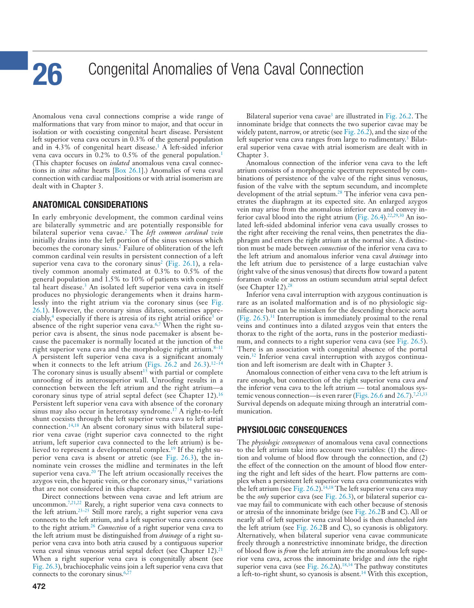

### Original PDF page 487

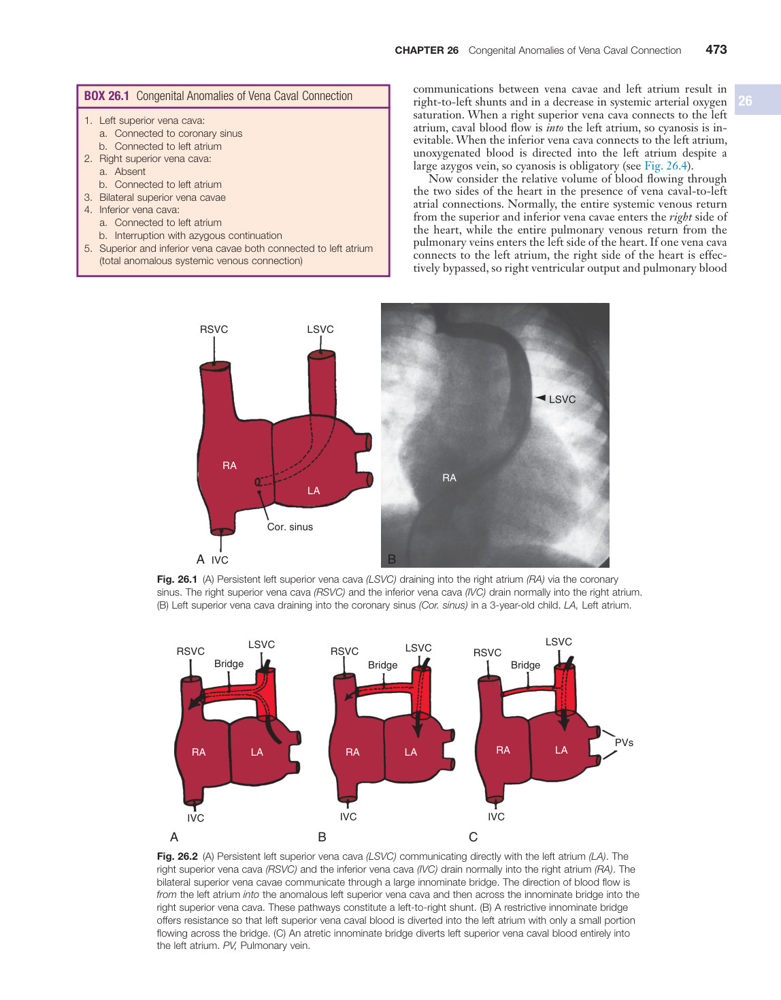

### Original PDF page 488

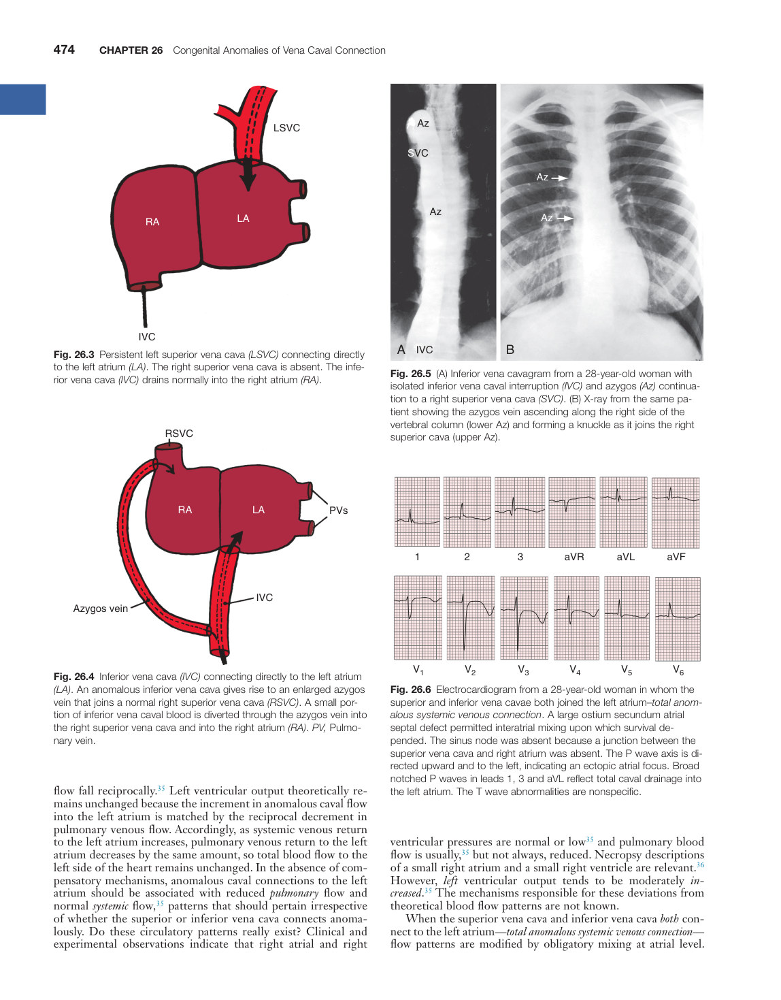

### Original PDF page 489

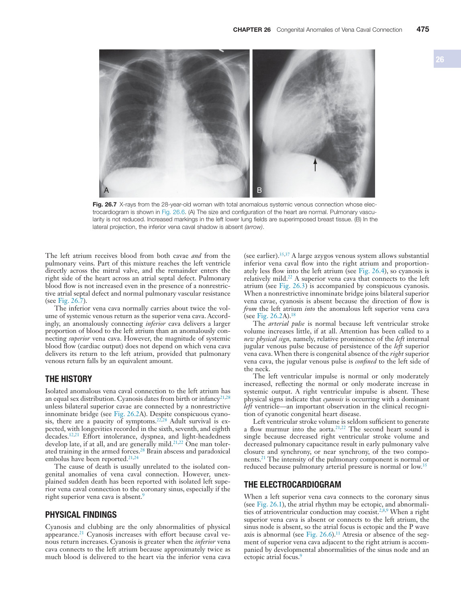

### Original PDF page 490

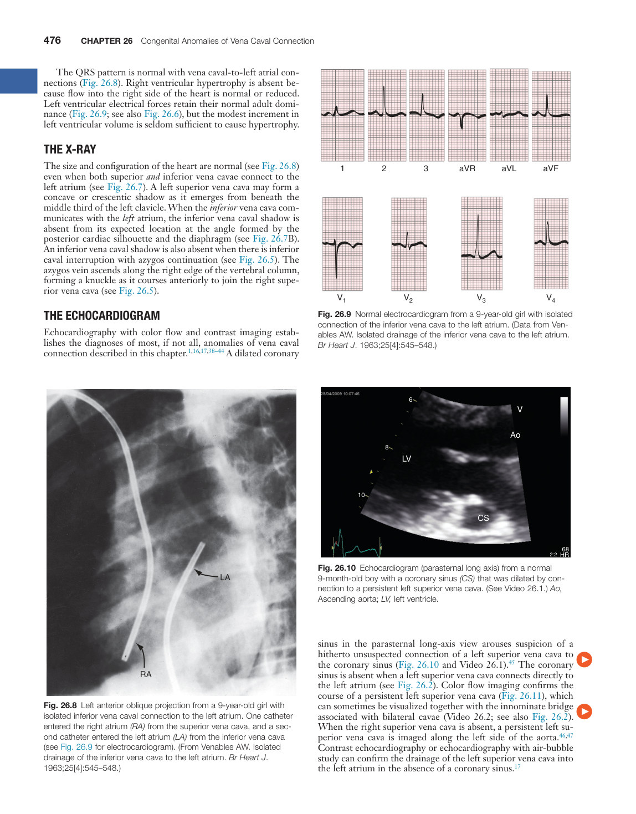

### Original PDF page 491

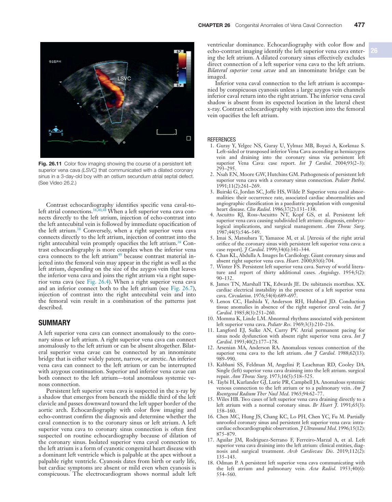

### Original PDF page 492

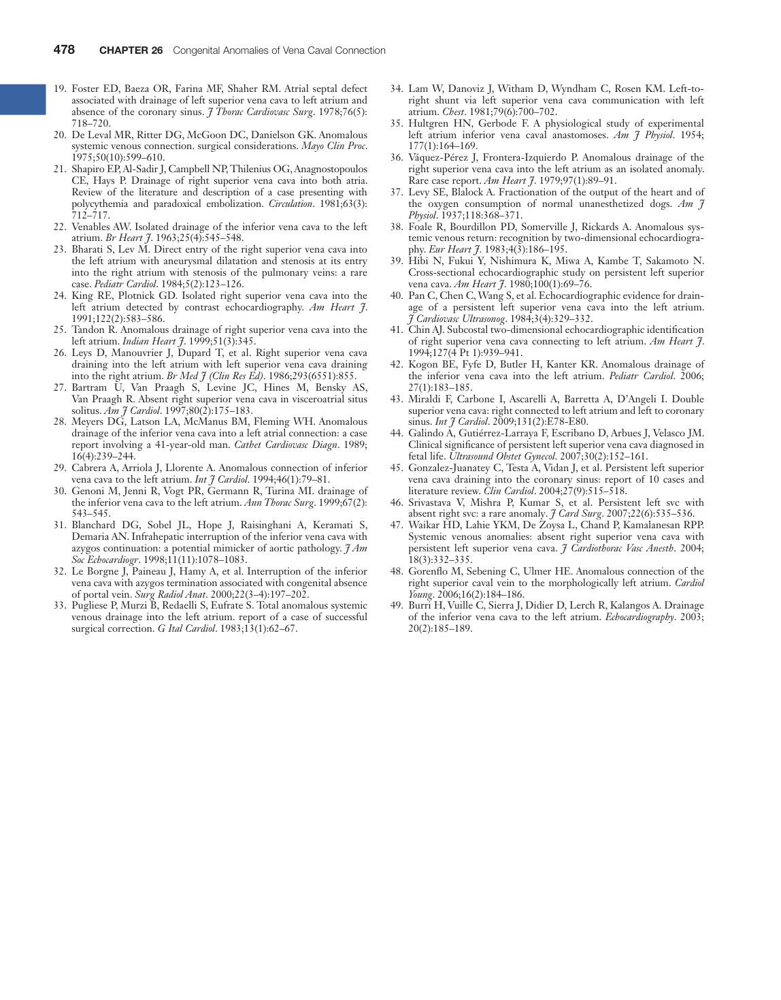

## Individual source figure views

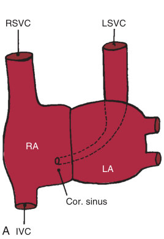

Fig. 26.1 ​(A) Persistent left superior vena cava (LSVC) draining into the right atrium (RA) via the coronary sinus. The right superior vena cava (RSVC) and the inferior vena cava (IVC) drain normally into the right atrium. (B) Left superior vena cava draining into the coronary sinus (Cor. sinus) in a 3-year-old child. LA, Left atrium.

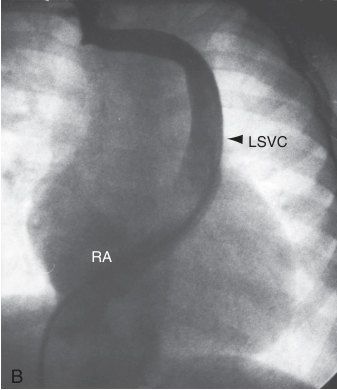

Fig. 26.1 ​(A) Persistent left superior vena cava (LSVC) draining into the right atrium (RA) via the coronary sinus. The right superior vena cava (RSVC) and the inferior vena cava (IVC) drain normally into the right atrium. (B) Left superior vena cava draining into the coronary sinus (Cor. sinus) in a 3-year-old child. LA, Left atrium.

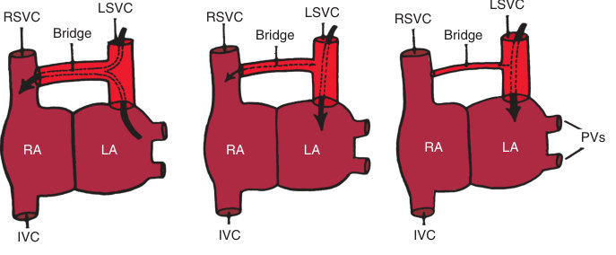

Fig. 26.2 ​(A) Persistent left superior vena cava (LSVC) communicating directly with the left atrium (LA). The right superior vena cava (RSVC) and the inferior vena cava (IVC) drain normally into the right atrium (RA). The bilateral superior vena cavae communicate through a large innominate bridge. The direction of blood flow is from the left atrium into the anomalous left superior vena cava and then across the innominate bridge into the right superior vena cava. These pathways constitute a left-to-right shunt. (B) A restrictive innominate bridge offers resistance so that left superior vena caval blood is diverted into the left atrium with only a small portion flowing across the bridge. (C) An atretic innominate bridge diverts left superior vena caval blood entirely into the left atrium. PV, Pulmonary vein.

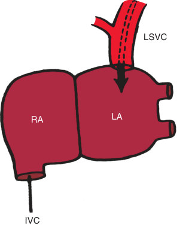

Fig. 26.3 ​Persistent left superior vena cava (LSVC) connecting directly to the left atrium (LA). The right superior vena cava is absent. The inferior vena cava (IVC) drains normally into the right atrium (RA).

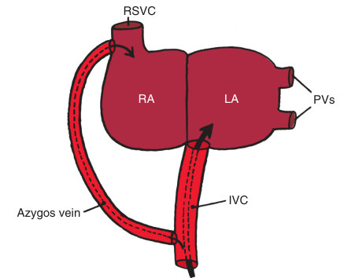

Fig. 26.4 ​Inferior vena cava (IVC) connecting directly to the left atrium (LA). An anomalous inferior vena cava gives rise to an enlarged azygos vein that joins a normal right superior vena cava (RSVC). A small portion of inferior vena caval blood is diverted through the azygos vein into the right superior vena cava and into the right atrium (RA). PV, Pulmonary vein.

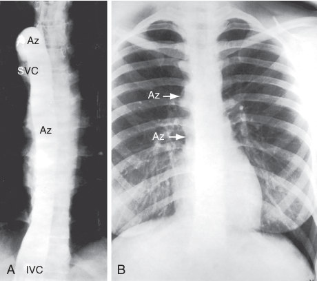

Fig. 26.5 ​(A) Inferior vena cavagram from a 28-year-old woman with isolated inferior vena caval interruption (IVC) and azygos (Az) continuation to a right superior vena cava (SVC). (B) X-ray from the same patient showing the azygos vein ascending along the right side of the vertebral column (lower Az) and forming a knuckle as it joins the right superior cava (upper Az).

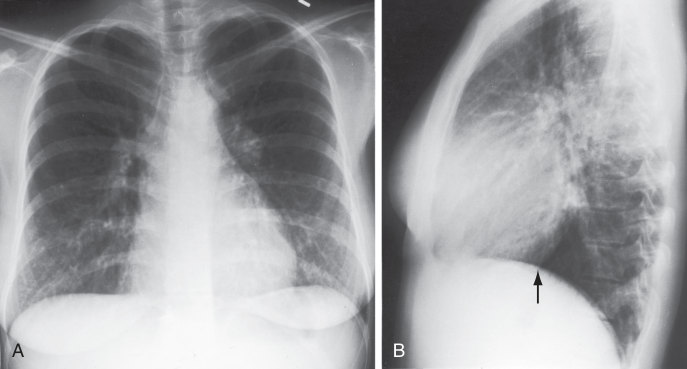

Fig. 26.7 ​X-rays from the 28-year-old woman with total anomalous systemic venous connection whose electrocardiogram is shown in Fig. 26.6. (A) The size and configuration of the heart are normal. Pulmonary vascularity is not reduced. Increased markings in the left lower lung fields are superimposed breast tissue. (B) In the lateral projection, the inferior vena caval shadow is absent (arrow).

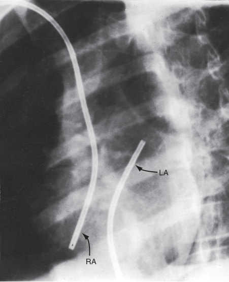

Fig. 26.8 ​Left anterior oblique projection from a 9-year-old girl with isolated inferior vena caval connection to the left atrium. One catheter entered the right atrium (RA) from the superior vena cava, and a second catheter entered the left atrium (LA) from the inferior vena cava (see Fig. 26.9 for electrocardiogram). (From Venables AW. Isolated drainage of the inferior vena cava to the left atrium. Br Heart J. 1963;25[4]:545–548.)

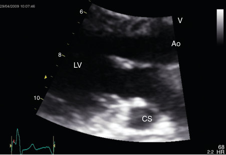

Fig. 26.10 ​Echocardiogram (parasternal long axis) from a normal 9-month-old boy with a coronary sinus (CS) that was dilated by connection to a persistent left superior vena cava. (See Video 26.1.) Ao, Ascending aorta; LV, left ventricle.

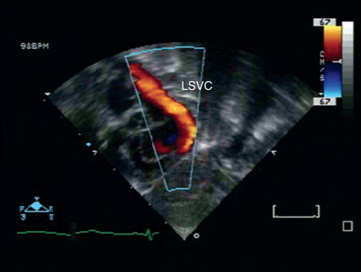

Fig. 26.11 ​Color flow imaging showing the course of a persistent left superior vena cava (LSVC) that communicated with a dilated coronary sinus in a 3-day-old boy with an ostium secundum atrial septal defect. (See Video 26.2.)

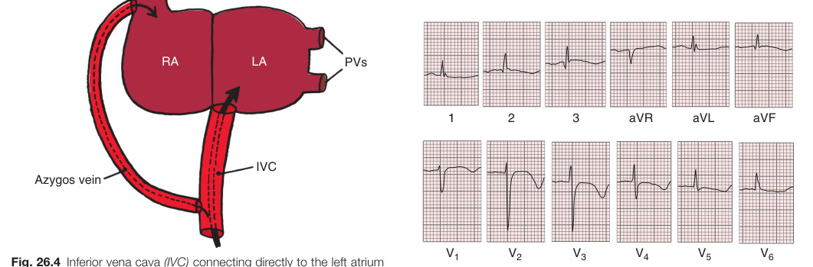

Fig. 26.6 ​Electrocardiogram from a 28-year-old woman in whom the superior and inferior vena cavae both joined the left atrium–total anomalous systemic venous connection. A large ostium secundum atrial septal defect permitted interatrial mixing upon which survival depended. The sinus node was absent because a junction between the superior vena cava and right atrium was absent. The P wave axis is directed upward and to the left, indicating an ectopic atrial focus. Broad notched P waves in leads 1, 3 and aVL reflect total caval drainage into the left atrium. The T wave abnormalities are nonspecific. flow fall reciprocally.35 Left ventricular output theoretically remains unchanged because the increment in anomalous caval flow into the left atrium is matched by the reciprocal decrement in pulmonary venous flow. Accordingly, as systemic venous return to the left atrium increases, pulmonary venous return to the left atrium decreases by the same amount, so total blood flow to the left side of the heart remains unchanged. In the absence of compensatory mechanisms, anomalous caval connections to the left atrium should be associated with reduced pulmonary flow and normal systemic flow ,35 patterns that should pertain irrespective of whether the superior or inferior vena cava connects anomalously. Do these circulatory patterns really exist? Clinical and experimental observations indicate that right atrial and right
