# 27. Congenital pulmonary arteriovenous fistula
> [Source credits](../../SOURCE_CREDITS.md).

## Study pillars

### Bypassing gas exchange

Blood bypasses gas exchange while flow through uninvolved lung may fall reciprocally. The right-to-left intrapulmonary route bypasses the capillary bed; redistribution can limit the net increase in ventricular flow.

PDF p. 493

### Associated vasculopathy

Hereditary hemorrhagic telangiectasia. The source describes an autosomal dominant vasculopathy with mucocutaneous bleeding and visceral arteriovenous malformations.

PDF p. 493

### Auscultatory localization

A peripheral pulmonary fistula can generate a localized flow murmur. Peripheral fistulae transmit sounds to the overlying chest wall; inspiratory flow and reduced compression may increase audibility.

PDF p. 499

### Delayed contrast

A pulmonary right-to-left shunt. The chapter describes delayed appearance beyond three cycles as usually indicating pulmonary shunting; the timing is a clue interpreted with anatomy.

PDF p. 500

### Neurologic risk

Paradoxical embolism, stroke and brain abscess. The shunt bypasses the pulmonary filter; the source highlights embolic events and brain abscess.

PDF p. 498

## Full source extraction

# 27. Congenital pulmonary arteriovenous fistula
> [Source credits](../../SOURCE_CREDITS.md).

## PDF page 493 | printed page 479

27 27 Congenital Pulmonary Arteriovenous Fistula

### HISTORICAL NOTES

In 1897, the British Medical Journal published a necropsy description of congenital pulmonary arteriovenous fistulae1 and, four decades later, the anomaly was recognized in a living subject.2 In 1865, Babington called attention to familial epistaxis,3 and in 1876, Legg described recurrent epistaxes and cutaneous telangiectasia in three generations.4 Twenty years later, Rendu published his classic description of familial epistaxes and telangiectasia (cutaneous angiomata) of the nose, cheeks, and upper lip.5 In 1901, Osler reported “On a family form of recurring epistaxis associated with multiple telangiectases of the skin and mucous membranes,”6 and in 1907, Weber reported “Multiple hereditary developmental angiomata (telangiectases) of the skin and mucous membranes associated with recurring haemorrhages.”7 In 1909, Hanes referred to the disorder as hereditary hemorrhagic telangiectasia,8,9 but the eponym Rendu, Osler, Weber remains in use without the inclusion of Legg,4 and with no consensus about the most appropriate sequence of names.10,11 The diagnosis of hereditary hemorrhagic telangiectasia (HHT) is made clinically by the Curac ̧ao criteria, which were established in 1999 by the Scientific Advisory Board of the HHT Foundation International. The criteria include recurrent epistaxis; telangiectases of the lips, oral cavity, fingers, and nose; gastrointestinal telangiectasia; and pulmonary, hepatic, cerebral, or spinal arteriovenous malformations.10,12,13

### ANATOMIC CONSIDERATIONS

Pulmonary arteriovenous fistulae are the result of an embryonic fault in the vascular complex that is responsible for the development of pulmonary arteries and veins.14 The fistulae can be solitary or multiple, unilateral or bilateral, or minute and diffuse throughout both lungs. 15–17 Approximately 75% of congenital pulmonary arteriovenous fistulae involve the lower lobes or right middle lobe15,18 (Figs. 27.1–27.5 and Videos 27.1–27.6), and usually occur without coexisting congenital heart disease. Isolated exceptions have been reported with left isomerism19,20 (see Chapter 3) and with atrial septal defect21 (see Chapter 12). Estimated minimum prevalence is 1:10,000 births.22

A fistula consists of either one or more relatively large vascular trunks, a thin aneurysmal sac, or a tangle of distended tortuous vascular channels (Figs. 27.6 and 27.7; see also Figs. 27.1– 27.5; see Videos 27.1 and 27.4).9 The arterial supply is through enlarged tortuous branches of a pulmonary artery, and drainage is through dilated pulmonary veins (see Figs. 27.1–27.4 and 27.7).14,23 Fistulous rupture results in hemorrhage into the pulmonary parenchyma or into the pleural space.24 Exceptionally, the arterial supply is from a bronchial, intercostal, anomalous systemic artery or a coronary artery (see Chapter 19). The fistula is then systemic arteriovenous rather than pulmonary arteriovenous.9 A rare anatomic variation consists of a congenital connection between a pulmonary artery and the left atrium, an anomaly in which an initial connection exists between a pulmonary artery and a pulmonary vein, but during vascular development the pulmonary vein becomes incorporated into the left atrium.25–29 Extralobar arteriovenous fistulae are represented by pulmonary sequestrations in which the arterial supply and venous drainage are systemic rather than pulmonary. Isolated congenital varicose

pulmonary veins are rare and not the result of arteriovenous malformations.30

### PHYSIOLOGIC CONSEQUENCES

The physiologic consequences of pulmonary arteriovenous fistulae depend on the amount of unoxygenated blood delivered through the malformation and on the size of the malformation, which tends to increase with age.31,32 Although the volume of blood delivered through the fistula is sufficient to cause cyanosis, it is rarely sufficient to impose a physiologic burden (see Fig. 27.4). Pulmonary artery pressure is normal with rare exception.33 In experimental pulmonary arteriovenous fistulae, cardiac output and left ventricular stroke volume are increased,34 but in congenital pulmonary arteriovenous fistulae, blood flow through the malformation is increased while flow through uninvolved lung decreases by a comparable amount. Accordingly, the net volume of blood reaching the left side of the heart is little if at all affected, so left ventricular stroke volume and cardiac output remain normal or nearly so. Rarely, a large pulmonary arteriovenous malformation imposes an excess volume load on the left side of the heart and induces congestive heart failure (Fig. 27.8 ).

Blood flow through pulmonary arteriovenous fistulae is affected by mechanical factors.35 Flow through lower lobe fistulae is augmented in the upright position because of increased perfusion of dependent portions of the lungs. A decubitus position compresses the dependent lung and reduces blood flow through an ipsilateral fistula. A case in point was a large pulmonary arteriovenous fistula in an adult female that was causing progressive cyanosis; coil embolization of the afferent limb of the fistula occluded the vessel, immediately decreasing the cyanosis (see Fig. 27.4 and Videos 27.1 and 27.2). Elevation of the diaphragm during pregnancy can compress a lower lobe fistula and abolish the accompanying murmur which reappears after delivery.35

Acquired pulmonary arteriovenous fistulae are occasional sequelae of cavo-pulmonary shunts, especially Glenn shunts (Fig. 27.9; see also Fig. 27.6).36,37 Acquired fistulae occur in children with hepatic cirrhosis and portal hypertension, especially with biliary atresia and right isomerism38,39 (see Chapter 3), and regress after liver transplantation.38 Large hepatic arteriovenous fistulae sometimes occur without pulmonary arteriovenous fistulae in Rendu-Osler-Weber disease.40–42 Hepatic, cerebral, and pulmonary arteriovenous fistulae may coexist.43

In 1917, telangiectasia and epistaxes were reported in a patient who died of massive hemothorax and at necropsy had three pulmonary arteriovenous fistulae.44 The association of hemorrhagic telangiectasia with pulmonary arteriovenous fistulae has been amply confirmed.9,10,15,16 Hereditary hemorrhagic telangiectasia is an autosomal dominant vasculopathy.22 Clinical diagnostic criteria have changed remarkably little over the last century.10

Pulmonary arteriovenous fistulae occur in 5% to 30% of patients with telangiectasia, and telangiectasia occurs in 30% to 60% of patients with pulmonary arteriovenous fistulae.45 Incidence of pulmonary arteriovenous fistulae with telangiectasia is 1:50,000 with autosomal dominant transmission and a 20% mutation rate. The mucocutaneous lesions are tiny, localized arteriovenous fistulae composed of thin, dilated vascular membranes with a layer of endothelium and no muscular or elastic coat.9,46 The lesions are fragile and rupture easily.9 Telangiectasia are found on the skin, the lips (Fig. 27.10), the nasal, oral, and vaginal

## PDF page 494 | printed page 480

A

Fig. 27.1 ​(A) X-ray of a 21-year-old male with a congenital right lower lobe pulmonary arteriovenous fistula (thick arrow). The lobulated density is connected to the hilus (thin arrow) by dilated vessels that enter and leave the fistula. The x-ray is otherwise normal. (B) Angiocardiogram showing the fistula (thick arrow) with its pulmonary arterial connection (thin arrow).

LPA AV Fistula Aff.

Eff.

Fig. 27.2 ​Pulmonary arteriogram from a 35-year-old female with a solitary left lower lobe congenital pulmonary arteriovenous fistula (AV Fistula). An afferent (Aff.) channel enters the fistula, and an efferent (Eff.) channel leaves the fistula. LPA, Left pulmonary artery.

mucous membranes, beneath the nails, and in the gastrointestinal tract, liver, central nervous system, kidney, and retina.9,47–49

### THE HISTORY

Pulmonary arteriovenous fistulae and hereditary hemorrhagic telangiectasia afflict males and females with equal frequency.9,50,51 The fistulae tend to increase in size and number with the passage of time31,32 and are seldom recognized until adulthood.50,52

B

Fig. 27.3 ​Angiocardiogram from a 32-year-old male with congenital bilateral pulmonary arteriovenous fistulae of the right and left lower lobes (arrows). Afferent and efferent vascular channels join and leave the fistula and are readily seen on the right. The left lower lobe fistula (arrow) is behind the cardiac apex, inviting a mistaken diagnosis of intracardiac origin. The heart size is normal.

## PDF page 495 | printed page 481

PV EL

AL

PA

EL

PV

A

AL

PA

C

Fig. 27.4 ​A 46-year-old female with pulmonary stenosis who has undergone previous surgical pulmonary valve replacement developed progressive cyanosis and was noted to have a pulmonary arteriovenous fistula on chest CT. Invasive angiography was then performed. (A) Anterior projection, selective angiogram in the distal right middle lobe pulmonary artery (PA) demonstrates brisk filling of a large and tortuous afferent limb (AL) with subsequent filling of two efferent limbs (ELs) that eventually enter the inferior and superior right sided pulmonary veins (PVs). (B) Lateral projection of the same injection as A; note the anterior location of the arteriovenous malformation and the length of the afferent and efferent limbs. (C and D), Anterior and lateral projections of a selective PA injection after comprehensive coil occlusion of the AL demonstrates no residual flow. The patient’s systemic arterial saturation improved from 88% on room air to 94% on room air immediately following this intervention.

Symptoms are the same whether the malformations are multiple or single (see Figs. 27.1–27.3), except for minute diffuse fistulous channels (see Figs. 27.4 and 27.5). Mean patient age in a large series was 39 years (range 3 years to 73 years) with a distinct majority over age 20 years. However, the first description of a pulmonary arteriovenous fistula was at necropsy in a 12-year-old boy (see earlier). 1 Despite adult prevalence, cyanosis is occasionally present shortly after birth, 53 and the malformation is occasionally overtly manifested in childhood.53

27

EL

PV

AL

EL

PV

B

PA AL

D

Asymptomatic acyanotic pulmonary arteriovenous fistulae usu - ally come to light because of abnormal shadows on a routine chest x-ray. Symptoms and complications are related to the pulmonary malformation per se or to coexisting hereditary hemorrhagic telangiectasia.3 4,54 Congestive heart failure is reserved for infants with a rare large fistula. The right-to-left shunt inherent in the fistulous communication results in cyanosis but seldom causes significant symptoms.53 Dyspnea and fatigue are the result of anemia provoked by bleeding telangiectasia. Rupture of fistulae into a

## PDF page 496 | printed page 482

AV Fistula

Eff.

Aff.

PT

A

Fig. 27.5 ​(A) Close-up of the chest x-ray of a 26-year-old female with a single large left upper lobe pulmonary arteriovenous fistula (AV Fistula). She had endured two brain abscesses. The solitary fistula and its afferent (Aff.) and efferent (Eff.) vascular channels are faintly seen. PT, Pulmonary trunk. (B) Contrast material selectively injected into the left pulmonary artery (LPA) visualized the afferent channel that entered the fistula and the efferent channel that left the fistula.

AL

EL

AVM

A B

Fig. 27.6 ​A 38-year-old male with complex single ventricle physiology who has undergone the Fontan operation and multiple intravascular interventions. The patient presents with worsening cyanosis. (A) Nonselective right pulmonary artery angiography demonstrating a right lower lobe arteriovenous malformation (AVM) fed by a long and tortuous afferent limb (AL) with one efferent limb (EL) faintly noted. (B) Complete occlusion of the AL and AVM with transcatheter coil embolization.

AV Fistula

Aff.

Eff.

LPA

B

Coils

## PDF page 497 | printed page 483

RPA

A

Fig. 27.7 ​(A) Selective injection of contrast material into the right pulmonary artery (RPA) of a 73-year-old female with multiple small bilateral congenital pulmonary arteriovenous fistulae but no telangiectasia. Arrows point to at least four fistulae in the right lower lobe. (B) Contrast material injected into the left pulmonary artery (LPA) of the patient’s 71-year-old brother who also had multiple small bilateral pulmonary arteriovenous fistulae and no telangiectasia. Arrows identify at least five left lower lobe fistulae. These siblings represent the rare occurrence of familial congenital pulmonary arteriovenous fistulae without telangiectasia.

AL

EL

AVM

PA PV

Fig. 27.8 ​A 3-D reconstruction of an invasive rotational right pulmonary artery angiogram viewed here from a right anterior oblique projection. There is a large pulmonary arteriovenous malformation (AVM) fed by an afferent limb (AL) coming off the right middle lobe pulmonary artery (PA) segment. Note the large efferent limb (EL) connected to a right pulmonary vein (PV).

27

LPA

B

contiguous bronchus causes hemoptysis that varies from mild and occasional to recurrent and massive.55,56 Fistulae are rarely substrates for infective endocarditis.23 Chest pain accompanies pleural involvement. Hemothorax results from rupture of a subpleural fistula.9,23,24,55,57 Intrapulmonary hemorrhage can be massive and fatal.58 Pregnancy is accompanied by adverse effects that resolve after delivery, including hemothorax,59 hemoptysis,60,61 enlargement of existing fistulae, increasing cyanosis,59,61 and expansion of occult fistulae.62 However, pregnancy exerts favorable effects, such as compression of lower lobe fistulae because of elevation of the diaphragm.35

Epistaxes are the most frequent and usually the first overt hemorrhagic event.9 Cutaneous lesions bleed easily, especially when exposed to sunlight.9 Tracheobronchial telangiectases set the stage for hemoptysis,9 and appropriately placed lesions elsewhere cause melena, hematuria, intraocular hemorrhage, vaginal bleeding, and cerebrovascular accidents.9,46,48

Gastrointestinal endoscopy detects mucosal telangiectases.13 Cerebral events deserve special comment with reference to a peculiar constellation of symptoms, including dizziness, vertigo, paresthesia, tinnitus, faintness, visual disturbances, speech defects, headache, weakness of the limbs, hemiplegia, mental confusion, and convulsions.9,35 Cerebral episodes may be brief or prolonged, isolated or recurrent, and tend to manifest similar patterns with subsequent attacks.9 Pathogenesis has not been established, but occurrence in acyanotic patients without pulmonary arteriovenous fistulae incriminates telangiectasias,9 which have been described with a cerebral arteriovenous malformation characterized by a plexiform nidus with an afferent arterial pedicle and a draining vein.63

## PDF page 498 | printed page 484

PA

EL

ALs

PAVMs

A B

Fig. 27.9 ​(A) Selective right lower lobe pulmonary artery angiogram (anteroposterior projection) in a 23-yearold with single ventricle physiology who had undergone a prior Fontan operation and attempted yet unsuccessful coil embolization of pulmonary arteriovenous malformations (PAVMs). Note the continued brisk flow from the pulmonary artery (PA) via multiple afferent limbs (ALs) to the PAVMs with subsequent filling of an efferent limb (EL) to which one coil had embolized. (B) Transesophageal echocardiogram performed at the time of cardiac catheterization. Right PA agitated saline injection reveals 41 shunting to the left atrium and subsequently to the single left ventricle (LV). LA, Left atrium.

Fig. 27.10 ​X-ray of a 6-month-old cyanotic female with a congenital right lower lobe pulmonary arteriovenous fistula that faintly revealed itself (paired arrows). Mucocutaneous telangiectasia was not identified. Cyanosis disappeared after coil embolization.

Pulmonary arteriovenous fistulae set the stage for paradoxical emboli, stroke, and brain abscess (see Fig. 27.7).9,32,63–68 Intracranial malformations induce grand mal seizures which can be fatal.69 Sudden death results from massive intrapulmonary hemorrhage and massive hemothorax.9,24,58 A 41-year-old woman whose case was reported in 1906 died of intractable epistaxes.70

LA

LV

Platypnea-orthodeoxia has been described with pulmonary arteriovenous fistula and a patent foramen ovale.71

### PHYSICAL FINDINGS

Cyanosis and clubbing are intense when the fistulous shunt is large.9,72 Anemia caused by bleeding telangiectasia can virtually abolish the cyanosis, but clubbing persists.9,72 Cyanosis is absent when systemic arteries rather than pulmonary arteries feed the fistulae.9

However, the most distinctive physical appearance in patients with pulmonary arteriovenous fistulae is the coexisting mucocutaneous telangiectases—clusters of tiny ruby lesions on the nasal and oral mucous membranes (see Fig. 27.10) and on the face, tongue, skin, retina, and nail beds.9,11 The lesions blanch with the slightest pressure and bleed with the slightest provocation. Unlike spider angioma, blanching with pressure is usually incomplete. Telangiectases are rarely evident in infants and young children but may be the first evidence of a pulmonary arteriovenous fistula.

An annotation in the Lancet vividly described the classic pattern of mucocutaneous telangiectases:

Every large general hospital is certain to have on its list of frequent attenders a small group of unfortunate adults who come to the casualty department complaining of recurrent bleeding from the nose, lips or mouth. The blood is seen to stem from an insignificant leak in the center of a small ruby patch, many of which are usually to be found scattered here and there on the mucous membrane (see Fig. 27.10). Although the flow of blood is seldom vigorous it may eventually, by its persistence, cause some concern. Its arrest can be infuriatingly difficult. Each ruby patch marks the position of a tiny arteriovenous communication at the capillary

## PDF page 499 | printed page 485

SM

Expiration Inspiration

Fig. 27.11 ​Phonocardiogram from the left mid axillary line of the 35-year-old female whose solitary left lower lobe pulmonary arteriovenous fistula is shown in Fig, 27.2. The systolic murmur (SM) recorded during expiration becomes continuous and increases appreciably during deep inspiration.

level. Presumably these vessels are very close to the surface or else they are abnormally fragile. Whatever the cause, they can be induced to bleed by the most trivial of injuries.

The arterial pulse and the jugular venous pulse are normal because left ventricular stroke volume is normal or only modestly increased, and congestive heart failure is rare. Isolated examples of an increased arterial pulse occur with a massive pulmonary arteriovenous fistula and when coexisting intrahepatic arteriovenous fistulae cause a hyperdynamic circulatory state.40,42

The extra amount of blood pumped by the right or left ventricle is relatively small (see Physiologic Consequences), so the impulses of both ventricles are normal. Precordial impulses are hyperdynamic in the rare event of a massive pulmonary arteriovenous fistula, and hepatic arteriovenous fistulae are accompanied by hyperdynamic ventricular impulses, hepatomegaly, and a hepatic thrill.40,42

Pulmonary arteriovenous fistulae transmit murmurs to overlying chest wall sites because the fistulae are close to the periphery of the lungs (see Figs. 27.1–27.3).53 Murmurs are absent when fistulae lie deeply within the lungs or when they are small and diffuse (see Figs. 27.4 and 27.5).9,21 Murmurs are missed when they are faint and are assigned to nonprecordial sites.53 The clinical diagnosis is untenable in acyanotic patients with no murmur and no telangiectases. The abdominal location of the murmur is responsible for oversight when arteriovenous fistulae are hepatic.40,41

Murmurs are typically less than grade 3, and are therefore rarely accompanied by a thrill.23 Loud harsh murmurs are exceptional. Auscultation should be carried out in a quiet room with the patient comfortable and the thorax relaxed to avoid the interference of muscle tremor. The entire chest should be examined in addition to the liver and the cranium. Respiration should be quiet and should include gentle held exhalation. Because 75% of pulmonary arteriovenous fistulae are in the lower lobes and right middle lobe, the relevant overlying chest wall sites warrant special auscultatory attention.18 Murmurs overlying the lingula of the left lung can be mistaken for intracardiac murmurs (see Fig. 27.3).

Pulmonary arteriovenous fistulae generate systolic or continuous murmurs (Figs. 27.11 and 27.12).9,23,73 In the first clinically diagnosed case, the murmur was continuous.2 The major pressure gradient across the fistula is systolic.23,73 Diastolic gradients are negligible or absent, so the diastolic portion of the murmur is negligible or absent, accounting for the high incidence of murmurs that are confined to systole (see Fig. 27.11). Isolated diastolic murmurs are rare.73 Fistulae are downstream from the right ventricle, so an interval elapses from the onset of right ventricular ejection to blood flow through the fistula. This interval is responsible for the delayed onset and late crescendo exhibited by the

27

Deep Inspiration

2 LICS

S1 SM S2

Left posterior chest

ACG

Fig. 27.12 ​Phonocardiograms from a 38-year-old female with a congenital pulmonary arteriovenous fistula of the left lower lobe. Recordings from the second left intercostal space (2 LICS) disclosed no murmur, but recordings from the left posterior chest disclosed a soft delayed systolic murmur (SM). ACG, Apex cardiogram; S1/S2, first and second heart sounds.

murmurs, which begin late and finish after the second heart sound (see Fig. 27.12). No murmur at all is heard in those with cavopulmonary circulations (e.g., Glenn or Fontan operations) since the afferent limb has central venous pressures and the efferent limb has pulmonary venous pressures; hence, there is a minimal continuous pressure gradient that is not sufficient to generate an audible murmur (see Figs. 27.6 and 27.8; Videos 27.3 and 27.5).

The normal inspiratory increase in right ventricular volume is available for forward flow through the fistula, and inspiratory depression of the diaphragm reduces compression of lower lobe fistulae. Accordingly, the murmur decreases during expiration and increases during inspiration, especially during deep held inspiration (see Fig. 27.11).9,23,35,73 The murmur may be heard only at the end of an exaggerated inspiratory effort, so unless this

## PDF page 500 | printed page 486

maneuver is performed, the response of the murmur will be missed. Inspiration may also cause a systolic murmur to become continuous (see Fig. 27.11). To detect these respiratory effects, auscultation should be carried out at the end of normal expiration and at the height of deep, momentarily held inspiration. These maneuvers serve two purposes: namely, to minimize respiratory interference, and to provide time for right ventricular blood to reach the fistula. The Valsalva and Müller maneuvers exaggerate these effects.23 Flow through the fistula diminishes during the Valsalva maneuver, so the murmur softens or vanishes. When straining is released, flow abruptly accelerates, and the murmur abruptly intensifies. The Müller maneuver (forced inspiration against a closed glottis) increases flow through the fistula and increases the intensity of the fistulous murmur. Standing increases perfusion of the dependent portions of the lungs and increases audibility of lower lobe murmurs.35 A lateral decubitus position on the side of a fistula compresses the ipsilateral lung and decreases the murmur.35 Pregnancy elevates the diaphragm, compresses lower lobe fistulae, and decreases or abolishes the murmur (see earlier).35

### THE ELECTROCARDIOGRAM

The electrocardiogram is typically normal because the hemodynamic burden is modest. Flow through the fistula is associated with a reciprocal decrease in flow through the uninvolved lung, so right ventricular output is normal, and the volume entering the left side of the heart is normal. The increment of blood shunted through the fistula seldom imposes volume load on either ventricle. These circulatory adjustments are less effective when fistulae are large, which may account for the occasional presence of right or left axis deviation.23,73 When a large pulmonary arteriovenous fistula or a large pulmonary arterial-to-left atrial fistula exists in utero, right ventricular blood preferentially flows through the low-resistance fistula and imposes volume overload on the left side of the heart. This mechanism is held responsible for left ventricular hypertrophy and left atrial P wave abnormalities.

### THE X-RAY

The rare large fistula is associated with an increase in heart size,23 but otherwise, the size and shape of the heart are normal (see Figs. 27.1 and 27.2). The most important feature of the x-ray is the abnormal density cast by the fistula itself (see Figs. 27.1A, 27.3, and 27.7A). Lateral views should be examined to disclose a density hidden by the heart or diaphragm (see Fig. 27.3).15 Multiple small fistulae are hazy radiodensities rather than circumscribed lesions and are difficult to identify in the x-ray.9,14,17,23 Fistulae in infants are usually poorly defined in the x-ray but tend to increase in size and radiodensity as the child grows.31,32 Large fistulae are exceptional.

Pulmonary arteriovenous fistulae can be single or multiple, unilateral or bilateral, and typically involve the lower lobes and right middle lobe (see Figs. 27.1–27.4) (see earlier). Upper lobe fistulae are uncommon (see Fig. 27.7). The densities vary in size and shape from small focal opacities (see Figs. 27.4 and 27.5) to large homogeneous densities that can be mistaken for coin lesions or metastatic carcinoma (see Figs. 27.1 and 27.2). The densities are hazy and ill-defined, or round or lobulated with well-demarcated edges (see Figs. 27.1 and 27.2).9,11,23 Lateral projections confirm that the opacities are within the lung parenchyma.9 Calcification is exceptional.74 Hemorrhage may obscure the lesion. Intrapleural rupture is accompanied by painful hemothorax.9,24

Vascular shadows connecting the parenchymal density to the hilus establish the lung lesion as pulmonary arteriovenous (see

Figs. 27.1–27.4 and 27.7).9,23,75 The linear vascular shadows correspond to dilated afferent pulmonary arterial channels that join the fistula, and efferent channels that leave the fistula (see Figs. 27.1–27.4 and 27.7). Rarely, localized notching of ribs is caused by dilated tortuous intercostal arteries that enter the fistula.23 Subtle variations in the size of a fistula can be induced by changes in intrathoracic pressure23 (see earlier). The Valsalva maneuver diminishes the fistula by decreasing flow. The Müller maneuver enlarges the fistula by increasing flow.

### THE ECHOCARDIOGRAM

Pulmonary arteriovenous fistulae are seldom imaged by echocardiography because the lesions are within the lung parenchyma. An exception is a solitary large paracardiac fistula.25 Pulsed Doppler echocardiography can record bi-directional flow into and out of the fistula,76 and the diagnosis has been made by color Doppler and amplitude ultrasound angiography.77 “Bubble echocardiography” can be a useful diagnostic tool (see Fig. 27.9 and Video 27.6).78 Contrast echocardiography detects relatively small right-to-left fistulous shunts, and establishes the shunts as extracardiac.25,79,80 Agitated saline injected into a peripheral vein, vena cava, or pulmonary artery is promptly detected in pulmonary veins or left atrium by transthoracic and transesophageal echocardiography.25,32,79,80 Delayed appearance of contrast in the left atrium of more than three cardiac cycles is usually indicative of pulmonary shunting.81

### SUMMARY

Pulmonary arteriovenous fistulae are usually discovered in young adults because of abnormal densities on routine chest xrays, or because of cyanosis or mucocutaneous telangiectasia. Dyspnea and fatigue do not correspond to the degree of cyanosis but are related to anemia caused by bleeding hemorrhagic telangiectasia. The history is characterized by recurrent epistaxis, hemoptysis, and bleeding from mouth, lips, and gastrointestinal tract. Cerebral, intrapulmonary, and intrapleural hemorrhage can be lethal. Peculiar cerebral symptoms include dizziness, tinnitus, vertigo, paresthesia, faintness, visual aberrations, speech disturbances, headache, extremity weakness, mental confusion, and seizures. Pulmonary arteriovenous malformations set the stage for paradoxical embolism, stroke, and brain abscess. Physical appearance reflects cyanosis and clubbing, but especially clusters of small ruby patches (telangiectases) on the face, nasal, and oral mucous membranes, and the tongue, lips, and skin. The arterial pulse, the jugular venous pulse, and the precordial movements are usually normal. Auscultation detects systolic or continuous murmurs at nonprecordial sites corresponding to the lower lobe or right middle lobe locations in the majority of pulmonary arteriovenous fistulae. Systolic murmurs increase in intensity and become continuous during inspiration, during the Müller maneuver, or with standing, and decrease in intensity during exhalation, the Valsalva maneuver, or in an ipsilateral decubitus position. The electrocardiogram is normal, and the size and shape of the heart on x-ray are normal. However, the lung fields show distinctive fistulous densities that are single or multiple, unilateral or bilateral, small or large, and are typically located in the lower lobes or right middle lobe. The densities are round or lobulated, well demarcated, and attached to the hilus by shadows that represent dilated afferent and efferent vessels entering and leaving the fistula. The radiologic size of a fistula decreases with the Valsalva maneuver and increases with the Müller maneuver. Contrast echocardiography confirms small right-to-left fistulous shunts and identifies the shunts as extracardiac.

## PDF page 501 | printed page 487

30. Nelson WP, Hall RJ, Garcia E. Varicosities of the pulmonary veins

REFERENCES 1. Churton T. Multiple aneurysms of pulmonary artery. Br Med J.

31. Swanson KL, Prakash UB, Stanson AW. Pulmonary arteriovenous fis-

1897;1:1223. 2. Smith HL, Horton BT. Arteriovenous fistula of the lung associated

with polycythemia vera: report of a case in which the diagnosis was made clinically. Am Heart J. 1939;18:589–592. 3. Babington BG. Hereditary epistaxis. Lancet. 1865;2:362. 4. Legg JW. A case of haemophilia complicated with multiple naevi.

32. Teragaki M, Akioka K, Yasuda M, et al. Hereditary hemorrhagic tel-

33. Sapru RP, Hutchison DC, Hall JI. Pulmonary hypertension in patients

Lancet. 1876;2:856. 5. Rendu H. Epistaxis répetée chez un sujet porteur de petits angiomes

34. Waldhausen JA, Abel FL. The circulatory effects of pulmonary arte-

cutanés et muqueaux. Bull Mem Soc Med Hop Paris. 1896;13:731. 6. Osler W. On a family form of recurring epistaxis, associated with

35. Hazlett DR, Medina J. Postural effects on the bruit and right-to-left

multiple telangiectases of skin and mucous membranes. Bull Johns Hopkins Hosp. 1901;12:333. 7. Weber FP. Multiple hereditary developmental angiomata (telangiec-

36. Bernstein HS, Brook MM, Silverman NH, Bristow J. Development

tases) of the skin and mucous membranes associated with recurring haemorrhages. Lancet. 1907;2:160–162. 8. Hanes FM. Multiple hereditary telangiectases causing hemorrhage

37. Premsekar R, Monro JL, Salmon AP. Diagnosis, management, and

(hereditary hemorrhagic) telangiectasia. Bull Johns Hopkins Hosp. 1909;20:63–73. 9. Hodgson CH, Burchell HB, Good CA, Clagett OT. Hereditary hem-

38. Barbé T, Losay J, Grimon G, et al. Pulmonary arteriovenous shunting

orrhagic telangiectasia and pulmonary arteriovenous fistula: survey of a large family. N Engl J Med. 1959;261:625–636. 10. Shovlin CL, Guttmacher AE, Buscarini E, et al. Diagnostic criteria

39. Hoffbauer FW, Rydell R. Multiple pulmonary arteriovenous fistulas

for hereditary hemorrhagic telangiectasia (Rendu-Osler-Weber syndrome). Am J Med Genet. 2000;91(1):66–67. 11. Steinberg I, McClenahan J. Pulmonary arteriovenous fistula; angio-

40. Burckhardt D, Stalder GA, Ludin H, Bianchi L. Hyperdynamic cir-

cardiographic observations in nine cases. Am J Med. 1955;19(4): 549–568. 12. Hu SY, Tsai CH, Tsan YT. Pulmonary arteriovenous malformation in

41. Danchin N, Thisse JY, Neimann JL, Faivre G. Osler-Weber-Rendu

Osler-Weber-Rendu syndrome. Eur J Cardiothorac Surg. 2009;36(2):395. 13. Yunoki K, Naruko T, Komiyama M, et al. Images in cardiovascular

42. Razi B, Beller RM, Ghidoni J, Linhart JW, Talley RC, Urban E.

medicine. Hereditary hemorrhagic telangiectasia with pulmonary arteriovenous fistulas. Circulation. 2006;114(3):e48-e49. 14. Anabtawi IN, Ellison RG. Maldevelopment of the pulmonary veins

43. Maruyama J, Watanabe M, Onodera S, Hasebe N, Yamashita H,

and pulmonary arteriovenous aneurysms. Am Surg. 1964;30:770–773. 15. Boczko ML. Pulmonary arteriovenous fistulas. Mayo Clin Proc.

1999;74(12):1305. 16. Brian CA, Payne RM, Link KM, Hundley WG, Warner JG Jr. Pulmo-

44. Wilkens GD. Ein Fall von multiplen pulmonalis Aneurysmen. Beitr

nary arteriovenous malformation. Circulation. 1999;100(4):e29-e30. 17. Hales MR. Multiple small arteriovenous fistulae of the lungs. Am J

45. Ehrenhaft JL, Taber RE. Arteriovenous fistulae and arterial aneurysms

Pathol. 1956;32(5):927–943. 18. Sahn SH, Bluth I, Schub H. Pulmonary arteriovenous fistula: a report

46. Mestre JR, Andres JM. Hereditary hemorrhagic telangiectasia caus-

of two unusual cases. Dis Chest. 1963;44:542–546. 19. Amodeo A, Marino B. Pulmonary arteriovenous fistulas in patients

47. Boston LN. Gastric hemorrhage due to familial telangiectasis. Am J

with left isomerism and cardiac malformations. Cardiol Young. 1998;8(3):283–284. 20. Kapur S, Rome J, Chandra RS. Diffuse pulmonary arteriovenous

48. Humphries JE, Frierson HF Jr, Underwood PB Jr. Vaginal telangiec-

malformation in a child with polysplenia syndrome. Pediatr Pathol Lab Med. 1995;15(3):463–468. 21. Sanders JS, Martt JM. Multiple small pulmonary arteriovenous fistulas.

49. Reilly PJ, Nostrant TT. Clinical manifestations of hereditary hemor-

50. McKusick VA. A genetical view of cardiovascular disease. The Lewis

Diagnosis by cardiac catheterization. Circulation. 1962;25:383–389. 22. Franzen O, Lund C, Baldus S. Pulmonary arteriovenous fistula in

51. Peery WH. Clinical spectrum of hereditary hemorrhagic telangiecta-

hereditary hemorrhagic telangiectasis. Clin Res Cardiol. 2009;98(11): 749–750. 23. Le Roux BT. Pulmonary arteriovenous fistulae. Q J Med. 1959;28(109):

52. Standefer JE, Tabakin BS, Hanson JS. Pulmonary arteriovenous fis-

1–19. 24. Dalton ML Jr, Goodwin FC, Bronwell AW, Rutledge R. Intrapleural

53. Husson GS. Pulmonary arteriovenous aneurysm in childhood. Pedi-

rupture of pulmonary arteriovenous aneurysm. Report of a case. Dis Chest. 1967;52(1):97–100. 25. Jimenez M, Fournier A, Choussat A. Pulmonary artery to the left

54. Kraemer N, Krombach GA. Images in clinical medicine. Pulmonary

atrium fistula as an unusual cause of cyanosis in the newborn. Pediatr Cardiol. 1989;10(4):216–220. 26. Kroeker EJ, Adams HD, Leon AS, Pouget JM. Congenital communi-

55. Brummelkamp WH. Unusual complication of pulmonary arteriove-

56. Lyons HA, Mannix EP Jr. Successful resections for bilateral pulmo-

cation between a pulmonary artery and the left atrium. Physiologic observations and review of the literature. Am J Med. 1963;34:721–725. 27. Sheikhzadeh A, Hakim H, Ghabusi P, Ataii M, Tarbiat S. Right pul-

57. Livingston SO, Carr RE. Hereditary hemorrhagic telangiectasia; re-

monary artery-to-left atrial communication: recognition and surgical correction. Am Heart J. 1984;107(2):396–398. 28. Tirilomis T, Busch T, Aleksic I, Ruschewski W, Criée CP, Dalichau

58. Ference BA, Shannon TM, White RI Jr, Zawin M, Burdge CM. Life-

H. Pulmonary arteriovenous fistula drainage into the left atrium. Thorac Cardiovasc Surg. 2000;48(1):37–39. 29. Tuncali T, Aytac A. Direct communication between right pulmonary

59. Freixinet J, Sanchez-Palacios M, Guerrero D, et al. Pulmonary arte-

artery and left atrium. Report of a case and proposal of a new entity. J Pediatr. 1967;71(3):384–389.

27

simulating arteriovenous fistulas. JAMA. 1966;195(1):13–17.

tulas: Mayo Clinic experience, 1982–1997. Mayo Clin Proc. 1999;74(7): 671–680.

angiectasia with growing pulmonary arteriovenous fistulas followed for 24 years. Am J Med Sci. 1988;295(6):545–547.

with pulmonary arteriovenous fistulae. Br Heart J. 1969;31(5):559–569.

riovenous fistulas. Surgery. 1966;59(1):76–80.

shunt of pulmonary arteriovenous fistula. Chest. 1971;60(1):89–92.

of pulmonary arteriovenous fistulae in children after cavopulmonary shunt. Circulation. 1995;92(9 Suppl):II309-II314.

pathophysiology of post-Fontan hypoxaemia secondary to Glenn shunt related pulmonary arteriovenous malformation. Heart. 1999;82(4): 528–530.

in children with liver disease. J Pediatr. 1995;126(4):571–579.

in juvenile cirrhosis. Am J Med. 1956;21(3):450–460.

culatory state due to Osler-Weber-Rendu disease with intrahepatic arteriovenous fistulas. Am Heart J. 1973;85(6):797–800.

disease with multiple intrahepatic arteriovenous fistulas. Am Heart J. 1983;105(5):856–859.

Hyperdynamic circulatory state due to intrahepatic fistula in Osler- Weber-Rendu disease. Am J Med. 1971;50(6):809–815.

Tobise K. A case of Rendu-Osler-Weber disease with cerebral hemangioma, multiple pulmonary arteriovenous fistulas and hepatic arteriovenous fistula. Jpn J Med. 1989;28(5):651–656.

Klin Tuberk. 1917;38:1–10.

of the pulmonary arterial tree. AMA Arch Surg. 1956;73(4):567–577.

ing hematemesis in an infant. J Pediatr. 1982;101(4):577–579.

Med Sci. 1930;180:798.

tasias: unusual presentation of the Osler-Weber-Rendu syndrome. Obstet Gynecol. 1993;81(5 Pt 2):865–866.

rhagic telangiectasia. Am J Gastroenterol. 1984;79(5):363–367.

A. Conner memorial lecture. Circulation. 1964;30:326–357.

sia (Osler-Weber-Rendu disease). Am J Med. 1987;82(5):989–997.

tulas. Case report with cine-angiographic studies. Am Rev Respir Dis. 1964;89:95–99.

atrics. 1956;18(6):871–879.

arteriovenous fistula. N Engl J Med. 2009;360(17):1769.

nous aneurysm: intrapleural rupture. Dis Chest. 1961;39:218.

nary arteriovenous fistulas. N Engl J Med. 1956;254(21):969–974.

port of a case with hemothorax. J Thorac Surg. 1956;31(4):497–503.

threatening pulmonary hemorrhage with pulmonary arteriovenous malformations and hereditary hemorrhagic telangiectasia. Chest. 1994;106(5):1387–390.

riovenous fistula ruptured to pleural cavity in pregnancy. Scand J Thorac Cardiovasc Surg. 1995;29(1):39–41.

## PDF page 502 | printed page 488

60. Bradshaw DA, Murray KM, Mull NH 4th. Massive hemoptysis in

pregnancy due to a solitary pulmonary arteriovenous malformation. West J Med. 1994;161(6):600–602. 61. Esplin MS, Varner MW. Progression of pulmonary arteriovenous

72. Dhillon BS, Fawcett AW. Pulmonary arterio-venous fistula; review of

malformation during pregnancy: case report and review of the literature. Obstet Gynecol Surv. 1997;52(4):248–253. 62. Wilmshurst P, Jackson P. Arterial hypoxemia during pregnancy

73. Yater WM, Finnegan J, Giffin HM. Pulmonary arteriovenous fistula;

caused by pulmonary arteriovenous microfistulas. Chest. 1996;110(5): 1368–1369. 63. Preston DC, Shapiro BE. Pulmonary arteriovenous fistula and brain

74. Sloan RD, Cooley RN. Congenital pulmonary arteriovenous aneu-

abscess. Neurology. 2001;56(3):418. 64. Brydon HL, Akinwunmi J, Selway R, Ul-Haq I. Brain abscesses as-

75. Singleton EB, Leachman RD, Rosenberg HS. Congenital abnor-

sociated with pulmonary arteriovenous malformations. Br J Neurosurg. 1999;13(3):265–269. 65. Chambers WR. Brain abscess associated with pulmonary arterio-

76. Kataoka H, Matsuno O. Rendu-Osler-Weber disease: transthoracic

venous fistula. Ann Surg. 1955;141(2):276–277. 66. Sajeev CG, Fasaludeen M, Venugopal K. Pulmonary arteriovenous

77. Wang HC, Kuo PH, Liaw YS, et al. Diagnosis of pulmonary arterio-

fistula presenting as brain abscess. Int J Cardiol. 2005;98(1):153. 67. Kawano H, Hirano T, Ikeno K, Fuwa I, Uchino M. Brain abscess

78. Sands A, Dalzell E, Craig B, Shields M. Multiple intrapulmonary

caused by pulmonary arteriovenous fistulas without Rendu-Osler- Weber disease. Intern Med. 2009;48(6):485–487. 68. Tomelleri G, Bovi P, Carletti M, et al. Paradoxical brain embolism in

79. Ozkutlu S, Saraçlar M. Two-dimensional contrast echocardiography

a young man with isolated pulmonary arteriovenous fistula. Neurol Sci. 2008;29(3):169–171. 69. Byard RW, Schliebs J, Koszyca BA. Osler-Weber-Rendu syndrome—

80. Shub C, Tajik AJ, Seward JB, Dines DE. Detecting intrapulmonary

pathological manifestations and autopsy considerations. J Forensic Sci. 2001;46(3):698–701. 70. Kelly AB. Multiple telangiectases of the skin and mucous membranes

81. Velthuis S, Buscarini E, Gossage JR, Snijder RJ, Mager JJ, Post MC.

of the nose and mouth. Glasgow Med J. 1906;65(6):411–422. 71. Ohara T, Nakatani S, Hashimoto S, et al. A case of platypnea-

orthodeoxia syndrome in a patient with a pulmonary arteriovenous

fistula and a patent foramen ovale. J Am Soc Echocardiogr. 2007;20(4): 439.e5–439.e10.

world literature and report on two additional cases. Postgrad Med J. 1956;32(369):353–356.

review of the literature and report of two cases. J Am Med Assoc. 1949;141(9):581–589.

rysm. Am J Roentgenol Radium Ther Nucl Med. 1953;70(2):183–210.

malities of the pulmonary arteries. Am J Roentgenol Radium Ther Nucl Med. 1964;91:487–499.

Doppler ultrasonographic findings. Circulation. 2001;103(7):E36-E38.

venous malformations by colour Doppler ultrasound and amplitude ultrasound angiography. Thorax. 1998;53(5):372–376.

arteriovenous fistulas in childhood. Pediatr Cardiol. 2000;21(5): 493–496.

in pulmonary arteriovenous fistula. Jpn Heart J. 1989;30(3):425–430.

right-to-left shunt with contrast echocardiography. Observations in a patient with diffuse pulmonary arteriovenous fistulas. Mayo Clin Proc. 1976;51(2):81–84.

Clinical implications of pulmonary shunting on saline contrast echocardiography. J Am Soc Echocardiogr. 2015;28(3):255–263.

## Complete original page views

Searchable extraction can lose mathematical symbols or reading order. These original pages preserve source layout, symbols and credits.

### Original PDF page 493

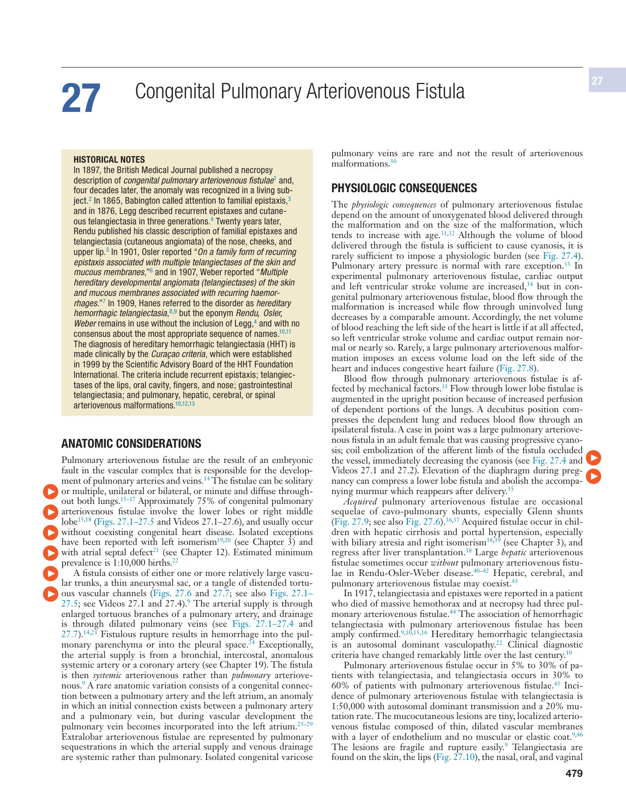

### Original PDF page 494

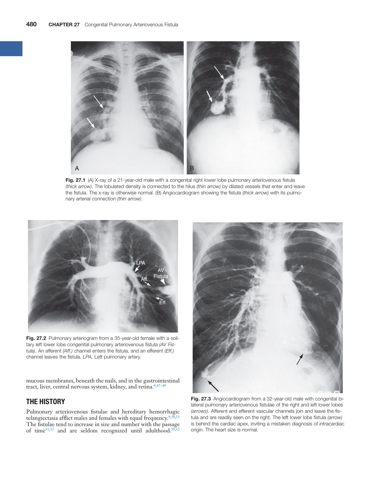

### Original PDF page 495

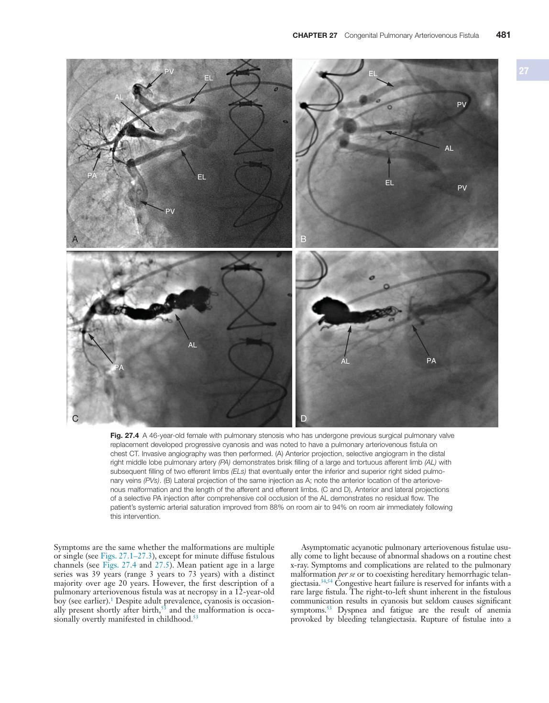

### Original PDF page 496

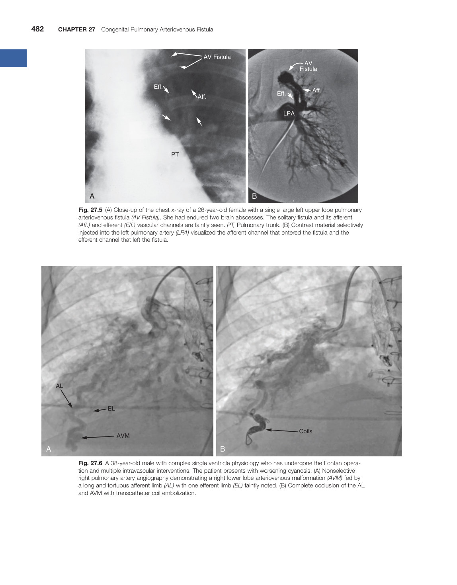

### Original PDF page 497

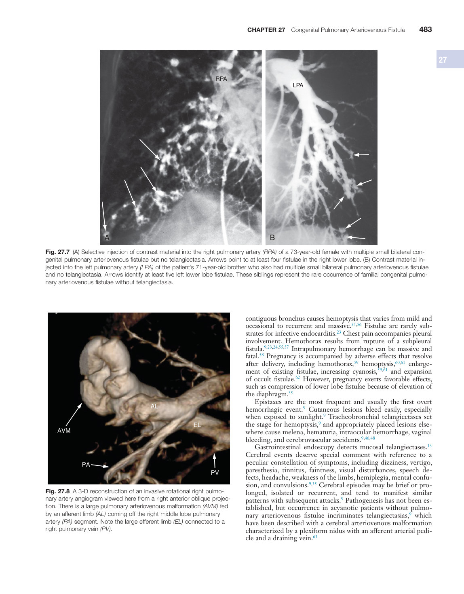

### Original PDF page 498

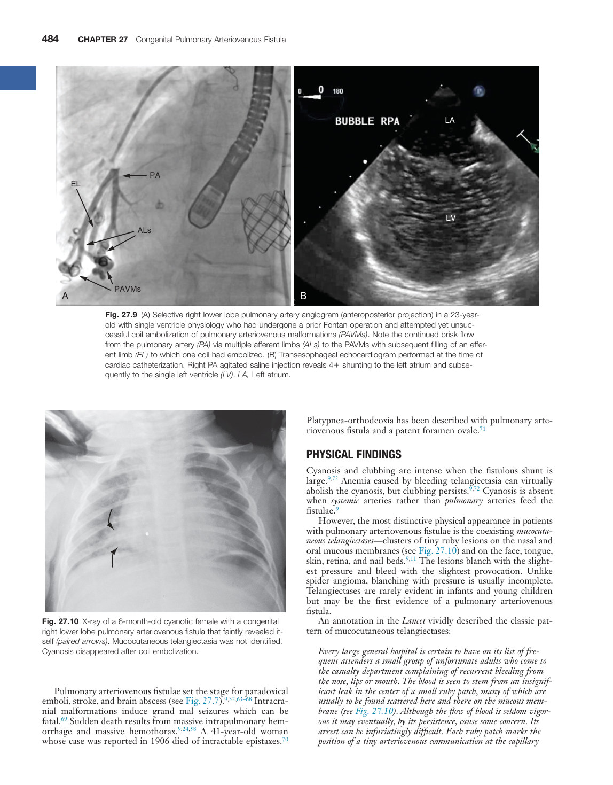

### Original PDF page 499

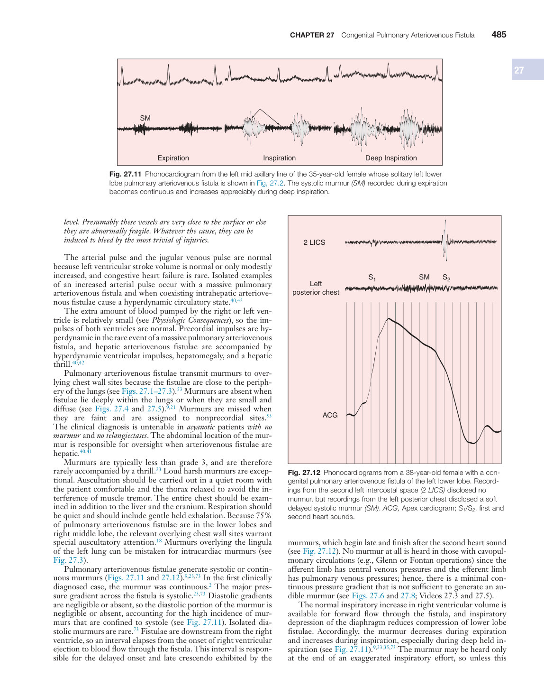

### Original PDF page 500

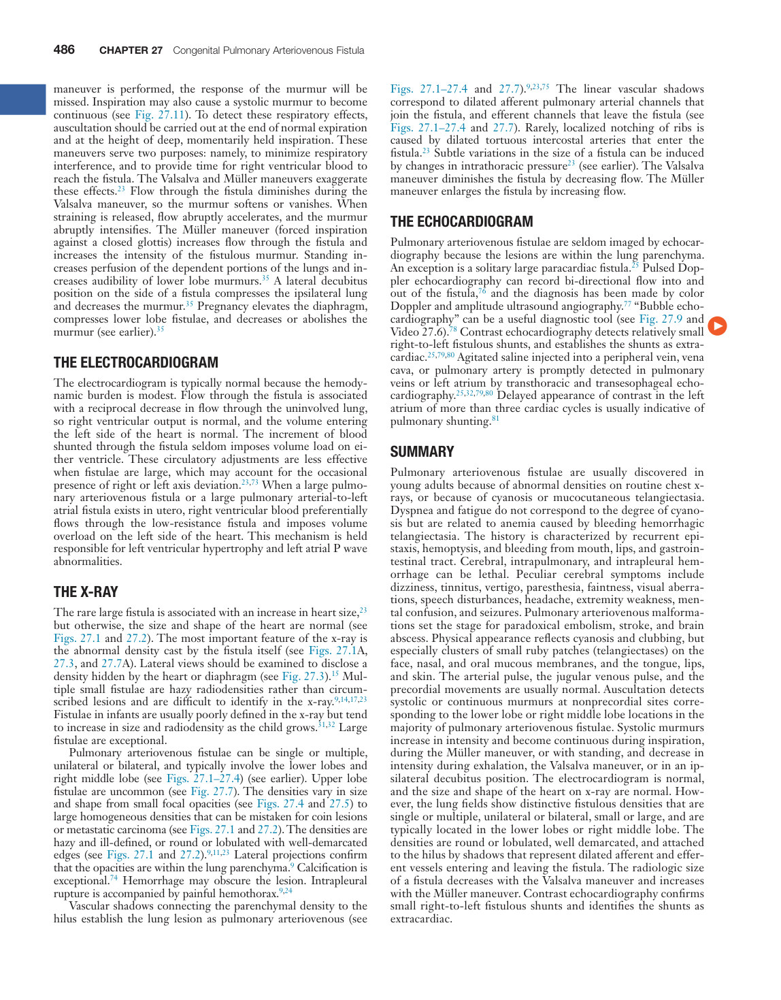

### Original PDF page 501

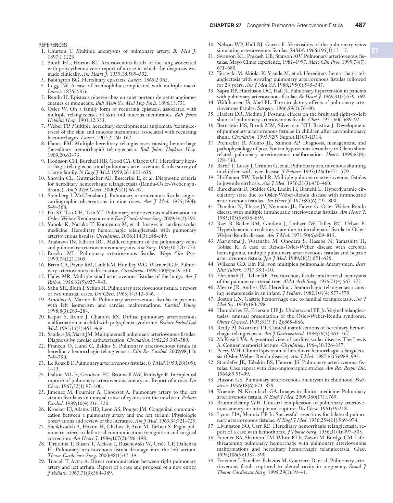

### Original PDF page 502

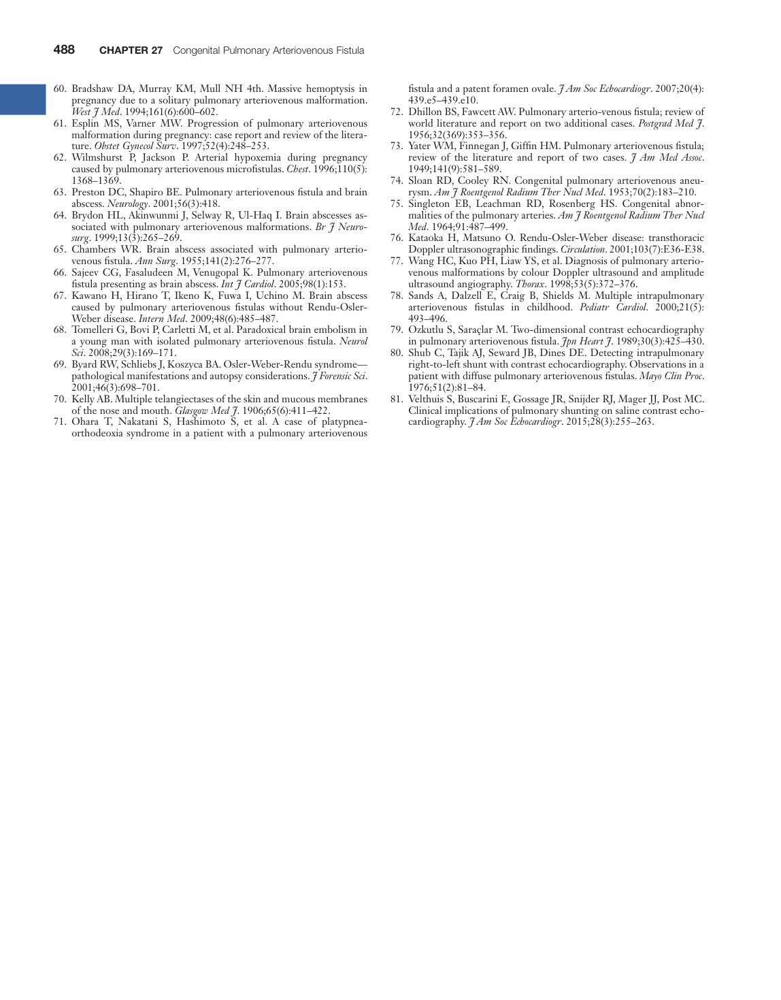

## Individual source figure views

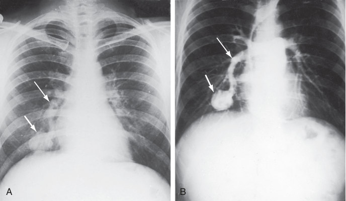

Fig. 27.1 ​(A) X-ray of a 21-year-old male with a congenital right lower lobe pulmonary arteriovenous fistula (thick arrow). The lobulated density is connected to the hilus (thin arrow) by dilated vessels that enter and leave the fistula. The x-ray is otherwise normal. (B) Angiocardiogram showing the fistula (thick arrow) with its pulmonary arterial connection (thin arrow).

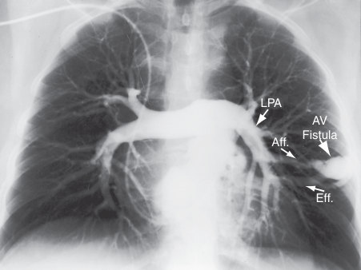

Fig. 27.2 ​Pulmonary arteriogram from a 35-year-old female with a solitary left lower lobe congenital pulmonary arteriovenous fistula (AV Fistula). An afferent (Aff.) channel enters the fistula, and an efferent (Eff.) channel leaves the fistula. LPA, Left pulmonary artery.

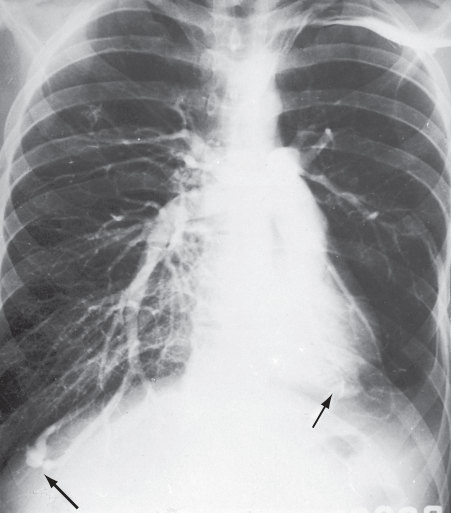

Fig. 27.3 ​Angiocardiogram from a 32-year-old male with congenital bilateral pulmonary arteriovenous fistulae of the right and left lower lobes (arrows). Afferent and efferent vascular channels join and leave the fistula and are readily seen on the right. The left lower lobe fistula (arrow) is behind the cardiac apex, inviting a mistaken diagnosis of intracardiac origin. The heart size is normal.

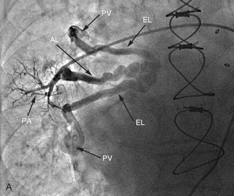

Fig. 27.4 ​A 46-year-old female with pulmonary stenosis who has undergone previous surgical pulmonary valve replacement developed progressive cyanosis and was noted to have a pulmonary arteriovenous fistula on chest CT. Invasive angiography was then performed. (A) Anterior projection, selective angiogram in the distal right middle lobe pulmonary artery (PA) demonstrates brisk filling of a large and tortuous afferent limb (AL) with subsequent filling of two efferent limbs (ELs) that eventually enter the inferior and superior right sided pulmonary veins (PVs). (B) Lateral projection of the same injection as A; note the anterior location of the arteriovenous malformation and the length of the afferent and efferent limbs. (C and D), Anterior and lateral projections of a selective PA injection after comprehensive coil occlusion of the AL demonstrates no residual flow. The patient’s systemic arterial saturation improved from 88% on room air to 94% on room air immediately following this intervention.

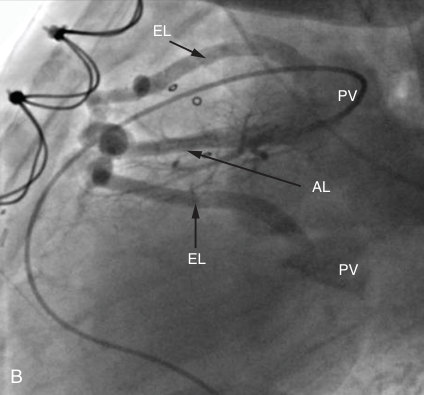

Fig. 27.4 ​A 46-year-old female with pulmonary stenosis who has undergone previous surgical pulmonary valve replacement developed progressive cyanosis and was noted to have a pulmonary arteriovenous fistula on chest CT. Invasive angiography was then performed. (A) Anterior projection, selective angiogram in the distal right middle lobe pulmonary artery (PA) demonstrates brisk filling of a large and tortuous afferent limb (AL) with subsequent filling of two efferent limbs (ELs) that eventually enter the inferior and superior right sided pulmonary veins (PVs). (B) Lateral projection of the same injection as A; note the anterior location of the arteriovenous malformation and the length of the afferent and efferent limbs. (C and D), Anterior and lateral projections of a selective PA injection after comprehensive coil occlusion of the AL demonstrates no residual flow. The patient’s systemic arterial saturation improved from 88% on room air to 94% on room air immediately following this intervention.

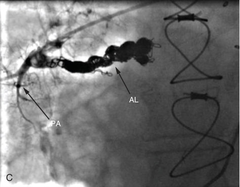

Fig. 27.4 ​A 46-year-old female with pulmonary stenosis who has undergone previous surgical pulmonary valve replacement developed progressive cyanosis and was noted to have a pulmonary arteriovenous fistula on chest CT. Invasive angiography was then performed. (A) Anterior projection, selective angiogram in the distal right middle lobe pulmonary artery (PA) demonstrates brisk filling of a large and tortuous afferent limb (AL) with subsequent filling of two efferent limbs (ELs) that eventually enter the inferior and superior right sided pulmonary veins (PVs). (B) Lateral projection of the same injection as A; note the anterior location of the arteriovenous malformation and the length of the afferent and efferent limbs. (C and D), Anterior and lateral projections of a selective PA injection after comprehensive coil occlusion of the AL demonstrates no residual flow. The patient’s systemic arterial saturation improved from 88% on room air to 94% on room air immediately following this intervention.

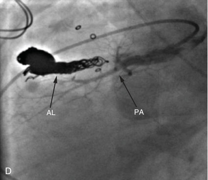

Fig. 27.4 ​A 46-year-old female with pulmonary stenosis who has undergone previous surgical pulmonary valve replacement developed progressive cyanosis and was noted to have a pulmonary arteriovenous fistula on chest CT. Invasive angiography was then performed. (A) Anterior projection, selective angiogram in the distal right middle lobe pulmonary artery (PA) demonstrates brisk filling of a large and tortuous afferent limb (AL) with subsequent filling of two efferent limbs (ELs) that eventually enter the inferior and superior right sided pulmonary veins (PVs). (B) Lateral projection of the same injection as A; note the anterior location of the arteriovenous malformation and the length of the afferent and efferent limbs. (C and D), Anterior and lateral projections of a selective PA injection after comprehensive coil occlusion of the AL demonstrates no residual flow. The patient’s systemic arterial saturation improved from 88% on room air to 94% on room air immediately following this intervention.

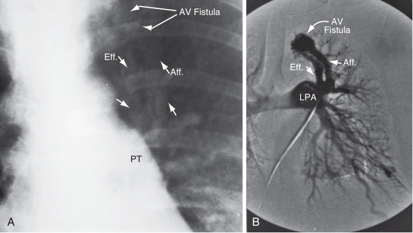

Fig. 27.5 ​(A) Close-up of the chest x-ray of a 26-year-old female with a single large left upper lobe pulmonary arteriovenous fistula (AV Fistula). She had endured two brain abscesses. The solitary fistula and its afferent (Aff.) and efferent (Eff.) vascular channels are faintly seen. PT, Pulmonary trunk. (B) Contrast material selectively injected into the left pulmonary artery (LPA) visualized the afferent channel that entered the fistula and the efferent channel that left the fistula.

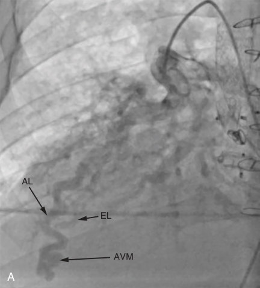

Fig. 27.6 ​A 38-year-old male with complex single ventricle physiology who has undergone the Fontan operation and multiple intravascular interventions. The patient presents with worsening cyanosis. (A) Nonselective right pulmonary artery angiography demonstrating a right lower lobe arteriovenous malformation (AVM) fed by a long and tortuous afferent limb (AL) with one efferent limb (EL) faintly noted. (B) Complete occlusion of the AL and AVM with transcatheter coil embolization.

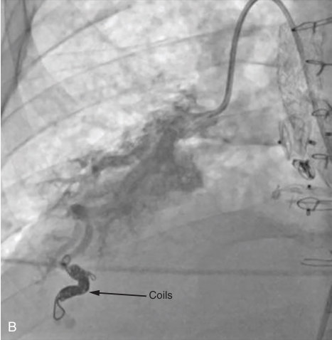

Fig. 27.6 ​A 38-year-old male with complex single ventricle physiology who has undergone the Fontan operation and multiple intravascular interventions. The patient presents with worsening cyanosis. (A) Nonselective right pulmonary artery angiography demonstrating a right lower lobe arteriovenous malformation (AVM) fed by a long and tortuous afferent limb (AL) with one efferent limb (EL) faintly noted. (B) Complete occlusion of the AL and AVM with transcatheter coil embolization.

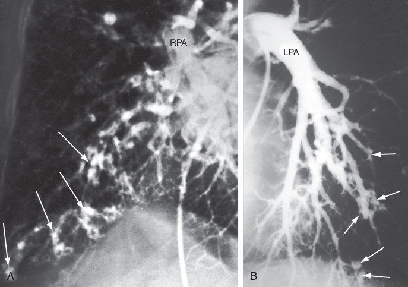

Fig. 27.7 ​(A) Selective injection of contrast material into the right pulmonary artery (RPA) of a 73-year-old female with multiple small bilateral congenital pulmonary arteriovenous fistulae but no telangiectasia. Arrows point to at least four fistulae in the right lower lobe. (B) Contrast material injected into the left pulmonary artery (LPA) of the patient’s 71-year-old brother who also had multiple small bilateral pulmonary arteriovenous fistulae and no telangiectasia. Arrows identify at least five left lower lobe fistulae. These siblings represent the rare occurrence of familial congenital pulmonary arteriovenous fistulae without telangiectasia.

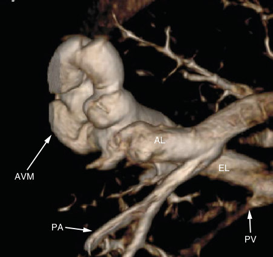

Fig. 27.8 ​A 3-D reconstruction of an invasive rotational right pulmonary artery angiogram viewed here from a right anterior oblique projection. There is a large pulmonary arteriovenous malformation (AVM) fed by an afferent limb (AL) coming off the right middle lobe pulmonary artery (PA) segment. Note the large efferent limb (EL) connected to a right pulmonary vein (PV).

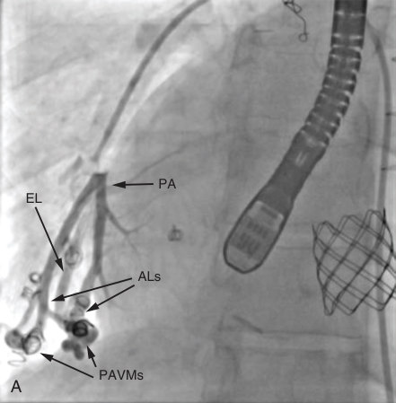

Fig. 27.9 ​(A) Selective right lower lobe pulmonary artery angiogram (anteroposterior projection) in a 23-yearold with single ventricle physiology who had undergone a prior Fontan operation and attempted yet unsuccessful coil embolization of pulmonary arteriovenous malformations (PAVMs). Note the continued brisk flow from the pulmonary artery (PA) via multiple afferent limbs (ALs) to the PAVMs with subsequent filling of an efferent limb (EL) to which one coil had embolized. (B) Transesophageal echocardiogram performed at the time of cardiac catheterization. Right PA agitated saline injection reveals 41 shunting to the left atrium and subsequently to the single left ventricle (LV). LA, Left atrium.

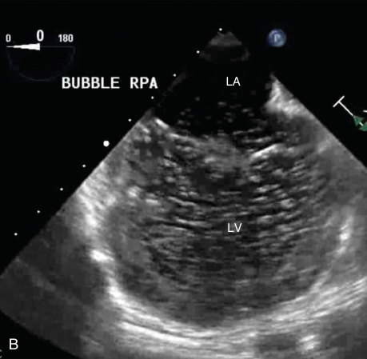

Fig. 27.9 ​(A) Selective right lower lobe pulmonary artery angiogram (anteroposterior projection) in a 23-yearold with single ventricle physiology who had undergone a prior Fontan operation and attempted yet unsuccessful coil embolization of pulmonary arteriovenous malformations (PAVMs). Note the continued brisk flow from the pulmonary artery (PA) via multiple afferent limbs (ALs) to the PAVMs with subsequent filling of an efferent limb (EL) to which one coil had embolized. (B) Transesophageal echocardiogram performed at the time of cardiac catheterization. Right PA agitated saline injection reveals 41 shunting to the left atrium and subsequently to the single left ventricle (LV). LA, Left atrium.

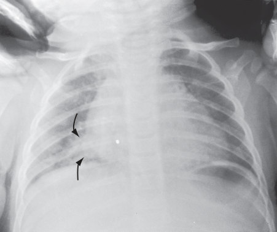

Fig. 27.10 ​X-ray of a 6-month-old cyanotic female with a congenital right lower lobe pulmonary arteriovenous fistula that faintly revealed itself (paired arrows). Mucocutaneous telangiectasia was not identified. Cyanosis disappeared after coil embolization.

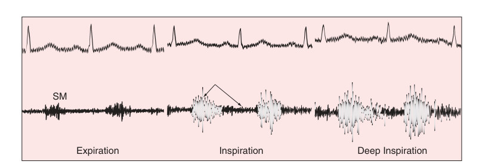

Fig. 27.11 ​Phonocardiogram from the left mid axillary line of the 35-year-old female whose solitary left lower lobe pulmonary arteriovenous fistula is shown in Fig, 27.2. The systolic murmur (SM) recorded during expiration becomes continuous and increases appreciably during deep inspiration.

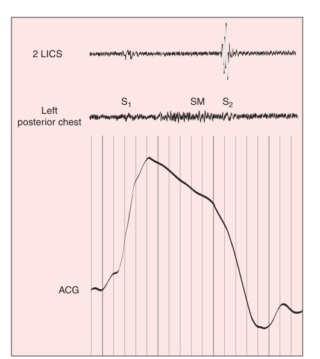

Fig. 27.12 ​Phonocardiograms from a 38-year-old female with a congenital pulmonary arteriovenous fistula of the left lower lobe. Recordings from the second left intercostal space (2 LICS) disclosed no murmur, but recordings from the left posterior chest disclosed a soft delayed systolic murmur (SM). ACG, Apex cardiogram; S1/S2, first and second heart sounds.
